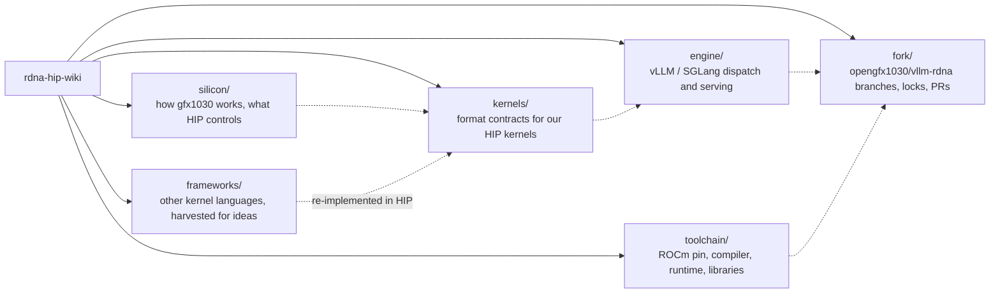

# RDNA HIP wiki

Notes for writing HIP kernels and serving LLMs on **gfx1030** (RDNA 2, Radeon PRO V620), with the gfx1100 delta where the work overlaps.[^engine][^silicon] This page is only an index. Each folder README and topic page carries its own footnotes and `## Sources` section.[^silicon][^engine]

## Live pins

- **ROCm:** the live dest pin is ROCm **7.14.0**. The tag `rocm-7.14.0` on `ROCm/ROCm` is commit `830cc1b5`.[^pin][^tag7140] Newer ROCm docs (7.14.1, 10.1.0) are tracked on that page and do not move the pin.[^pin]
- **Fork dest:** branch `rdna_extras` on [`opengfx1030/vllm-rdna`](https://github.com/opengfx1030/vllm-rdna), the repo's default branch, on upstream vLLM **v0.31.0** since PR #47.[^branches][^repo][^pr47][^v031] The fork pages are pinned to tip [`fbe84e94`](https://github.com/opengfx1030/vllm-rdna/commit/fbe84e9411abcd229bd836deffe23f92176b978e), the merge of PR #52, which is also the live tip read on 2026-10-11.[^branches][^livetip]
- **Silicon contract:** gfx1030 has packed DOT only (`fdot2` / `sdot4`), with no WMMA, MFMA or FP8. gfx1100 has WMMA, and the two ship as separate fatbins.[^engine]
- **Tickets:** GitHub Project 4 "GFX1030 inference" (private) and the Linear project **V620 inference** in team UNC.[^prlife]

## Map

The arrows are reading order, not ownership: hardware facts in `silicon/` feed the format contracts in `kernels/`, which the engine pages dispatch, and the fork pages record what landed.[^silicon][^kernels][^fork] Framework ideas are re-implemented in HIP rather than shipped.[^frameworks]

## silicon/

[silicon/README.md](silicon/README.md): how gfx1030 (RDNA 2, Navi 21, V620) works and what HIP can control.[^silicon]

| Topic | Folder |
|---|---|
| CU / WGP layout, VALU and packed DOT, cache hierarchy | [arch-and-memory/](silicon/arch-and-memory/README.md) |
| LDS banks, padding vs swizzle, tile seeds | [lds-and-tiles/](silicon/lds-and-tiles/README.md) |
| Occupancy limiters and effective occupancy | [occupancy/](silicon/occupancy/README.md) |
| waitcnt, builtins, codegen, graph capture | [hip-craft/](silicon/hip-craft/README.md) |
| `fa_rdna2` budget, GQA dispatch, FlashKDA | [attention/](silicon/attention/README.md) |
| Silicon side of EXL3, mxfp4, W4A16 K_STEP | [formats/](silicon/formats/README.md) |
| PCIe 4.0, RCCL, P2P, all-reduce, hetero MoE | [interconnect/](silicon/interconnect/README.md) |
| Third-party kernels and forks, Take / Leave | [external-projects/](silicon/external-projects/README.md) |
| V340L (gfx900) notes | [other-hardware/](silicon/other-hardware/README.md) |

## kernels/

[kernels/README.md](kernels/README.md): format contracts for the HIP kernels we write, and which DOT each format uses. Engine dispatch is not here.[^kernels]

| Topic | Folder |
|---|---|
| Weight / activation formats: pack, dequant, DOT | [quant/](kernels/quant/README.md) |
| Skinny GEMM / GEMV and fused-MoE GEMM | [gemm-moe/](kernels/gemm-moe/README.md) |
| Attention kernels, KV INT8, Sage QK, sparse MLA, indexer | [attention/](kernels/attention/README.md) |
| GDN decode / prefill, causal conv1d, FlashKDA | [linear-attn/](kernels/linear-attn/README.md) |
| HIP glue replacing Triton JIT (RMSNorm, AOT list) | [aot-glue/](kernels/aot-glue/README.md) |
| Model-specific HIP glue | [models/](kernels/models/README.md) |
| Read-only reviews of other gfx1030 trees | [overlays/](kernels/overlays/README.md) |

## engine/

[engine/README.md](engine/README.md): vLLM / SGLang dispatch, scheduling, attention, KV, MoE, spec decoding and multi-GPU serving on gfx1030. Owned by LLM_Inference_specialist.[^engine] The topic folders have no README of their own; each link goes to its section of the engine index.

| Topic | Section |
|---|---|
| One-page verdict and coverage map | [overview/](engine/README.md#overview--overview) |
| Stock vLLM / SGLang on gfx1030 and what the fork adds | [serving-stack/](engine/README.md#serving-stack--serving-stack) |
| Stock Triton / ROCM_ATTN baseline before HIP A/B | [stock-baseline/](engine/README.md#stock-baseline--stock-baseline) |
| Prefill vs decode, batching, prefix caching | [scheduling/](engine/README.md#scheduling--scheduling) |
| `fa_rdna2` dispatch, Sage QK, KDA | [attention/](engine/README.md#attention--attention) |
| KV quantization and offload | [kv-cache/](engine/README.md#kv-cache--kv-cache) |
| MoE offload and placement | [moe/](engine/README.md#moe--moe) |
| Quant formats as the engine sees them | [quant-formats/](engine/README.md#quant-formats--quant-formats) |
| Spec decoding, MTP | [spec-decoding/](engine/README.md#spec-decoding--spec-decoding) |
| P/D disaggregation, all-to-all | [multi-gpu/](engine/README.md#multi-gpu--multi-gpu) |
| llama.cpp, ExLlama and other engines | [alt-engines/](engine/README.md#alt-engines--alt-engines) |
| Run recipes per model | [run-recipes/](engine/README.md#run-recipes--run-recipes) |
| Dated digests (not the contract) | [notes/](engine/notes/README.md) |

## fork/

[fork/README.md](fork/README.md): the gfx1030 vLLM fork `opengfx1030/vllm-rdna`. Owned by VLLM_FORK_Manager.[^fork]

| Page | What it answers |
|---|---|
| [branches.md](fork/branches.md) | Which branch is dest, the 0.28 line, version-port branches |
| [serve-locks.md](fork/serve-locks.md) | What every gfx1030 serve keeps fixed |
| [pr-lifecycle.md](fork/pr-lifecycle.md) | Draft PR, review gates, merge, tracking |
| [dispatch.md](fork/dispatch.md) | How a gfx1030 layer picks its kernel |

## toolchain/

[toolchain/README.md](toolchain/README.md): the ROCm pin, compiler, HIP runtime, math libraries and RCCL gates. Owned by ROCM_specialist.[^toolchain]

| Topic | Folder |
|---|---|
| Live 7.14.0 pin, docs status, host DRM gate | [pin/](toolchain/pin/README.md) |
| `hipcc`, `--offload-arch`, compiler bugs | [compiler/](toolchain/compiler/README.md) |
| HIP allocator, graphs, VMM hang | [runtime/](toolchain/runtime/README.md) |
| rocBLAS, hipBLASLt, MIOpen, Tensile, CK | [libraries/](toolchain/libraries/README.md) |
| RCCL arch gating and env knobs | [comms/](toolchain/comms/README.md) |
| rocjitsu, `amd-smi`, `tune_rocblas` | [tools/](toolchain/tools/README.md) |
| Dated pin scans and domain passes | [log/](toolchain/log/README.md) |

## frameworks/

[frameworks/README.md](frameworks/README.md): other kernel languages, compilers and runtimes read for ideas. Nothing here ships in vllm-rdna unless it is already contracted (Triton).[^frameworks]

| Topic | Folder |
|---|---|
| Mojo / Modular MAX sandbox | [mojo-max/](frameworks/mojo-max/README.md) |
| Triton, TileLang, IREE, TVM, Pallas, Inductor, CuTe | [portable/](frameworks/portable/README.md) |

## Start here

1. [silicon/arch-and-memory/architecture.md](silicon/arch-and-memory/architecture.md): CU / WGP / caches
2. [silicon/hip-craft/hip-craft.md](silicon/hip-craft/hip-craft.md): waitcnt, occupancy workflow, builtins
3. [kernels/quant/w4a16.md](kernels/quant/w4a16.md): W4A16 format contract
4. [silicon/attention/fa-occupancy.md](silicon/attention/fa-occupancy.md): `fa_rdna2` launch bounds and LDS
5. [engine/overview/full-map.md](engine/overview/full-map.md): one-page engine verdict and technique table
6. [fork/serve-locks.md](fork/serve-locks.md): what a gfx1030 serve keeps fixed
7. [toolchain/pin/README.md](toolchain/pin/README.md): the live ROCm pin

## Sources

[^silicon]: In-repo: [silicon/README.md](silicon/README.md)
[^kernels]: In-repo: [kernels/README.md](kernels/README.md)
[^engine]: In-repo: [engine/README.md](engine/README.md), intro and "Dest" paragraph
[^fork]: In-repo: [fork/README.md](fork/README.md)
[^toolchain]: In-repo: [toolchain/README.md](toolchain/README.md)
[^frameworks]: In-repo: [frameworks/README.md](frameworks/README.md)
[^pin]: In-repo: [toolchain/pin/README.md § Live dest](toolchain/pin/README.md#live-dest)
[^tag7140]: GitHub tag `rocm-7.14.0` on `ROCm/ROCm`, commit `830cc1b5e90d7da1b07e39113d7a5c95f3e687a1`: <https://github.com/ROCm/ROCm/commit/830cc1b5e90d7da1b07e39113d7a5c95f3e687a1>
[^branches]: In-repo: [fork/branches.md § Dest](fork/branches.md#dest-rdna_extras)
[^repo]: Repo and default branch `rdna_extras`: <https://github.com/opengfx1030/vllm-rdna>
[^pr47]: PR #47 "[RDNA2] Port rdna_extras onto vLLM v0.31.0": <https://github.com/opengfx1030/vllm-rdna/pull/47>
[^v031]: Upstream release `v0.31.0`: <https://github.com/vllm-project/vllm/releases/tag/v0.31.0>
[^livetip]: `rdna_extras` head `fbe84e94`, "Merge feat/ple-int4-disk: INT4 PLE table from disk via the CPU sidecar (#52)", committed 2026-10-11 14:05 Europe/Paris (GitHub API, read 2026-10-11): <https://github.com/opengfx1030/vllm-rdna/commit/fbe84e9411abcd229bd836deffe23f92176b978e>
[^prlife]: In-repo: [fork/pr-lifecycle.md § Tracking](fork/pr-lifecycle.md#tracking); Project 4: <https://github.com/users/BlivionIaG/projects/4>
