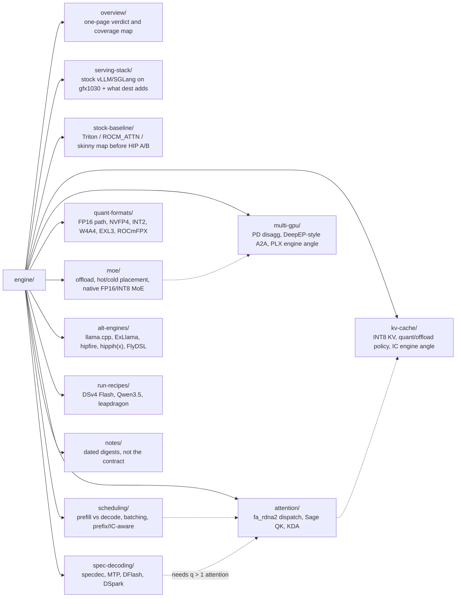

# Engine

vLLM / SGLang dispatch, scheduling, attention, KV, MoE, spec decoding and multi-GPU serving on **gfx1030** (gfx1100 only where work combines). Owned by LLM_Inference_specialist.

Client, gateway and `/v1/systemone` questions belong to the tooling wiki ([BlivionIaG/llm-tooling-wiki](https://github.com/BlivionIaG/llm-tooling-wiki), private), not here.

**Dest:** [`opengfx1030/vllm-rdna` `rdna_extras`](https://github.com/opengfx1030/vllm-rdna/tree/rdna_extras) — vLLM **v0.31.0** port ([PR #47](https://github.com/opengfx1030/vllm-rdna/pull/47)), tip `fbe84e94` (contains `8abf4c97`; engine code claims are pinned at `1dc3bac4` unless a footnote says otherwise, since dest #52 changed only PLE Python/tools/tests) as of 2026-10-11. gfx1030 = packed DOT only (`fdot2` / `sdot4`), no WMMA / MFMA / FP8; gfx1100 has WMMA; separate fatbins. Serve locks (ROCm pin, all-reduce path, prefix caching) are owned by [fork/serve-locks.md](../fork/serve-locks.md)10)#10) and [fork/](../fork/README.md) and [toolchain/pin/README.md](../toolchain/pin/README.md); hardware detail by [silicon/](../silicon/README.md); format contracts by [kernels/](../kernels/README.md). Tips quoted inside older pages are historical snapshots.

Do not invent tok/s, IC TB/s, or a P2P-works claim. Vocabulary: **Take / Leave / Import**, **Now / Later / Dead**, **Live / Must / Fallback / Dead / Later**.

## Map

Every page ends with `## Sources` (URLs checked 2026-10-11) and carries footnotes `[^key]` on key claims. Unverifiable claims are marked *(unsourced)*. Figures in [assets/](assets/) are Apache-2.0 vLLM docs images, credited under each use.

## Overview — `overview/`

| Page | Contents |
|---|---|
| [full-map.md](overview/full-map.md) | One-page verdict + technique table |
| [coverage.md](overview/coverage.md) | Feature / quant / HIP kernel coverage + progress |

## Serving stack — `serving-stack/`

| Page | Contents |
|---|---|
| [vllm-sglang-map.md](serving-stack/vllm-sglang-map.md) | What stock vLLM/SGLang actually run on gfx1030 vs CDNA |
| [fork-delta.md](serving-stack/fork-delta.md) | Each added feature vs upstream — most incomplete, W4A16 dense is the bar |
| [rdna2-extras.md](serving-stack/rdna2-extras.md) | Release overlay — **`rdna2_extras`** = vLLM tag + gfx1030 work *(historical branch; dest is now `rdna_extras`)* |
| [sglang-fork.md](serving-stack/sglang-fork.md) | SGLang rdna2 overlay — parallel serving path **after occupancy** |
| [rocm-host.md](serving-stack/rocm-host.md) | Official Ubuntu-only vs attested Fedora 43 / RHEL 10 / ROCm 7.14 |

## Stock baseline — `stock-baseline/`

| Page | Contents |
|---|---|
| [baseline-order.md](stock-baseline/baseline-order.md) | Stock-first research order: harness → Triton map → skinny → FA → HIP A/B → FlyDSL |
| [triton-rocm.md](stock-baseline/triton-rocm.md) | Stock Triton / ROCM_ATTN / skinny dispatch on gfx1030 |
| [triton-flash-attention.md](stock-baseline/triton-flash-attention.md) | Stock Triton FA configs (ROCM_ATTN is Triton/Triton here) |
| [triton-tuning.md](stock-baseline/triton-tuning.md) | Tuning knobs only — never overwrite stock |

## Scheduling — `scheduling/`

| Page | Contents |
|---|---|
| [prefill-decode.md](scheduling/prefill-decode.md) | The load-bearing split and kernel hit-list |
| [batching.md](scheduling/batching.md) | Continuous batching, chunked prefill, MBT |
| [cache-aware.md](scheduling/cache-aware.md) | Scheduling — KV prefix/APC vs IC residency; stock V1 only |

## Attention — `attention/`

| Page | Contents |
|---|---|
| [attention-dispatch.md](attention/attention-dispatch.md) | fa_rdna2 vs Triton, head-64 hole, short vs split-K, Sage |
| [sage-attention.md](attention/sage-attention.md) | Sage INT8 QK / sdot4 — prefill only, check vs impl later |
| [flashkda.md](attention/flashkda.md) | FlashKDA — steal KDA math / two-kernel split; CUTLASS SM90 is dead here |

## KV cache — `kv-cache/`

| Page | Contents |
|---|---|
| [kv-int8.md](kv-cache/kv-int8.md) | INT8 KV spec — fused dequant in `fa_rdna2`, per-token-head |
| [kv-quant-offload.md](kv-cache/kv-quant-offload.md) | FP8-KV is not a vLLM path here |
| [infinity-cache.md](kv-cache/infinity-cache.md) | IC for inference — fit+reuse, no persist bit; W4 TP=4 keep |

## MoE — `moe/`

| Page | Contents |
|---|---|
| [moe.md](moe/moe.md) | Expert offload + gfx10xx whitelist |
| [multi-tier.md](moe/multi-tier.md) | Hetero MoE — extras first, SGLang parallel, Llaminar, **hippih in-house** |
| [fp16-moe.md](moe/fp16-moe.md) | Native HIP FP16 MoE draft — decode skinny + prefill grouped, `fdot2` |
| [int8-moe.md](moe/int8-moe.md) | Dual-route INT8 MoE — W8A16 `fdot2` + W8A8 `sdot4` |

## Quant formats — `quant-formats/`

| Page | Contents |
|---|---|
| [fp16-rdna2.md](quant-formats/fp16-rdna2.md) | Fastest gfx1030 FP16 — explicit `fdot2` + occupancy, phase-split |
| [nvfp4.md](quant-formats/nvfp4.md) | NVFP4 engine spec — unpack E2M1→fp16→`fdot2`, E4M3×16 scale |
| [int2.md](quant-formats/int2.md) | INT2 + mixed INT2/INT4 MoE — unpack→`fdot2`, bitwidth grouped outside K |
| [w4a4.md](quant-formats/w4a4.md) | W4A4 explore — integer `sdot8` i4×i4; MXFP4/NVFP4 A4 stays `fdot2` |
| [exl3.md](quant-formats/exl3.md) | EXL3 / QTIP trellis — no vLLM path; HIP would be unpack→`fdot2`, Later |
| [rocmfpx.md](quant-formats/rocmfpx.md) | ROCmFPX leverage — codebook→`perm`→`sdot4`, not a vLLM port |

## Spec decoding — `spec-decoding/`

| Page | Contents |
|---|---|
| [specdec.md](spec-decoding/specdec.md) | Verify is extend; skip until q>1 exists |
| [mtp.md](spec-decoding/mtp.md) | MTP — native heads, fat tile first, no new DOT |
| [dflash.md](spec-decoding/dflash.md) | DFlash — parallel block draft, same fat-tile gate |
| [dspark.md](spec-decoding/dspark.md) | DSpark — DFlash + Markov + confidence schedule |

## Multi-GPU — `multi-gpu/`

| Page | Contents |
|---|---|
| [pd-disagg.md](multi-gpu/pd-disagg.md) | Why PD is not a win on this box |
| [deepep.md](multi-gpu/deepep.md) | DeepEP insight — mapped-peer scatter/combine, not MORI/IBGDA |
| [plx.md](multi-gpu/plx.md) | PEX88096 / PEX8749 — ACS, PIX, Gen4 vs Gen3 ceiling, MMIO |

## Alt engines — `alt-engines/`

| Page | Contents |
|---|---|
| [alt-engines.md](alt-engines/alt-engines.md) | What to steal from llama.cpp / ExLlama / ktransformers / Llaminar / hippih / SGLang / hipfire |
| [hippih.md](alt-engines/hippih.md) | Older stub / Vega lab — see [hippihx.md](alt-engines/hippihx.md) for V620 op zoo |
| [hippihx.md](alt-engines/hippihx.md) | HIP op zoo (locked) — thin `rdna_extras`; migrate after ticket-26 |
| [hipfire.md](alt-engines/hipfire.md) | warpfront/hipfire — Rust+HIP engine; gfx1030 portable DOT/sdot4; not extras pivot |
| [flydsl.md](alt-engines/flydsl.md) | FlyDSL gfx1030 gates — compiler yes, shipped MFMA/WMMA kernels no |
| [llamacpp-rocmfpx.md](alt-engines/llamacpp-rocmfpx.md) | llama.cpp side project: `build-rdna2.sh` on V620 |

## Run recipes — `run-recipes/`

| Page | Contents |
|---|---|
| [dsv4-flash-run.md](run-recipes/dsv4-flash-run.md) | DSv4 Flash on 120 GB — keep mxfp4, no drop-in EXL3 |
| [qwen35.md](run-recipes/qwen35.md) | Qwen3.5 hybrid GDN + Gemma `(1+w)` — steal gates, not their Triton AWQ |
| [leapdragon.md](run-recipes/leapdragon.md) | leapdragon V620 recipe — steal grid/LDS/pitfalls, not tok/s or GPL plugins |

## Notes — `notes/`

Dated source digests and idle upstream sweeps: [notes/README.md](notes/README.md). Session dump 2026-08-17/18: [notes/session-2026-08-17.md](notes/session-2026-08-17.md). Not the contract.

## Diagrams and figures

| Page | What |
|---|---|
| [scheduling/prefill-decode.md](scheduling/prefill-decode.md) | request flow: prefill → paged KV → decode loop |
| [scheduling/batching.md](scheduling/batching.md) | vLLM V1 scheduler step (decode-first, leftover prefill, dest interval knob) |
| [scheduling/cache-aware.md](scheduling/cache-aware.md) | prefix-cache hit path + vLLM block-pool figure |
| [attention/attention-dispatch.md](attention/attention-dispatch.md) | attention dispatch tree, gfx1030 vs gfx1100 |
| [kv-cache/kv-int8.md](kv-cache/kv-int8.md) | INT8 KV writer / reader with fused dequant |
| [kv-cache/kv-quant-offload.md](kv-cache/kv-quant-offload.md) | KV tiers G1–G4 and which hops are allowed |
| [moe/moe.md](moe/moe.md) | MoE routing → EP mode → expert GEMM |
| [moe/multi-tier.md](moe/multi-tier.md) | hot / cold expert placement (rdna3 or Spark hot, rdna2 cold) |
| [multi-gpu/pd-disagg.md](multi-gpu/pd-disagg.md) | PD request sequence + vLLM disagg figure |
| [spec-decoding/specdec.md](spec-decoding/specdec.md) | draft / verify loop and the gfx1030 gate |
| [spec-decoding/mtp.md](spec-decoding/mtp.md) | MTP vs DFlash vs DSpark drafting |
| [overview/full-map.md](overview/full-map.md) | technique verdicts + vLLM V1 TP=4 process figure |
| [serving-stack/vllm-sglang-map.md](serving-stack/vllm-sglang-map.md) | arch gates → CDNA / gfx1x / gfx10x island |
| [run-recipes/qwen35.md](run-recipes/qwen35.md) | vLLM hybrid KV cache manager figure |

Tickets: [project 4](https://github.com/users/BlivionIaG/projects/4) (sign-in required).

## Sources

- dest `opengfx1030/vllm-rdna` branch `rdna_extras` — <https://github.com/opengfx1030/vllm-rdna/tree/rdna_extras>
- dest PR #47 (v0.31.0 port) — <https://github.com/opengfx1030/vllm-rdna/pull/47>
- dest commit `8abf4c97` — <https://github.com/opengfx1030/vllm-rdna/commit/8abf4c9719d588349b6ed5afc75e9d0133a43984>
- vLLM licence (Apache-2.0) for `assets/` figures — <https://github.com/vllm-project/vllm/blob/main/LICENSE>
