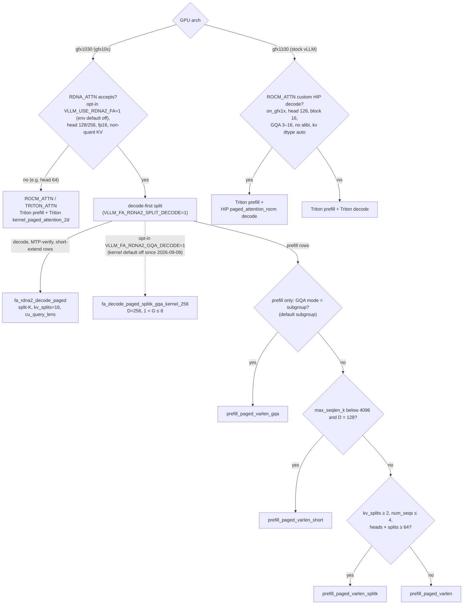

# fa_rdna2 dispatch / head-64 / short vs split-K

Date: 2026-08-17. Engine slice. Occupancy / LDS / VGPR live in [silicon/attention/fa-occupancy.md](../../silicon/attention/fa-occupancy.md). Live tree details from VLLM_FORK_Manager (not all pushed).

`VLLM_USE_RDNA2_FA=1` splits MHA: `fa_rdna2_decode_paged` vs `fa_rdna2_prefill_*`.[^dest-rdna-attn]

## Dispatch table

| Phase | q_len | head_dim | KV length vs 72 CU | Take |
|---|---|---|---|---|
| Decode | 1 | 128 or 256 | grid B×H << 72 | `fa_rdna2_decode_paged` split-K (Br=1) |
| Decode | 1 | 128 or 256 | grid already fills 72 CU | decode paged, fewer splits or no split |
| Decode | 1 | 64 (and 80/96) | any | **hole** → Triton `kernel_paged_attention_2d` until a D=64 tile exists |
| Short extend / MTP verify | small q (decode-first) | 128/256 | `nd_tok * H_q <= 256` | split-K decode + `cu_query_lens` (PR #29 @ `e0112c55`)[^dest-pr29]; above 256 rows → prefill |
| Prefill | large q | 128/256 | — | fa_rdna2_prefill Br=16/32 |
| Prefill / decode | any | other | — | Triton |
| MLA decode | 1 | ragged / fp8_ds_mla | 16 CTAs/query, WG=32 | HIP `sparse_mla_decode_rdna2` whenever the RDNA ops are registered (no env gate on the DSv4 path at `1dc3bac4`)[^d-dsv4path], else Triton. Mix/spec off. |
| MLA prefill | T queries | plain fp16 `[skv,D]` | grid `(T, H/4)`, WG=32 | HIP `sparse_mla_prefill_rdna2` (same selection as decode; kernel now in `csrc/rocm/rdna/dsv4/`). Many Q rows ≠ fat tile. |
| MLA | q>1 verify / draft | — | — | no fat tile yet. Blocks MTP / DFlash / DSpark. |

Stock HIP `attention.cu` instantiates 64 and 128 but gfx1030 never launches it (`on_gfx1x` = 11/12).[^vllm-rocm-py] gfx11 runtime gate is head==128 only. Head 256: HIP has no instantiation; fa_rdna2 claims D=256 decode (DeepSeek/MLA-adjacent). Keep it.

## Diagram — attention dispatch, gfx1030 vs gfx1100

Dest gates at `1dc3bac4`: `VLLM_USE_RDNA2_FA` defaults to `"False"` in `envs.py` and `platforms/rocm.py` only selects RDNA_ATTN when it is `"1"`[^dest-fa-optin]. The GQA decode kernel (D=256 only, group 1 < G ≤ `GQA_MAX_G`=8) runs only with `VLLM_FA_RDNA2_GQA_DECODE=1`; the kernel turned it off on 2026-09-09 after garbage output at n_dec ≥ 2[^dest-gqa-decode]. `VLLM_FA_RDNA2_GQA_MODE` defaults to `subgroup` and only steers prefill[^dest-rdna-attn]. Note that the launcher's `rdna_select_attention fa` (the `serve_rdna.sh` default `ATTN=fa`) exports `VLLM_USE_RDNA2_FA=1` and `VLLM_FA_RDNA2_GQA_DECODE=${VLLM_FA_RDNA2_GQA_DECODE:-1}`[^dest-launcher-attn], so a launcher serve opts in to both unless overridden. Whether that is meant is a [fork/serve-locks.md](../../fork/serve-locks.md) question.

gfx1030 branch: dest `rdna_attn.py` on `rdna_extras`[^dest-rdna-attn] (head-size set, env defaults, `_forward_prefill` heuristics) and dest PR #29 (decode-first split for verify/mixed rows)[^dest-pr29]. gfx1100 branch: stock `use_rocm_custom_paged_attention` constraints in `rocm.py`[^vllm-rocm-py], summarised in [vllm-sglang-map.md §2.2](../serving-stack/vllm-sglang-map.md#22-attention). MLA (`VLLM_USE_RDNA2_MLA`) is a separate path, see the table above.

## Head-64 hole

fa_rdna2 decode/prefill as reported: D=128/256 only. Treat 64 as the first missing FA2 tile after 128/256 are solid. Confirm which served models are actually d=64 (many Llama/Gemma/Mistral 7B are d=128). GQA packing can look like 64.

## Short vs split-K (72 CU V620)

**Locked:** Split-K = grid-fill when B×H leaves 72 CUs idle. Short Br=32 = small-q. Do **not** use D=256 split-K to "fix occupancy." Occupancy is [silicon/attention/fa-occupancy.md](../../silicon/attention/fa-occupancy.md). **Decode flip landed** at `1dc3bac4`: both paged decode kernels (D=128, D=256) carry `amdgpu_waves_per_eu(4, 8)` with no min-blocks arg. Still left: every prefill kernel, including the INT8 split-K and GQA prefill kernels, stays `__launch_bounds__(N, 1)`, and the GQA decode kernel has no `waves_per_eu`[^dest-occupancy].

Split-K (Flash-Decoding): extra parallel axis = KV partitions + LSE reduce.[^flash-decoding]

- B=1, GQA (e.g. 8 KV heads): 8 WGs. 16 CTAs/query on MLA is the same idea. Split-K or multi-CTA/query is mandatory.
- B×H ≳ 72: split-K adds reduce traffic and can lose.
- Short (small q, no KV split): wins when q_len is a few tokens (spec/chunk) and the Br tile already occupies, or when seqlen_kv is short enough that one pass is the whole working set (IC-hot pages).
- Prefill Br=16/32: never split-K the Q axis the decode way; occupancy comes from q tiles.

#44899 (DSv4 split-K) is gfx950.[^vllm-pr44899] Copy the heuristic (`CUs / (B×H)`), not the kernel.

## Sage

Locked. Full page: [sage-attention.md](sage-attention.md).

INT8 QK via `sdot4` (pack 4×i8, `D%4==0`, i32 through K, scale in epilogue). PV stays `fdot2`. **Prefill only**, after occupancy. Decode stays `fa_rdna2`. Absent in the live tree today. Do not port FA3 / Sage2 / Sage3.

## Write order

1. Keep MHA 128/256 decode split-K + prefill Br tiles (already live). Decode occupancy flip is landed; the prefill flip is a ticket, not a direct edit of dest `rdna_extras` (historically `perf/rdna2_w4a16`).
2. Head-64 decode tile.
3. Sage-style INT8 QK via sdot4 on prefill only. See [sage-attention.md](sage-attention.md).
4. MLA fat tile (q>1) before mix, MTP, DFlash, or DSpark. HIP sparse prefill (`66bb24d7`) does not unlock this. Specs: [mtp.md](../spec-decoding/mtp.md), [dflash.md](../spec-decoding/dflash.md), [dspark.md](../spec-decoding/dspark.md).

## Unknowns

- Split-decode vs prefill row crossover locked at `nd_tok * H_q = 256` (`e0112c55`); deeper one-CTA-per-request verify still Later.
- Whether any served model is actually d=64.
- Exact fa_rdna2 source not all pushed.

## Sources

Added in the 2026-10-11 sourcing pass:

- dest `csrc/rocm/fa_rdna2.cu` — <https://github.com/opengfx1030/vllm-rdna/blob/rdna_extras/csrc/rocm/fa_rdna2.cu>
- vLLM `rocm_attn.py` (ROCM_ATTN backend) — <https://github.com/vllm-project/vllm/blob/main/vllm/v1/attention/backends/rocm_attn.py>

[^dest-rdna-attn]: dest `vllm/v1/attention/backends/rdna_attn.py` (RDNA_ATTN: head 128/256, fp16, split-decode, prefill heuristics) — <https://github.com/opengfx1030/vllm-rdna/blob/rdna_extras/vllm/v1/attention/backends/rdna_attn.py>
[^dest-pr29]: dest PR #29 — FA-RDNA2 decode kernel for spec-decode verify and mixed batches — <https://github.com/opengfx1030/vllm-rdna/pull/29>
[^vllm-rocm-py]: vLLM `vllm/platforms/rocm.py` (arch gates, `supports_fp8`, custom paged-attn, custom AR) — <https://github.com/vllm-project/vllm/blob/main/vllm/platforms/rocm.py>
[^flash-decoding]: Dao et al., *Flash-Decoding for long-context inference* (split-K over KV) — <https://crfm.stanford.edu/2023/10/12/flashdecoding.html>
[^vllm-pr44899]: vLLM PR #44899 — DSv4 split-K (gfx950) — <https://github.com/vllm-project/vllm/pull/44899>
[^dest-fa-optin]: dest `vllm/envs.py` (`VLLM_USE_RDNA2_FA` default `"False"`) — <https://github.com/opengfx1030/vllm-rdna/blob/1dc3bac4cda3201a1b4fb345e044578e84a272cf/vllm/envs.py#L1442-L1444>; `vllm/platforms/rocm.py` (selects only when `== "1"`) — <https://github.com/opengfx1030/vllm-rdna/blob/1dc3bac4cda3201a1b4fb345e044578e84a272cf/vllm/platforms/rocm.py#L553>, <https://github.com/opengfx1030/vllm-rdna/blob/1dc3bac4cda3201a1b4fb345e044578e84a272cf/vllm/platforms/rocm.py#L1134-L1147>
[^dest-gqa-decode]: dest `csrc/rocm/fa_rdna2.cu` `fa_gqa_decode_enabled()` and the off-by-default comment — <https://github.com/opengfx1030/vllm-rdna/blob/1dc3bac4cda3201a1b4fb345e044578e84a272cf/csrc/rocm/fa_rdna2.cu#L2937-L2944>, <https://github.com/opengfx1030/vllm-rdna/blob/1dc3bac4cda3201a1b4fb345e044578e84a272cf/csrc/rocm/fa_rdna2.cu#L3061-L3069>
[^dest-launcher-attn]: dest `tools/rdna/rdna_launcher_common.sh` `rdna_select_attention` — <https://github.com/opengfx1030/vllm-rdna/blob/1dc3bac4cda3201a1b4fb345e044578e84a272cf/tools/rdna/rdna_launcher_common.sh#L106-L118>
[^dest-occupancy]: dest `csrc/rocm/fa_rdna2.cu` decode kernels — <https://github.com/opengfx1030/vllm-rdna/blob/1dc3bac4cda3201a1b4fb345e044578e84a272cf/csrc/rocm/fa_rdna2.cu#L283-L284>, <https://github.com/opengfx1030/vllm-rdna/blob/1dc3bac4cda3201a1b4fb345e044578e84a272cf/csrc/rocm/fa_rdna2.cu#L535-L536>; prefill `__launch_bounds__(N, 1)` — <https://github.com/opengfx1030/vllm-rdna/blob/1dc3bac4cda3201a1b4fb345e044578e84a272cf/csrc/rocm/fa_rdna2.cu#L1054>; GQA decode — <https://github.com/opengfx1030/vllm-rdna/blob/1dc3bac4cda3201a1b4fb345e044578e84a272cf/csrc/rocm/fa_rdna2.cu#L776>; INT8 / GQA prefill — <https://github.com/opengfx1030/vllm-rdna/blob/1dc3bac4cda3201a1b4fb345e044578e84a272cf/csrc/rocm/fa_rdna2.cu#L2447>, <https://github.com/opengfx1030/vllm-rdna/blob/1dc3bac4cda3201a1b4fb345e044578e84a272cf/csrc/rocm/fa_rdna2.cu#L2695>, <https://github.com/opengfx1030/vllm-rdna/blob/1dc3bac4cda3201a1b4fb345e044578e84a272cf/csrc/rocm/fa_rdna2.cu#L3810>
[^d-dsv4path]: dest at `1dc3bac4`: `deepseek_v4/amd/model.py` `_attention_cls()` picks `DeepseekV4RDNAAttention` on `on_rdna_family()` when both `sparse_mla_decode_rdna2` and `sparse_mla_prefill_rdna2` are registered (no env check) — <https://github.com/opengfx1030/vllm-rdna/blob/1dc3bac4cda3201a1b4fb345e044578e84a272cf/vllm/models/deepseek_v4/amd/model.py#L226-L239>; op presence checks — <https://github.com/opengfx1030/vllm-rdna/blob/1dc3bac4cda3201a1b4fb345e044578e84a272cf/vllm/models/deepseek_v4/amd/rdna/ops.py#L24-L37>; HIP decode/prefill routing — <https://github.com/opengfx1030/vllm-rdna/blob/1dc3bac4cda3201a1b4fb345e044578e84a272cf/vllm/models/deepseek_v4/amd/rdna/attention.py#L3-L22>; kernels in `csrc/rocm/rdna/dsv4/` (decode L251, prefill L581 of `sparse_mla_decode.cu`) — <https://github.com/opengfx1030/vllm-rdna/blob/1dc3bac4cda3201a1b4fb345e044578e84a272cf/csrc/rocm/rdna/dsv4/sparse_mla_decode.cu#L251>, <https://github.com/opengfx1030/vllm-rdna/blob/1dc3bac4cda3201a1b4fb345e044578e84a272cf/csrc/rocm/rdna/dsv4/sparse_mla_decode.cu#L581>; indexer `__builtin_amdgcn_fdot2` — <https://github.com/opengfx1030/vllm-rdna/blob/1dc3bac4cda3201a1b4fb345e044578e84a272cf/csrc/rocm/rdna/dsv4/indexer_mqa_logits.cu#L179>, <https://github.com/opengfx1030/vllm-rdna/blob/1dc3bac4cda3201a1b4fb345e044578e84a272cf/csrc/rocm/rdna/dsv4/indexer_mqa_logits.cu#L415>; `VLLM_USE_RDNA2_MLA` only in the generic wrapper — <https://github.com/opengfx1030/vllm-rdna/blob/1dc3bac4cda3201a1b4fb345e044578e84a272cf/vllm/v1/attention/ops/rocm_rdna2_mla_sparse.py#L44>
