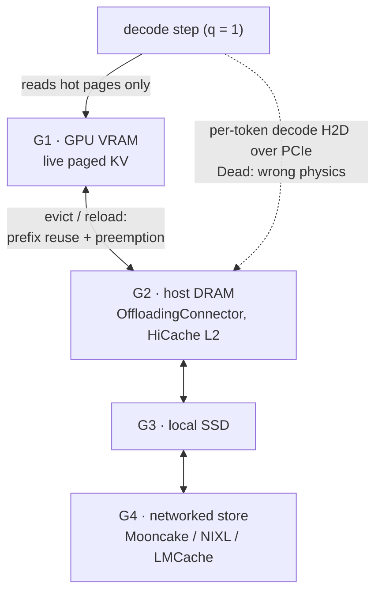

# KV cache quantization and offloading

Date: 2026-08-17. Sourced only.

## Quant

Shipped elsewhere: vLLM FP8 / per-token-head INT8/INT4 / TurboQuant / NVFP4. SGLang FP8 + experimental FP4. Official ROCm dtype is `fp8_e4m3` on MI-class. gfx11 is documented "no FP8" (PR #34741).[^vllm-pr34741] gfx1030: `supports_fp8()` is false.[^vllm-rocm-py] No sourced FP8-KV kernel.

If you write KV quant here, start from **INT8 + fused dequant into paged-decode**. Unfused dequant erases the memory win. Native cvt is the honest path; do not plan an FP8 path.

IC leftover after a resident weight shard is hundreds of KV tokens, not the full cache. Paged-decode that walks the whole cache still streams GDDR6; IC only helps the hot pages this step touches. See [silicon/arch-and-memory/cache-policy.md](../../silicon/arch-and-memory/cache-policy.md).

## Offload

GPU L1 → host L2 → Mooncake/NIXL/LMCache L3. Helps **prefix reuse and preemption**. Does **not** hide per-token decode H2D. HiCache hides H2D behind **prefill**, not per-token decode.[^sglang-hicache] ktransformers refuses the scan-KV-over-PCIe path (sparse CPU attn on DRAM).[^ktransformers] See [alt-engines.md](../alt-engines/alt-engines.md).

OffloadingConnector is GPU→CPU, not PD.[^vllm-kv-offload] Streaming decode KV over PCIe every token is the wrong physics.

## Diagram — KV tiers and what each hop is allowed to do

Tier names follow the Kiely storage hierarchy on this page ([book](https://www.baseten.co/inference-engineering/); digest: [notes/kiely-inference-engineering.md](../notes/kiely-inference-engineering.md)); the GPU→CPU offload connector is documented in vLLM[^vllm-kv-offload]. Dest fixed ROCm RAM KV-offload corruption in PR #24[^dest-pr24].

## Unknowns

- Specdec / FP8-KV quality on gfx1030.
- Whether any fused INT8-KV + fa_rdna2 path exists in the unpushed tree.

## Kiely addendum (Jan 2026)

Sensitivity ladder, least → most: weights (linears) < activations < KV < attention/softmax. Leave embed / lm_head and softmax wide. KV quant’s extra win is more resident cache and cheaper prefix/PD movement, not raw FLOPS. Storage hierarchy G1 GPU → G2 host ↓ G3 local SSD → G4 networked SSD; keep hot blocks high.

On this chip the book’s “FP8 is the production sweet spot / integers are local-only” does not apply (`supports_fp8()` false). INT8 + fused dequant stays the honest KV path. Offload stays prefix/preempt, not per-token decode H2D.

## Sources

- Philip Kiely, *Inference Engineering* (Baseten Books, 2026) — <https://www.baseten.co/inference-engineering/> (Kiely addendum)
Added in the 2026-10-11 sourcing pass:

- vLLM docs, Quantized KV cache — <https://docs.vllm.ai/en/latest/features/quantization/quantized_kvcache.html>

[^vllm-pr34741]: vLLM PR #34741 — RDNA4 FP8 KV + relaxed custom paged-attn (open) — <https://github.com/vllm-project/vllm/pull/34741>
[^vllm-rocm-py]: vLLM `vllm/platforms/rocm.py` (arch gates, `supports_fp8`, custom paged-attn, custom AR) — <https://github.com/vllm-project/vllm/blob/main/vllm/platforms/rocm.py>
[^sglang-hicache]: LMSYS blog, SGLang HiCache — <https://lmsys.org/blog/2025-09-10-sglang-hicache/>
[^ktransformers]: ktransformers repository — <https://github.com/kvcache-ai/ktransformers>
[^vllm-kv-offload]: vLLM docs, KV offloading — <https://docs.vllm.ai/en/latest/features/kv_offloading_usage.html>
[^dest-pr24]: dest PR #24 — ROCm RAM KV offload corruption fix — <https://github.com/opengfx1030/vllm-rdna/pull/24>
