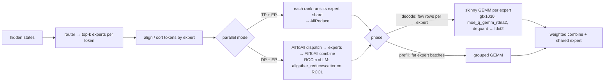

# MoE expert offloading

Date: 2026-08-18. Sourced only. DeepEP / asymmetric A2A: [deepep.md](../multi-gpu/deepep.md). Hetero placement (W7800 + V620): [multi-tier.md](multi-tier.md) + [silicon/hetero-moe-w7800-v620.md](../../silicon/hetero-moe-w7800-v620.md).

**Product path:** vLLM fork first, then SGLang. Llaminar is a placement model, not the base.

## Verdict on gfx1030

No sourced MoE-on-gfx1030 notes. gfx1030 is outside AITER's matrix and outside vLLM's Triton MoE ROCm whitelist (PR #37826 explicitly excluded gfx10xx).[^vllm-pr37826] Radeon MoE work that exists is gfx1100 / gfx1201.

Honest one-box huge-MoE design: CPU-resident experts + GPU attention/hot set (ktransformers / llama.cpp `--n-cpu-moe`). Layerwise GPU prefill when the batch is large enough that PCIe+GPU math beats CPU experts.

Decode MoE is many tiny GEMMs — terrible even on RDNA3 (7900 XTX: Triton-unfused 8.5 → native HIP 48.8 tok/s). *(unsourced — figure not in [vLLM PR #44075](https://github.com/vllm-project/vllm/pull/44075), which reports up to 2.17× vs Triton on RX 7900 XTX)*

**Live in the fork:** W4A16 / W8A16 / W8A16-FP8 (LUT→`fdot2`). **Not shipping:** W8A8/`sdot4`, mxfp4 (format contracts; PR #52391 is enablement, not a launched gfx1030 MoE). **Queued spec:** INT2 + mixed INT2/INT4 experts — [int2.md](../quant-formats/int2.md). Native FP16 / INT8 HIP MoE: [fp16-moe.md](fp16-moe.md), [int8-moe.md](int8-moe.md). Nothing first-class ships. Format contracts: [kernels/w4a16.md](../../kernels/w4a16.md), [kernels/w8a8-mxfp4.md](../../kernels/w8a8-mxfp4.md), [kernels/int2.md](../../kernels/int2.md).

MoE tile: A (activations) in LDS; stream B (weights). Token-major + small BLOCK_M at decode. Under TP>1 write unreduced rows (do not fuse reduce-before-allreduce). Do not copy AITER W8A8 CK (MFMA, AGPR, CDNA). `0c59068e` changes RCCL transport only; GEMM still does not own the collective ([deepep.md](../multi-gpu/deepep.md)).

Mixed INT2/INT4: sort tokens by expert, **then** group by bitwidth. Two unpackers, one `fdot2`. Do not switch unpackers inside K.

Hetero later: attn+router+**live KV** on W7800 (gfx1100); experts on V620 (gfx1030); activations only; fp16 on the hop. Do not park live KV on V620.

## Diagram — MoE layer data flow and where gfx1030 sits

TP+EP = AllReduce and DP+EP = AllToAll from the vLLM EP guide[^vllm-ep]; shared + routed experts from DeepSeek-V3[^deepseek-v3]; density rule of thumb from AMD's MoE playbook[^amd-moe-playbook]. The gfx1030 expert kernel is dest `csrc/rocm/moe_q_gemm_rdna2.cu`[^dest-moe-q-gemm].

## Basics

DeepSeek-V3: 1 shared + 256 routed, 8 activated/token, 671B/37B.[^deepseek-v3] Prefill wants fat expert batches (EP32). Decode: one expert per GPU at EP320, batch/expert usually ≤256, memory-bound.

AMD playbook: <1% activation density prefer no-EP (AllReduce); >3% prefer EP (AllToAll).[^amd-moe-playbook] MLA still wants DP+EP for KV reasons. DeepEP is a GPU-initiated AllToAll for the high-density case, not a reason to AllToAll a 4×PCIe box by default. V620 analogue: mapped-peer scatter/combine, not IBGDA.

## vLLM

`--enable-expert-parallel`. `EP_SIZE = TP × DP`. TP+EP = AllReduce; DP+EP = AllToAll.[^vllm-ep] ROCm A2A: `VLLM_ALL2ALL_BACKEND=allgather_reducescatter` on RCCL.

Kernels: Triton, DeepGEMM, Marlin WNA16, rocm aiter moe (CDNA). `--cpu-offload-gb` shipped (generic). Static CPU expert offload merged (#34535).[^vllm-pr34535] LFRU GPU cache of hottest N (#37190) still open as of 2026-08-05.[^vllm-pr37190]

## SGLang

`--moe-a2a-backend`: none / deepep / mooncake / nixl / mori (AMD, gfx942+, normal only). Hybrid with ktransformers kt-kernel shipped (CPU AMX experts). UVM offload PR #20126 open, CUDA-only. Product path: after vLLM kernels exist.

## Offload policies

Shipped: static CPU placement (vLLM #34535, llama.cpp `--n-cpu-moe`); KT hot-expert set (uniform/frequency/front-loading). Not shipped as production: vLLM LFRU, SGLang UVM, HybriMoE MRS.

## Kernel hit-list

Grouped GEMM (prefill), skinny GEMV (decode), router/align-sort, combine, EP all-to-all (MORI on CDNA; RCCL gather/reducescatter on ROCm vLLM), fused MoE, shared-expert fusion.

## Unknowns

gfx1030 MoE kernel quality. Whether #37190 / #20126 merged later. llama.cpp compute vs H2D split. AITER fused MoE on any RDNA. Named INT2 / mixed-bitwidth checkpoint. Whether 4×V620 has working `hipDeviceCanAccessPeer` after IOMMU/ACS. W7800↔V620 P2P unmeasured.

## Sources

- [DeepSeek-V3](https://arxiv.org/abs/2412.19437)
- [vLLM EP](https://docs.vllm.ai/en/stable/serving/expert_parallel_deployment/)
- [AMD MoE playbook](https://rocm.blogs.amd.com/software-tools-optimization/vllm-moe-guide/README.html)
- [ktransformers layerwise](https://ktransformers.net/en/docs/optimization-techniques/layerwise-prefill)
- [llama.cpp --cpu-moe](https://github.com/ggml-org/llama.cpp/pull/15077)
- [Triton MoE excludes gfx10xx](https://github.com/vllm-project/vllm/pull/37826)
- [deepep.md](../multi-gpu/deepep.md), [multi-tier.md](multi-tier.md)

[^vllm-pr37826]: vLLM PR #37826 — Triton MoE ROCm whitelist excludes gfx10xx — <https://github.com/vllm-project/vllm/pull/37826>
[^vllm-ep]: vLLM docs, Expert Parallel Deployment — <https://docs.vllm.ai/en/stable/serving/expert_parallel_deployment/>
[^deepseek-v3]: DeepSeek-AI, *DeepSeek-V3 Technical Report* (MoE layout, MTP) — <https://arxiv.org/abs/2412.19437>
[^amd-moe-playbook]: AMD ROCm blog, vLLM MoE playbook — <https://rocm.blogs.amd.com/software-tools-optimization/vllm-moe-guide/README.html>
[^dest-moe-q-gemm]: dest `csrc/rocm/moe_q_gemm_rdna2.cu` — <https://github.com/opengfx1030/vllm-rdna/blob/rdna_extras/csrc/rocm/moe_q_gemm_rdna2.cu>
[^vllm-pr34535]: vLLM PR #34535 — static CPU expert offload — <https://github.com/vllm-project/vllm/pull/34535>
[^vllm-pr37190]: vLLM PR #37190 — LFRU GPU expert cache — <https://github.com/vllm-project/vllm/pull/37190>

