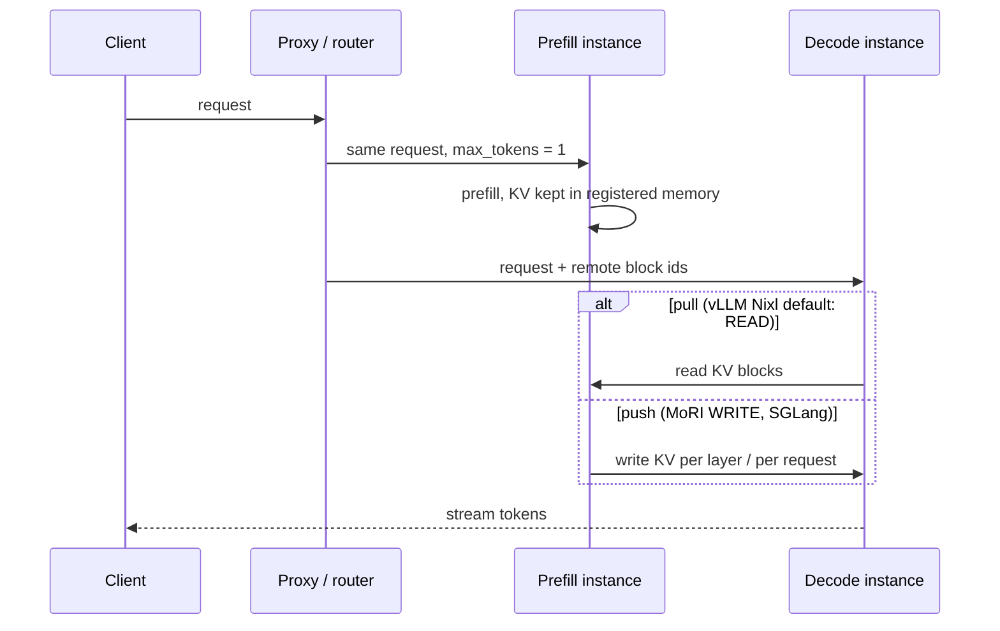

# Prefill-decode disaggregation

Date: 2026-08-17. Sourced only.

## Verdict on 4× V620

Skip as a win.

Every current production PD stack (vLLM Nixl/Mooncake, SGLang Mooncake/NIXL, MoRI-IO) is built around RDMA and/or NVLink/xGMI. Transfer Engine *can* speak TCP; that is not a documented way to win TTFT/ITL on RDNA. No gfx1030/gfx1100 PD recipe found.

vLLM: PD does **not** raise throughput; it decouples TTFT vs ITL.[^vllm-disagg] DistServe: wrong design for throughput-only offline and few/single-GPU boxes.[^distserve]

Sourced alternatives on this box: colocate + [chunked prefill](../scheduling/batching.md), OffloadingConnector, ktransformers-style CPU sparse attn (don't move KV on decode).

This is collectives / a KV fabric, not something RCCL P2P unlocks. See [silicon/rccl-p2p.md](../../silicon/rccl-p2p.md).

## Diagram — PD request path (generic)

Proxy flow and connector modes from the vLLM disaggregated-prefill docs[^vllm-disagg] and MoRI-IO docs[^vllm-moriio]; SGLang pushes from P[^sglang-pd]. Dest has an **open, unmerged** local variant — PR #23 `PcieP2pConnector` (HIP IPC export + `hipMemcpy` pull across two PLX switches, based on the archived 0.28 line)[^dest-pr23]. It does not change the verdict below until measured.

*Figure: vLLM disaggregated prefill overview. Source: [vLLM docs, Disaggregated Prefilling](https://docs.vllm.ai/en/latest/features/disagg_prefill.html), file `docs/assets/features/disagg_prefill/overview.jpg` in [vllm-project/vllm](https://github.com/vllm-project/vllm). Licence: [Apache-2.0](https://github.com/vllm-project/vllm/blob/main/LICENSE).*

## What moves

Payload is prefill KV (plus token ids so decode can skip re-tokenize). Classic path does not move decode-generated KV until bidirectional/multi-turn.

When: DistServe pull after prefill; Mooncake layer-wise stream to D CPU DRAM overlapped with compute;[^mooncake] vLLM Nixl D pulls (READ) by default; MoRI WRITE = P pushes after every layer; SGLang P pushes.

Handshake is always TCP/HTTP/ZMQ control + registered-memory data plane.

## Connectors

vLLM: NixlConnector (NVIDIA primary, UCX), MooncakeConnector (V1 experimental, default protocol rdma), MoRIIOConnector (ROCm only: rdma or xgmi). OffloadingConnector is GPU→CPU, not PD.

SGLang: `--disaggregation-mode prefill|decode`; backend mooncake (default) or nixl. `page_size` and `kv_cache_dtype` must match.

Mooncake TE protocols: tcp (any), rdma, efa, nvlink, hip (ROCm intra-node IPC). HIP path: peer access iff `hipDeviceCanAccessPeer`. No consumer-RDNA PD recipe.

NIXL: no first-class PCIe-P2P plugin.[^nixl] UCX cuda_ipc may ride PCIe P2P if the driver allows; not a reliable default. Production data planes are RDMA (GDR), NVLink/xGMI, or host-bounce TCP.

## Layout contract

Both sides must match: architecture, dtype, KV heads, head size, layers, attn backend, cache_dtype, spec method, push vs pull. Dynamic FP8 scales are not transferred. Hetero TP: SGLang without staging ~30k small RDMA ops; staging gather→bulk RDMA→scatter.

## Unknowns

- Any production PD recipe for gfx1030/gfx1100.
- Whether HIP IPC on RDNA ever gets true P2P.
- Measured TCP/PCIe-host-bounce PD goodput on consumer GPUs.
- MoRI xGMI on anything that is not Instinct HGX-class.

## Sources

- Philip Kiely, *Inference Engineering* (Baseten Books, 2026) — <https://www.baseten.co/inference-engineering/> (Kiely addendum)
- [DistServe](https://arxiv.org/abs/2401.09670)
- [Mooncake](https://arxiv.org/abs/2407.00079)
- [vLLM disagg](https://docs.vllm.ai/en/latest/features/disagg_prefill/)
- [MoRI](https://docs.vllm.ai/en/latest/features/moriio_connector_usage/)
- [SGLang PD](https://docs.sglang.ai/advanced_features/pd_disaggregation.html)
- [NIXL](https://github.com/ai-dynamo/nixl)

[^vllm-disagg]: vLLM docs, Disaggregated Prefilling — <https://docs.vllm.ai/en/latest/features/disagg_prefill.html>
[^distserve]: Zhong et al., *DistServe* (OSDI 2024) — <https://arxiv.org/abs/2401.09670>
[^vllm-moriio]: vLLM docs, MoRI-IO connector — <https://docs.vllm.ai/en/latest/features/moriio_connector_usage/>
[^sglang-pd]: SGLang docs, PD disaggregation — <https://docs.sglang.ai/advanced_features/pd_disaggregation.html>
[^dest-pr23]: dest PR #23 — PCIe P2P KV bridge for local PD (open, 0.28 line) — <https://github.com/opengfx1030/vllm-rdna/pull/23>
[^mooncake]: Qin et al., *Mooncake* (FAST 2025) — <https://arxiv.org/abs/2407.00079>
[^nixl]: NVIDIA NIXL repository — <https://github.com/ai-dynamo/nixl>

## Kiely addendum (Jan 2026)

Three gates, all wanted, before PD pays: volume on the order of 1e8–1e9 tok/day; model ≳100B; prefill-heavy, long, diverse ISL. If any fail, extra GPUs are better as replicas. Conditional PD: decode does local prefill on short ISL or prefix-hit and skips the transfer. New bottlenecks if you do it anyway: prefill queue and decode KV capacity.

This box still fails interconnect (PCIe, no XGMI) and is a few-GPU lab. Verdict stays **skip as a win**.
