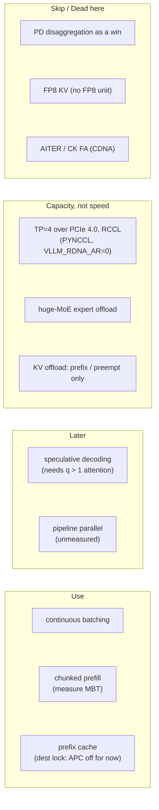
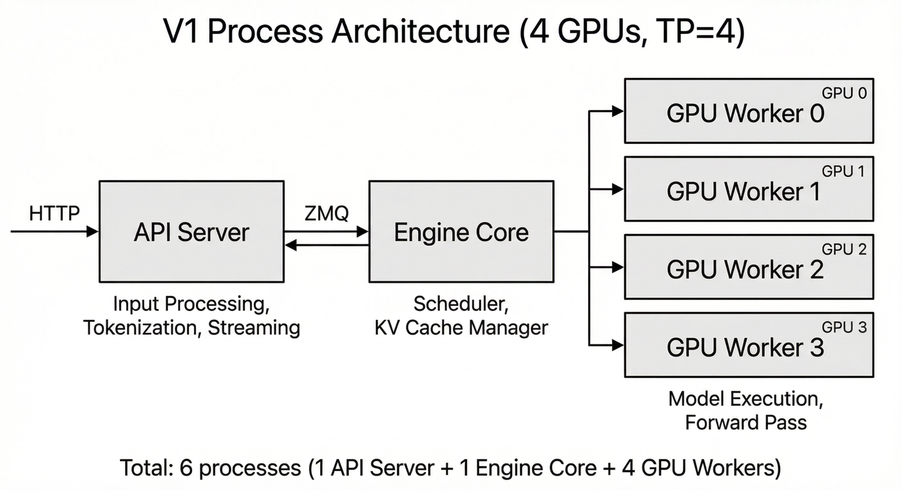

# Inference engine map for 4× V620 (gfx1030)

> **Dest today (2026-10-11):** [`opengfx1030/vllm-rdna` `rdna_extras`](https://github.com/opengfx1030/vllm-rdna/tree/rdna_extras) = vLLM **v0.31.0** port ([PR #47](https://github.com/opengfx1030/vllm-rdna/pull/47)), tip `1dc3bac4` (contains `8abf4c97`). Tips and branch names quoted below (`rdna2_extras` on BlivionIaG/vllm, `perf/rdna2_w4a16`) are **historical snapshots**. Serve locks (ROCm pin, APC, PYNCCL / `VLLM_RDNA_AR=0`) live in [fork/](../../fork/README.md) and [toolchain/matrix.md](../../toolchain/matrix.md); this page only says what the engine does.

Date: 2026-08-17. Sourced only. Hardware facts from [silicon/](../../silicon/README.md).

Target: 4× AMD V620 (Navi 21 / gfx1030, 32 GB), ROCm 7.2 at time of writing (live pin now ROCm 7.14.0 — [toolchain/matrix.md](../../toolchain/matrix.md)), TP=4 considered. GDDR6 512 GB/s, L2 4 MB, IC 128 MB. Wave32 native. No WMMA, no MFMA, no AGPR. Packed DOT only. `supports_fp8()` is false on gfx1030 and gfx1100.[^vllm-rocm-py]

## One-page verdict

A request is two programs that share a KV cache. Prefill is a fat GEMM (compute-bound). Decode is a skinny GEMV plus a gather of every past K/V (memory-bound). Every serving trick is a way of living with that split.

Official vLLM and SGLang do **not** list gfx1030. Forced build = Triton attention + rocBLAS + Triton AWQ. Custom HIP paged-decode and skinny GEMM **never launch** (`on_gfx1x` = gfx11/12).[^vllm-rocm-py][^vllm-pr34709] AITER/CK FA is CDNA-only.[^vllm-pr32944]

The work is not "port AITER." Write Wave32 paged-decode + skinny GEMM + DOT-based quant GEMMs, keep weights quantized on device, colocate P+D with a measured token budget. Treat PD / TP-for-speed / streaming decode-KV over PCIe as the wrong physics.

**Live in the fork** (not paged-decode first): W4A16 / W8A16 / W8A16-FP8 (LUT→`fdot2`) and `fa_rdna2`. **Not shipping:** W8A8/`sdot4`, mxfp4 — those are format contracts, not launched kernels. See [kernels/](../../kernels/README.md) and [attention-dispatch.md](../attention/attention-dispatch.md).

## Diagram — technique verdicts at a glance

Verdicts are this page's technique table; serve locks (APC, PYNCCL, ROCm pin) live in [fork/](../../fork/README.md) and [toolchain/matrix.md](../../toolchain/matrix.md).

*Figure: vLLM V1 process layout at TP=4 (1 API server + 1 engine core + 4 GPU workers) — the shape a 4× V620 TP=4 serve runs. Source: [vLLM docs, Architecture Overview](https://docs.vllm.ai/en/latest/design/arch_overview.html), file `docs/assets/design/arch_overview/v1_process_architecture_tp4.png` (downscaled) in [vllm-project/vllm](https://github.com/vllm-project/vllm). Licence: [Apache-2.0](https://github.com/vllm-project/vllm/blob/main/LICENSE).*

## Technique table

| Technique | Verdict on 4× V620 |
|---|---|
| Continuous / in-flight batching | Use. Iteration-level is the product.[^orca] |
| Chunked prefill | Use. Measure token budget. Instinct 8k–16k is HBM. |
| Prefix / radix cache | Use. |
| PD disaggregation | Skip as a win. RDMA/xGMI stacks only. PD does not raise throughput.[^vllm-disagg] |
| Speculative decoding | Later. Verify is extend (q=k+1).[^leviathan] No sourced gfx1030 specdec. |
| KV FP8 | Not a vLLM path (`supports_fp8()` false). If you write KV quant, INT8 + fused dequant. |
| KV offload (host/SSD) | Prefix reuse and preemption only. Not per-token decode H2D. |
| MoE expert offload | Huge MoE: CPU-resident experts + GPU attention. gfx1030 is outside AITER and the Triton MoE whitelist. |
| Tensor parallel | Capacity, not speed. RCCL Ring/Tree over PCIe. No XGMI. Custom AR is gfx94/95 only. |
| Pipeline parallel | AMD's hint with no high-speed interconnect. No sourced RDNA2 measurement. |

## Write order (engine, not silicon)

1. Keep MHA 128/256 decode split-K + prefill Br tiles (`fa_rdna2`, already live).
2. Matching `reshape_and_cache` writer.
3. Head-64 decode tile (Triton hole).
4. Skinny GEMM / GEMV Wave32 for QKV+FFN decode.
5. Sage-style INT8 QK via sdot4 on **prefill only**, after FA2 occupancy is clean. Do not list sdot4 as shipping.
6. MLA fat tile (q>1) before mix or MTP.
7. Do not start with shuffled KV / `pa_fwd_asm` / AITER MLA.

## Cache / RCCL (one-liners)

HIP default loads stay. No persist / IC bypass / prefetch on gfx1030. Single-GPU: only 7B W4/mxfp4 fit a layer in 128 MB IC. TP=4: 7B all formats; 27B W4/mxfp4 fit; 27B W8A8 ~7 MiB over (format-size note, not a live kernel). Leftover IC is hundreds of KV tokens, not the full cache. Details: [silicon/cache-policy.md](../../silicon/cache-policy.md).

4× V620 is PCIe 4.0 x16 only. `HSA_FORCE_FINE_GRAIN_PCIE=1` + large BAR. Ring n=4 algbw ≤ ~21 GB/s if the bus is perfect. W4A16 does not shrink all-reduce. P2P is attested on this 4× V620 (attested, 2026-08-17). Still no measured `hipMemcpyPeer` GB/s. Custom AR is a policy/perf question, not a “does P2P exist” question. Details: [silicon/rccl-p2p.md](../../silicon/rccl-p2p.md).

## Unknowns (do not fill)

- Any tok/s, occupancy, or effective PCIe GB/s on V620.
- Whether HIP IPC on RDNA ever gets true P2P on this board.
- Optimal MBT on GDDR6+IC.
- Specdec / FP8-KV / fused MoE quality on gfx1030.
- PP vs TP on this exact 4× V620 topology.
- IC TB/s, L2 associativity.

## Sources

[Anatomy of vLLM](https://vllm.ai/blog/2025-09-05-anatomy-of-vllm), [ROCm attention backends](https://vllm.ai/blog/2026-02-27-rocm-attention-backend), [PagedAttention](https://arxiv.org/abs/2309.06180), [vLLM rocm.py](https://github.com/vllm-project/vllm/blob/main/vllm/platforms/rocm.py), ISA 70648.

[^vllm-rocm-py]: vLLM `vllm/platforms/rocm.py` (arch gates, `supports_fp8`, custom paged-attn, custom AR) — <https://github.com/vllm-project/vllm/blob/main/vllm/platforms/rocm.py>
[^vllm-pr34709]: vLLM PR #34709 — wvSplitK skinny GEMM for gfx1x (gfx1030 not included) — <https://github.com/vllm-project/vllm/pull/34709>
[^vllm-pr32944]: vLLM PR #32944 — CK FlashAttention is CDNA-only — <https://github.com/vllm-project/vllm/pull/32944>
[^orca]: Yu et al., *Orca: A Distributed Serving System for Transformer-Based Generative Models* (OSDI 2022) — <https://www.usenix.org/system/files/osdi22-yu.pdf>
[^vllm-disagg]: vLLM docs, Disaggregated Prefilling — <https://docs.vllm.ai/en/latest/features/disagg_prefill.html>
[^leviathan]: Leviathan et al., *Fast Inference from Transformers via Speculative Decoding* — <https://arxiv.org/abs/2211.17192>

