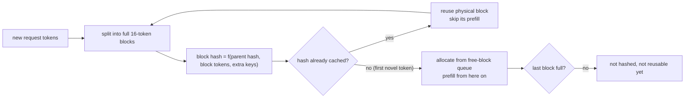
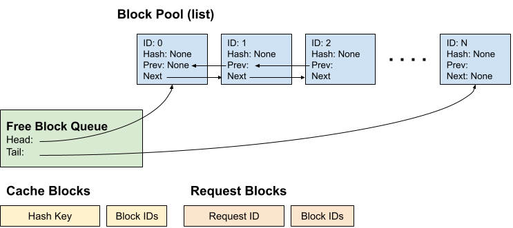

# Cache-aware scheduling

Date: 2026-08-20. Engine contract. Batching mechanics: [batching.md](batching.md). IC fit: [infinity-cache.md](../kv-cache/infinity-cache.md). Occupancy still first. Do not invent tok/s.

**Two different caches.** Do not merge them into one “cache-aware” ticket.

| Cache | What it holds | Scheduler lever we already have |
|---|---|---|
| **KV prefix** (paged, `block_size=16`) | Reusable tokens | vLLM V1 **APC on by default**. Hash complete blocks. Incomplete last block is not reusable.[^vllm-prefix-caching] |
| **Infinity Cache** (128 MB L3) | Hot **weight shard + this-step pages** | Working set + decode-first. **No persist bit.** |

extras has **no** custom cache-aware scheduler. Stock V1 is the lever. SGLang radix / cache-aware router is steal-later, not the next engine.

## Diagram — prefix (APC) hit path

Hashing of complete blocks and the free-block queue are from the vLLM prefix-caching design doc[^vllm-prefix-caching]. **Dest serve lock:** see [fork/serve-locks.md](../../fork/serve-locks.md). At `1dc3bac4` every recipe except `dsv4-flash` enables prefix caching[^dest-recipes-apc], which disagrees with the earlier room lock "APC off"; that is not settled here. Engine consequence either way: hybrid state rings (Engram / GDN / indexer) stay in heaps separate from KV blocks, so block hashing here covers attention KV only (per fork/serve-locks.md). This page describes the stock lever, not the live pin.

*Figure: vLLM prefix-caching block pool / free block queue. Source: [vLLM docs, Automatic Prefix Caching design](https://docs.vllm.ai/en/latest/design/prefix_caching.html), file `docs/assets/design/prefix_caching/overview.png` in [vllm-project/vllm](https://github.com/vllm-project/vllm). Licence: [Apache-2.0](https://github.com/vllm-project/vllm/blob/main/LICENSE).*

## What stock V1 already does

- **Prefix cache:** skip prefill for hashed complete 16-token blocks. Put stable context first (system / repo / RAG / history); unique user tokens last. Reuse **ends at the first novel token** ([batching.md](batching.md) Kiely).
- **Decode first:** `schedule()` packs running decodes into `token_budget`, then waiting only if no preemption. That is the IC-friendly order — same W4 shard reread every token.
- **Chunked prefill:** leftover budget, `max_num_partial_prefills` default **1**.[^vllm-v1-guide] One fat chunk + many `l_q=1` still fights the 128 MB.
- Policy: FCFS or priority. Not “route to the GPU that already has this prefix” (that is a **router**, multi-replica).

Measure `max_num_batched_tokens` on V620. Do not copy Instinct 8k/16k.

## IC-aware rule (this box)

Keep a **decode-only** step when we care about the 128 MB hit: 7B/27B W4 TP=4 shards fit; a fat prefill chunk does not. Two HIP streams / SDMA on the same V620 evict the shard ([infinity-cache.md](../kv-cache/infinity-cache.md)).

Do **not** write a new scheduler to pin lines. Do:

1. Leave APC on.
2. Occupancy flip so the decode GEMV actually runs.
3. Sweep MBT; prefer decode-heavy mixed batches over huge leftover prefills.
4. Later: nontemporal only miss-path weights; INT8-KV shrinks the window ([kv-int8.md](../kv-cache/kv-int8.md)).

Not a win here: PD-disagg ([pd-disagg.md](../multi-gpu/pd-disagg.md)), per-token KV H2D, SGLang cache-aware LB (needs a replica pool we are not running).

## Not a card

Same occupancy card. APC/MBT is tune-and-measure after occupancy, not a new first kernel.

## Sources

- [batching.md](batching.md), [infinity-cache.md](../kv-cache/infinity-cache.md), [silicon/cache-policy.md](../../silicon/cache-policy.md)
- Note 2026-08-20 (user: cache-aware scheduling)

Added in the 2026-10-11 sourcing pass:

- Agrawal et al., *Taming Throughput-Latency Tradeoff in LLM Inference with Sarathi-Serve* (OSDI 2024) — <https://arxiv.org/abs/2403.02310>

[^vllm-prefix-caching]: vLLM docs, Automatic Prefix Caching design — <https://docs.vllm.ai/en/latest/design/prefix_caching.html>
[^vllm-v1-guide]: vLLM docs, V1 user guide — <https://docs.vllm.ai/en/latest/usage/v1_guide/>
[^dest-recipes-apc]: dest recipes at `1dc3bac4` (prefix caching in every recipe except `dsv4-flash.env`) — <https://github.com/opengfx1030/vllm-rdna/tree/1dc3bac4cda3201a1b4fb345e044578e84a272cf/tools/rdna/recipes>
