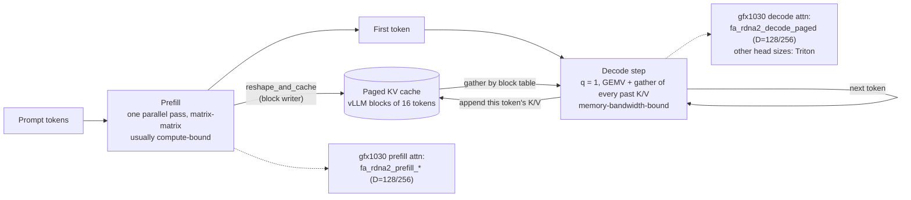

# Prefill vs decode

Date: 2026-08-17. Sourced only.

A request is two programs that share a KV cache.

- **Prefill:** one parallel pass over the prompt. Matrix-matrix. Usually compute-bound.
- **Decode:** one new token per step. Matrix-vector plus a gather of every past K/V. Memory-bandwidth-bound.
- **KV:** the coupling. Grows by one token per step. Decode re-reads weights and that cache every time.

PagedAttention (SOSP'23): prefill can use matrix-matrix; decode is sequential, typically matrix-vector. vLLM pages KV into blocks of **16 tokens**.[^pagedattn] After split:

```
K: [num_blocks, num_kv_heads, head_size/x, block_size, x]   x = 16/sizeof
V: [num_blocks, num_kv_heads, head_size, block_size]
```

SGLang Triton: `page_size = 1` (CSR indptr/indices). ExLlama: page = 256 because FlashAttention's API requires a multiple of 256 (Tri Dao: convenience, not a law).

On V620 the prefill GEMM is VALU/DOT, not MFMA. Decode is GDDR6 512 GB/s plus 128 MB IC, not HBM. Instinct token-budget defaults do not transfer. See [batching.md](batching.md).

## Diagram — one request, two programs



Split and block size from PagedAttention[^pagedattn]; gfx1030 kernel names from the dest `RDNA_ATTN` backend[^dest-rdna-attn] (head sizes 128/256 only, everything else falls back to `ROCM_ATTN`/`TRITON_ATTN`).

## extras lock 2026-09-28 — tip `6ed39093` (prefill schedule interval)

Engine-only: non-DP engines honor `prefill_schedule_interval` (default 1 = off). MTP launcher knob `PREFILL_INTERVAL` (default 1). No HIP/ISA delta. See [batching.md](batching.md). Do not copy tok/s.

---

## How engines live with it

**vLLM V1:** no separate P/D phases. Decode-first into `max_num_batched_tokens`, leftover budget is chunked prefill. Prefix cache on (hash complete 16-token blocks). Preemption is RECOMPUTE (swap removed).[^vllm-anatomy] Chunked prefill cannot be turned off.[^vllm-v1-guide] FCFS default.

**SGLang:** waiting / chunked_req / running_batch. Mixed P+D is **off** by default because the whole batch still goes through the prefill kernel.[^sglang-mixed-chunk] Chunk size heuristic: 8192 on A100/H100, 16384 on MI300, 4096 fallback. *(unsourced)* Overlap schedule on. Retract = recompute.

**Orca** invented iteration-level batching.[^orca] **Sarathi-Serve** named stall-free batching: pack decodes, continue partial prefill, admit new only into leftover τ. On A100, one decode token ≈ 128 prefill tokens in linear cost; crossover ~500–600 tokens.[^sarathi] That number is A100, not RDNA.

## Kernel hit-list

1. **Paged decode attention** — gather K/V by block table, Q seqlen≈1. This is the RDNA decode kernel. Live: `fa_rdna2_decode_paged` for D=128/256. Head-64 is still Triton. See [attention-dispatch.md](../attention/attention-dispatch.md).
2. **Prefill / varlen FA** — causal, GEMM-like QK/PV tiles. Live: `fa_rdna2_prefill_*` Br=16/32.
3. **Extend / chunked-context** — new tokens attend to already-paged prefix. Short Br=32 for small-q. DeepSeek V4 chunked prefill must be a separate prefill step, not V1 leftover-MBT mix, until an MLA fat tile exists.
4. **reshape_and_cache / block write** — matching writer for that layout. A gather without a matching write is wasted. Do not assume AITER shuffle's 15–20% (CDNA number).
5. **QKV + FFN GEMM vs GEMV** — prefill: large-M. Decode: M=1. Skinny GEMM is gated off gfx10.[^vllm-pr34709]
6. **MLA decode** — sparse MLA only today (q=`[B,H,D]`, WG=32, 16 CTAs/query). Mix/spec off until fat tile.

Kernel vs scheduler: kernels decide occupancy/layout/GEMV. Scheduler decides whether a step is pure-decode or mixed, and whether PD is worth the KV copy.

## Techniques that exist because of the split

| Technique | Why | Names |
|---|---|
| Chunked prefill | Bound per-step work so decode is not stalled | Sarathi-Serve; vLLM V1 default; SGLang `--chunked-prefill-size` |
| Continuous / in-flight batching | Admit/retire at iteration granularity | Orca (OSDI'22) |
| PD disaggregation | Opposite rooflines + interference; pay KV transfer | DistServe; Mooncake; vLLM connectors. [Skip here](../multi-gpu/pd-disagg.md). |
| Speculative decoding | Amortize a full weight/KV load over k+1 tokens | Leviathan; EAGLE. [Later](../spec-decoding/specdec.md). |

## Sources

- [PagedAttention](https://arxiv.org/abs/2309.06180)
- [Anatomy of vLLM](https://vllm.ai/blog/2025-09-05-anatomy-of-vllm)
- [ROCm attention backends](https://vllm.ai/blog/2026-02-27-rocm-attention-backend)
- [Sarathi-Serve](https://arxiv.org/abs/2403.02310)

Added in the 2026-10-11 sourcing pass:

- dest PR #36 — adaptive prefill scheduling (chunk cap + step cadence, opt-in) — <https://github.com/opengfx1030/vllm-rdna/pull/36>

[^pagedattn]: Kwon et al., *Efficient Memory Management for LLM Serving with PagedAttention* (SOSP 2023) — <https://arxiv.org/abs/2309.06180>
[^dest-rdna-attn]: dest `vllm/v1/attention/backends/rdna_attn.py` (RDNA_ATTN: head 128/256, fp16, split-decode, prefill heuristics) — <https://github.com/opengfx1030/vllm-rdna/blob/rdna_extras/vllm/v1/attention/backends/rdna_attn.py>
[^vllm-anatomy]: vLLM blog, *Inside vLLM: Anatomy of a High-Throughput LLM Inference System* — <https://vllm.ai/blog/2025-09-05-anatomy-of-vllm>
[^vllm-v1-guide]: vLLM docs, V1 user guide — <https://docs.vllm.ai/en/latest/usage/v1_guide/>
[^sglang-mixed-chunk]: SGLang discussion #1163 — mixed chunked prefill — <https://github.com/sgl-project/sglang/discussions/1163>
[^orca]: Yu et al., *Orca: A Distributed Serving System for Transformer-Based Generative Models* (OSDI 2022) — <https://www.usenix.org/system/files/osdi22-yu.pdf>
[^sarathi]: Agrawal et al., *Taming Throughput-Latency Tradeoff in LLM Inference with Sarathi-Serve* (OSDI 2024) — <https://arxiv.org/abs/2403.02310>
[^vllm-pr34709]: vLLM PR #34709 — wvSplitK skinny GEMM for gfx1x (gfx1030 not included) — <https://github.com/vllm-project/vllm/pull/34709>

