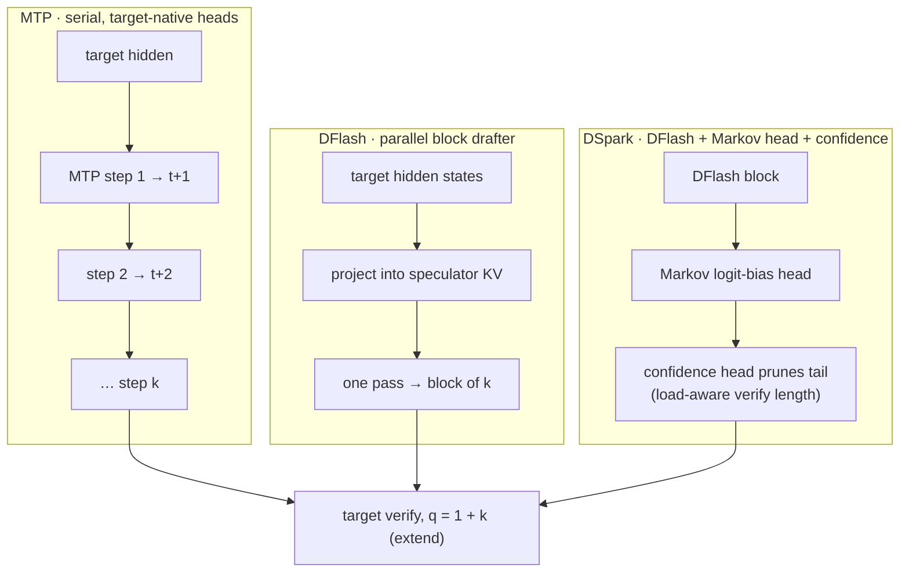

# MTP — engine spec (gfx1030)

Date: 2026-08-17. Engine contract. Card: MTP on [project 4](https://github.com/users/BlivionIaG/projects/4). Not sdot4. Sibling cards: [dflash.md](dflash.md), [dspark.md](dspark.md). Family page: [specdec.md](specdec.md). Do not edit dest `rdna_extras` (historically `perf/rdna2_w4a16`) from this page. Occupancy still first.

**Verdict:** MTP is **native multi-token prediction** on the target (DeepSeek D=1 heads, serial draft). Verify is **extend / short-prefill** (`q = 1+k`), not q=1 decode. On this box it does **not** fire until a **fat MLA tile (`q>1`)** exists. No new DOT kernel. Same silicon blocker as mix/spec.

Fork today: DSv4 gfx10x routing keeps MTP off (`VLLM_DISABLE_DSPARK_MTP` / mix off). That is policy, not a missing GEMM.

## What MTP is (engine)

| | MTP |
|---|---|
| Draft | Target-native heads. MTP-1 = one extra token (DeepSeek production baseline before DSpark). MTP-k = k serial draft steps. |
| vLLM method | `speculative-config.method = mtp` |
| Verify | one target forward over accepted prefix + draft tokens. `max_query_len = 1+k`. |
| Extra weights | MTP heads on the same checkpoint (not an external speculator). |
| vs DFlash / DSpark | Serial, no parallel backbone, no confidence scheduler. |

Wrong tool when the batch is already compute-bound, accept rate is low, or k is large under high concurrency (DeepSeek kept MTP-1 in prod for that reason).[^dspark]

## Diagram — MTP vs DFlash vs DSpark drafting



MTP from DeepSeek-V3[^deepseek-v3]; DFlash parallel drafting from the vLLM Speculators blog[^vllm-parallel-drafting]; DSpark from its paper[^dspark]. All three hit the same verify shape, so the same gfx1030 gate (q > 1 attention) applies — see [specdec.md](specdec.md).

## gfx1030 contract

```
// keep — after occupancy + fat tile
fa_rdna2 / HIP MLA short-extend (q = 1+k)
RejectionSampler as stock V1
fp16 only

// drop
AITER paged_attention_v1 (no query_len > 1)
CUDA-graph draft loops that assume SM120 / gfx950 sparse MLA
Turning MTP on while HIP MLA is q=1 decode only
A new DOT / sdot4 path "for MTP"
```

Live sparse MLA is q=`[B,H,D]` only. Short Br=32 is the verify-shaped path once occupancy is clean. See [attention-dispatch.md](../attention/attention-dispatch.md).

## Dispatch

| Piece | Spec |
|---|---|
| Gate | stay off on gfx10x until fat tile + occupancy. Do not flip `VLLM_DISABLE_DSPARK_MTP` early. |
| Draft | existing DSv4 MTP heads, fp16 workspace (already the gfx10x path). |
| Verify attn | HIP MLA fat tile **or** fa_rdna2 short-extend. Not Triton compile-tax as the product. |
| Scheduler | stock V1 `num_tokens_with_spec` / lookahead slots. |
| k | start MTP-1. MTP-3/5 only after verify is cheap. |

## Done-when

Fat tile exists. MTP-1 verify runs on gfx1030 without AITER. ISA of verify attn is the same `fdot2` / scalar-FMA MLA we already own — no new opcode. No tok/s from this page.

## Not this ticket

Occupancy flip. Sage QK. INT2. DFlash / DSpark (own cards). INT8 KV. Writing a draft GEMM.

## Sources

- [specdec.md](specdec.md) (verify = extend)
- DeepSeek-V3 MTP; V4 production baseline MTP-1 ([DSpark paper](https://arxiv.org/html/2607.05147v1))
- vLLM `--speculative-config` method `mtp`
- Lock: HIP MLA still q=1; fat tile before mix/spec/MTP

Added in the 2026-10-11 sourcing pass:

- vLLM docs, Speculative Decoding — <https://docs.vllm.ai/en/latest/features/speculative_decoding/>
- dest PR #29 — FA-RDNA2 decode kernel for spec-decode verify and mixed batches — <https://github.com/opengfx1030/vllm-rdna/pull/29>

[^dspark]: DSpark paper — <https://arxiv.org/html/2607.05147v1>
[^deepseek-v3]: DeepSeek-AI, *DeepSeek-V3 Technical Report* (MoE layout, MTP) — <https://arxiv.org/abs/2412.19437>
[^vllm-parallel-drafting]: vLLM blog, Speculators parallel drafting (DFlash) — <https://vllm.ai/blog/2026-07-28-speculators-parallel-drafting>

