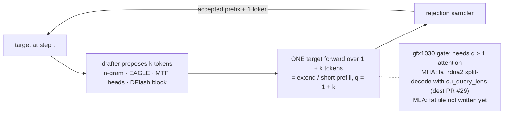

# Speculative decoding

Date: 2026-08-17. Sourced only.

## Verdict on gfx1030

Later. Verify is **extend / short-prefill** (q = k+1 or tree nodes), not q=1 decode. AITER `paged_attention_v1` does not support `query_len > 1`.[^vllm-issue31625] No sourced gfx1030/gfx1100 specdec in vLLM/SGLang.

Wrong tool when already compute-bound or high batch (published EAGLE <1× at bs=24–56) *(unsourced)*, tiny target, low accept rate, or no spare FLOPs.

Live `fa_rdna2` sparse MLA is q=`[B,H,D]` only. Mix/spec **off** until a fat tile exists. Short Br=32 is the verify-shaped path once occupancy is clean. See [attention-dispatch.md](../attention/attention-dispatch.md).

Per-method engine specs (not sdot4; no new DOT):

| Method | Page | gfx1030 gate |
|---|---|---|
| MTP | [mtp.md](mtp.md) | fat tile (`q>1`) |
| DFlash | [dflash.md](dflash.md) | same |
| DSpark | [dspark.md](dspark.md) | same |

## Diagram — draft / verify loop and the gfx1030 gate

Draft/verify and rejection sampling from Leviathan et al.[^leviathan] and the vLLM spec-decode docs[^vllm-specdec]; the MHA verify path is dest PR #29[^dest-pr29].

## Families

Draft-model, n-gram/suffix, Medusa, EAGLE/EAGLE-3, MTP (DeepSeek D=1), DFlash, DSpark (DFlash backbone + Markov + confidence). Tree vs chain: tree raises tokens verified, not batch size. SpecDecode-Bench: wide trees <1× at bs=64.[^specdecode-bench]

## vLLM V1

`--speculative-config` JSON. Methods: ngram, eagle/eagle3, mtp, draft_model, medusa, suffix, dflash, dspark. Scheduler: `num_tokens_with_spec` includes `spec_token_ids`; `allocate_slots` lookahead. One target forward over drafts; Triton RejectionSampler. Graphs: uniform decode with `max_query_len = 1+k`.

## SGLang

EAGLE/EAGLE3/MTP/DFLASH/STANDALONE/NGRAM. Default `speculative-attention-mode = prefill` (verify on extend kernel). NGRAM is CUDA-only. Overlap scheduler requires topk=1.

## ROCm

VLLM PR #21496 enabled V1 specdec on ROCm (Instinct).[^vllm-pr21496] AITER FA q=1 kernel wrong under specdec (#31625). AMD blog 2.31× is MI300X draft-model. *(unsourced)* SGLang EAGLE/MTP on HIP via aiter; EAGLE-3+aiter broken for non-MLA.

## Sources

- Philip Kiely, *Inference Engineering* (Baseten Books, 2026) — <https://www.baseten.co/inference-engineering/> (Kiely addendum)
- [Leviathan](https://arxiv.org/abs/2211.17192)
- [EAGLE-3](https://arxiv.org/abs/2503.01840)
- [SpecDecode-Bench](https://arxiv.org/abs/2601.11580)
- [vLLM specdec](https://docs.vllm.ai/en/latest/features/speculative_decoding/)
- [SGLang specdec](https://docs.sglang.io/docs/advanced_features/speculative_decoding)
- [AITER q>1](https://github.com/vllm-project/vllm/issues/31625)
- [DSpark](https://arxiv.org/html/2607.05147v1)

[^vllm-issue31625]: vLLM issue #31625 — AITER q=1 kernel wrong under spec decode — <https://github.com/vllm-project/vllm/issues/31625>
[^leviathan]: Leviathan et al., *Fast Inference from Transformers via Speculative Decoding* — <https://arxiv.org/abs/2211.17192>
[^vllm-specdec]: vLLM docs, Speculative Decoding — <https://docs.vllm.ai/en/latest/features/speculative_decoding/>
[^dest-pr29]: dest PR #29 — FA-RDNA2 decode kernel for spec-decode verify and mixed batches — <https://github.com/opengfx1030/vllm-rdna/pull/29>
[^specdecode-bench]: SpecDecode-Bench — <https://arxiv.org/abs/2601.11580>
[^vllm-pr21496]: vLLM PR #21496 — V1 spec decode on ROCm — <https://github.com/vllm-project/vllm/pull/21496>

## Kiely addendum (Jan 2026)

Verify is ITL / perceived TPS only, not TTFT. Draft should be ≳10× smaller (params), same family/tokenizer. Accept falls with depth and with high temperature. Disable when the batch is already compute-bound. N-gram / lookahead wins when output ≈ input (code). EAGLE is the general trained-head default in the book.

Verdict stays **later**. Need a q>1 / short-extend kernel first.
