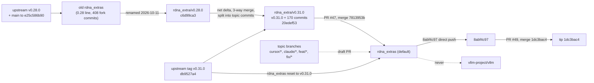

# Fork branches

[← fork/](README.md)

## Dest: `rdna_extras`

- `rdna_extras` on `opengfx1030/vllm-rdna` is the dest branch and the repo's default branch[^repo].
- Since 2026-10-11 it is the **v0.31 RDNA line**. PR #47 first reset `rdna_extras` to upstream `v0.31.0` (`db9527a4`), then merged `rdna_extra/v0.31.0` on top. That branch is `v0.31.0` plus 170 topic commits[^pr47]. The merge commit is `7813953b`, parents `db9527a4` and `20edef53`[^m47]. `db9527a4` is the upstream `v0.31.0` tag[^v031].
- Tip **`1dc3bac4`** (2026-10-11 08:55 Europe/Paris) is the merge of PR #49, the INT4 PLE table read from `VLLM_PLE_QUANT_DIR`[^tip].
- Policy: on CUDA, CDNA, CPU and every other platform the branch behaves like upstream v0.31. Fork behavior in shared code runs only on ROCm RDNA, behind `on_rdna_family()` (see [dispatch.md](dispatch.md))[^gating].

## The 0.28 line: `rdna_extra/v0.28.0`

- The old `rdna_extras` (v0.28.0 + upstream main up to `e25c586b90` + 408 fork-only commits) was **renamed** to `rdna_extra/v0.28.0`. The open 0.28-era PRs moved with it[^pr47][^portnotes].
- Its head is `c6d99ca3`, which is what the v0.31 port carried over[^c6d][^portnotes]. `c6d99ca3` is **not** an ancestor of the new `rdna_extras`: the 0.28 history is kept on that branch, not in the new line's history (`git merge-base --is-ancestor`, 2026-10-11).
- Open PRs still target it: #10, #18, #23, #25, #31, #35, #37, #41, #42, #44, #48[^prs]. Treat it as the archive of the 0.28 line. Nothing in the repo marks it read-only (unsourced as a rule).

## Version-port branches

Branches are named `rdna_extra/vX.Y.Z` (no `s`) because git cannot hold both `refs/heads/rdna_extras` and `refs/heads/rdna_extras/v0.31.0`[^portnotes]. At the time of writing these exist[^repo]:

| Branch | Head | Role |
|---|---|---|
| `rdna_extra/v0.28.0` | `c6d99ca3` | 0.28 line (former `rdna_extras`) |
| `rdna_extra/v0.29.0` | `552cce86` | earlier version branch (role unsourced) |
| `rdna_extra/v0.30.0` | `12cc662b` | earlier version branch (role unsourced) |
| `rdna_extra/v0.31.0` | `20edef53` | the v0.31 port merged by #47 |

The roles of v0.29/v0.30 come only from the port notes ("like `rdna_extra/v0.29.0` and `rdna_extra/v0.30.0`")[^portnotes]. Whether they are dead is unsourced.

## Branch flow

## Rules

- **Never PR to `vllm-project/vllm`.** Dest extras live on opengfx1030[^qa]. Every fork PR on record targets a branch of `opengfx1030/vllm-rdna`[^prs].
- **Nobody pushes `rdna_extras` directly. Changes land through a PR** (house rule, unsourced in the repo). Nothing enforces it: `rdna_extras` has no branch protection and the repo has no rulesets (GitHub API, 2026-10-11)[^ghprot]. One direct push is on record after the port. `8abf4c97` "fix(rocm): moe_w4a8_rdna2 builds for every RDNA arch" sits between #47 and #49 on the first-parent history, and no PR is associated with it[^8abf]. If the rule is meant to hold, turn on branch protection.
- Stay on the upstream path off RDNA. Any fork change in shared code is RDNA-gated (see [dispatch.md](dispatch.md))[^gating].

## Sources

[^repo]: Repo, default branch and branch list: <https://github.com/opengfx1030/vllm-rdna>
[^tip]: Tip `1dc3bac4`: <https://github.com/opengfx1030/vllm-rdna/commit/1dc3bac4cda3201a1b4fb345e044578e84a272cf>
[^pr47]: PR #47 body, "Branch layout (2026-10-11)": <https://github.com/opengfx1030/vllm-rdna/pull/47>
[^m47]: Merge `7813953b`: <https://github.com/opengfx1030/vllm-rdna/commit/7813953b6f1c7c111ea9080bed08c21d1d703206>
[^v031]: Upstream release `v0.31.0` (tag → `db9527a4`): <https://github.com/vllm-project/vllm/releases/tag/v0.31.0>
[^portnotes]: Port notes at the pinned tip, header and "How the port was built": <https://github.com/opengfx1030/vllm-rdna/blob/1dc3bac4cda3201a1b4fb345e044578e84a272cf/docs/rdna2/v0.31.0-port-notes.md?plain=1#L1-L33>
[^gating]: Port notes, "RDNA gating": <https://github.com/opengfx1030/vllm-rdna/blob/1dc3bac4cda3201a1b4fb345e044578e84a272cf/docs/rdna2/v0.31.0-port-notes.md?plain=1#L83-L101>
[^c6d]: `c6d99ca3` "fix(rdna2): HC HIP stream correctness + MoE prefill tile", head of `rdna_extra/v0.28.0`: <https://github.com/opengfx1030/vllm-rdna/commit/c6d99ca30580f0ce6a97a168fa53bf9c6ee6b2af> · branch <https://github.com/opengfx1030/vllm-rdna/tree/rdna_extra/v0.28.0>
[^prs]: PR list (all states), with base branches: <https://github.com/opengfx1030/vllm-rdna/pulls?q=is%3Apr>
[^qa]: Maintainer QA skill `rdna-dest-review` §2, "Never PR to `vllm-project/vllm`": <https://github.com/BlivionIaG/vllm-rdna-qa/blob/7da8bd852eb35b511172a073eca05010a03d7eb1/skills/rdna-dest-review/SKILL.md#L35-L36>
[^ghprot]: `GET /repos/opengfx1030/vllm-rdna/branches/rdna_extras` → `"protected": false`; `/rulesets` → `[]`. GitHub docs on protected branches: <https://docs.github.com/en/repositories/configuring-branches-and-merges-in-your-repository/managing-protected-branches/about-protected-branches>
[^8abf]: `8abf4c97`, no associated PR (`GET /commits/8abf4c97/pulls` → empty): <https://github.com/opengfx1030/vllm-rdna/commit/8abf4c9719d588349b6ed5afc75e9d0133a43984>
