# Fork branches

[← fork/](README.md)

## Dest: `rdna_extras` (current)

- `rdna_extras` on `opengfx1030/vllm-rdna` is the dest branch and the repo's default branch[^repo].
- Tip **`ea8aa241`** is the merge of PR #211, TP=1 MoE expert offloading and a unified 16/32 GiB recipe for Inkling-2-Mini (merged 2026-11-25 08:24 Europe/Paris)[^tip211].
- The line is now based on **vLLM v0.34.0**. Merge `2bf77978` (2026-11-18) has parents `1e1cac53` (the previous fork tip) and `62d4bc3c`, which is the upstream `v0.34.0` tag[^m034][^v034]. `ea8aa241` is 131 commits ahead of `2bf77978` and 0 behind (GitHub compare, 2026-11-25).
- Prefix caching: `serve_rdna.sh` defaults `ENABLE_PREFIX_CACHING=1` and passes `--enable-prefix-caching` only when a recipe lists the `prefix-caching` feature[^apc]. The Inkling-2-Mini recipes list it (`FEATURES="prefix-caching prompt-tokens-details"`)[^apcrecipe]. That it stays off for other recipes under a global lock is per VLLM_FORK_Manager, 2026-11-25 (unsourced in the repo).
- Pins held by VLLM_FORK_Manager as of 2026-11-25 (unsourced in the repo; Linear is the live board): W4A16 ISA lock `f263172a`, EXL3 produce `mul1`, occupancy pin closed, live ROCm 7.14.
- Bots never edit `rdna_extras` or `rdna2_extras`; bot patches go only on `perf/rdna2_w4a16_bot`; no upstream PRs (per VLLM_FORK_Manager, unsourced as a rule). `perf/rdna2_w4a16_bot` does not exist on `opengfx1030/vllm-rdna` (GitHub API 404, 2026-11-25). Still nothing enforces the PR rule: `rdna_extras` has `"protected": false` and the repo has no rulesets (GitHub API, 2026-11-25)[^ghprot].
- `rdna_extras_wip_20260910` (head `7e37923f`) also exists on the repo; its role is unsourced[^repo].

## History: the v0.31 line (2026-10, historical)

Everything in this section describes the branch as of 2026-10-12 and is kept as history.

- From 2026-10-11 it is the **v0.31 RDNA line**. PR #47 first reset `rdna_extras` to upstream `v0.31.0` (`db9527a4`), then merged `rdna_extra/v0.31.0` on top. That branch is `v0.31.0` plus 170 topic commits[^pr47]. The merge commit is `7813953b`, parents `db9527a4` and `20edef53`[^m47]. `db9527a4` is the upstream `v0.31.0` tag[^v031].
- Tip **`64d59b89`** (2026-10-12 00:44 Europe/Paris) is the merge of PR #84: the native RDNA2 MoE path declines asymmetric compressed-tensors checkpoints and falls back to the generic WNA16 MoE method[^tip][^pr84].
- Previous tip `fbe84e94` (2026-10-11 14:05 Europe/Paris) is the merge of PR #52, the INT4 PLE table served from disk through the CPU sidecar. The launcher knob is `PLE=bf16|int4|int4-disk`; `int4-disk` exports `VLLM_PLE_QUANT_DIR` and `VLLM_PLE_CPU_OFFLOAD=1`[^tip][^pr52][^plelaunch]. #52 changed only Python, `tools/` and tests (no `csrc/`, no `CMakeLists.txt`)[^pr52].
- Tip history since the port (first-parent, `git log --first-parent 7813953b..64d59b89`):
  - `7813953b`: PR #47, v0.31.0 port[^m47].
  - `8abf4c97`: direct push, no PR (see [Rules](#rules))[^8abf].
  - `1dc3bac4` (2026-10-11 08:55 Europe/Paris): PR #49, INT4 PLE table read from `VLLM_PLE_QUANT_DIR`[^tip49].
  - `fbe84e94` (2026-10-11 14:05 Europe/Paris): PR #52, `PLE=int4-disk`[^tipprev][^pr52].
  - `69a166dc` (2026-10-11 17:46): PR #79, `docs/rdna2/tuning.md` tuning guide plus doc and comment edits: `AGENTS.md`, the PLE comment in the three `flashnext*.env` recipes, and the `tunableop/README.md` row count (783 → 1601) (`git diff --stat fbe84e94 69a166dc`)[^pr79].
  - `efe9cf5d` (2026-10-11 23:19): PR #65, W4A8 MoE prefill opt-in (`VLLM_RDNA2_W4A8_SDOT4=1`, MoE GEMMs with ≥ 512 tokens); touches `csrc/rocm/moe_w4a8_rdna2.cu`[^pr65].
  - `c057ee54` (2026-10-11 23:19): PR #81, TunableOp rows for 8192-token prefill chunks, 1601 → 1766 rows per rank[^pr81].
  - `6956c105` (2026-10-12 00:22): PR #83, `P2P=0` launcher knob and `LD_LIBRARY_PATH` fix[^pr83].
  - `64d59b89` (2026-10-12 00:44): PR #84, native MoE declines asymmetric checkpoints[^tip][^pr84].
- Policy at the time: on CUDA, CDNA, CPU and every other platform the branch behaved like upstream v0.31. Fork behavior in shared code runs only on ROCm RDNA, behind `on_rdna_family()` (see [dispatch.md](dispatch.md))[^gating].

## The 0.28 line: `rdna_extra/v0.28.0`

- The old `rdna_extras` (v0.28.0 + upstream main up to `e25c586b90` + 408 fork-only commits) was **renamed** to `rdna_extra/v0.28.0`. The open 0.28-era PRs moved with it[^pr47][^portnotes].
- Its head is `c6d99ca3`, which is what the v0.31 port carried over[^c6d][^portnotes]. `c6d99ca3` is **not** an ancestor of the new `rdna_extras`: the 0.28 history is kept on that branch, not in the new line's history (`git merge-base --is-ancestor`, 2026-10-11).
- Open PRs still target it: #10, #18, #23, #25, #31, #35, #37, #41, #42, #44, #48[^prs]. Treat it as the archive of the 0.28 line. Nothing in the repo marks it read-only (unsourced as a rule).

## Version-port branches

Branches are named `rdna_extra/vX.Y.Z` (no `s`) because git cannot hold both `refs/heads/rdna_extras` and `refs/heads/rdna_extras/v0.31.0`[^portnotes]. At the time of writing these exist[^repo]:

| Branch | Head | Role |
|---|---|---|
| `rdna_extra/v0.28.0` | `c6d99ca3` | 0.28 line (former `rdna_extras`) |
| `rdna_extra/v0.29.0` | `552cce86` | earlier version branch (role unsourced) |
| `rdna_extra/v0.30.0` | `12cc662b` | earlier version branch (role unsourced) |
| `rdna_extra/v0.31.0` | `20edef53` | the v0.31 port merged by #47 |

All four heads are unchanged as of 2026-11-25 (GitHub API). No `rdna_extra/v0.34.0` branch exists; v0.34.0 was merged straight into `rdna_extras` by `2bf77978`[^m034].

The roles of v0.29/v0.30 come only from the port notes ("like `rdna_extra/v0.29.0` and `rdna_extra/v0.30.0`")[^portnotes]. Whether they are dead is unsourced.

## Branch flow

```mermaid
flowchart LR
  up28["upstream v0.28.0<br/>+ main to e25c586b90"] --> old["old rdna_extras<br/>(0.28 line, 408 fork commits)"]
  old -->|renamed 2026-10-11| r28["rdna_extra/v0.28.0<br/>c6d99ca3"]
  r28 -->|net delta, 3-way merge,<br/>split into topic commits| r31["rdna_extra/v0.31.0<br/>v0.31.0 + 170 commits<br/>20edef53"]
  up31["upstream tag v0.31.0<br/>db9527a4"] --> r31
  up31 -->|rdna_extras reset to v0.31.0| dest["rdna_extras (default)"]
  r31 -->|PR #47, merge 7813953b| dest
  dest -->|8abf4c97 direct push| d2["8abf4c97"]
  d2 -->|PR #49, merge 1dc3bac4| d3["1dc3bac4"]
  d3 -->|PR #52, merge fbe84e94| d4["fbe84e94<br/>PLE=int4-disk"]
  d4 -->|"#79, #65, #81, #83"| d5["6956c105"]
  d5 -->|PR #84, merge 64d59b89| d6["64d59b89"]
  d6 -.->|"… 1e1cac53"| d7["1e1cac53"]
  up34["upstream tag v0.34.0<br/>62d4bc3c"] --> m34["merge 2bf77978"]
  d7 --> m34
  m34 -->|"131 commits, … PR #211"| tip["tip ea8aa241"]
  topic["topic branches<br/>cursor/*, claude/*, feat/*, fix/*"] -.->|draft PR| dest
  dest -. never .-> vllm["vllm-project/vllm"]
```

## Rules

- **Never PR to `vllm-project/vllm`.** Dest extras live on opengfx1030[^qa]. Every fork PR on record targets a branch of `opengfx1030/vllm-rdna`[^prs].
- **Nobody pushes `rdna_extras` directly. Changes land through a PR** (house rule, unsourced in the repo). Nothing enforces it: `rdna_extras` has no branch protection and the repo has no rulesets (GitHub API, 2026-10-11)[^ghprot]. One direct push is on record after the port. `8abf4c97` "fix(rocm): moe_w4a8_rdna2 builds for every RDNA arch" sits between #47 and #49 on the first-parent history, and no PR is associated with it[^8abf]. If the rule is meant to hold, turn on branch protection.
- Stay on the upstream path off RDNA. Any fork change in shared code is RDNA-gated (see [dispatch.md](dispatch.md))[^gating].

## Sources

[^tip211]: Tip `ea8aa2418e6373de1537fa56e4ae0911ef6162a6`, "Merge pull request #211 from opengfx1030/feat/inkling2-tp1-moe-offload": <https://github.com/opengfx1030/vllm-rdna/commit/ea8aa2418e6373de1537fa56e4ae0911ef6162a6> · PR <https://github.com/opengfx1030/vllm-rdna/pull/211>
[^m034]: `2bf779784d938e2981c56405f2586c3623e20b7e` "Merge upstream vLLM v0.34.0 into RDNA integration branch": <https://github.com/opengfx1030/vllm-rdna/commit/2bf779784d938e2981c56405f2586c3623e20b7e>
[^v034]: Upstream `v0.34.0` (tag → `62d4bc3c7e33b1b6c906e233e6af2d3506c482ca`): <https://github.com/vllm-project/vllm/releases/tag/v0.34.0>
[^apc]: `serve_rdna.sh` default and `prefix-caching` feature case: <https://github.com/opengfx1030/vllm-rdna/blob/ea8aa2418e6373de1537fa56e4ae0911ef6162a6/tools/rdna/serve_rdna.sh#L219> · <https://github.com/opengfx1030/vllm-rdna/blob/ea8aa2418e6373de1537fa56e4ae0911ef6162a6/tools/rdna/serve_rdna.sh#L450-L458>
[^apcrecipe]: Inkling-2-Mini TP=2 recipe, `FEATURES`: <https://github.com/opengfx1030/vllm-rdna/blob/ea8aa2418e6373de1537fa56e4ae0911ef6162a6/tools/rdna/recipes/inkling2-mini-tp2.env#L30>
[^repo]: Repo, default branch and branch list: <https://github.com/opengfx1030/vllm-rdna>
[^tip]: Tip `64d59b89`, "Merge fix/rdna2-moe-asymmetric: native MoE path declines asymmetric checkpoints (#84)": <https://github.com/opengfx1030/vllm-rdna/commit/64d59b8942d3b982f1d91f0f3e625dfda4418106>
[^pr79]: PR #79 "docs(rdna): tuning guide for fork knobs, modes and TunableOp", merge `69a166dc`: <https://github.com/opengfx1030/vllm-rdna/pull/79>
[^pr65]: PR #65 "perf(rdna2): W4A8 MoE prefill on Flash-Next (opt-in)", merge `efe9cf5d`: <https://github.com/opengfx1030/vllm-rdna/pull/65>
[^pr81]: PR #81 "tunableop: rows for 8192-token prefill chunks" ("1601 → 1766 rows per rank"), merge `c057ee54`: <https://github.com/opengfx1030/vllm-rdna/pull/81>
[^pr83]: PR #83 "tools(rdna): P2P=0 launcher knob + LD_LIBRARY_PATH fix", merge `6956c105`: <https://github.com/opengfx1030/vllm-rdna/pull/83>
[^pr84]: PR #84 "fix(rdna2): native MoE path declines asymmetric checkpoints", `rocm_moe_rdna.is_supported` returns False when `weight_quant.symmetric` is false: <https://github.com/opengfx1030/vllm-rdna/pull/84> · <https://github.com/opengfx1030/vllm-rdna/blob/64d59b8942d3b982f1d91f0f3e625dfda4418106/vllm/model_executor/layers/quantization/compressed_tensors/compressed_tensors_moe/rocm_moe_rdna.py#L20-L31>
[^tipprev]: Previous tip `fbe84e94`, "Merge feat/ple-int4-disk: INT4 PLE table from disk via the CPU sidecar (#52)": <https://github.com/opengfx1030/vllm-rdna/commit/fbe84e9411abcd229bd836deffe23f92176b978e>
[^tip49]: Previous tip `1dc3bac4`, merge of PR #49: <https://github.com/opengfx1030/vllm-rdna/commit/1dc3bac4cda3201a1b4fb345e044578e84a272cf>
[^pr52]: PR #52 "[RDNA2] INT4 PLE table from disk via the CPU sidecar (PLE=int4-disk)"; file list matches `git diff --stat 1dc3bac4 fbe84e94` (8 files: tests, `tools/rdna/`, `vllm/` Python): <https://github.com/opengfx1030/vllm-rdna/pull/52>
[^plelaunch]: `serve_rdna.sh` `PLE` default and `case $PLE`: <https://github.com/opengfx1030/vllm-rdna/blob/64d59b8942d3b982f1d91f0f3e625dfda4418106/tools/rdna/serve_rdna.sh#L146-L161> and <https://github.com/opengfx1030/vllm-rdna/blob/64d59b8942d3b982f1d91f0f3e625dfda4418106/tools/rdna/serve_rdna.sh#L185-L202>
[^pr47]: PR #47 body, "Branch layout (2026-10-11)": <https://github.com/opengfx1030/vllm-rdna/pull/47>
[^m47]: Merge `7813953b`: <https://github.com/opengfx1030/vllm-rdna/commit/7813953b6f1c7c111ea9080bed08c21d1d703206>
[^v031]: Upstream release `v0.31.0` (tag → `db9527a4`): <https://github.com/vllm-project/vllm/releases/tag/v0.31.0>
[^portnotes]: Port notes at the pinned tip, header and "How the port was built": <https://github.com/opengfx1030/vllm-rdna/blob/64d59b8942d3b982f1d91f0f3e625dfda4418106/docs/rdna2/v0.31.0-port-notes.md?plain=1#L1-L33>
[^gating]: Port notes, "RDNA gating": <https://github.com/opengfx1030/vllm-rdna/blob/64d59b8942d3b982f1d91f0f3e625dfda4418106/docs/rdna2/v0.31.0-port-notes.md?plain=1#L83-L101>
[^c6d]: `c6d99ca3` "fix(rdna2): HC HIP stream correctness + MoE prefill tile", head of `rdna_extra/v0.28.0`: <https://github.com/opengfx1030/vllm-rdna/commit/c6d99ca30580f0ce6a97a168fa53bf9c6ee6b2af> · branch <https://github.com/opengfx1030/vllm-rdna/tree/rdna_extra/v0.28.0>
[^prs]: PR list (all states), with base branches: <https://github.com/opengfx1030/vllm-rdna/pulls?q=is%3Apr>
[^qa]: Maintainer QA skill `rdna-dest-review` §2, "Never PR to `vllm-project/vllm`": <https://github.com/BlivionIaG/vllm-rdna-qa/blob/7da8bd852eb35b511172a073eca05010a03d7eb1/skills/rdna-dest-review/SKILL.md#L35-L36>
[^ghprot]: `GET /repos/opengfx1030/vllm-rdna/branches/rdna_extras` → `"protected": false`; `/rulesets` → `[]`. GitHub docs on protected branches: <https://docs.github.com/en/repositories/configuring-branches-and-merges-in-your-repository/managing-protected-branches/about-protected-branches>
[^8abf]: `8abf4c97`, no associated PR (`GET /commits/8abf4c97/pulls` → empty): <https://github.com/opengfx1030/vllm-rdna/commit/8abf4c9719d588349b6ed5afc75e9d0133a43984>
