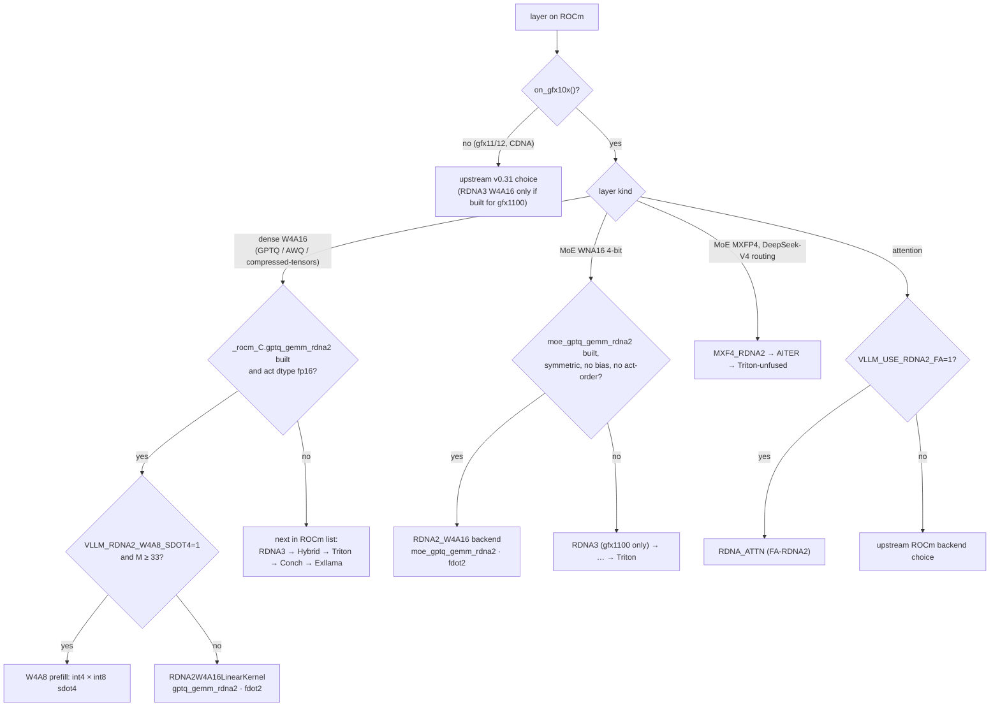

# Kernel dispatch on gfx1030

[← fork/](README.md)

How a gfx1030 layer ends up on a given kernel in `rdna_extras` at `1dc3bac4`. It has two halves: **runtime gates** in Python, which pick the kernel class, and **compile-time macros** in HIP, which decide whether the device code exists at all for gfx1030. Kernel formats live in [kernels/](../kernels/README.md); attention backend choice in depth is in [engine/attention-dispatch.md](../engine/attention/attention-dispatch.md).

## Runtime gates

| Function | True on | Where |
|---|---|---|
| `on_rdna_family()` | ROCm and (`on_gfx10x()` or `on_rdna()`) = RDNA2 + RDNA3/4. Never imports `vllm.platforms.rocm` off ROCm, memoized | `vllm/platforms/rdna.py`[^rdna] |
| `on_rdna2()` | ROCm and `on_gfx10x()` | `vllm/platforms/rdna.py`[^rdna] |
| `on_gfx10x()` | `"gfx10"` in the GCN arch | `vllm/platforms/rocm.py`[^gfx10x] |
| `on_rdna()` (upstream) | gfx11/gfx12, not CDNA. **Excludes gfx1030** | `vllm/platforms/rocm.py`[^onrdna] |

Policy: fork behavior in shared code runs only behind `on_rdna_family()`; gfx1030-only kernels (`causal_conv1d_*_rdna2`, GDN HIP prefill) use `on_rdna2()`. Where upstream already makes an RDNA3/4 decision, gfx11/12 keep upstream and the fork change applies to gfx10x only. The EXL3 fp16 cast had used upstream `on_rdna()` and so never fired on gfx1030; it now uses `on_rdna_family()`[^gating].

## Decision tree

Sources for the tree: [^linprio][^w4can][^w4a8][^moeprio][^moeincompat][^mxfp4][^fa].

### Dense W4A16

- ROCm candidates in priority order: `RDNA2W4A16LinearKernel` → `RDNA3W4A16LinearKernel` → `RDNAHybridW4A16LinearKernel` → Triton → Conch → Exllama. "gfx1030 auto must keep RDNA2 ahead of Hybrid"; `--linear-backend rdna_hybrid` forces Hybrid[^linprio].
- `RDNA2W4A16LinearKernel.can_implement` needs ROCm, `on_gfx10x()`, the `_rocm_C.gptq_gemm_rdna2` op in the build, and fp16 activations[^w4can].
- Inner op: explicit `__builtin_amdgcn_fdot2`, because hipcc does not lower `hfma2`+cast+add to `v_dot2` on gfx1030[^fdot2].
- Opt-in W4A8: `VLLM_RDNA2_W4A8_SDOT4=1` sends prefill GEMMs with M ≥ 33 to int8-activation `sdot4`. Decode stays W4A16[^w4a8] (lock: [serve-locks.md](serve-locks.md)).

### MoE

- WNA16 oracle: on ROCm with `on_gfx10x()` and `_rocm_C.moe_gptq_gemm_rdna2` built, `RDNA2_W4A16` goes **first**, then `RDNA3` (device-gated to gfx1100), FlashInfer-TRTLLM, Marlin, Batched-Marlin, Triton, Humming, Emulation[^moeprio].
- `RDNA2_W4A16` is rejected for asymmetric (zero-point) checkpoints, expert bias, non-4-bit weights, and GPTQ `desc_act`[^moeincompat].
- Compressed-tensors MoE on gfx10x goes through `rocm_moe_rdna.make_method`: 4-bit → `CompressedTensorsWNA16RDNA2MoEMethod` (`moe_gptq_gemm_rdna2`); 8-bit → W8A16 RDNA2 when `moe_w8a16_gemm_rdna2` is built[^ctmoe].
- `moe_q_gemm_rdna2.cu`: fp16 uses `v_dot2_f32_f16` (`__builtin_amdgcn_fdot2`); there is no bf16 dot on gfx1030[^moefdot2][^moebf16].
- MXFP4 MoE with DeepSeek-V4 routing on ROCm: `MXF4_RDNA2` → `AITER_MXFP4_BF16` → `TRITON_UNFUSED`[^mxfp4].

### Attention

- On gfx10x, `VLLM_USE_RDNA2_FA=1` adds `RDNA_ATTN` to the backend list and pins the attention backend to `RDNA_ATTN` (FA-RDNA2)[^fa]. Default off[^faenv].

## Compile-time arch macros

| Macro | Defined when | Effect on gfx1030 |
|---|---|---|
| `__HIP__RDNA3__` | `__HIPCC__ && __gfx1100__` in `q_gemm_rdna3.cu`, `q_gemm_rdna3_wmma.cu` (`v_wmma_f32_16x16x16_*`) and `moe_q_gemm_rdna3.cu` | RDNA3 W4A16 / WMMA device code is **not** compiled for gfx1030[^rdna3][^wmma] |
| `__HIP__GFX1X__` (fork, `skinny_gemms_int4.cu`) | `__GFX10__ \|\| __GFX11__ \|\| __GFX12__` | `wvSplitK_int4*` device code **is** built for gfx1030 in the fork[^gfx1xfork] |
| `__HIP__GFX1X__` (`skinny_gemms.cu`) | `__GFX11__ \|\| __GFX12__` | Not defined for gfx1030 at the tip[^skinny] |
| `VLLM_ROCM_GFX1030` / `VLLM_ROCM_GFX1100` | CMake, when the arch list contains that target | Host-side op registration per target[^cmake] |

## Stock vLLM gates (v0.31.0)

Moved from the old `fork/README.md` "Gates (stock vLLM)" and re-checked against upstream tag **`v0.31.0` = `db9527a4`**. This is what an unmodified v0.31 does on gfx1030, and why the fork exists.

- `on_gfx1x()` = gfx11/gfx12, not gfx1030[^upgfx1x]. Upstream v0.31 has no `on_gfx10x()`. vLLM PR #52391 adds it (`_ON_GFX10X`, `on_gfx10x()`) and is **still open**[^pr52391]. The fork carries its own `on_gfx10x()`[^gfx10x].
- HIP W4A16 dense and MoE GPTQ ops for RDNA (`gptq_gemm_rdna3`, `gptq_gemm_rdna3_wmma`, `moe_gptq_gemm_rdna3`) register only under `#ifdef VLLM_ROCM_GFX1100`[^upbind][^upcmake]. The old page also listed mxfp4 under this ifdef; that could not be verified at `v0.31.0` and is dropped here.
- `wvSplitK_int4_g` device code sits behind `__HIP__GFX1X__` = gfx11/gfx12. On gfx1030 the kernel body is an `UNREACHABLE_CODE` stub[^upskinny]. The fork widens the macro to `__GFX10__`[^gfx1xfork].
- `supports_fp8()` = `on_cdna() or on_rdna4()` and `supports_mx()` = gfx95/gfx1250, so both are false on gfx1030[^upfp8].
- Custom all-reduce: `use_custom_allreduce()` is gfx94/gfx95 only[^upcar]. The fork adds the `VLLM_FORCE_CUSTOM_ALL_REDUCE` escape hatch and its own `rdna_ar` ([serve-locks.md](serve-locks.md))[^forkcar].

## Sources

[^rdna]: `vllm/platforms/rdna.py`: <https://github.com/opengfx1030/vllm-rdna/blob/1dc3bac4cda3201a1b4fb345e044578e84a272cf/vllm/platforms/rdna.py#L13-L44>
[^gfx10x]: Fork `_ON_GFX10X` / `on_gfx10x()`: <https://github.com/opengfx1030/vllm-rdna/blob/1dc3bac4cda3201a1b4fb345e044578e84a272cf/vllm/platforms/rocm.py#L228-L229> and <https://github.com/opengfx1030/vllm-rdna/blob/1dc3bac4cda3201a1b4fb345e044578e84a272cf/vllm/platforms/rocm.py#L340-L345>
[^onrdna]: `_ON_RDNA = _ON_GFX1X and not _ON_CDNA`, `on_rdna()`: <https://github.com/opengfx1030/vllm-rdna/blob/1dc3bac4cda3201a1b4fb345e044578e84a272cf/vllm/platforms/rocm.py#L242> and <https://github.com/opengfx1030/vllm-rdna/blob/1dc3bac4cda3201a1b4fb345e044578e84a272cf/vllm/platforms/rocm.py#L396-L397>
[^gating]: Port notes "RDNA gating": <https://github.com/opengfx1030/vllm-rdna/blob/1dc3bac4cda3201a1b4fb345e044578e84a272cf/docs/rdna2/v0.31.0-port-notes.md?plain=1#L83-L101>
[^linprio]: ROCm `_POSSIBLE_KERNELS`: <https://github.com/opengfx1030/vllm-rdna/blob/1dc3bac4cda3201a1b4fb345e044578e84a272cf/vllm/model_executor/kernels/linear/__init__.py#L525-L534>
[^w4can]: `RDNA2W4A16LinearKernel.can_implement`: <https://github.com/opengfx1030/vllm-rdna/blob/1dc3bac4cda3201a1b4fb345e044578e84a272cf/vllm/model_executor/kernels/linear/mixed_precision/rdna2_w4a16.py#L243-L263>
[^w4a8]: W4A8 gate (`VLLM_RDNA2_W4A8_SDOT4`, `W4A8_MIN_ROWS = 33`): <https://github.com/opengfx1030/vllm-rdna/blob/1dc3bac4cda3201a1b4fb345e044578e84a272cf/vllm/model_executor/kernels/linear/mixed_precision/rdna2_w4a16.py#L39-L49> and <https://github.com/opengfx1030/vllm-rdna/blob/1dc3bac4cda3201a1b4fb345e044578e84a272cf/vllm/model_executor/kernels/linear/mixed_precision/rdna2_w4a16.py#L97-L104>
[^fdot2]: <https://github.com/opengfx1030/vllm-rdna/blob/1dc3bac4cda3201a1b4fb345e044578e84a272cf/csrc/rocm/q_gemm_rdna2_common.cuh#L37-L45>
[^moeprio]: WNA16 `_get_priority_backends`: <https://github.com/opengfx1030/vllm-rdna/blob/1dc3bac4cda3201a1b4fb345e044578e84a272cf/vllm/model_executor/layers/fused_moe/oracle/int_wna16.py#L132-L162>
[^moeincompat]: `_backend_incompatibility_reason` for `RDNA2_W4A16`: <https://github.com/opengfx1030/vllm-rdna/blob/1dc3bac4cda3201a1b4fb345e044578e84a272cf/vllm/model_executor/layers/fused_moe/oracle/int_wna16.py#L176-L187>
[^ctmoe]: `rocm_moe_rdna.is_supported` / `make_method`: <https://github.com/opengfx1030/vllm-rdna/blob/1dc3bac4cda3201a1b4fb345e044578e84a272cf/vllm/model_executor/layers/quantization/compressed_tensors/compressed_tensors_moe/rocm_moe_rdna.py#L16-L39> and <https://github.com/opengfx1030/vllm-rdna/blob/1dc3bac4cda3201a1b4fb345e044578e84a272cf/vllm/model_executor/layers/quantization/compressed_tensors/compressed_tensors_moe/rocm_moe_rdna.py#L95-L110>
[^moefdot2]: <https://github.com/opengfx1030/vllm-rdna/blob/1dc3bac4cda3201a1b4fb345e044578e84a272cf/csrc/rocm/moe_q_gemm_rdna2.cu#L28>
[^moebf16]: <https://github.com/opengfx1030/vllm-rdna/blob/1dc3bac4cda3201a1b4fb345e044578e84a272cf/csrc/rocm/moe_q_gemm_rdna2.cu#L439-L445>
[^mxfp4]: MXFP4 oracle, DeepSeek-V4 priority: <https://github.com/opengfx1030/vllm-rdna/blob/1dc3bac4cda3201a1b4fb345e044578e84a272cf/vllm/model_executor/layers/fused_moe/oracle/mxfp4.py#L708-L718>
[^fa]: `RDNA_ATTN` selection: <https://github.com/opengfx1030/vllm-rdna/blob/1dc3bac4cda3201a1b4fb345e044578e84a272cf/vllm/platforms/rocm.py#L553-L554> and <https://github.com/opengfx1030/vllm-rdna/blob/1dc3bac4cda3201a1b4fb345e044578e84a272cf/vllm/platforms/rocm.py#L1134-L1148>
[^faenv]: `VLLM_USE_RDNA2_FA` default False: <https://github.com/opengfx1030/vllm-rdna/blob/1dc3bac4cda3201a1b4fb345e044578e84a272cf/vllm/envs.py#L1442-L1444>
[^rdna3]: `__HIP__RDNA3__`: <https://github.com/opengfx1030/vllm-rdna/blob/1dc3bac4cda3201a1b4fb345e044578e84a272cf/csrc/rocm/q_gemm_rdna3.cu#L47-L49>, <https://github.com/opengfx1030/vllm-rdna/blob/1dc3bac4cda3201a1b4fb345e044578e84a272cf/csrc/rocm/moe_q_gemm_rdna3.cu#L30-L32>
[^wmma]: `q_gemm_rdna3_wmma.cu` header (`v_wmma_f32_16x16x16_{f16,bf16}_w32`) and macro: <https://github.com/opengfx1030/vllm-rdna/blob/1dc3bac4cda3201a1b4fb345e044578e84a272cf/csrc/rocm/q_gemm_rdna3_wmma.cu#L16> and <https://github.com/opengfx1030/vllm-rdna/blob/1dc3bac4cda3201a1b4fb345e044578e84a272cf/csrc/rocm/q_gemm_rdna3_wmma.cu#L47-L49>
[^gfx1xfork]: Fork `skinny_gemms_int4.cu`: <https://github.com/opengfx1030/vllm-rdna/blob/1dc3bac4cda3201a1b4fb345e044578e84a272cf/csrc/rocm/skinny_gemms_int4.cu#L14-L19>
[^skinny]: Fork `skinny_gemms.cu`: <https://github.com/opengfx1030/vllm-rdna/blob/1dc3bac4cda3201a1b4fb345e044578e84a272cf/csrc/rocm/skinny_gemms.cu#L36-L39>
[^cmake]: Fork `CMakeLists.txt`: <https://github.com/opengfx1030/vllm-rdna/blob/1dc3bac4cda3201a1b4fb345e044578e84a272cf/CMakeLists.txt#L1593-L1599>
[^upgfx1x]: v0.31.0 `_ON_GFX1X` / `on_gfx1x()`: <https://github.com/vllm-project/vllm/blob/db9527a46873454610df6dbedf79a36d6bf1a7f6/vllm/platforms/rocm.py#L212> and <https://github.com/vllm-project/vllm/blob/db9527a46873454610df6dbedf79a36d6bf1a7f6/vllm/platforms/rocm.py#L301-L302>
[^pr52391]: vllm-project/vllm#52391 "[Feature][ROCm] Enable gfx1030 (RDNA2) as a recognized RDNA arch", open as of 2026-10-11: <https://github.com/vllm-project/vllm/pull/52391>
[^upbind]: v0.31.0 `torch_bindings.cpp` `#ifdef VLLM_ROCM_GFX1100`: <https://github.com/vllm-project/vllm/blob/db9527a46873454610df6dbedf79a36d6bf1a7f6/csrc/rocm/torch_bindings.cpp#L56-L76>
[^upcmake]: v0.31.0 `CMakeLists.txt`: <https://github.com/vllm-project/vllm/blob/db9527a46873454610df6dbedf79a36d6bf1a7f6/CMakeLists.txt#L1515-L1541>
[^upskinny]: v0.31.0 `skinny_gemms_int4.cu` macro and stub: <https://github.com/vllm-project/vllm/blob/db9527a46873454610df6dbedf79a36d6bf1a7f6/csrc/rocm/skinny_gemms_int4.cu#L15-L18> and <https://github.com/vllm-project/vllm/blob/db9527a46873454610df6dbedf79a36d6bf1a7f6/csrc/rocm/skinny_gemms_int4.cu#L344-L356>
[^upfp8]: v0.31.0 `supports_mx` / `supports_fp8`: <https://github.com/vllm-project/vllm/blob/db9527a46873454610df6dbedf79a36d6bf1a7f6/vllm/platforms/rocm.py#L1076-L1082>
[^upcar]: v0.31.0 `use_custom_allreduce`: <https://github.com/vllm-project/vllm/blob/db9527a46873454610df6dbedf79a36d6bf1a7f6/vllm/platforms/rocm.py#L1096-L1099>
[^forkcar]: Fork `use_custom_allreduce`: <https://github.com/opengfx1030/vllm-rdna/blob/1dc3bac4cda3201a1b4fb345e044578e84a272cf/vllm/platforms/rocm.py#L1257-L1263>
