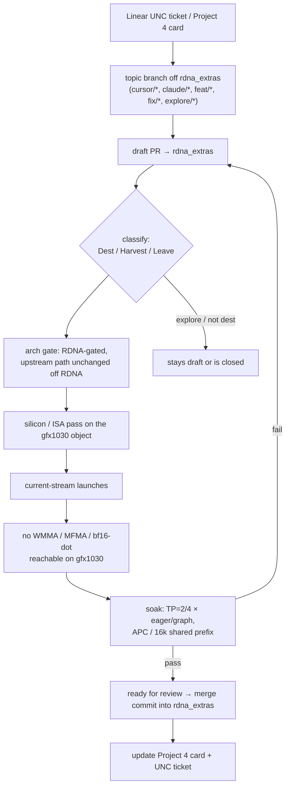

# PR lifecycle (fork)

[← fork/](README.md)

How a change reaches `rdna_extras` on `opengfx1030/vllm-rdna`. Branch rules are in [branches.md](branches.md).

## Flow

## 1. Draft PR

- Work starts on a topic branch and opens as a **draft PR** against `rdna_extras`. At the time of writing (2026-10-12) 35 open PRs on `rdna_extras` are drafts (#33 through #89, e.g. #40, #50, #51, #53); #80 and #85 are open and marked ready[^prs][^pr51].
- Explore PRs (`[explore] …`, e.g. #9 and #30) stay drafts and get closed without merging. They are not dest[^prs].
- Some PRs merged while still marked draft (#6, #7, #14, #28, #29)[^prs]. Mark the PR ready before merging (house rule, unsourced).

## 2. Review gates

| Gate | What the reviewer checks | Source |
|---|---|---|
| Classify | Dest (new HIP kernel/dispatcher/gate, full review), Harvest (re-import, spot-check the gate), Leave (env-gated A/B, confirm no regression on the active path) | [^qa1] |
| Arch gate | Fork behavior runs only on ROCm RDNA (`on_rdna_family()` / `on_rdna2()`, [dispatch.md](dispatch.md)); upstream behavior everywhere else. Gate dest kernels in the Python import side, the dispatch site, `torch_bindings.cpp` and `CMakeLists.txt` | [^gating][^qa2] |
| **Silicon / ISA pass** | Build for `--offload-arch=gfx1030` (one arch per `.so`). Check the object targets `amdgcn-amd-amdhsa--gfx1030`. Use explicit `__builtin_amdgcn_fdot2` / `__builtin_amdgcn_sdot4`, since hipcc does not peephole `__hfma2` into DOT. LDS ≤ 64 KiB per WG. Reject VGPR/SGPR spills | [^qasil1][^qasil4][^qasil9][^fdot2] · depth: [silicon/](../silicon/README.md) |
| **Current-stream launches** | Every HIP launch passes `at::cuda::getCurrentCUDAStream()`. A bare `<<<grid, block>>>` goes to the null stream on ROCm and does not order against torch's current stream; that is how `hc_rdna2` raced the forward pass | [^c6d][^hcstream] |
| **No WMMA / MFMA / bf16-dot on gfx1030** | gfx1030 has no WMMA or MFMA, and `fdot2.bf16` is gfx11+, so force fp16. Any RDNA3 WMMA kernel must compile only under `__gfx1100__` ([dispatch.md § compile-time](dispatch.md#compile-time-arch-macros)) | [^qasil2][^moebf16] |
| Soak | Coherent output, no NaN, no faults at TP=2/4 × eager/graph plus the APC / 16k shared-prefix cell. **tok/s is not a dest gate** | [^qa7] |

## 3. Merge into `rdna_extras`

- Accepted PRs land as a **merge commit** on `rdna_extras`, e.g. #47 → `7813953b`, #49 → `1dc3bac4` #52 → `fbe84e94` and #84 → `64d59b89` (current tip)[^pr47][^pr49][^pr52][^pr84].
- The PR body carries the validation evidence, as #47 does (gates passed per serving config, unit suite)[^pr47].
- Direct pushes skip this flow. See [branches.md § Rules](branches.md#rules) for the one on record (`8abf4c97`).

## Tracking

- **GitHub Project 4 "GFX1030 inference"**: <https://github.com/users/BlivionIaG/projects/4>. Private, so it 404s when signed out.[^p4]
- **Linear**: team **UNC** (UncoolRed Labs), project **V620 inference**: <https://linear.app/uncoolred/project/v620-inference-c347dcd6d967> (private workspace)[^lin]. PR titles reference tickets where they exist, e.g. #2 "(UNC-33..37, Later)"[^prs].
- Card and ticket status moves only when a gate actually passes. A tok/s number alone does not move it (house rule; "tok/s is not dest"[^qa7]).

## Sources

[^prs]: PR list with draft state, base branch and merge commit (`gh pr list --state all`, 2026-10-11): <https://github.com/opengfx1030/vllm-rdna/pulls?q=is%3Apr>
[^pr51]: Draft PR #51: <https://github.com/opengfx1030/vllm-rdna/pull/51>
[^pr47]: PR #47 (merge `7813953b`): <https://github.com/opengfx1030/vllm-rdna/pull/47>
[^pr49]: PR #49 (merge `1dc3bac4`): <https://github.com/opengfx1030/vllm-rdna/pull/49>
[^pr52]: PR #52 (merge `fbe84e94`, `PLE=int4-disk`): <https://github.com/opengfx1030/vllm-rdna/pull/52>
[^pr84]: PR #84 (merge `64d59b89`): <https://github.com/opengfx1030/vllm-rdna/pull/84>
[^gating]: Port notes "RDNA gating": <https://github.com/opengfx1030/vllm-rdna/blob/64d59b8942d3b982f1d91f0f3e625dfda4418106/docs/rdna2/v0.31.0-port-notes.md?plain=1#L83-L101>
[^qa1]: QA `rdna-dest-review` §1: <https://github.com/BlivionIaG/vllm-rdna-qa/blob/7da8bd852eb35b511172a073eca05010a03d7eb1/skills/rdna-dest-review/SKILL.md?plain=1#L13-L20>
[^qa2]: QA `rdna-dest-review` §2: <https://github.com/BlivionIaG/vllm-rdna-qa/blob/7da8bd852eb35b511172a073eca05010a03d7eb1/skills/rdna-dest-review/SKILL.md?plain=1#L21-L37>
[^qa7]: QA `rdna-dest-review` §7 "Soak matrix": <https://github.com/BlivionIaG/vllm-rdna-qa/blob/7da8bd852eb35b511172a073eca05010a03d7eb1/skills/rdna-dest-review/SKILL.md?plain=1#L85-L104>
[^qasil1]: QA `rdna-silicon-gate` §1: <https://github.com/BlivionIaG/vllm-rdna-qa/blob/7da8bd852eb35b511172a073eca05010a03d7eb1/skills/rdna-silicon-gate/SKILL.md?plain=1#L13-L26>
[^qasil2]: QA `rdna-silicon-gate` §2 "ISA on gfx1030": <https://github.com/BlivionIaG/vllm-rdna-qa/blob/7da8bd852eb35b511172a073eca05010a03d7eb1/skills/rdna-silicon-gate/SKILL.md?plain=1#L27-L49>
[^qasil4]: QA `rdna-silicon-gate` §4 "LDS budget": <https://github.com/BlivionIaG/vllm-rdna-qa/blob/7da8bd852eb35b511172a073eca05010a03d7eb1/skills/rdna-silicon-gate/SKILL.md?plain=1#L64-L71>
[^qasil9]: QA `rdna-silicon-gate` §9 "Reject VGPR / SGPR spills": <https://github.com/BlivionIaG/vllm-rdna-qa/blob/7da8bd852eb35b511172a073eca05010a03d7eb1/skills/rdna-silicon-gate/SKILL.md?plain=1#L119-L130>
[^fdot2]: `q_gemm_rdna2_common.cuh`, "hipcc does not lower the obvious hfma2+cast+add pattern to v_dot2 on gfx1030": <https://github.com/opengfx1030/vllm-rdna/blob/64d59b8942d3b982f1d91f0f3e625dfda4418106/csrc/rocm/q_gemm_rdna2_common.cuh#L37-L45>
[^c6d]: `c6d99ca3` "fix(rdna2): HC HIP stream correctness + MoE prefill tile" (commit body): <https://github.com/opengfx1030/vllm-rdna/commit/c6d99ca30580f0ce6a97a168fa53bf9c6ee6b2af>
[^hcstream]: Current-stream pattern at the tip, `hc_rdna2.cu`: <https://github.com/opengfx1030/vllm-rdna/blob/64d59b8942d3b982f1d91f0f3e625dfda4418106/csrc/rocm/hc_rdna2.cu#L165-L171>
[^moebf16]: `moe_q_gemm_rdna2.cu`, "gfx1030 has no v_dot2_f32_bf16 (RDNA3+)": <https://github.com/opengfx1030/vllm-rdna/blob/64d59b8942d3b982f1d91f0f3e625dfda4418106/csrc/rocm/moe_q_gemm_rdna2.cu#L439-L445>
[^p4]: `gh project view 4 --owner BlivionIaG` → title "GFX1030 inference", private: <https://github.com/users/BlivionIaG/projects/4>
[^lin]: Linear project "V620 inference", team UNC: <https://linear.app/uncoolred/project/v620-inference-c347dcd6d967>
