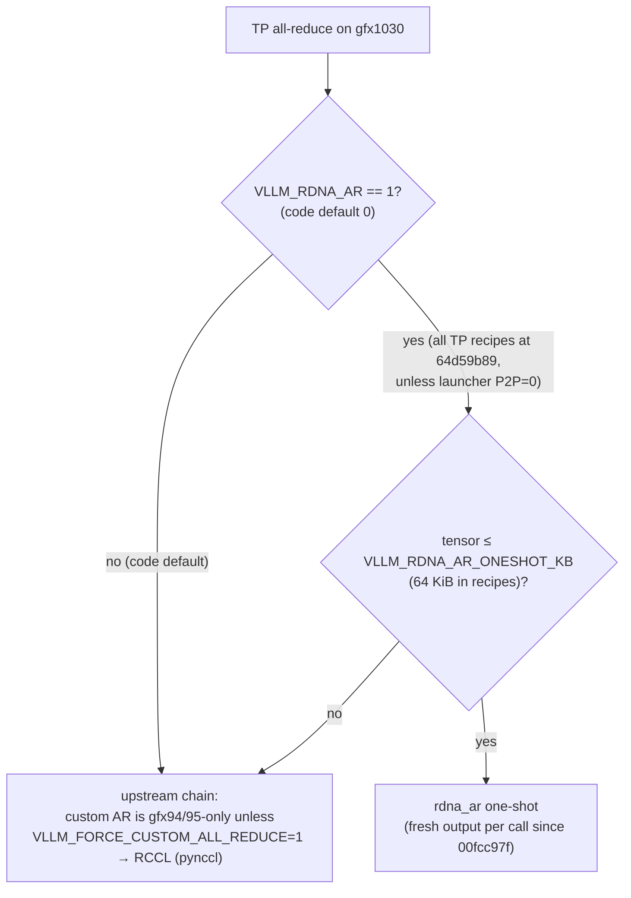

# Serve locks (gfx1030)

[← fork/](README.md)

A serve lock is a setting every gfx1030 serve keeps fixed until a dest PR moves it. This page only names the fork-side lock and its evidence at `64d59b89`. Depth lives elsewhere: the ROCm pin and compiler in [toolchain/](../toolchain/README.md), all-reduce and RCCL in [silicon/rdna-allreduce.md](../silicon/interconnect/rdna-allreduce.md) and [silicon/rccl-p2p.md](../silicon/interconnect/rccl-p2p.md), kernel formats in [kernels/](../kernels/README.md).

All serves go through one launcher, `bash tools/rdna/serve_rdna.sh RECIPE=<name>`, with per-model deltas in `tools/rdna/recipes/*.env`[^launcher].

> **Two room locks disagree with the tip.** "`VLLM_RDNA_AR=0` / PYNCCL" and "APC off" are both contradicted by the recipes at `64d59b89`, which turn on `VLLM_RDNA_AR=1` and prefix caching. Both are flagged below. Settle them in a dest PR (recipes) or in the lock (this page). Don't change either side quietly.

## Lock table

| Lock | State at `64d59b89` | Evidence |
|---|---|---|
| ROCm **7.14.0** | Build and serve venvs are `venv-7.14.0_*` with `ROCM_HOME=/opt/rocm/core-7.14`, torch `2.12.0+rocm7.14.0` | [^build][^portvenv] · pin details: [toolchain/pin/](../toolchain/pin/README.md) |
| fp16 activations | The launcher always passes `--dtype float16`. The RDNA2 W4A16 kernel refuses non-fp16, and the RDNA2 MoE GEMM has no bf16 dot on gfx1030 | [^dtype][^w4fp16][^moebf16] |
| All-reduce: room lock `VLLM_RDNA_AR=0` / PYNCCL | **Disagrees with the tip.** In code the default is `VLLM_RDNA_AR=0` (RCCL / pynccl chain). Every TP recipe sets `RDNA_AR=1` / `VLLM_RDNA_AR=1`: one-shot up to 64 KiB, RCCL above, `VLLM_FORCE_CUSTOM_ALL_REDUCE=0`. Launcher `P2P=0` (PR #83) forces `VLLM_RDNA_AR=0` and `NCCL_P2P_DISABLE=1` | [^ardefault][^arcomm][^ar27b][^arfn][^p2p] |
| `rdna_ar` shared-output-buffer fix | `00fcc97f` (2026-10-08): `rdna_ar` returns a fresh `empty_like` output per call instead of one process-wide persistent buffer. **It is in the tip** (ancestor of `64d59b89`) | [^arfix] |
| Prefix caching (APC): room lock "off" | **Disagrees with the tip.** `ENABLE_PREFIX_CACHING` defaults to 1, and every recipe except `dsv4-flash` lists the `prefix-caching` feature | [^apc][^apcrec] |
| APC per family: *proposal, pending Blivion* | Room proposal (LLM_Arch_specialist, 2026-10-11): on for families whose hybrid prefix hits #47 validated (Flash-Next MTP0/MTP2, 27B AWQ, EXL3 with block-aligned mamba splits, Qwen3.6-35B-A3B). Off for DSV4, and for GLM-5.3-Flash on #51 until a V620 run shows prefix hits. Not a lock yet *(unsourced)* | — |
| APC state ≠ KV | Hybrid state rings (Engram/GDN/indexer) stay in heaps separate from KV, and merging them is a reject | [^qa3] |
| Four separate freeze heaps: GDN / QSA KV / `hc_combine` / PLE | **(unsourced)**. Nothing at the tip names four freeze heaps. According to the port notes, on 2026-10-10 the port removed the capture-freeze flags (`rdna2_freeze_capture_persist` and others) and RDNA now uses upstream CUDA-graph capture and replay | [^freeze] |
| W4A8 `sdot4`: serve-time opt-in | `VLLM_RDNA2_W4A8_SDOT4=1` (recipe knob `W4A8=1`), off by default (`27b-awq.env: W4A8=0`). Dense: prefill only (M ≥ 33); decode stays W4A16. MoE (PR #65): the same variable routes RDNA2 MoE GEMMs with ≥ 512 tokens to `moe_w4a8_gemm_rdna2`; smaller batches and decode stay W4A16. #65 reports Flash-Next validation (MTP0 gates pass; MTP2 at `MAXBAT=8192` still running at merge) | [^w4a8][^w4a8gate][^w4a8env][^w4a8moe] |
| EXL3 codebook `3inst`, inner `fdot2` | Default codebook is `cb==0` "3inst", the "RDNA2 produce target". `mcg`/`mul1` are picked per module from checkpoint markers. After decode the inner op is `V_DOT2_F32_F16` via `__builtin_amdgcn_fdot2`, never `sdot*` | [^exl3][^exl3cb] · format: [kernels/quant/exl3.md](../kernels/quant/exl3.md) |
| Leftover BF16 stays dense | Tensors a checkpoint leaves unquantized stay on the dense path, served as fp16 (above). **(unsourced as a written lock)** | — |
| Clients never export RDNA knobs | Server env is set by the launcher only. See [Client boundary](#client-boundary) | [^clients] |

## All-reduce path at the tip

Sources for the diagram: [^ardefault][^arcomm][^ar27b][^cardefault].

## Client boundary

Clients (OmO, OMP, LiteLLM, OpenCode, Codex, …) talk OpenAI `/v1` only. They never set `VLLM_*`, `ROCM_*`, `HSA_*`, `HIP_*` or fork-specific `extra_body`. If a default is wrong, fix the **server launcher**[^clients]. The tooling side of this rule is in the LLM tooling wiki's [harness comparison](https://github.com/BlivionIaG/llm-tooling-wiki/blob/ea613ffacd26d19ed35e4cc1140edbbd1292757e/agent-routing/harness-comparison.md) (private repo); it isn't copied here.

**Rule:** every `VLLM_RDNA*`, `VLLM_FA_RDNA2*`, `VLLM_PLE*`, `LMCACHE_*`, hetero, all-reduce and System One setting is server-side only. A client or gateway never sets any of them.

`RDSE_ENV_KEYS`[^envkeys] is not an export allow-list. It only chooses which variables `--print` shows[^envprint]. The server starts through `exec` and inherits the launcher's whole environment[^exec].

Examples, each checked to exist at `64d59b89`:

| Env var | Where it is read at `64d59b89` |
|---|---|
| `VLLM_RDNA_AR` | `vllm/envs.py` (default `"0"`)[^ardefault]; `cuda_communicator.py`[^arcomm] |
| `VLLM_PLE_QUANT_DIR` | `vllm/envs.py`[^plequant]; INT4 PLE table from PR #49[^pr49]. Since PR #52 the launcher exports it from `PLE=int4\|int4-disk` + `PLE_QUANT_DIR`[^plelaunch] |
| `VLLM_PLE_CPU_OFFLOAD` | `vllm/envs.py` (default False)[^pleoffload]; the launcher exports `1` only for `PLE=int4-disk` (PR #52)[^plelaunch][^pr52] |
| `VLLM_RDNA2_W4A8_SDOT4` | `rdna2_w4a16.py` (`W4A8_ENV_VAR`)[^w4a8gate]; `rdna2_w4a16_moe.py` (`W4A8_MOE_ENV_VAR`, MoE ≥ 512 tokens)[^w4a8moe] |
| `NCCL_P2P_DISABLE` | Exported as `1`, together with `VLLM_RDNA_AR=0`, by launcher `P2P=0` (PR #83; default `P2P=1`): no PCIe P2P, so RCCL goes over host shared memory and the recipe's `rdna_ar` is overridden[^p2p] |
| `VLLM_FA_RDNA2_GQA_DECODE` | Launcher `rdna_select_attention` still defaults it to `1` when `ATTN=fa` (`${VLLM_FA_RDNA2_GQA_DECODE:-1}`); draft PR #53 would change that[^gqa] |
| `VLLM_RDNA_AR_ONESHOT_KB` | `rdna_all_reduce.py` `resolve_gate_kb()`, one-shot size cap (default 64 KiB); `vllm/envs.py` only mentions it in a comment[^oneshot]. `RDNA_AR_ONESHOT_MAX` is a compile-time constant, not a setting |
| `VLLM_USE_RDNA2_FA` | `vllm/envs.py`[^fa]; pins `RDNA_ATTN` (see [dispatch.md](dispatch.md)) |

`VLLM_HETERO_MOE` is **not** at `64d59b89` (no match anywhere in the tree). Hetero MoE is still the draft PR #40[^pr40], so it is left out of this table.

## Sources

[^launcher]: `serve_rdna.sh` header: <https://github.com/opengfx1030/vllm-rdna/blob/64d59b8942d3b982f1d91f0f3e625dfda4418106/tools/rdna/serve_rdna.sh#L5-L24>
[^build]: `build.sh` venv and ROCm paths: <https://github.com/opengfx1030/vllm-rdna/blob/64d59b8942d3b982f1d91f0f3e625dfda4418106/tools/rdna/port_v031/build.sh#L7-L14> and <https://github.com/opengfx1030/vllm-rdna/blob/64d59b8942d3b982f1d91f0f3e625dfda4418106/tools/rdna/port_v031/build.sh#L44-L48>
[^portvenv]: Port notes, test target "venv-7.14.0": <https://github.com/opengfx1030/vllm-rdna/blob/64d59b8942d3b982f1d91f0f3e625dfda4418106/docs/rdna2/v0.31.0-port-notes.md?plain=1#L9-L10>
[^dtype]: `--dtype float16`: <https://github.com/opengfx1030/vllm-rdna/blob/64d59b8942d3b982f1d91f0f3e625dfda4418106/tools/rdna/serve_rdna.sh#L309>
[^w4fp16]: `RDNA2W4A16LinearKernel.can_implement`, "only supports fp16 on gfx1030": <https://github.com/opengfx1030/vllm-rdna/blob/64d59b8942d3b982f1d91f0f3e625dfda4418106/vllm/model_executor/kernels/linear/mixed_precision/rdna2_w4a16.py#L243-L263>
[^moebf16]: `moe_q_gemm_rdna2.cu`, "gfx1030 has no v_dot2_f32_bf16 (RDNA3+)": <https://github.com/opengfx1030/vllm-rdna/blob/64d59b8942d3b982f1d91f0f3e625dfda4418106/csrc/rocm/moe_q_gemm_rdna2.cu#L439-L445>
[^ardefault]: `VLLM_RDNA_AR` default `"0"`: <https://github.com/opengfx1030/vllm-rdna/blob/64d59b8942d3b982f1d91f0f3e625dfda4418106/vllm/envs.py#L1476>
[^arcomm]: `rdna_ar` built only when `VLLM_RDNA_AR=1`; "Opt-in; default off": <https://github.com/opengfx1030/vllm-rdna/blob/64d59b8942d3b982f1d91f0f3e625dfda4418106/vllm/distributed/device_communicators/cuda_communicator.py#L172-L180>
[^ar27b]: `27b-awq.env` `RDNA_AR=1`, one-shot 64 KiB, force-custom-AR 0: <https://github.com/opengfx1030/vllm-rdna/blob/64d59b8942d3b982f1d91f0f3e625dfda4418106/tools/rdna/recipes/27b-awq.env#L38> and <https://github.com/opengfx1030/vllm-rdna/blob/64d59b8942d3b982f1d91f0f3e625dfda4418106/tools/rdna/recipes/27b-awq.env#L50-L56>
[^arfn]: `flashnext.env` `VLLM_RDNA_AR=1`: <https://github.com/opengfx1030/vllm-rdna/blob/64d59b8942d3b982f1d91f0f3e625dfda4418106/tools/rdna/recipes/flashnext.env#L48-L54>; `dsv4-flash.env`: <https://github.com/opengfx1030/vllm-rdna/blob/64d59b8942d3b982f1d91f0f3e625dfda4418106/tools/rdna/recipes/dsv4-flash.env#L45-L48>
[^cardefault]: Fork `RocmPlatform.use_custom_allreduce` (`VLLM_FORCE_CUSTOM_ALL_REDUCE` escape hatch): <https://github.com/opengfx1030/vllm-rdna/blob/64d59b8942d3b982f1d91f0f3e625dfda4418106/vllm/platforms/rocm.py#L1257-L1265>
[^arfix]: `00fcc97f` "fix(rocm): rdna_ar returns a fresh output tensor per all-reduce": <https://github.com/opengfx1030/vllm-rdna/commit/00fcc97ff5015158da93f52bd32f2c70757f0f8a>
[^apc]: `ENABLE_PREFIX_CACHING` default and `prefix-caching` feature: <https://github.com/opengfx1030/vllm-rdna/blob/64d59b8942d3b982f1d91f0f3e625dfda4418106/tools/rdna/serve_rdna.sh#L165> and <https://github.com/opengfx1030/vllm-rdna/blob/64d59b8942d3b982f1d91f0f3e625dfda4418106/tools/rdna/serve_rdna.sh#L328-L329>
[^apcrec]: e.g. `27b-awq.env` FEATURES: <https://github.com/opengfx1030/vllm-rdna/blob/64d59b8942d3b982f1d91f0f3e625dfda4418106/tools/rdna/recipes/27b-awq.env#L39>; `flashnext.env`: <https://github.com/opengfx1030/vllm-rdna/blob/64d59b8942d3b982f1d91f0f3e625dfda4418106/tools/rdna/recipes/flashnext.env#L39>; `dsv4-flash.env` (no prefix-caching): <https://github.com/opengfx1030/vllm-rdna/blob/64d59b8942d3b982f1d91f0f3e625dfda4418106/tools/rdna/recipes/dsv4-flash.env#L37>
[^qa3]: QA skill `rdna-dest-review` §4 "Three residuals stay separate": <https://github.com/BlivionIaG/vllm-rdna-qa/blob/7da8bd852eb35b511172a073eca05010a03d7eb1/skills/rdna-dest-review/SKILL.md?plain=1#L48-L60>
[^freeze]: Port notes "Replay-copy wrapper removed (2026-10-10)": <https://github.com/opengfx1030/vllm-rdna/blob/64d59b8942d3b982f1d91f0f3e625dfda4418106/docs/rdna2/v0.31.0-port-notes.md?plain=1#L772-L790>
[^w4a8]: Port notes "W4A8 prefill (opt-in)": <https://github.com/opengfx1030/vllm-rdna/blob/64d59b8942d3b982f1d91f0f3e625dfda4418106/docs/rdna2/v0.31.0-port-notes.md?plain=1#L279-L296>
[^w4a8gate]: `W4A8_ENV_VAR`, `W4A8_MIN_ROWS = 33`: <https://github.com/opengfx1030/vllm-rdna/blob/64d59b8942d3b982f1d91f0f3e625dfda4418106/vllm/model_executor/kernels/linear/mixed_precision/rdna2_w4a16.py#L39-L49>
[^w4a8env]: Launcher maps `W4A8` → `VLLM_RDNA2_W4A8_SDOT4`: <https://github.com/opengfx1030/vllm-rdna/blob/64d59b8942d3b982f1d91f0f3e625dfda4418106/tools/rdna/serve_rdna.sh#L207-L209>; `27b-awq.env` `W4A8=0`: <https://github.com/opengfx1030/vllm-rdna/blob/64d59b8942d3b982f1d91f0f3e625dfda4418106/tools/rdna/recipes/27b-awq.env#L37>
[^exl3]: `exl3_dot2_common.cuh` header and `decode_3inst`: <https://github.com/opengfx1030/vllm-rdna/blob/64d59b8942d3b982f1d91f0f3e625dfda4418106/csrc/rocm/exl3_dot2_common.cuh#L10-L23> and <https://github.com/opengfx1030/vllm-rdna/blob/64d59b8942d3b982f1d91f0f3e625dfda4418106/csrc/rocm/exl3_dot2_common.cuh#L82-L90>
[^exl3cb]: `_CB` map and per-module codebook markers: <https://github.com/opengfx1030/vllm-rdna/blob/64d59b8942d3b982f1d91f0f3e625dfda4418106/vllm/model_executor/layers/quantization/exl3.py#L132-L155> and <https://github.com/opengfx1030/vllm-rdna/blob/64d59b8942d3b982f1d91f0f3e625dfda4418106/vllm/model_executor/layers/quantization/exl3.py#L271-L283>
[^clients]: QA skill `rdna-http-clients` §2 "What clients do NOT send": <https://github.com/BlivionIaG/vllm-rdna-qa/blob/7da8bd852eb35b511172a073eca05010a03d7eb1/skills/rdna-http-clients/SKILL.md?plain=1#L33-L64>
[^envkeys]: `RDSE_ENV_KEYS`: <https://github.com/opengfx1030/vllm-rdna/blob/64d59b8942d3b982f1d91f0f3e625dfda4418106/tools/rdna/serve_rdna.sh#L356-L385>
[^plequant]: `VLLM_PLE_QUANT_DIR`: <https://github.com/opengfx1030/vllm-rdna/blob/64d59b8942d3b982f1d91f0f3e625dfda4418106/vllm/envs.py#L2189>
[^pr49]: PR #49 "[RDNA2] INT4 PLE table on the upstream PLE path (VLLM_PLE_QUANT_DIR)": <https://github.com/opengfx1030/vllm-rdna/pull/49>
[^fa]: `VLLM_USE_RDNA2_FA`: <https://github.com/opengfx1030/vllm-rdna/blob/64d59b8942d3b982f1d91f0f3e625dfda4418106/vllm/envs.py#L1442-L1444>
[^pr40]: Draft PR #40 "default-off hetero MoE for gfx1100 hot experts and gfx1030 cold experts": <https://github.com/opengfx1030/vllm-rdna/pull/40>
[^envprint]: `rdse_print_plan` loops over `RDSE_ENV_KEYS` only for `--print`: <https://github.com/opengfx1030/vllm-rdna/blob/64d59b8942d3b982f1d91f0f3e625dfda4418106/tools/rdna/serve_rdna.sh#L387-L404>
[^exec]: `exec "${cmd[@]}"`: <https://github.com/opengfx1030/vllm-rdna/blob/64d59b8942d3b982f1d91f0f3e625dfda4418106/tools/rdna/serve_rdna.sh#L414>
[^w4a8moe]: `W4A8_MOE_ENV_VAR` / `W4A8_MOE_MIN_TOKENS = 512`: <https://github.com/opengfx1030/vllm-rdna/blob/64d59b8942d3b982f1d91f0f3e625dfda4418106/vllm/model_executor/layers/fused_moe/experts/rdna2_w4a16_moe.py#L41-L47>; PR #65 body (validation): <https://github.com/opengfx1030/vllm-rdna/pull/65>
[^p2p]: `serve_rdna.sh` `P2P` knob: <https://github.com/opengfx1030/vllm-rdna/blob/64d59b8942d3b982f1d91f0f3e625dfda4418106/tools/rdna/serve_rdna.sh#L213-L221>; PR #83: <https://github.com/opengfx1030/vllm-rdna/pull/83>
[^gqa]: `rdna_launcher_common.sh` `rdna_select_attention`: <https://github.com/opengfx1030/vllm-rdna/blob/64d59b8942d3b982f1d91f0f3e625dfda4418106/tools/rdna/rdna_launcher_common.sh#L106-L112>; draft PR #53: <https://github.com/opengfx1030/vllm-rdna/pull/53>
[^oneshot]: `VLLM_RDNA_AR_ONESHOT_KB` read in `resolve_gate_kb()`, default `_ONESHOT_DEFAULT_KB = 64`: <https://github.com/opengfx1030/vllm-rdna/blob/64d59b8942d3b982f1d91f0f3e625dfda4418106/vllm/distributed/device_communicators/rdna_all_reduce.py#L53-L67>; comment in `envs.py`: <https://github.com/opengfx1030/vllm-rdna/blob/64d59b8942d3b982f1d91f0f3e625dfda4418106/vllm/envs.py#L1470>
[^pleoffload]: `VLLM_PLE_CPU_OFFLOAD`: <https://github.com/opengfx1030/vllm-rdna/blob/64d59b8942d3b982f1d91f0f3e625dfda4418106/vllm/envs.py#L2182-L2184>
[^plelaunch]: `serve_rdna.sh` `PLE=bf16|int4|int4-disk` default and `case $PLE` exports: <https://github.com/opengfx1030/vllm-rdna/blob/64d59b8942d3b982f1d91f0f3e625dfda4418106/tools/rdna/serve_rdna.sh#L146-L161> and <https://github.com/opengfx1030/vllm-rdna/blob/64d59b8942d3b982f1d91f0f3e625dfda4418106/tools/rdna/serve_rdna.sh#L185-L202>
[^pr52]: PR #52 "[RDNA2] INT4 PLE table from disk via the CPU sidecar (PLE=int4-disk)", merge `fbe84e94` (Python/tools/tests only): <https://github.com/opengfx1030/vllm-rdna/pull/52>
