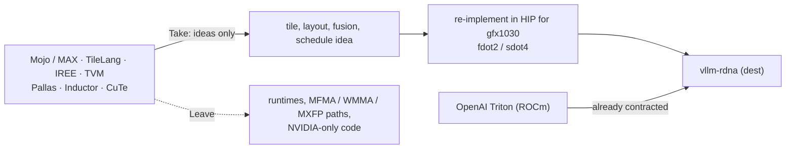

# Frameworks

Other kernel languages, compilers and runtimes we read for ideas. gfx1030 dest = HIP harvest; nothing here ships in vllm-rdna unless already contracted (Triton).

| Page | Scope |
|---|---|
| [mojo-max/README.md](mojo-max/README.md) | Mojo / Modular MAX sandbox: AMD HIP backend facts, harvest rules |
| [portable/README.md](portable/README.md) | Portable kernel / IR zoo: Triton, TileLang, IREE, TVM, Pallas, Inductor, CuTe |

## Harvest flow

*Summarises the Take / Leave tables in [mojo-max](mojo-max/README.md) and [portable](portable/README.md): no framework runtime ships in vllm-rdna except Triton, which is already part of it. Primary sources for the AMD facts: Modular packages[^modular-packages] and `tensor_core.mojo`[^modular-tc], TileLang[^tilelang], IREE ROCm guide[^iree-rocm], PyTorch Inductor[^inductor-sel].*

Related: [kernels index](../kernels/README.md) · [engine/stock-baseline/triton-rocm.md](../engine/stock-baseline/triton-rocm.md)

## Sources

Index rows summarise the linked pages; each page carries its own footnoted primary sources. Footnotes below back the diagram and any claim made on this index itself.

[^modular-packages]: Modular docs, packages / GPU support. <https://docs.modular.com/packages/>
[^modular-tc]: modular/modular @ `135c332f`, `max/kernels/src/layout/tensor_core.mojo` L1961–L1966 (`comptime assert False` for RDNA1/RDNA2 tensor cores). <https://github.com/modular/modular/blob/135c332fec9b326cab8e2f3951a0b2f31d017a5d/max/kernels/src/layout/tensor_core.mojo#L1961-L1966>
[^tilelang]: tile-ai/tilelang README (HIP backend, RDNA3/4/CDNA targets). <https://github.com/tile-ai/tilelang>
[^iree-rocm]: IREE deployment guide, GPU – ROCm (`--iree-rocm-target`, SKU table). <https://iree.dev/guides/deployment-configurations/gpu-rocm/>
[^inductor-sel]: pytorch/pytorch @ `72655314`, `torch/_inductor/select_algorithm.py` L950–L952 (`triton_meta["waves_per_eu"]`, `triton_meta["kpack"]`). <https://github.com/pytorch/pytorch/blob/7265531410fb689cf388a6fe083f772ec72e869a/torch/_inductor/select_algorithm.py#L950-L952>
