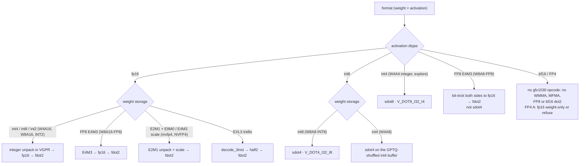

# Kernels

Format contracts for the HIP kernels we write. Not engine dispatch. Feature index vs upstream: [engine/serving-stack/fork-delta.md](../engine/serving-stack/fork-delta.md).

Pages are grouped by topic. Each folder has its own README index; this page is the map.

## Layout

| Folder | What lives there | Pages |
|---|---|---|
| [quant/](quant/README.md) | Weight/activation format contracts: pack, dequant, which DOT. | 14 |
| [gemm-moe/](gemm-moe/README.md) | Dense skinny GEMM / GEMV and fused-MoE GEMM contracts, stock and extras. | 4 |
| [attention/](attention/README.md) | Attention-side kernels: stock Triton baseline, KV INT8, Sage QK, sparse MLA, indexer. | 5 |
| [linear-attn/](linear-attn/README.md) | Linear-attention / recurrent kernels: GDN decode + prefill, causal conv1d, FlashKDA. | 4 |
| [aot-glue/](aot-glue/README.md) | Small HIP glue that replaces Triton JIT: RMSNorm, AOT list. | 2 |
| [models/](models/README.md) | Model-specific HIP glue (one page per model family). | 1 |
| [overlays/](overlays/README.md) | Reviews of other gfx1030 trees we harvest from (read-only). | 2 |

Figures: [img/](img/) holds primary-source figures (each with caption, source and licence on the page that uses it).

## Which DOT does a format use?

*gfx1030 has packed DOT only: `V_DOT2_F32_F16`, `V_DOT4_I32_I8`, `V_DOT8_I32_I4` (RDNA2 ISA[^isa]; LLVM `dot-insts` feature list for gfx1030[^llvm-gfx1030]). Per-format detail is on the linked pages; W8A8-FP8 converts both sides to fp16 and still uses `fdot2`; Quark W4A4 (FP4 activations) runs weight-only on fp16 activations or the checkpoint is refused ([w8a8-mxfp4.md](quant/w8a8-mxfp4.md) §8).*

## All pages

### Quant formats — [quant/](quant/README.md)

| Page | Inner loop | Completeness |
|---|---|---|
| [w4a16.md](quant/w4a16.md) | nibble dequant → `fdot2` | **Most complete** (dense). MoE GPTQ in-tree + resident skinny opt-in @ `e1315629`; MoE AWQ Not done. Modes: [../engine/overview/coverage.md](../engine/overview/coverage.md) (W4A16 row; no separate engine W4A16 page exists). K_STEP split repair @ `3a0786ea` |
| [w4a8.md](quant/w4a8.md) | int4 W × int8 A → `sdot4` | **Live / opt-in** @ `3a0786ea`; MoE epilogue CAS default / fp32 scratch opt-in @ `30b0bd4e`. Default = W4A16 |
| [w8a16.md](quant/w8a16.md) | i8 → fp16 → `fdot2` | Incomplete. MoE in-tree; dense `.cu` absent at tip |
| [w8a16-fp8.md](quant/w8a16-fp8.md) | E4M3 bit-trick → `fdot2` (LUT historical) | Dense built; MoE `.cu` excluded from build at `1dc3bac4` |
| [w8a8-fp8.md](quant/w8a8-fp8.md) | both sides E4M3 → fp16 → `fdot2` | Incomplete. **Not** `sdot4` |
| [w8a8.md](quant/w8a8.md) | extras vs contract: live FP8-`fdot2` / W8A16-`fdot2`; INT8 `sdot4` **absent** | **Spec / not on branch** @ `83de31cf` |
| [mxfp4.md](quant/mxfp4.md) | E2M1 + E8M0 → `fdot2` | Incomplete |
| [int2.md](quant/int2.md) | i2 unpack → `fdot2` (later `sdot4`) | Spec. Mixed INT2/INT4 MoE = two unpackers, one DOT |
| [w4a4.md](quant/w4a4.md) | i4×i4 `sdot8` | Explore. After W8A8. Not E2M1 |
| [sdot4-explore.md](quant/sdot4-explore.md) | when `sdot4` is legal | Explore: W8A8 INT8, Sage QK; W4A8 → [w4a8.md](quant/w4a8.md) Live opt-in |
| [w8a8-mxfp4.md](quant/w8a8-mxfp4.md) | W8A8 INT8 = `sdot4` | **Spec / not added** |
| [nvfp4.md](quant/nvfp4.md) | E2M1 + E4M3 mul → `fdot2` | Spec (no RDNA NVFP4 kernel at `1dc3bac4`) |
| [rocmfpx.md](quant/rocmfpx.md) | codebook10 `perm` → i8 → `sdot4` | Later. llama.cpp GGUF, not a vLLM port |
| [exl3.md](quant/exl3.md) | trellis state → 3-inst → `fdot2` | Later. mul1 + K=1..8 + `exl3_project_rdna2` @ `30b0bd4e`; cb 0/1/2 all dispatch at `1dc3bac4`. Occupancy + W4 first |

Do not conflate W8A16 / W8A16-FP8 / W8A8-FP8 (`fdot2`) with spec W8A8 INT8 (`sdot4`).

### GEMM and MoE — [gemm-moe/](gemm-moe/README.md)

| Page | Inner loop | Completeness |
|---|---|---|
| [fp16-moe.md](gemm-moe/fp16-moe.md) | native fp16 `fdot2`, fp32 accum | Spec: tiny-M GEMM + grouped prefill |
| [int8-moe.md](gemm-moe/int8-moe.md) | W8A16 `fdot2` / W8A8 `sdot4` | Spec: dual route by expert rows/shape/scales |
| [triton-skinny-gemm.md](gemm-moe/triton-skinny-gemm.md) | stock dispatch baseline | Stock gfx1030 = BLAS; LLMM1/wvSplitK gate excludes gfx10 |
| [skinny-gemm.md](gemm-moe/skinny-gemm.md) | no MFMA; gemv_f16 decode @ `3b59ee16`; MoE int4 `fdot2` @ `5c3c0c6f`; resident MoE @ `e1315629` | gfx1030 dense decode = gemv; resident MoE opt-in M=1..4; `(1,1)` leftover open |

### Attention — [attention/](attention/README.md)

| Page | Inner loop | Completeness |
|---|---|---|
| [mla-sparse.md](attention/mla-sparse.md) | scalar fp32 FMA | Decode + prefill HIP in `rdna/dsv4/sparse_mla_decode.cu` at `1dc3bac4`; DSv4 selects it when the ops are built |
| [lightning-indexer.md](attention/lightning-indexer.md) | `fdot2` at `1dc3bac4` (scalar half FMA at `9a344444`) | `rdna/dsv4/indexer_mqa_logits.cu` decode + prefill at `1dc3bac4` |
| [sage-qk.md](attention/sage-qk.md) | QK `sdot4`, PV `fdot2` | Spec |
| [kv-int8.md](attention/kv-int8.md) | i8 load + cvt → `fdot2` | Kernels built, not wired at `1dc3bac4` (RDNA_ATTN accepts auto/float16 KV only) |
| [triton-attention-gfx1030.md](attention/triton-attention-gfx1030.md) | stock Triton attention baseline + ISA map | Baseline evidence @ vLLM `49fb2ee`, not tuning. FP16 only |

### Linear attention — [linear-attn/](linear-attn/README.md)

| Page | Inner loop | Completeness |
|---|---|---|
| [flashkda.md](linear-attn/flashkda.md) | 128×128 `S` → `fdot2` | Later. Not extras; no CUTLASS/SM90 |
| [causal-conv1d.md](linear-attn/causal-conv1d.md) | scalar fp32 FMA (depthwise FIR) | Live HIP (still default on at `1dc3bac4`). UPDATE wire order fixed at `1dc3bac4` (HIP before Triton) |
| [gdn-decode.md](linear-attn/gdn-decode.md) | fp32 FMA + shfl K-reduce | Decode HIP Live (`69d2efe`); default on at `1dc3bac4` |
| [gdn-prefill.md](linear-attn/gdn-prefill.md) | kkt scalar FMA; wy/delta_h/o `fdot2` | Prefill HIP opt-in at `1dc3bac4` (`VLLM_GDN_HIP_PREFILL=1`). o BV 32 / 45312 B at the tip (`77d6fdf8` BV 64 is historical). All `(2,4)` |

### AOT glue — [aot-glue/](aot-glue/README.md)

| Page | Inner loop | Completeness |
|---|---|---|
| [triton-jit-aot.md](aot-glue/triton-jit-aot.md) | HIP AOT vs leftover Triton JIT | Take: conv1d / ApplyRotaryEmb / SwigluStep. Leave: FA/EXL3/W4/GDN. RMSNorm AOT ≠ PIECEWISE |
| [layernorm.md](aot-glue/layernorm.md) | scalar fp32 FMA + shfl + tiny LDS | Live AOT HIP (`83de31cf` + gated `71a54552`). Cudagraph-safe. Not FA leftover |

### Models — [models/](models/README.md)

| Page | Inner loop | Completeness |
|---|---|---|
| [qwen4exp-flash-next-hip.md](models/qwen4exp-flash-next-hip.md) | T46 fdot2 glue; T47–T49 HC/QSA/PLE scalar | HC compute-correct @ `8960a3bc`. At `1dc3bac4`: `VLLM_RDNA_FUSED_HC` default **on**; fused HC prefill (`hc_prefill_rdna2.cu`) default mode 2; HC_PREFILL_HIP / QSA / PLE default off |

### Overlays — [overlays/](overlays/README.md)

| Page | Inner loop | Completeness |
|---|---|---|
| [ikantkode-gfx1030.md](overlays/ikantkode-gfx1030.md) | sourced overlay (Triton, not HIP) | Take LLMM1 gate + RMSNorm; Leave GEMV |
| [rdna2-extras.md](overlays/rdna2-extras.md) | HIP / silicon review of the archive overlay | `rdna2_extras` @ `3e05abc9`, read-only |

## Sources

Index rows summarise the linked pages; each page carries its own footnoted primary sources. Footnotes below back the diagram and any claim made on this index itself.

[^isa]: AMD, *"RDNA 2" Instruction Set Architecture Reference Guide* (doc 70648): "Feature Changes in RDNA2 Devices" dot-product list; VOP2 opcodes 2 `V_DOT2C_F32_F16` / 13 `V_DOT4C_I32_I8`; VOP3P opcodes 19–25 `V_DOT2_F32_F16` … `V_DOT8_U32_U4`; LDS "128kB memory per workgroup processor split up into 64 banks of dword-wide RAMs"; "a single workgroup may allocate up to 64kB of LDS". <https://docs.amd.com/v/u/en-US/rdna2-shader-instruction-set-architecture>
[^llvm-gfx1030]: LLVM `AMDGPU.td` @ `eb61ef62df` L2278–L2292, `FeatureISAVersion10_3_0` (gfx1030): `FeatureDot1/2/5/6/7/10Insts`, no `Dot8`/`Dot12`, `FeatureMaxWavesPerEU16`. <https://github.com/llvm/llvm-project/blob/eb61ef62df4fd5151c4c379302f636ac430bc32d/llvm/lib/Target/AMDGPU/AMDGPU.td#L2278-L2292>
