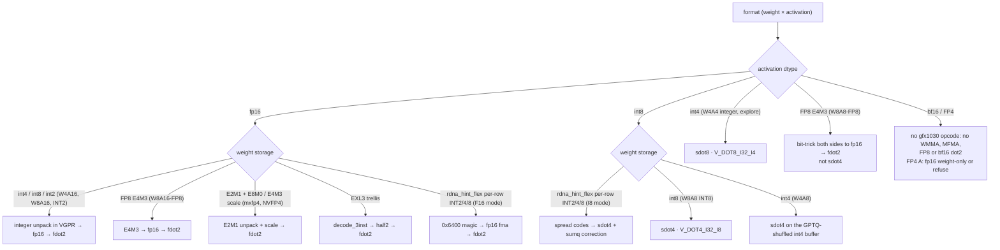

# Kernels

Format contracts for the HIP kernels we write. Not engine dispatch. Feature index vs upstream: [engine/serving-stack/fork-delta.md](../engine/serving-stack/fork-delta.md).

Pages are grouped by topic. Each folder has its own README index; this page is the map.

## Layout

| Folder | What lives there | Pages |
|---|---|---|
| [quant/](quant/README.md) | Weight/activation format contracts: pack, dequant, which DOT. | 15 |
| [gemm-moe/](gemm-moe/README.md) | Dense skinny GEMM / GEMV and fused-MoE GEMM contracts, stock and extras. | 5 |
| [attention/](attention/README.md) | Attention-side kernels: stock Triton baseline, KV INT8, Sage QK, sparse MLA, indexer. | 5 |
| [linear-attn/](linear-attn/README.md) | Linear-attention / recurrent kernels: GDN decode + prefill, causal conv1d, FlashKDA. | 4 |
| [aot-glue/](aot-glue/README.md) | Small HIP glue that replaces Triton JIT: RMSNorm, AOT list. | 2 |
| [models/](models/README.md) | Model-specific HIP glue (one page per model family). | 2 |
| [persistent/](persistent/README.md) | Persistent single-launch decode kernels (MonoKernel class): gfx1030 port plan. | 1 |
| [overlays/](overlays/README.md) | Reviews of other gfx1030 trees we harvest from (read-only). | 2 |

Figures: [img/](img/) holds primary-source figures (each with caption, source and licence on the page that uses it).

## Silicon tip watermark

Kernel pages are read through dest `rdna_extras` tip **`b7402893`** (`b74028935393d1e21f73f80f65f506c9ea4639af`, merge of PR #147, read 2026-10-29).[^c-b7402893] From `8015ea48` the range adds two new HIP sources (`rdna_hint_flex_rdna2.cu` in the gfx1030 list, `rdna_expert_cache.cu` in the base ROCm list) and a Q32 fixed-point epilogue on the W4A16 kernels. Existing kernels keep their tiles, `__launch_bounds__` and DOT; the other changes are new template specializations (K2 offload stages, GDN diagnostics), the GDN norm reduction, and a 2 KiB static-LDS sort in QSA index expansion. Locks: [quant/rdna-hint-flex.md](quant/rdna-hint-flex.md), [gemm-moe/rdna2-moe-offload-q32.md](gemm-moe/rdna2-moe-offload-q32.md), [persistent/monokernel-gfx1030-dest.md](persistent/monokernel-gfx1030-dest.md) (GDN FP32 norm partials, K2 offload stages), [models/qwen4exp-flash-next-hip.md](models/qwen4exp-flash-next-hip.md) (QSA canonical order).[^c-b7402893-cmp]

*(Historical, `8bb8ff36`, read 2026-10-14)* Kernel pages are read through dest `rdna_extras` tip **`8bb8ff36`** (`8bb8ff36cdb2e885553a151a824706d2d920fe3a`, merge of PR #98, read 2026-10-14).[^c-8bb8ff36] From `64d59b89` to `15e9e7ad` there is no `csrc/` or `CMakeLists.txt` change; `15e9e7ad` → `8bb8ff36` changes only the MoE W4A16 zero-point plumbing (`zero_offset` runtime argument, asymmetric 4-bit compressed-tensors MoE stays native). Lock: [quant/w4a16.md](quant/w4a16.md#extras-lock-2026-10-14-tip-8bb8ff36-pr-98--moe-w4a16-asymmetric-zero-points).[^c-15e9e7ad][^c-8bb8ff36]

*(Historical, `64d59b89`, read 2026-10-12)* Kernel pages are read through dest `rdna_extras` tip **`64d59b89`** (`64d59b8942d3b982f1d91f0f3e625dfda4418106`, merge of PR #84, read 2026-10-12).[^c-64d59b89] The silicon watch's previous recorded tip was `c6d99ca3` on the 0.28 line (still cited by dated locks on [gemm-moe/README.md](gemm-moe/README.md), [quant/w4a16.md](quant/w4a16.md) and [models/qwen4exp-flash-next-hip.md](models/qwen4exp-flash-next-hip.md)). That commit is not an ancestor of `64d59b89`: the branch was replaced by the v0.31 port (PR #47), and the ported kernels are locked at `1dc3bac4` on the pages above.[^c-c6d99ca3][^pr47][^c-1dc3bac4]

From `1dc3bac4` to `64d59b89` there is **no kernel-body silicon delta**. The only `csrc/` change in that range is `f2cc25ca` in `csrc/rocm/moe_w4a8_rdna2.cu`, and it is host-only: the per-shape cached activation workspace became a per-call `at::empty`. The `__global__` kernels, `CMakeLists.txt` and the bindings are unchanged.[^c-f2cc25ca][^c-64d59b89] Pages that cite `1dc3bac4` therefore still describe the `64d59b89` kernels.[^c-64d59b89]

## Which DOT does a format use?

*gfx1030 has packed DOT only: `V_DOT2_F32_F16`, `V_DOT4_I32_I8`, `V_DOT8_I32_I4` (RDNA2 ISA[^isa]; LLVM `dot-insts` feature list for gfx1030[^llvm-gfx1030]). Per-format detail is on the linked pages; W8A8-FP8 converts both sides to fp16 and still uses `fdot2`; Quark W4A4 (FP4 activations) runs weight-only on fp16 activations or the checkpoint is refused ([quant/w8a8-mxfp4.md](quant/w8a8-mxfp4.md) §8).*

## All pages

### Quant formats — [quant/](quant/README.md)

| Page | Inner loop | Completeness |
|---|---|---|
| [quant/w4a16.md](quant/w4a16.md) | nibble dequant → `fdot2` | **Most complete** (dense). MoE GPTQ in-tree + resident skinny opt-in @ `e1315629`; MoE AWQ Not done. Modes: [../engine/overview/coverage.md](../engine/overview/coverage.md) (W4A16 row; no separate engine W4A16 page exists). K_STEP split repair @ `3a0786ea` |
| [quant/w4a8.md](quant/w4a8.md) | int4 W × int8 A → `sdot4` | **Live / opt-in** @ `3a0786ea`; MoE epilogue CAS default / fp32 scratch opt-in @ `30b0bd4e`. Default = W4A16 |
| [quant/w8a16.md](quant/w8a16.md) | i8 → fp16 → `fdot2` | Incomplete. MoE in-tree; dense `.cu` absent at tip |
| [quant/w8a16-fp8.md](quant/w8a16-fp8.md) | E4M3 bit-trick → `fdot2` (LUT historical) | Dense built; MoE `.cu` excluded from build at `1dc3bac4` |
| [quant/w8a8-fp8.md](quant/w8a8-fp8.md) | both sides E4M3 → fp16 → `fdot2` | Incomplete. **Not** `sdot4` |
| [quant/w8a8.md](quant/w8a8.md) | extras vs contract: live FP8-`fdot2` / W8A16-`fdot2`; INT8 `sdot4` **absent** | **Spec / not on branch** @ `83de31cf` |
| [quant/mxfp4.md](quant/mxfp4.md) | E2M1 + E8M0 → `fdot2` | Incomplete |
| [quant/int2.md](quant/int2.md) | i2 unpack → `fdot2` (later `sdot4`) | Spec. Mixed INT2/INT4 MoE = two unpackers, one DOT |
| [quant/w4a4.md](quant/w4a4.md) | i4×i4 `sdot8` | Explore. After W8A8. Not E2M1 |
| [quant/sdot4-explore.md](quant/sdot4-explore.md) | when `sdot4` is legal | Explore: W8A8 INT8, Sage QK; W4A8 → [quant/w4a8.md](quant/w4a8.md) Live opt-in |
| [quant/w8a8-mxfp4.md](quant/w8a8-mxfp4.md) | W8A8 INT8 = `sdot4` | **Spec / not added** |
| [quant/nvfp4.md](quant/nvfp4.md) | E2M1 + E4M3 mul → `fdot2` | Spec (no RDNA NVFP4 kernel at `1dc3bac4`) |
| [quant/rocmfpx.md](quant/rocmfpx.md) | codebook10 `perm` → i8 → `sdot4` | Later. llama.cpp GGUF, not a vLLM port |
| [quant/exl3.md](quant/exl3.md) | trellis state → 3-inst → `fdot2` | Later. mul1 + K=1..8 + `exl3_project_rdna2` @ `30b0bd4e`; cb 0/1/2 all dispatch at `1dc3bac4`; decode-once v3 GEMM (`__launch_bounds__(128)`, gfx103x, bits 3/4/6, M ≤ 64) @ `c2cbf004` / `0835e3cb` / `f419d8d6`, unchanged at `64d59b89`. Occupancy + W4 first [^c-c2cbf004] |

Do not conflate W8A16 / W8A16-FP8 / W8A8-FP8 (`fdot2`) with spec W8A8 INT8 (`sdot4`).

### GEMM and MoE — [gemm-moe/](gemm-moe/README.md)

| Page | Inner loop | Completeness |
|---|---|---|
| [gemm-moe/fp16-moe.md](gemm-moe/fp16-moe.md) | native fp16 `fdot2`, fp32 accum | Spec: tiny-M GEMM + grouped prefill |
| [gemm-moe/int8-moe.md](gemm-moe/int8-moe.md) | W8A16 `fdot2` / W8A8 `sdot4` | Spec: dual route by expert rows/shape/scales |
| [gemm-moe/triton-skinny-gemm.md](gemm-moe/triton-skinny-gemm.md) | stock dispatch baseline | Stock gfx1030 = BLAS; LLMM1/wvSplitK gate excludes gfx10 |
| [gemm-moe/skinny-gemm.md](gemm-moe/skinny-gemm.md) | no MFMA; gemv_f16 decode @ `3b59ee16`; MoE int4 `fdot2` @ `5c3c0c6f`; resident MoE @ `e1315629` | gfx1030 dense decode = gemv; resident MoE opt-in M=1..4; `(1,1)` leftover open |

### Attention — [attention/](attention/README.md)

| Page | Inner loop | Completeness |
|---|---|---|
| [attention/mla-sparse.md](attention/mla-sparse.md) | scalar fp32 FMA | Decode + prefill HIP in `rdna/dsv4/sparse_mla_decode.cu` at `1dc3bac4`; DSv4 selects it when the ops are built |
| [attention/lightning-indexer.md](attention/lightning-indexer.md) | `fdot2` at `1dc3bac4` (scalar half FMA at `9a344444`) | `rdna/dsv4/indexer_mqa_logits.cu` decode + prefill at `1dc3bac4` |
| [attention/sage-qk.md](attention/sage-qk.md) | QK `sdot4`, PV `fdot2` | Spec |
| [attention/kv-int8.md](attention/kv-int8.md) | i8 load + cvt → `fdot2` | Kernels built, not wired at `1dc3bac4` (RDNA_ATTN accepts auto/float16 KV only) |
| [attention/triton-attention-gfx1030.md](attention/triton-attention-gfx1030.md) | stock Triton attention baseline + ISA map | Baseline evidence @ vLLM `49fb2ee`, not tuning. FP16 only |

### Linear attention — [linear-attn/](linear-attn/README.md)

| Page | Inner loop | Completeness |
|---|---|---|
| [linear-attn/flashkda.md](linear-attn/flashkda.md) | 128×128 `S` → `fdot2` | Later. Not extras; no CUTLASS/SM90 |
| [linear-attn/causal-conv1d.md](linear-attn/causal-conv1d.md) | scalar fp32 FMA (depthwise FIR) | Live HIP (still default on at `1dc3bac4`). UPDATE wire order fixed at `1dc3bac4` (HIP before Triton) |
| [linear-attn/gdn-decode.md](linear-attn/gdn-decode.md) | fp32 FMA + shfl K-reduce | Decode HIP Live (`69d2efe`); default on at `1dc3bac4` |
| [linear-attn/gdn-prefill.md](linear-attn/gdn-prefill.md) | kkt `v_dot2c_f32_f16` (fp16-rounded beta*k); wy/delta_h/o `fdot2` | Prefill HIP **default on** at `30d6e82d` (`VLLM_GDN_HIP_PREFILL` default 1). delta_h `(4, 8)` = 2 WG/CU @ 37120 B LDS; o BV 64. *(`1dc3bac4`: opt-in, all `(2,4)`, o BV 32 — historical)* |

### AOT glue — [aot-glue/](aot-glue/README.md)

| Page | Inner loop | Completeness |
|---|---|---|
| [aot-glue/triton-jit-aot.md](aot-glue/triton-jit-aot.md) | HIP AOT vs leftover Triton JIT | Take: conv1d / ApplyRotaryEmb / SwigluStep. Leave: FA/EXL3/W4/GDN. RMSNorm AOT ≠ PIECEWISE |
| [aot-glue/layernorm.md](aot-glue/layernorm.md) | scalar fp32 FMA + shfl + tiny LDS | Live AOT HIP (`83de31cf` + gated `71a54552`). Cudagraph-safe. Not FA leftover |

### Models — [models/](models/README.md)

| Page | Inner loop | Completeness |
|---|---|---|
| [models/qwen4exp-flash-next-hip.md](models/qwen4exp-flash-next-hip.md) | T46 fdot2 glue; T47–T49 HC/QSA/PLE scalar | HC compute-correct @ `8960a3bc`. At `1dc3bac4`: `VLLM_RDNA_FUSED_HC` default **on**; fused HC prefill (`hc_prefill_rdna2.cu`) default mode 2; HC_PREFILL_HIP / QSA / PLE default off |
| [models/dsv4-mhc-hip.md](models/dsv4-mhc-hip.md) | scalar fp32 (no DOT); 16-lane xor-shuffle Sinkhorn | DSv4 mHC pre/post HIP (`rdna/dsv4/mhc.cu`, `ec349e90` + `0f596e6e`, unchanged at `64d59b89`); decode pre GEMM split over 32 blocks; ≤16 tokens fused GEMM, else rocBLAS. Selected after AITER / TileLang for 4 streams fp16/bf16 [^c-0f596e6e] |

### Overlays — [overlays/](overlays/README.md)

| Page | Inner loop | Completeness |
|---|---|---|
| [overlays/ikantkode-gfx1030.md](overlays/ikantkode-gfx1030.md) | sourced overlay (Triton, not HIP) | Take LLMM1 gate + RMSNorm; Leave GEMV |
| [overlays/rdna2-extras.md](overlays/rdna2-extras.md) | HIP / silicon review of the archive overlay | `rdna2_extras` @ `3e05abc9`, read-only |

## Sources

Index rows summarise the linked pages; each page carries its own footnoted primary sources. Footnotes below back the diagram and any claim made on this index itself.

[^isa]: AMD, *"RDNA 2" Instruction Set Architecture Reference Guide* (doc 70648): "Feature Changes in RDNA2 Devices" dot-product list; VOP2 opcodes 2 `V_DOT2C_F32_F16` / 13 `V_DOT4C_I32_I8`; VOP3P opcodes 19–25 `V_DOT2_F32_F16` … `V_DOT8_U32_U4`; LDS "128kB memory per workgroup processor split up into 64 banks of dword-wide RAMs"; "a single workgroup may allocate up to 64kB of LDS". <https://docs.amd.com/v/u/en-US/rdna2-shader-instruction-set-architecture>
[^llvm-gfx1030]: LLVM `AMDGPU.td` @ `eb61ef62df` L2278–L2292, `FeatureISAVersion10_3_0` (gfx1030): `FeatureDot1/2/5/6/7/10Insts`, no `Dot8`/`Dot12`, `FeatureMaxWavesPerEU16`. <https://github.com/llvm/llvm-project/blob/eb61ef62df4fd5151c4c379302f636ac430bc32d/llvm/lib/Target/AMDGPU/AMDGPU.td#L2278-L2292>
[^c-c2cbf004]: opengfx1030/vllm-rdna commit [`c2cbf004`](https://github.com/opengfx1030/vllm-rdna/commit/c2cbf004772c2fa10f71e9858f98080e102107af) (2026-10-09) — "perf(rdna2): EXL3 decode-once GEMM for decode and MTP verify batches"; bits 6 added in [`0835e3cb`](https://github.com/opengfx1030/vllm-rdna/commit/0835e3cbf57de062b09fbf6a4a804abaf6db71cb), tile-word prefetch in [`f419d8d6`](https://github.com/opengfx1030/vllm-rdna/commit/f419d8d6c037003cc21c64e9a105f3fe9d06abe2).
[^c-0f596e6e]: opengfx1030/vllm-rdna commit [`0f596e6e`](https://github.com/opengfx1030/vllm-rdna/commit/0f596e6e0e9b2683ef7a4ec3eb6ef93eac9e1fd9) (2026-10-09) — "perf(rdna): split the decode mHC pre GEMM across blocks, parallel Sinkhorn" (file first added in [`ec349e90`](https://github.com/opengfx1030/vllm-rdna/commit/ec349e9079f6d19865362010bebcd36bfbbe0f8d)).
[^c-64d59b89]: opengfx1030/vllm-rdna commit [`64d59b89`](https://github.com/opengfx1030/vllm-rdna/commit/64d59b8942d3b982f1d91f0f3e625dfda4418106) — "Merge fix/rdna2-moe-asymmetric: native MoE path declines asymmetric checkpoints (#84)". `git diff --stat 1dc3bac4cda3201a1b4fb345e044578e84a272cf 64d59b8942d3b982f1d91f0f3e625dfda4418106 -- csrc CMakeLists.txt` lists only `csrc/rocm/moe_w4a8_rdna2.cu` (11+ / 37−).
[^c-1dc3bac4]: opengfx1030/vllm-rdna commit [`1dc3bac4`](https://github.com/opengfx1030/vllm-rdna/commit/1dc3bac4cda3201a1b4fb345e044578e84a272cf) (2026-10-11) — "Merge feat/ple-int4: INT4 PLE table on the upstream PLE path (#49)"; the silicon lock the kernel pages cite.
[^c-f2cc25ca]: opengfx1030/vllm-rdna commit [`f2cc25ca`](https://github.com/opengfx1030/vllm-rdna/commit/f2cc25ca927d0f3c6b0754d6f3982b3608746716) (2026-10-11) — "fix(rdna2): W4A8 MoE per-call workspace, 512-token threshold, microbench". The `.cu` diff removes `struct Workspace` / `get_workspace` and allocates `a_i8` / `a_scale` / `a_sum` per call in `moe_w4a8_gemm_rdna2`; the threshold change is in Python (`rdna2_w4a16_moe.py`).
[^c-c6d99ca3]: opengfx1030/vllm-rdna commit [`c6d99ca3`](https://github.com/opengfx1030/vllm-rdna/commit/c6d99ca30580f0ce6a97a168fa53bf9c6ee6b2af) (2026-10-06) — "fix(rdna2): HC HIP stream correctness + MoE prefill tile"; `git merge-base --is-ancestor` with `64d59b89` is false.
[^pr47]: opengfx1030/vllm-rdna PR #47 — v0.31 port of `rdna_extras`. <https://github.com/opengfx1030/vllm-rdna/pull/47>
[^c-8bb8ff36]: opengfx1030/vllm-rdna commit [`8bb8ff36`](https://github.com/opengfx1030/vllm-rdna/commit/8bb8ff36cdb2e885553a151a824706d2d920fe3a) (2026-10-14 11:45 Europe/Paris) — "Merge pull request #98 from opengfx1030/feat/rdna2-moe-asym-zp", merging [`6f5edc41`](https://github.com/opengfx1030/vllm-rdna/commit/6f5edc41a1d7eef6451d3a7b758284bbe7e2c23f) "feat(rdna2): native W4A16 MoE for asymmetric compressed-tensors checkpoints". `compare 15e9e7ad...8bb8ff36` touches `csrc/rocm/moe_q_gemm_rdna2.cu` (+18/−14), `moe_w4a8_rdna2.cu` (+1/−1), `ops.h`, `torch_bindings.cpp`, two compressed-tensors MoE Python files, `_custom_ops.py` and one test; no `CMakeLists.txt` change.
[^c-15e9e7ad]: `gh api repos/opengfx1030/vllm-rdna/compare/64d59b89...15e9e7ad` (read 2026-10-14): 23 commits ahead, 24 files, none under `csrc/` or `CMakeLists.txt`. <https://github.com/opengfx1030/vllm-rdna/compare/64d59b8942d3b982f1d91f0f3e625dfda4418106...15e9e7adbd0de5c56bda1b4644ddf10bcbdfc17c>
[^c-b7402893]: opengfx1030/vllm-rdna commit [`b7402893`](https://github.com/opengfx1030/vllm-rdna/commit/b74028935393d1e21f73f80f65f506c9ea4639af) (2026-10-29 01:23 Paris) — "Merge pull request #147 from opengfx1030/codex/rdna2-moe-offload-improvements".
[^c-b7402893-cmp]: Compare [`8015ea48...b7402893`](https://github.com/opengfx1030/vllm-rdna/compare/8015ea485b7f6c0298d8f98ce6e824ce1c444c45...b74028935393d1e21f73f80f65f506c9ea4639af) (59 commits, PRs #142–#147 plus the HI2 / rdna_hint_flex series); `CMakeLists.txt` +2 lines, both new sources.
