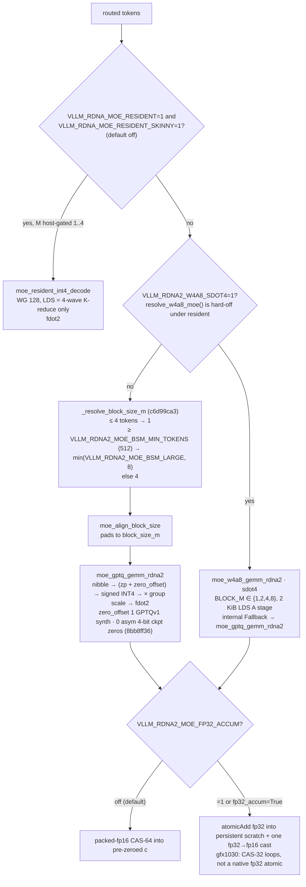

# GEMM and MoE

Dense skinny GEMM / GEMV and fused-MoE GEMM contracts, stock and extras. Back to the [kernels index](../README.md).

| Page | Inner loop | Completeness |
|---|---|---|
| [fp16-moe.md](fp16-moe.md) | native fp16 `fdot2`, fp32 accum | Spec: tiny-M GEMM + grouped prefill |
| [int8-moe.md](int8-moe.md) | W8A16 `fdot2` / W8A8 `sdot4` | Spec: dual route by expert rows/shape/scales |
| [triton-skinny-gemm.md](triton-skinny-gemm.md) | stock dispatch baseline | Stock gfx1030 = BLAS; LLMM1/wvSplitK gate excludes gfx10 [^f-c6d99ca3-skinny-gemms-cu] |
| [skinny-gemm.md](skinny-gemm.md) | no MFMA; gemv_f16 decode @ `3b59ee16`; MoE int4 `fdot2` @ `5c3c0c6f`; resident MoE @ `e1315629` | gfx1030 dense decode = gemv; resident MoE opt-in M=1..4; `(1,1)` leftover open [^c-3b59ee16][^c-5c3c0c6f][^c-e1315629] |
| [rdna2-moe-offload-q32.md](rdna2-moe-offload-q32.md) | unchanged `fdot2`; new Q32 int64 epilogue | MoE expert offload (graph-safe passes, one rounding), deterministic dense W4A16 opt-in, native expert-cache copy opt-in @ `b7402893` [^c-b740-moe] |

## MoE dispatch on gfx1030 (W4A16 / W4A8)

*Built only from the pages: resident decode and dequant order from [quant/w4a16.md](../quant/w4a16.md) (`e1315629`), `block_size_m` resolve from the `c6d99ca3` lock, W4A8 MoE from [quant/w4a8.md](../quant/w4a8.md) (`3a0786ea`), and the accum switch from the "MoE epilogue accum" section of w4a8 (`30b0bd4e`); the runtime `zero_offset` from the `8bb8ff36` lock in quant/w4a16.md. Diagram does not imply a tile size beyond what those pages state.*[^c-e1315629][^c-c6d99ca3][^c-3a0786ea][^c-30b0bd4e][^c-8bb8ff36]

*Update @ `b7402893`:* the accum switch in the diagram now has a third, Q32 integer branch (int64 `[rows, N+1]` + status column, one finalize cast), used by the expert-offload path and the deterministic dense opt-in; the default is still packed-fp16 CAS. See [rdna2-moe-offload-q32.md](rdna2-moe-offload-q32.md).[^c-b740-moe]

## Sources

Index rows summarise the linked pages; each page carries its own footnoted primary sources. Footnotes below back the diagram and any claim made on this index itself.

[^f-c6d99ca3-skinny-gemms-cu]: opengfx1030/vllm-rdna `csrc/rocm/skinny_gemms.cu` @ [`c6d99ca3`](https://github.com/opengfx1030/vllm-rdna/blob/c6d99ca30580f0ce6a97a168fa53bf9c6ee6b2af/csrc/rocm/skinny_gemms.cu).
[^c-3b59ee16]: opengfx1030/vllm-rdna commit [`3b59ee16`](https://github.com/opengfx1030/vllm-rdna/commit/3b59ee16e553168b1e3809c9a141088662171448) (2026-09-18) — "feat(rocm): opt-in leap T44b rdna_ar (VRAM flags + wedge check) (#13)".
[^c-5c3c0c6f]: opengfx1030/vllm-rdna commit [`5c3c0c6f`](https://github.com/opengfx1030/vllm-rdna/commit/5c3c0c6f53a3bffc20319de5621f1e560ffa4ab4) (2026-09-14) — "docs(rdna2): 27B AWQ bench matrix (1k/512 + 16k/1k at c=1/4/8)".
[^c-e1315629]: opengfx1030/vllm-rdna commit [`e1315629`](https://github.com/opengfx1030/vllm-rdna/commit/e131562936f9c6f27c26449b00aaaeeb34159b4c) (2026-09-23) — "Merge pull request #17 from GeorgeMA-Strong/codex/v620-baseline-port-20260922".
[^c-c6d99ca3]: opengfx1030/vllm-rdna commit [`c6d99ca3`](https://github.com/opengfx1030/vllm-rdna/commit/c6d99ca30580f0ce6a97a168fa53bf9c6ee6b2af) (2026-10-06) — "fix(rdna2): HC HIP stream correctness + MoE prefill tile".
[^c-3a0786ea]: opengfx1030/vllm-rdna commit [`3a0786ea`](https://github.com/opengfx1030/vllm-rdna/commit/3a0786eaa70f37890b729ff4943e5cc9a0cb68c0) (2026-09-30) — "merge(rdna2): land w4a8-wiring onto rdna_extras (W4A8 opt-in; W4A16 default unchanged)".
[^c-30b0bd4e]: opengfx1030/vllm-rdna commit [`30b0bd4e`](https://github.com/opengfx1030/vllm-rdna/commit/30b0bd4e3604a6ea678244a0df74e452ac05fee6) (2026-10-01) — "test(exl3): backport loader unit tests + mul1 tile reformat".
[^c-8bb8ff36]: opengfx1030/vllm-rdna commit [`8bb8ff36`](https://github.com/opengfx1030/vllm-rdna/commit/8bb8ff36cdb2e885553a151a824706d2d920fe3a) (2026-10-14 11:45 Europe/Paris) — "Merge pull request #98 from opengfx1030/feat/rdna2-moe-asym-zp", merging [`6f5edc41`](https://github.com/opengfx1030/vllm-rdna/commit/6f5edc41a1d7eef6451d3a7b758284bbe7e2c23f) "feat(rdna2): native W4A16 MoE for asymmetric compressed-tensors checkpoints". `compare 15e9e7ad...8bb8ff36` touches `csrc/rocm/moe_q_gemm_rdna2.cu` (+18/−14), `moe_w4a8_rdna2.cu` (+1/−1), `ops.h`, `torch_bindings.cpp`, two compressed-tensors MoE Python files, `_custom_ops.py` and one test; no `CMakeLists.txt` change.
[^c-b740-moe]: dest tip [`b7402893`](https://github.com/opengfx1030/vllm-rdna/commit/b74028935393d1e21f73f80f65f506c9ea4639af); PR #146 [`2436df23`](https://github.com/opengfx1030/vllm-rdna/commit/2436df23358ef8b9397076c0663707ec3dce69bf) and PR #147.
