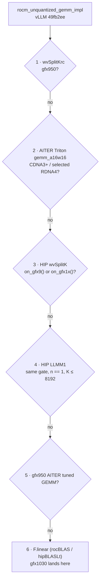

# Stock skinny GEMM on gfx1030 (and what does not fire)

Date: 2026-08-18. **Stock only.** vLLM `main` @ `49fb2ee`. Engine map: [engine/stock-baseline/triton-rocm.md](../../engine/stock-baseline/triton-rocm.md). Tuning: [engine/stock-baseline/triton-tuning.md](../../engine/stock-baseline/triton-tuning.md).[^c-49fb2ee]

## Verdict

Stock unquantized decode GEMM on gfx1030 is **`torch.nn.functional.linear`** (rocBLAS / maybe hipBLASLt). HIP `wvSplitK` and `LLMM1` exist in `csrc/rocm/skinny_gemms.cu` but the Python gate is `on_gfx9() or on_gfx1x()`. **gfx1030 is neither.** `VLLM_ROCM_USE_SKINNY_GEMM=1` does nothing here.[^f-49fb2ee-skinny-gemms-cu]

Our fork occupancy ticket on `skinny_gemms.cu` is still real if we open that gate. ikantkode opening `LLMM1` for gfx1030 is overlay, not stock ([engine/run-recipes/qwen35.md](../../engine/run-recipes/qwen35.md)).[^f-49fb2ee-skinny-gemms-cu]

## Dispatcher (`rocm_unquantized_gemm_impl`)

| Step | Kernel | gfx1030 [^f-49fb2ee-utils-py][^f-49fb2ee-skinny-gemms-cu] |
|---|---|---|
| 1 | `wvSplitKrc` | gfx950 only [^f-49fb2ee-skinny-gemms-cu] |
| 2 | AITER Triton `gemm_a16w16` | CDNA3+ / selected RDNA4 [^f-49fb2ee-utils-py][^f-49fb2ee-skinny-gemms-cu] |
| 3 | HIP `wvSplitK` | no (`on_gfx9` / `on_gfx1x`) [^f-49fb2ee-skinny-gemms-cu] |
| 4 | HIP `LLMM1` (`LLGemm1_kernel`) | no (same gate). `n==1`, `K<=8192`, no bias, N%4==0 [^f-49fb2ee-skinny-gemms-cu] |
| 5 | gfx950 AITER tuned GEMM | no [^f-49fb2ee-utils-py][^f-49fb2ee-skinny-gemms-cu] |
| 6 | `F.linear` | **yes** [^f-49fb2ee-utils-py][^f-49fb2ee-skinny-gemms-cu] |

*Steps and gates from the table above (`vllm/model_executor/layers/utils.py` and `csrc/rocm/skinny_gemms.cu` at `49fb2ee`). Every "yes" branch leaves gfx1030 out, so stock decode on gfx1030 is `F.linear`.*[^c-49fb2ee][^f-49fb2ee-utils-py][^f-49fb2ee-skinny-gemms-cu]

`wvSplitK` extra: N>8, tokens 1..5, `K%8==0`, fp16/bf16, contiguous. `wvSplitKQ` FP8: MI3xx or gfx12 only. Rename PR #40827 (`vecMatMul`) is **not** this SHA — still `LLMM1`.[^f-49fb2ee-skinny-gemms-cu][^vpr-40827]

## Fair lab (after harness)

Shapes: real `q_proj` / `o_proj` / MLP, M `{1,2,4,5,8,16,64,…}`. Compare:[^f-49fb2ee-utils-py][^f-49fb2ee-skinny-gemms-cu]

1. Stock `F.linear`.[^f-49fb2ee-utils-py][^f-49fb2ee-skinny-gemms-cu]
2. `TORCH_BLAS_PREFER_HIPBLASLT=1` (label as prefer, not guaranteed).[^f-49fb2ee-utils-py][^f-49fb2ee-skinny-gemms-cu]
3. Experimental: open `LLMM1` / `wvSplitK` on gfx1030 (fork / overlay) and ISA them.[^f-49fb2ee-skinny-gemms-cu]
4. Triton skinny GEMM (new) only after standalone numeric.[^f-49fb2ee-utils-py][^f-49fb2ee-skinny-gemms-cu]
5. Custom HIP `fdot2` skinny / FP16 MoE decode.[^f-49fb2ee-utils-py][^f-49fb2ee-skinny-gemms-cu]

Cold compile vs steady-state. Bias and non-contiguous as separate cells. Occupancy still first on any HIP we already ship.[^f-49fb2ee-utils-py][^f-49fb2ee-skinny-gemms-cu]

## Sources

- `vllm/model_executor/layers/utils.py`
- `csrc/rocm/skinny_gemms.cu`, `torch_bindings.cpp` (`LLMM1`, `wvSplitK`)
- PRs #34709, #40827

[^c-49fb2ee]: vllm-project/vllm commit [`49fb2ee`](https://github.com/vllm-project/vllm/commit/49fb2ee3481246ce88224220442c6ef30f88b209) (2026-08-17) — "\[ROCm\]\[CI\] add Aiter ops tests (#52208)".
[^f-49fb2ee-skinny-gemms-cu]: vllm-project/vllm `csrc/rocm/skinny_gemms.cu` @ [`49fb2ee`](https://github.com/vllm-project/vllm/blob/49fb2ee3481246ce88224220442c6ef30f88b209/csrc/rocm/skinny_gemms.cu).
[^f-49fb2ee-utils-py]: vllm-project/vllm `vllm/model_executor/layers/utils.py` @ [`49fb2ee`](https://github.com/vllm-project/vllm/blob/49fb2ee3481246ce88224220442c6ef30f88b209/vllm/model_executor/layers/utils.py).
[^vpr-40827]: vLLM PR #40827 — Fix two RDNA4 correctness bugs in LLMM1 (open). <https://github.com/vllm-project/vllm/pull/40827>
