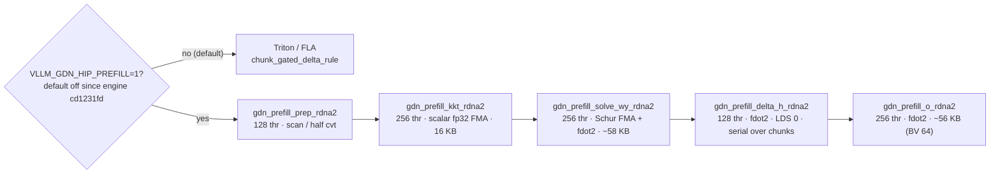

# GDN chunked prefill — extras HIP (`aac1fcd6`)

## Current state at dest `rdna_extras` @ `1dc3bac4` (checked 2026-10-11)

| Item | State |
|---|---|
| Gate | `VLLM_GDN_HIP_PREFILL` is opt-in (default off); the flashnext recipes pin it to `0`. The default prefill is Triton/FLA.[^gdnp-tip-gate] |
| Occupancy | All GDN kernels: `__launch_bounds__(N)` + `amdgpu_waves_per_eu(2, 4)`.[^gdnp-tip-k] |
| `delta_h` | **256 threads, `GDN_BV = 32`.** That is not the `e054854f`/`5d2cf49f` 128 / BV 16 values in the table below; those are BlivionIaG history.[^gdnp-tip-k] |
| `o` | **`GDN_BV = 32`, LDS 45312 B.** That is not the `77d6fdf8` BV 64 / ~56 KB value below, which is historical.[^gdnp-tip-k] |

`b53a7a2` landed the 5 kernels. Two later fixes make multi-chunk **correct**. `e054854f` is spill/LDS on **delta_h only**. `77d6fdf8` is o-kernel BV. `5d2cf49f` is delta_h unroll (not a tok/s close). `aac1fcd6` is the multi-chunk **correctness** close for delta_h indexing:[^c-b53a7a2][^c-e054854f][^c-77d6fdf8][^c-5d2cf49f][^c-aac1fcd6]

| SHA | Bug | Silicon [^c-aac1fcd6][^c-b53a7a2] |
|---|---|---|
| `f563820e` | delta_h only advanced `h`; k/w/u/vnew stayed on chunk 0 | Serial recurrence re-applied chunk-0 `(I − k0ᵀw0)` → state explode. Pointers + `g` must step `BT` [^c-f563820e] |
| `6e20b239` | o-kernel LDS zero-fill wrote only first 2 cols, **no barrier** before copy; varlen used global `i_t` | Sparse clobber under occupancy at NT≥2. Now full-tile zero + `__syncthreads()`. Local `i_t` for q/k/v/o/g; `h` stays global [^c-6e20b239] |
| `e054854f` | delta_h `GDN_BV` 32→16, `GDN_THREADS` 256→128. Same lane layout as decode (`v = lane >> 3`, `ks = lane & 7`). Still `fdot2`, still `(2, 4)` | ELF (commit): `.vgpr_spill_count` 426→94, `.sgpr_spill_count` 78→0, `.private_segment_fixed` 1628→372 B, **`.group_segment_fixed` 65536→0**. Prior wiki “0 for h (VGPR)” was source intent; the 256-thr binary still reserved **64 KB** LDS. 128-thr actually 0. Grid tiles 4→8. Not FA occupancy. Do not copy tok/s [^c-e054854f] |
| `77d6fdf8` | o-kernel `GDN_BV` 32→64. Still 256 thr, `(2, 4)`, `fdot2`. Grid tiles V/BV 4→2 | LDS **45312→57600 B** (~44→~56 KB): `h` 8→16 KB, `v_T` 4→8 KB. Still <64 KB/WG (~8 KB headroom). Same 1-WG class as wy. Source comments still say BV=32 / 8+4 KB — stale. Not FA occupancy. Do not copy kernel/e2e % [^c-77d6fdf8][^isa] |
| `5d2cf49f` | delta_h `#pragma unroll 8` on the 32-iter t-pair loop (full unroll hoists w/k into VGPR) | Source: still 128 thr / BV 16 / `(2, 4)` / LDS 0 / `fdot2`. Full unroll spilled (94 VGPR / 372 B scratch). Partial 8: 182 VGPR, 0 scratch. 182→192 granule; `(2,4)` VGPR cap 512 — fits. Not FA occupancy. Do not copy −14% [^c-5d2cf49f] |
| `aac1fcd6` | delta_h loop used chunk-local `t` on unbaselined `p_k`/`p_w`/`p_u`/`p_vnew` (chunk 0 only; later chunks garbage / unwritten `v_new`) | Rebase those four row pointers by `chunk_start` each chunk. Still 128 thr / BV 16 / `(2, 4)` / LDS 0 / `fdot2`. No tile change. Cousin of `f563820e` (that one advanced `h`/`g`; this one fixes the in-chunk row base). Not FA occupancy. Do not copy tok/s [^c-aac1fcd6][^c-f563820e] |

Five kernels. Replaces Triton `chunk_gated_delta_rule` + `fused_post_conv_prep` on gfx10x. Decode already HIP (`69d2efe`). Occupancy leftover is still **FA prefill `(N, 1)`** — do not close that card. Fat-M / ConfigA unchanged. Do **not** put 16k/c=8 tok/s on coverage.[^c-69d2efe]

All five: `__launch_bounds__(N)` + `amdgpu_waves_per_eu(2, 4)` — not `(1,1)`.[^c-aac1fcd6][^c-b53a7a2]

| Kernel | Threads | Inner | LDS | Note [^c-aac1fcd6][^c-b53a7a2] |
|---|---|---|---|---|
| `gdn_prefill_prep_rdna2` | 128 | scan / half cvt | 1 float carry | fused post-conv + chunk cumsum [^f-aac1fcd6-gdn-prefill-prep-rdna2-cu] |
| `gdn_prefill_kkt_rdna2` | 256 | **scalar fp32 FMA** | 16 KB `k[64,128]` half | `_CAST_DOT_TO_K_DTYPE=False` on gfx1030. **No `fdot2`** [^f-aac1fcd6-gdn-prefill-kkt-rdna2-cu] |
| `gdn_prefill_solve_wy_rdna2` | 256 | Phase1 fp32 FMA Schur; Phase2 **`fdot2`** | **~58 KB** (`A`/`Ai` 16+16, `Aih` 8, rhsT 16.5, pad 2) | 64 KB tight. `expf` not `__expf` [^f-aac1fcd6-gdn-prefill-solve-wy-rdna2-cu] |
| `gdn_prefill_delta_h_rdna2` | **128** (`e054854f`; was 256) *(historical; 256 / BV 32 at `1dc3bac4`)* | **`fdot2`** (rtne half pairs) | **0** (ELF). Was 64 KB group_segment at 256-thr | serial inter-chunk. Same `(2, 4)` [^c-e054854f][^f-e054854f-gdn-prefill-delta-h-rdna2-cu] |
| `gdn_prefill_o_rdna2` | 256 (`77d6fdf8` BV=64) *(historical; BV 32 / 45312 B at `1dc3bac4`)* | **`fdot2`** qk / qh / Av | **~56 KB** (was ~44). q+k reuse slot for `b_A` | causal `>=`. Tiles 4→2 [^c-77d6fdf8][^f-77d6fdf8-gdn-prefill-o-rdna2-cu] |

### Chain at a glance

*Kernel rows from the table above (`b53a7a2` landed the five kernels; thread/LDS values after `e054854f` and `77d6fdf8`). All five use `amdgpu_waves_per_eu(2, 4)`. Chunk `BT = 64`, `K = V = 128`. The env gate is from the `50120e13` / `cd1231fd` lock.*[^c-b53a7a2][^c-e054854f][^c-77d6fdf8][^c-50120e13][^c-cd1231fd]

Chunk `BT=64`, `K=V=128`. hipOccupancy still TBD. JIT hang at 16k/c=8 is the Triton surface they removed — not an FA occupancy flip.[^c-aac1fcd6][^c-b53a7a2]

## extras lock 2026-09-04 (tip `aac1fcd6`)

HIP: `gdn_prefill_delta_h_rdna2.cu` chunk-local pointer rebase (table row above). ISA shape unchanged vs `5d2cf49f`.[^c-5d2cf49f][^f-5d2cf49f-gdn-prefill-delta-h-rdna2-cu]

Engine note (not ISA): `5ce7d86e` defaulted the HIP prefill chain **off** (`VLLM_GDN_HIP_PREFILL=1` opt-in) after multi-chunk corruption; `aac1fcd6` re-enables the chain by default (`VLLM_GDN_HIP_PREFILL=0` rollback). Decode HIP stayed on through both. Until that fix, hybrid chunked-prefill for GDN state layers was Triton/generic for prefill. Regression: `tests/kernels/test_gdn_prefill_rdna2.py`. Occupancy leftover still FA prefill `(N,1)`. Do not invent numbers. Do not copy tok/s.[^c-5ce7d86e][^c-aac1fcd6][^f-aac1fcd6-test-gdn-prefill-rdna2-py]

## extras lock 2026-09-17 (tip `50120e13`, engine `cd1231fd`)

Engine only (no `csrc/rocm` tile change): `VLLM_GDN_HIP_PREFILL` defaults to **off** again. Must set `VLLM_GDN_HIP_PREFILL=1` to use the RDNA2 HIP 5-kernel chain; default path is Triton/FLA. Reverses the `aac1fcd6`-era default-on. Decode HIP path unchanged. Occupancy leftover still FA prefill `(N,1)`. Do not invent numbers. Do not copy tok/s.[^c-aac1fcd6]

## extras lock 2026-10-16 (tip `a01f2637`)

Tests only, no `csrc/rocm` change. `test_gdn_prefill_kkt_rdna2.py` is now skipped at module level and the HIP chain test in `test_gdn_prefill_rdna2.py` is marked skip, both citing a recorded GPU hang: the kkt test fails, then the process aborts in `hsa_signal_wait`.[^c-7a6d6757][^f-a01f-kkt-test][^f-a01f-chain-test]

- The port notes call this pre-existing on 0.28 and v0.31, and list `test_gdn_prefill_delta_h_rdna2` (29/30 fail) and `test_gdn_prefill_o_rdna2` (30/42 fail on v0.31) as failing on both trees too.[^f-a01f-port-notes]
- Serving is not affected by default: the HIP prefill chain is opt-in (`VLLM_GDN_HIP_PREFILL=1`, off by default), so default prefill stays Triton/FLA.[^f-a01f-port-notes][^gdnp-tip-gate]
- **Take:** keep `VLLM_GDN_HIP_PREFILL` off. Treat the HIP kkt / delta_h / o kernels as not correct until those tests pass again.[^f-a01f-port-notes]
- **Leave:** running the kkt test next to other GPU jobs. Run it alone (`ONLY=gdn_prefill_kkt`); the port notes record two unit runs hanging in it while another model was profiling, before a host crash.[^f-a01f-port-notes]

## Sources

[^c-b53a7a2]: BlivionIaG/vllm commit [`b53a7a2`](https://github.com/BlivionIaG/vllm/commit/b53a7a2c2bdf0739daa459ffff169c53a9a0f49e) (2026-08-23) — "feat: hand-port GDN chunked prefill to HIP RDNA2 (5 kernels)".
[^c-e054854f]: BlivionIaG/vllm commit [`e054854f`](https://github.com/BlivionIaG/vllm/commit/e054854f239b139b8bec5991345056b49315735d) (2026-08-24) — "perf(gdn): reduce delta_h register pressure 78% with BV 32→16, neutral bench".
[^c-77d6fdf8]: BlivionIaG/vllm commit [`77d6fdf8`](https://github.com/BlivionIaG/vllm/commit/77d6fdf801f8618a66dee12e6df14d983b530b33) (2026-08-24) — "perf(gdn): o-kernel BV 32->64 halves workgroup count, +8.9% kernel / +0.5% e2e".
[^c-5d2cf49f]: BlivionIaG/vllm commit [`5d2cf49f`](https://github.com/BlivionIaG/vllm/commit/5d2cf49f32486b53db4058d9532c82d8668361ae) (2026-08-24) — "perf(gdn): delta_h t-pair loop unroll 8 -14% kernel, kills 94 VGPR spills".
[^c-aac1fcd6]: opengfx1030/vllm-rdna commit [`aac1fcd6`](https://github.com/opengfx1030/vllm-rdna/commit/aac1fcd6ce0b3ab66875d05d17c8087003524cda) (2026-09-04) — "fix(gdn): chunk-local indexing bug in delta_h prefill kernel".
[^c-f563820e]: BlivionIaG/vllm commit [`f563820e`](https://github.com/BlivionIaG/vllm/commit/f563820e3874307fb5d7cfe3f019c2557394625a) (2026-08-24) — "fix: correct GDN delta_h chunk-offset in serial loop, stabilise parity test".
[^c-6e20b239]: BlivionIaG/vllm commit [`6e20b239`](https://github.com/BlivionIaG/vllm/commit/6e20b2399378f35ea988e5a413b9a16512af6b8f) (2026-08-24) — "fix(gdn): correct LDS race and varlen chunk indexing in o-kernel".
[^isa]: AMD, *"RDNA 2" Instruction Set Architecture Reference Guide* (doc 70648): "Feature Changes in RDNA2 Devices" dot-product list; VOP2 opcodes 2 `V_DOT2C_F32_F16` / 13 `V_DOT4C_I32_I8`; VOP3P opcodes 19–25 `V_DOT2_F32_F16` … `V_DOT8_U32_U4`; LDS "128kB memory per workgroup processor split up into 64 banks of dword-wide RAMs"; "a single workgroup may allocate up to 64kB of LDS". <https://docs.amd.com/v/u/en-US/rdna2-shader-instruction-set-architecture>
[^c-69d2efe]: BlivionIaG/vllm commit [`69d2efe`](https://github.com/BlivionIaG/vllm/commit/69d2efea371e52e4dca4c233e198ef627e181f0b) (2026-08-23) — "feat: hand-port GDN packed decode to HIP RDNA2".
[^f-aac1fcd6-gdn-prefill-prep-rdna2-cu]: opengfx1030/vllm-rdna `csrc/rocm/gdn_prefill_prep_rdna2.cu` @ [`aac1fcd6`](https://github.com/opengfx1030/vllm-rdna/blob/aac1fcd6ce0b3ab66875d05d17c8087003524cda/csrc/rocm/gdn_prefill_prep_rdna2.cu).
[^f-aac1fcd6-gdn-prefill-kkt-rdna2-cu]: opengfx1030/vllm-rdna `csrc/rocm/gdn_prefill_kkt_rdna2.cu` @ [`aac1fcd6`](https://github.com/opengfx1030/vllm-rdna/blob/aac1fcd6ce0b3ab66875d05d17c8087003524cda/csrc/rocm/gdn_prefill_kkt_rdna2.cu).
[^f-aac1fcd6-gdn-prefill-solve-wy-rdna2-cu]: opengfx1030/vllm-rdna `csrc/rocm/gdn_prefill_solve_wy_rdna2.cu` @ [`aac1fcd6`](https://github.com/opengfx1030/vllm-rdna/blob/aac1fcd6ce0b3ab66875d05d17c8087003524cda/csrc/rocm/gdn_prefill_solve_wy_rdna2.cu).
[^f-e054854f-gdn-prefill-delta-h-rdna2-cu]: BlivionIaG/vllm `csrc/rocm/gdn_prefill_delta_h_rdna2.cu` @ [`e054854f`](https://github.com/BlivionIaG/vllm/blob/e054854f239b139b8bec5991345056b49315735d/csrc/rocm/gdn_prefill_delta_h_rdna2.cu).
[^f-77d6fdf8-gdn-prefill-o-rdna2-cu]: BlivionIaG/vllm `csrc/rocm/gdn_prefill_o_rdna2.cu` @ [`77d6fdf8`](https://github.com/BlivionIaG/vllm/blob/77d6fdf801f8618a66dee12e6df14d983b530b33/csrc/rocm/gdn_prefill_o_rdna2.cu).
[^c-50120e13]: opengfx1030/vllm-rdna commit [`50120e13`](https://github.com/opengfx1030/vllm-rdna/commit/50120e13b46895fc5d074e88fc493f1eef69da9f) (2026-09-17) — "fix(rocm,hc): make the HC HIP dispatcher's _contig() capture-safe".
[^c-cd1231fd]: opengfx1030/vllm-rdna commit [`cd1231fd`](https://github.com/opengfx1030/vllm-rdna/commit/cd1231fd6b2d3b19b930ba20ee73dde80a15288c) (2026-09-17) — "perf(rocm,gdn): default the GDN prefill to Triton/FLA".
[^f-5d2cf49f-gdn-prefill-delta-h-rdna2-cu]: BlivionIaG/vllm `csrc/rocm/gdn_prefill_delta_h_rdna2.cu` @ [`5d2cf49f`](https://github.com/BlivionIaG/vllm/blob/5d2cf49f32486b53db4058d9532c82d8668361ae/csrc/rocm/gdn_prefill_delta_h_rdna2.cu).
[^c-5ce7d86e]: opengfx1030/vllm-rdna commit [`5ce7d86e`](https://github.com/opengfx1030/vllm-rdna/commit/5ce7d86eaf759c40d83de0973e9318e193ffe28a) (2026-09-04) — "fix(gdn): default GDN HIP prefill chain to off (chunk-boundary corruption)".
[^f-aac1fcd6-test-gdn-prefill-rdna2-py]: opengfx1030/vllm-rdna `tests/kernels/test_gdn_prefill_rdna2.py` @ [`aac1fcd6`](https://github.com/opengfx1030/vllm-rdna/blob/aac1fcd6ce0b3ab66875d05d17c8087003524cda/tests/kernels/test_gdn_prefill_rdna2.py).
[^gdnp-tip-k]: `GDN_BV` / `GDN_THREADS` in `csrc/rocm/gdn_prefill_delta_h_rdna2.cu` L46-L47 and `csrc/rocm/gdn_prefill_o_rdna2.cu` L51-L77 (BV 32, LDS 16384+16384+8192+4096+256 B); `amdgpu_waves_per_eu(2, 4)` on all six GDN kernels, dest at 1dc3bac4. https://github.com/opengfx1030/vllm-rdna/blob/1dc3bac4cda3201a1b4fb345e044578e84a272cf/csrc/rocm/gdn_prefill_delta_h_rdna2.cu#L46-L68 ; https://github.com/opengfx1030/vllm-rdna/blob/1dc3bac4cda3201a1b4fb345e044578e84a272cf/csrc/rocm/gdn_prefill_o_rdna2.cu#L51-L77
[^gdnp-tip-gate]: `_gdn_prefill_dispatch_available()` in `vllm/model_executor/layers/mamba/gdn/qwen_gdn_linear_attn.py` L168-L175 (opt-in `VLLM_GDN_HIP_PREFILL=1`; comment: HIP chain 8.7% slower than Triton/FLA on a 16k prefill); flashnext recipes set `VLLM_GDN_HIP_PREFILL=0` (`tools/rdna/recipes/flashnext.env` L45), dest at 1dc3bac4. https://github.com/opengfx1030/vllm-rdna/blob/1dc3bac4cda3201a1b4fb345e044578e84a272cf/vllm/model_executor/layers/mamba/gdn/qwen_gdn_linear_attn.py#L168-L175 ; https://github.com/opengfx1030/vllm-rdna/blob/1dc3bac4cda3201a1b4fb345e044578e84a272cf/tools/rdna/recipes/flashnext.env#L45
[^c-7a6d6757]: opengfx1030/vllm-rdna commit `7a6d6757` "test: drop stale fork tests and skip the recorded GDN GPU hang" (PR #106). https://github.com/opengfx1030/vllm-rdna/commit/7a6d6757ad5916f5ef3fa6648c77da7f885be045
[^f-a01f-kkt-test]: `tests/kernels/quantization/test_gdn_prefill_kkt_rdna2.py` L32-L39 (module-level `pytest.skip`, "Recorded GPU hang ... aborts in hsa_signal_wait"), dest at a01f2637. https://github.com/opengfx1030/vllm-rdna/blob/a01f26374e4ce6e8b8072c6bd0ef81ebd2387e0a/tests/kernels/quantization/test_gdn_prefill_kkt_rdna2.py#L32-L39
[^f-a01f-chain-test]: `tests/kernels/test_gdn_prefill_rdna2.py` L39-L45 (`@pytest.mark.skip`, chain calls `gdn_prefill_kkt_rdna2`), dest at a01f2637. https://github.com/opengfx1030/vllm-rdna/blob/a01f26374e4ce6e8b8072c6bd0ef81ebd2387e0a/tests/kernels/test_gdn_prefill_rdna2.py#L39-L45
[^f-a01f-port-notes]: `docs/rdna2/v0.31.0-port-notes.md` L469-L476 (kkt hang pre-existing on 0.28; run in isolation; concurrent hang before host crash) and L540-L553 (failure table; opt-in `VLLM_GDN_HIP_PREFILL=1`, serving uses Triton FLA), dest at a01f2637. https://github.com/opengfx1030/vllm-rdna/blob/a01f26374e4ce6e8b8072c6bd0ef81ebd2387e0a/docs/rdna2/v0.31.0-port-notes.md#L469-L553
