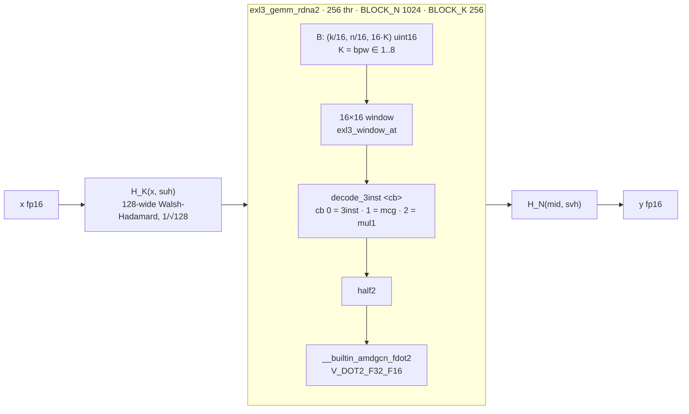
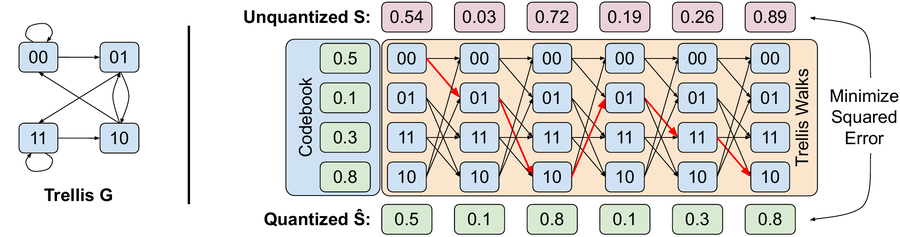
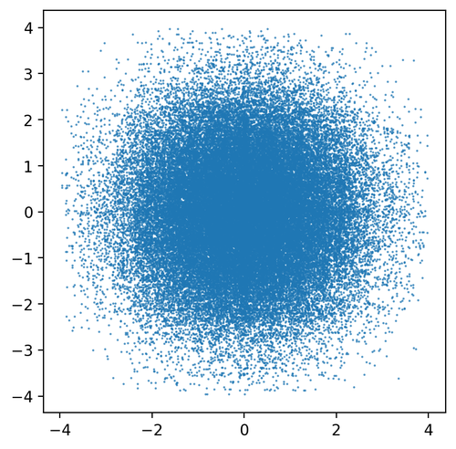

# EXL3 — silicon / HIP contract

Occupancy + live W4 still first. Silicon: [silicon/exl3.md](../../silicon/exl3.md).[^exl3-cb][^exl3-dq][^f-30b0bd4e-exl3-dot2-common-cuh]

Take the math only: unpack trellis → fp16 → `fdot2`. Same job as mxfp4, fatter decode. **No** Marlin / MMA / WMMA port.[^qtip]

## Live extras (2026-08-28)

In the fork. Tip `e268c7d3`. HIP ISA lock `a2c8d5cf`: own `exl3_dot2_*` files, not a fatter `mxfp4_dot2_moe` unpack. Inner loop is 16×16 window → `decode_3inst<cb>` → `half2` → `fdot2`. No GEMM `__launch_bounds__`. `e268c7d3` deleted unused `TILES_N` / `offset_m` / `c0` (gfx1030 `-Werror`); behavior unchanged.[^c-e268c7d3][^c-a2c8d5cf][^f-e268c7d3-exl3-dot2-common-cuh][^exl3-cb]

HIP compiles `cb==0` (`3inst`) and `cb==1` (`mcg`). `cb==2` (`mul1`) does not launch. Live Python still only feeds unmarked 2/3/4-bit single-shard into the kernel; marked mul1/mcg layers fold fp16.[^exl3-cb]

## Arch guard lock 2026-09-21 (dest tip `f3dd65fa` / `3d6df9ed`)

`__HIP__RDNA__` on `exl3_dot2_{dense,dequant,moe}.cu` matches the docker RDNA fatbin set: `gfx1030`/`1031`, `gfx1100`/`1101`, `gfx1150`/`1151`, `gfx1200`/`1201`. Compile-guard only — ISA and tile contract above unchanged. Not `gfx900`/`906`/`1013`. See [silicon/exl3.md](../../silicon/exl3.md).[^c-f3dd65fa][^c-3d6df9ed]

## Pack

```
B: (k/16, n/16, 16*K) uint16     K = bpw ∈ {1..8}
suh: (k,) half                    input scales + Hadamard flips
svh: (n,) half                    output scales + Hadamard flips
cb:  0 | mcg=1 | mul1=2           one codebook, not both flags
```

`k % 16 == 0`, `n % 16 == 0`. Tile is **format-mandatory 16×16**, not a sweep. 4 bpw tile = 128 B packed → 512 B half after decode.[^exl3-cb][^exl3-dq][^f-30b0bd4e-exl3-dot2-common-cuh]

Writer/reader must agree on bit-extract order (`exl3_dq.cuh`: aligned 1/2/4-bit paths, `dq4`/`dq8` for the rest). Lock that when a real checkpoint is named.[^exl3-cb][^exl3-dq][^f-30b0bd4e-exl3-dot2-common-cuh]

## extras WIP (tip `a2c8d5cf`, 2026-08-28)

CMake + `torch_bindings` + `Exl3Config` wired (`d3fe4c98` / `a2c8d5cf`). Still not the default AWQ/GPTQ path. Occupancy hygiene missing on the GEMMs.[^c-d3fe4c98][^c-a2c8d5cf]

| File | Role |
|---|---|
| `csrc/rocm/exl3_dot2_common.cuh` | `decode_3inst<cb>`, real `exl3_window_*` (flat `dq8_flat` is unused scaffold) [^f-a2c8d5cf-exl3-dot2-common-cuh][^exl3-cb] |
| `csrc/rocm/exl3_dot2_dense.cu` | `exl3_gemm_rdna2` — 256 thr, `BLOCK_N=1024`, `BLOCK_K=256`, `M_PER` 1/2/4/8 [^f-a2c8d5cf-exl3-dot2-dense-cu] |
| `csrc/rocm/exl3_dot2_moe.cu` | `moe_exl3_gemm_rdna2` — 256 thr / 1024 N; `BLOCK_SIZE_M` 1/2/4/8; CAS epilogue [^f-a2c8d5cf-exl3-dot2-moe-cu][^f-a2c8d5cf-exl3-dot2-dense-cu] |
| `csrc/rocm/exl3_hadamard.cu` | `exl3_hadamard_128` — `__launch_bounds__(32)`, not in the K-dot [^f-a2c8d5cf-exl3-hadamard-cu] |

Inner: real 16×16 window → `decode_3inst<cb>` → `half2` → `V_DOT2_F32_F16`. Launch (pre-`8c23f0bd`): `bits` ∈ {2,3,4}, `cb` ∈ {0,1} (rejected `mul1`). At `8c23f0bd`: dense also launches `bits=6` and `cb=2`; 6bpw lm_head uses load-time dequant. Dense/MoE GEMM have **no** `__launch_bounds__` / `waves_per_eu` — do not ship on `(1,1)`. Dense LDS is A only (`M×264` half). MoE LDS is A `M×16` half + `s_tile[64][8*bits]` u32. Occupancy risk is VGPR (`w0`+`w1` 4×16 halves on dense), not LDS. `suh`/`svh` stay caller-side / Hadamard kernel.[^c-8c23f0bd][^f-8c23f0bd-exl3-dot2-common-cuh][^isa][^qtip][^exl3-cb]

Do not copy tok/s. Do not treat as Live until occupancy dump + named 3inst checkpoint.[^exl3-cb]

## Inner loop (landed shape)

| Step | Op |
|---|---|
| Load W | `uint32` from packed tile [^exl3-cb][^exl3-dq][^f-30b0bd4e-exl3-dot2-common-cuh] |
| extract | K-bit / 16-bit state in VGPR [^exl3-cb][^exl3-dq][^f-30b0bd4e-exl3-dot2-common-cuh] |
| `decode_3inst<cb>` | mul + (LOP3-emulate or byte-sum) → `half` / `half2` [^f-30b0bd4e-exl3-dot2-common-cuh][^exl3-cb] |
| Hadamard | 128-wide Walsh on A (`suh`) and C (`svh`), `1/sqrt(128)` — not in the K DOT [^qtip] |
| A16 · W16 | `V_DOT2_F32_F16` [^isa] |

Decode kernels (`cb==0/1`): integer mul + bit-force + `hadd` of the two forced halves. `cb==2`: mul + byte-sum (`sdot4` vs `0x01010101` + `0x6400`) + `hfma`. That `sdot4` is **not** the GEMM.[^exl3-cb][^exl3-dq][^f-30b0bd4e-exl3-dot2-common-cuh]

Tile seed after unpack: same as W4A16 (`64×64×32` fp16) for prefill; decode skinny like `q_gemm_rdna2`. Do not copy CUDA `16×16×128` MMA shapes.[^f-30b0bd4e-q-gemm-rdna2-cu]

## vs other unpack-then-DOT

| Format | Unpack | Then |
|---|---|---|
| W4A16 | nibble → scale | `fdot2` [^exl3-cb][^exl3-dq][^f-30b0bd4e-exl3-dot2-common-cuh] |
| mxfp4 | E2M1 + E8M0 | `fdot2` [^ocp-mx] |
| INT2 | 16×i2 | `fdot2` [^exl3-cb][^exl3-dq][^f-30b0bd4e-exl3-dot2-common-cuh] |
| **EXL3** | trellis state → 3-inst codebook | `fdot2` [^qtip] |
| ROCmFPX | codebook10 → `perm` → i8 | `sdot4` (llama.cpp only) [^exl3-cb][^exl3-dq][^f-30b0bd4e-exl3-dot2-common-cuh] |

EXL3 is closest to mxfp4 (weird storage → half → DOT2). It is **not** ROCmFPX.[^exl3-cb][^exl3-dq][^f-30b0bd4e-exl3-dot2-common-cuh]

## Do not

- Invent a gfx1030 MMA fragment layout.[^exl3-cb][^exl3-dq][^f-30b0bd4e-exl3-dot2-common-cuh]
- Mix `cb` in one launch.[^exl3-cb][^exl3-dq][^f-30b0bd4e-exl3-dot2-common-cuh]
- `sdot4`/`sdot8` the reconstructed halves.[^exl3-cb][^exl3-dq][^f-30b0bd4e-exl3-dot2-common-cuh]
- Cooperative-grid Hadamard as a ship gate.[^qtip]
- Land on `waves_per_eu(1,1)`.[^exl3-cb][^exl3-dq][^f-30b0bd4e-exl3-dot2-common-cuh]
- vLLM GGUF / old `exllama.py` uint4 path — those are not this format.[^f-30b0bd4e-exllama-py]

## Done-when (if ever)

- ISA dump: integer decode + `v_dot2_f32_f16`. No `wmma` / `mfma` / mystery DOT.[^isa]
- One named checkpoint (`mcg` xor `mul1` xor default) bit-matches `decode_3inst`.[^f-30b0bd4e-exl3-dot2-common-cuh][^exl3-cb]
- `suh`/`svh` 128-Hadamard applied, scale locked.[^qtip]
- Smoke vs fp16 / W4A16 on the same model. No tok/s from this page.[^exl3-cb][^exl3-dq][^f-30b0bd4e-exl3-dot2-common-cuh]

## extras tip `8c23f0bd` (2026-09-01)

HIP: 6bpw `mul1` load-time dequant + dense launch of `bits∈{2,3,4,6}`, `cb∈{0,1,2}`.[^exl3-cb]

| File | Role |
|---|---|
| `csrc/rocm/exl3_dot2_dequant.cu` | `exl3_dequant_bits6_mul1` — `16×16` block, no LDS, no launch_bounds; one-shot at weight load for 6bpw lm_head [^f-8c23f0bd-exl3-dot2-dequant-cu][^exl3-cb] |
| `exl3_dot2_common.cuh` | `bits==6` → `dq4<6>` window extract [^f-8c23f0bd-exl3-dot2-common-cuh] |
| `exl3_dot2_dense.cu` | launches `bits=6` and `cb=2`; sizes from tensors [^f-8c23f0bd-exl3-dot2-dense-cu] |

Inner GEMM still 16×16 → `decode_3inst` → `half2` → `fdot2`. Dequant is not a K-dot path (no Hadamard in kernel). Occupancy hygiene still missing on GEMMs. Produce experts as `3inst`; do not treat `mul1` launch as produce flip. FA pin closed. No tok/s.[^f-8c23f0bd-exl3-dot2-common-cuh][^qtip][^exl3-cb]


## extras tip `aac1fcd6` (2026-09-04)

Prefill unpack-once: `exl3_decode_trellis_rdna2` — 16×16 block, 256 thr, `decode_3inst` only, no LDS / no fdot2 / no launch_bounds. bits 2/3/4; bits=6 stays mul1 dequant. Dot work after unpack is rocBLAS, not a new HIP DOT tile. Fused decode GEMM path unchanged. Produce `3inst`. No tok/s.[^f-aac1fcd6-exl3-dot2-dense-cu][^f-aac1fcd6-exl3-dot2-common-cuh][^qtip][^exl3-cb]

## extras lock 2026-10-01 (dest tip `30b0bd4e`)

Range `3a0786ea` → `30b0bd4e` (+16). Silicon Take on EXL3 HIP (PR #32 family + loader backport). Occupancy still first. Do not copy tok/s.[^c-3a0786ea][^c-30b0bd4e][^fpr-32]

### mul1 decode + K=1..8 trellis

| File | Delta |
|---|---|
| `csrc/rocm/exl3_dot2_common.cuh` | `cb==2` (`mul1`) byte-sum is **unsigned** (`0x6400` + byte adds), matching exllamav3 `decode_mul1_product_2` (signed sum was ~6 off on real tiles). `exl3_window_at`: `bits ∈ {5,6,8}` use the `dq4` batch reader (pair reader mis-aligns odd windows; found at K=6). `exl3_window_pos`: bitrate-independent inverse of `tensor_core_perm` except locked K=4 special case. [^f-30b0bd4e-exl3-dot2-common-cuh][^exl3-cb] |
| `csrc/rocm/exl3_dot2_dense.cu` | Dense GEMM + `exl3_decode_trellis_rdna2` launch **bits ∈ {1..8}**. New **`exl3_project_rdna2`**: one host op queues `H_K(x,suh)` → `exl3_gemm_rdna2` → `H_N(mid,svh)` on the current stream (caller pre-zeros mid via `cudaMemsetAsync`). Inner K-loop still `decode_3inst` → `half2` → `__builtin_amdgcn_fdot2`. No new `__launch_bounds__` / `waves_per_eu` on GEMM. [^f-30b0bd4e-exl3-dot2-dense-cu][^f-30b0bd4e-exl3-dot2-common-cuh][^qtip][^exl3-cb] |
| `csrc/rocm/exl3_dot2_moe.cu` | MoE launches bits 1..8 and **`cb==2`**. Trellis LDS stage bound to the block's real n-range (`n_tiles_stage`) so N<1024 / last expert k-tile does not over-read past the per-k_tile trellis (page-fault class). [^f-30b0bd4e-exl3-dot2-moe-cu][^qtip] |

Bindings: `ops.h` / `torch_bindings.cpp` register `exl3_project_rdna2`. CMake gfx1030 EXL3 list unchanged (no new `.cu`).[^f-30b0bd4e-ops-h][^f-30b0bd4e-torch-bindings-cpp][^f-30b0bd4e-exl3-dot2-dense-cu]

### Projection at a glance



*`exl3_project_rdna2` as described in the `30b0bd4e` lock below: one host op queues `H_K(x,suh)` → `exl3_gemm_rdna2` → `H_N(mid,svh)`. Hadamard is not in the K dot. Codebook names follow exllamav3 `codebook.cuh` (`decode_3inst`, `decode_mcg_product_2`, `decode_mul1_product_2`). Produce policy stays `-cb 3inst`.*[^c-30b0bd4e][^f-30b0bd4e-exl3-dot2-dense-cu][^f-30b0bd4e-exl3-dot2-common-cuh][^exl3-cb][^qtip]

### Leave (same tip, not ISA locks)

- Python loader rewrite (`exl3.py`: mul1/mcg markers, suh grouping, TP column slices) — contract for feeding the kernels; not DOT.[^f-30b0bd4e-exl3-py][^exl3-cb]
- `Exl3MoEMethod` / `Exl3NgramTable` (PLE gather) — Python; n-gram gather inert on `rdna_extras` until PLE offload rewrite.[^c-30b0bd4e]
- PR #30 W4A16 compile-dispatch explore — opt-in, default off; not EXL3 DOT.[^fpr-30]

Produce policy unchanged: experts **`-cb 3inst`**. `mul1` / mixed-codebook is load+decode support, not a produce flip. FA pin stays closed. No tok/s.[^exl3-cb]

## Figures (QTIP paper, CC BY 4.0)

EXL3 is a QTIP-style trellis code: a weight group is a walk on a bitshift trellis, and each state's value comes from a compute-only codebook such as 3INST, so there is no codebook LUT in the kernel.[^qtip]

[^qtip]

*Figure 1 of QTIP (Tseng et al., arXiv:2406.11235): "A bitshift trellis code with L = 2, k = 1, V = 1. Nodes 0, 1, 2, and 3 have code values 0.5, 0.1, 0.8, and 0.3, respectively. Each node can only transition to the 2^kV = 2 nodes that share their top L−kV = 1 bit with its bottom L−kV = 1 bit." Reproduced unmodified (rasterised from the arXiv source) under CC BY 4.0.[^qtip]*

[^exl3-cb]

*Panel "3INST" of the QTIP correlation figure (arXiv:2406.11235): the set of representable neighbouring values in a bitshift trellis with L = 16, k = 2, V = 1 for the 3INST code; the paper notes 3INST is close to a random Gaussian code. Downscaled from the arXiv source under CC BY 4.0.[^qtip] 3INST is what `decode_3inst` (`cb == 0`) computes on gfx1030 before `fdot2`.[^exl3-cb]*[^f-30b0bd4e-exl3-dot2-common-cuh]

## Sources

- [turboderp-org/exllamav3](https://github.com/turboderp-org/exllamav3) `codebook.cuh`, `exl3_dq.cuh` (2026-08-21)
- [kernels/quant/mxfp4.md](mxfp4.md), [kernels/quant/w4a16.md](w4a16.md)

[^exl3-cb]: exllamav3 `exllamav3_ext/quant/codebook.cuh` @ `abf49117ab` (2026-08-21): `decode_3inst`, `decode_mcg_product_2` (cb 1), `decode_mul1_product_2` (cb 2). <https://github.com/turboderp-org/exllamav3/blob/abf49117abfb2d328e1fe6d51f9cdc8a2889f5bf/exllamav3/exllamav3_ext/quant/codebook.cuh>
[^exl3-dq]: exllamav3 `exllamav3_ext/quant/exl3_dq.cuh` @ `abf49117ab` — trellis bit-extract paths. <https://github.com/turboderp-org/exllamav3/blob/abf49117abfb2d328e1fe6d51f9cdc8a2889f5bf/exllamav3/exllamav3_ext/quant/exl3_dq.cuh>
[^f-30b0bd4e-exl3-dot2-common-cuh]: opengfx1030/vllm-rdna `csrc/rocm/exl3_dot2_common.cuh` @ [`30b0bd4e`](https://github.com/opengfx1030/vllm-rdna/blob/30b0bd4e3604a6ea678244a0df74e452ac05fee6/csrc/rocm/exl3_dot2_common.cuh).
[^qtip]: Tseng, Chee, Sun, Kuleshov, De Sa, *QTIP: Quantization with Trellises and Incoherence Processing*, arXiv:2406.11235 (CC BY 4.0) — bitshift trellis, computed codes 1MAD / 3INST, incoherence processing. <https://arxiv.org/abs/2406.11235>
[^c-e268c7d3]: BlivionIaG/vllm commit [`e268c7d3`](https://github.com/BlivionIaG/vllm/commit/e268c7d37c8b68cf5551266655b8cb0ecb544a00) (2026-08-28) — "fix(rocm): remove unused scaffold vars in exl3 dense kernel".
[^c-a2c8d5cf]: BlivionIaG/vllm commit [`a2c8d5cf`](https://github.com/BlivionIaG/vllm/commit/a2c8d5cf7a5857df77a64305b63e1d106e9ccb1c) (2026-08-28) — "wip(rocm): exl3 quant method registration (Exl3Config) for RDNA".
[^f-e268c7d3-exl3-dot2-common-cuh]: BlivionIaG/vllm `csrc/rocm/exl3_dot2_common.cuh` @ [`e268c7d3`](https://github.com/BlivionIaG/vllm/blob/e268c7d37c8b68cf5551266655b8cb0ecb544a00/csrc/rocm/exl3_dot2_common.cuh).
[^c-f3dd65fa]: opengfx1030/vllm-rdna commit [`f3dd65fa`](https://github.com/opengfx1030/vllm-rdna/commit/f3dd65fa70636566c11b249209d281c0b63c819e) (2026-09-20) — "Merge pull request #15 from GeorgeMA-Strong/codex/qsa-live-prefill-bound".
[^c-3d6df9ed]: opengfx1030/vllm-rdna commit [`3d6df9ed`](https://github.com/opengfx1030/vllm-rdna/commit/3d6df9ed617a3ce728412dbfe433d400596745b8) (2026-09-18) — "fix(rocm): extend exl3_dot2 RDNA arch guard to all RDNA arches in docker build".
[^c-d3fe4c98]: BlivionIaG/vllm commit [`d3fe4c98`](https://github.com/BlivionIaG/vllm/commit/d3fe4c985d7404defc01ca7b98d7aead836c6768) (2026-08-27) — "wip(rocm): exl3 RDNA2 dot2 kernel - wire ops and refine kernels".
[^f-a2c8d5cf-exl3-dot2-common-cuh]: BlivionIaG/vllm `csrc/rocm/exl3_dot2_common.cuh` @ [`a2c8d5cf`](https://github.com/BlivionIaG/vllm/blob/a2c8d5cf7a5857df77a64305b63e1d106e9ccb1c/csrc/rocm/exl3_dot2_common.cuh).
[^f-a2c8d5cf-exl3-dot2-dense-cu]: BlivionIaG/vllm `csrc/rocm/exl3_dot2_dense.cu` @ [`a2c8d5cf`](https://github.com/BlivionIaG/vllm/blob/a2c8d5cf7a5857df77a64305b63e1d106e9ccb1c/csrc/rocm/exl3_dot2_dense.cu).
[^f-a2c8d5cf-exl3-dot2-moe-cu]: BlivionIaG/vllm `csrc/rocm/exl3_dot2_moe.cu` @ [`a2c8d5cf`](https://github.com/BlivionIaG/vllm/blob/a2c8d5cf7a5857df77a64305b63e1d106e9ccb1c/csrc/rocm/exl3_dot2_moe.cu).
[^f-a2c8d5cf-exl3-hadamard-cu]: BlivionIaG/vllm `csrc/rocm/exl3_hadamard.cu` @ [`a2c8d5cf`](https://github.com/BlivionIaG/vllm/blob/a2c8d5cf7a5857df77a64305b63e1d106e9ccb1c/csrc/rocm/exl3_hadamard.cu).
[^c-8c23f0bd]: BlivionIaG/vllm commit [`8c23f0bd`](https://github.com/BlivionIaG/vllm/commit/8c23f0bd8b9a9c691bfc46c36eddd56e086441e0) (2026-09-01) — "feat(exl3): wrap kernels in @torch._dynamo.allow_in_graph".
[^f-8c23f0bd-exl3-dot2-common-cuh]: BlivionIaG/vllm `csrc/rocm/exl3_dot2_common.cuh` @ [`8c23f0bd`](https://github.com/BlivionIaG/vllm/blob/8c23f0bd8b9a9c691bfc46c36eddd56e086441e0/csrc/rocm/exl3_dot2_common.cuh).
[^isa]: AMD, *"RDNA 2" Instruction Set Architecture Reference Guide* (doc 70648): "Feature Changes in RDNA2 Devices" dot-product list; VOP2 opcodes 2 `V_DOT2C_F32_F16` / 13 `V_DOT4C_I32_I8`; VOP3P opcodes 19–25 `V_DOT2_F32_F16` … `V_DOT8_U32_U4`; LDS "128kB memory per workgroup processor split up into 64 banks of dword-wide RAMs"; "a single workgroup may allocate up to 64kB of LDS". <https://docs.amd.com/v/u/en-US/rdna2-shader-instruction-set-architecture>
[^f-30b0bd4e-q-gemm-rdna2-cu]: opengfx1030/vllm-rdna `csrc/rocm/q_gemm_rdna2.cu` @ [`30b0bd4e`](https://github.com/opengfx1030/vllm-rdna/blob/30b0bd4e3604a6ea678244a0df74e452ac05fee6/csrc/rocm/q_gemm_rdna2.cu).
[^ocp-mx]: Open Compute Project, *OCP Microscaling Formats (MX) v1.0 Specification* — MXFP4 = E2M1 elements with one shared E8M0 scale per 32-element block. <https://www.opencompute.org/documents/ocp-microscaling-formats-mx-v1-0-spec-final-pdf>
[^f-30b0bd4e-exllama-py]: opengfx1030/vllm-rdna `vllm/model_executor/kernels/linear/mixed_precision/exllama.py` @ [`30b0bd4e`](https://github.com/opengfx1030/vllm-rdna/blob/30b0bd4e3604a6ea678244a0df74e452ac05fee6/vllm/model_executor/kernels/linear/mixed_precision/exllama.py).
[^f-8c23f0bd-exl3-dot2-dequant-cu]: BlivionIaG/vllm `csrc/rocm/exl3_dot2_dequant.cu` @ [`8c23f0bd`](https://github.com/BlivionIaG/vllm/blob/8c23f0bd8b9a9c691bfc46c36eddd56e086441e0/csrc/rocm/exl3_dot2_dequant.cu).
[^f-8c23f0bd-exl3-dot2-dense-cu]: BlivionIaG/vllm `csrc/rocm/exl3_dot2_dense.cu` @ [`8c23f0bd`](https://github.com/BlivionIaG/vllm/blob/8c23f0bd8b9a9c691bfc46c36eddd56e086441e0/csrc/rocm/exl3_dot2_dense.cu).
[^f-aac1fcd6-exl3-dot2-dense-cu]: opengfx1030/vllm-rdna `csrc/rocm/exl3_dot2_dense.cu` @ [`aac1fcd6`](https://github.com/opengfx1030/vllm-rdna/blob/aac1fcd6ce0b3ab66875d05d17c8087003524cda/csrc/rocm/exl3_dot2_dense.cu).
[^f-aac1fcd6-exl3-dot2-common-cuh]: opengfx1030/vllm-rdna `csrc/rocm/exl3_dot2_common.cuh` @ [`aac1fcd6`](https://github.com/opengfx1030/vllm-rdna/blob/aac1fcd6ce0b3ab66875d05d17c8087003524cda/csrc/rocm/exl3_dot2_common.cuh).
[^c-3a0786ea]: opengfx1030/vllm-rdna commit [`3a0786ea`](https://github.com/opengfx1030/vllm-rdna/commit/3a0786eaa70f37890b729ff4943e5cc9a0cb68c0) (2026-09-30) — "merge(rdna2): land w4a8-wiring onto rdna_extras (W4A8 opt-in; W4A16 default unchanged)".
[^c-30b0bd4e]: opengfx1030/vllm-rdna commit [`30b0bd4e`](https://github.com/opengfx1030/vllm-rdna/commit/30b0bd4e3604a6ea678244a0df74e452ac05fee6) (2026-10-01) — "test(exl3): backport loader unit tests + mul1 tile reformat".
[^fpr-32]: opengfx1030/vllm-rdna PR #32 — port(exl3): mul1 decode and K=1..8 trellis kernels. <https://github.com/opengfx1030/vllm-rdna/pull/32>
[^f-30b0bd4e-exl3-dot2-dense-cu]: opengfx1030/vllm-rdna `csrc/rocm/exl3_dot2_dense.cu` @ [`30b0bd4e`](https://github.com/opengfx1030/vllm-rdna/blob/30b0bd4e3604a6ea678244a0df74e452ac05fee6/csrc/rocm/exl3_dot2_dense.cu).
[^f-30b0bd4e-exl3-dot2-moe-cu]: opengfx1030/vllm-rdna `csrc/rocm/exl3_dot2_moe.cu` @ [`30b0bd4e`](https://github.com/opengfx1030/vllm-rdna/blob/30b0bd4e3604a6ea678244a0df74e452ac05fee6/csrc/rocm/exl3_dot2_moe.cu).
[^f-30b0bd4e-ops-h]: opengfx1030/vllm-rdna `csrc/rocm/ops.h` @ [`30b0bd4e`](https://github.com/opengfx1030/vllm-rdna/blob/30b0bd4e3604a6ea678244a0df74e452ac05fee6/csrc/rocm/ops.h).
[^f-30b0bd4e-torch-bindings-cpp]: opengfx1030/vllm-rdna `csrc/rocm/torch_bindings.cpp` @ [`30b0bd4e`](https://github.com/opengfx1030/vllm-rdna/blob/30b0bd4e3604a6ea678244a0df74e452ac05fee6/csrc/rocm/torch_bindings.cpp).
[^f-30b0bd4e-exl3-py]: opengfx1030/vllm-rdna `vllm/model_executor/layers/quantization/exl3.py` @ [`30b0bd4e`](https://github.com/opengfx1030/vllm-rdna/blob/30b0bd4e3604a6ea678244a0df74e452ac05fee6/vllm/model_executor/layers/quantization/exl3.py).
[^fpr-30]: opengfx1030/vllm-rdna PR #30 — [explore] RDNA2 W4A16 torch.compile M-dispatch. <https://github.com/opengfx1030/vllm-rdna/pull/30>
