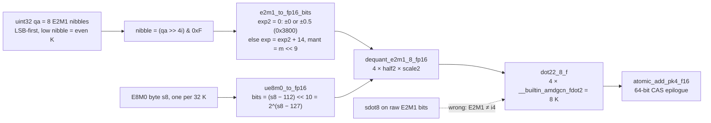

# mxfp4 dense + MoE — silicon / HIP contract

Live: `mxfp4_dot2_common.cuh`, `mxfp4_dot2_dense.cu`, `mxfp4_dot2_moe.cu` @ `290715e6`. **Incomplete** — GPU smoke pending.[^c-290715e6][^f-290715e6-mxfp4-dot2-common-cuh][^f-290715e6-mxfp4-dot2-dense-cu][^f-290715e6-mxfp4-dot2-moe-cu]

No FP4 unit. E2M1 nibble → fp16 (inline bit-trick, no LUT — as of `add17dd7`; the first land `290715e6` used a 16-entry `__constant__` LUT), × E8M0 scale (exponent add), then `V_DOT2_F32_F16` (`dot22_8_f` = 4× `fdot2` / 8 K).[^f-add17dd7-mxfp4-dot2-common-cuh][^f-290715e6-mxfp4-dot2-common-cuh][^isa][^ocp-mx][^c-add17dd7][^c-290715e6]

NVFP4 is the same DOT with **E4M3** scales (mul, not exp add): [nvfp4.md](nvfp4.md). Spec W8A8 `sdot4` is unrelated: [w8a8-mxfp4.md](w8a8-mxfp4.md).[^f-290715e6-mxfp4-dot2-common-cuh][^ocp-mx]

DSv4 Flash leftover attn/shared/indexer is **MXFP8** (E4M3 + E8M0 / 128×128), not this expert pack and not W8A16-FP8 group-scale. Same `fdot2` after e4m3 bit-trick + `mxfp4_apply_e8m0_bits` broadcast. Silicon: [silicon/formats/dsv4-flash.md](../../silicon/formats/dsv4-flash.md).[^f-290715e6-mxfp4-dot2-common-cuh][^ocp-mx]

Petit (CDNA FP4 reference): silicon Take/Leave only — [silicon/external-projects/petit-kernel.md](../../silicon/external-projects/petit-kernel.md). Do not import MFMA grids.[^f-290715e6-mxfp4-dot2-common-cuh][^ocp-mx]

## Unpack at a glance

*Functions as named in `csrc/rocm/mxfp4_dot2_common.cuh` at `add17dd7` (bit-trick, no LUT). The E8M0 scale is a power of two, so the fp16 multiply is the exponent add described above; upstream PR #46676 writes it as an integer exponent add (`mxfp4_apply_e8m0_bits`). See [w8a8-mxfp4.md](w8a8-mxfp4.md) §6–§7.*[^c-add17dd7][^f-add17dd7-mxfp4-dot2-common-cuh][^ocp-mx][^vpr-46676]

## Sources

[^c-290715e6]: BlivionIaG/vllm commit [`290715e6`](https://github.com/BlivionIaG/vllm/commit/290715e6f44307d2e253fc53248cf4271fa2a578) (2026-08-13) — "feat(rocm): add native RDNA2 W4A4 MXFP4 fused MoE + dense GEMM kernels for gfx1030".
[^f-290715e6-mxfp4-dot2-common-cuh]: BlivionIaG/vllm `csrc/rocm/mxfp4_dot2_common.cuh` @ [`290715e6`](https://github.com/BlivionIaG/vllm/blob/290715e6f44307d2e253fc53248cf4271fa2a578/csrc/rocm/mxfp4_dot2_common.cuh).
[^f-290715e6-mxfp4-dot2-dense-cu]: BlivionIaG/vllm `csrc/rocm/mxfp4_dot2_dense.cu` @ [`290715e6`](https://github.com/BlivionIaG/vllm/blob/290715e6f44307d2e253fc53248cf4271fa2a578/csrc/rocm/mxfp4_dot2_dense.cu).
[^f-290715e6-mxfp4-dot2-moe-cu]: BlivionIaG/vllm `csrc/rocm/mxfp4_dot2_moe.cu` @ [`290715e6`](https://github.com/BlivionIaG/vllm/blob/290715e6f44307d2e253fc53248cf4271fa2a578/csrc/rocm/mxfp4_dot2_moe.cu).
[^f-add17dd7-mxfp4-dot2-common-cuh]: BlivionIaG/vllm `csrc/rocm/mxfp4_dot2_common.cuh` @ [`add17dd7`](https://github.com/BlivionIaG/vllm/blob/add17dd7b35942748fae68f7a7cec939c46d0b82/csrc/rocm/mxfp4_dot2_common.cuh).
[^isa]: AMD, *"RDNA 2" Instruction Set Architecture Reference Guide* (doc 70648): "Feature Changes in RDNA2 Devices" dot-product list; VOP2 opcodes 2 `V_DOT2C_F32_F16` / 13 `V_DOT4C_I32_I8`; VOP3P opcodes 19–25 `V_DOT2_F32_F16` … `V_DOT8_U32_U4`; LDS "128kB memory per workgroup processor split up into 64 banks of dword-wide RAMs"; "a single workgroup may allocate up to 64kB of LDS". <https://docs.amd.com/v/u/en-US/rdna2-shader-instruction-set-architecture>
[^ocp-mx]: Open Compute Project, *OCP Microscaling Formats (MX) v1.0 Specification* — MXFP4 = E2M1 elements with one shared E8M0 scale per 32-element block. <https://www.opencompute.org/documents/ocp-microscaling-formats-mx-v1-0-spec-final-pdf>
[^c-add17dd7]: BlivionIaG/vllm commit [`add17dd7`](https://github.com/BlivionIaG/vllm/commit/add17dd7b35942748fae68f7a7cec939c46d0b82) (2026-08-17) — "feat(rocm): fp16 sparse MLA Triton kernels + indexer int64 fix for gfx1030".
[^vpr-46676]: vLLM PR #46676 — Native HIP MXFP4 (dense + MoE) for RDNA3 (open). <https://github.com/vllm-project/vllm/pull/46676>
