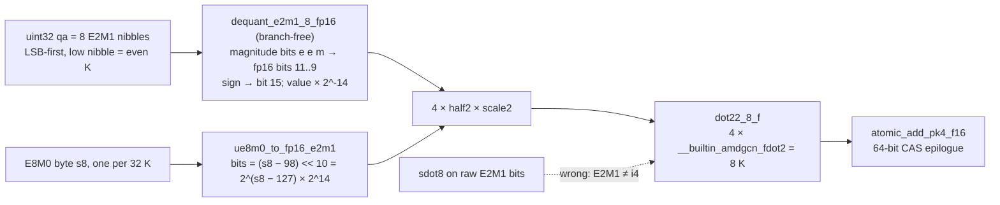

# mxfp4 dense + MoE — silicon / HIP contract

## Current state at dest `rdna_extras` @ `1dc3bac4` (checked 2026-10-11)

| Item | State at `1dc3bac4` |
|---|---|
| Files | `csrc/rocm/mxfp4_dot2_common.cuh`, `mxfp4_dot2_dense.cu`, `mxfp4_dot2_moe.cu`; both `.cu` files are in the gfx1030-only CMake list.[^mx-tip-cmake] Ops `mxfp4_gemm_rdna2` and `moe_mxfp4_gemm_rdna2`.[^mx-tip-bind] |
| E2M1 decode | **Branch-free, no lookup.** `dequant_e2m1_8_fp16` places each nibble's 3 magnitude bits at fp16 bits 11..9 (the fp16 encoding of value × 2^-14, normals and the 0.5 subnormal alike) and the sign at bit 15, two nibbles per `half2`, then multiplies by the scale.[^mx-tip-dequant] |
| E8M0 scale | The 2^14 left out by the decode is folded into the scale: `ue8m0_to_fp16_e2m1(s) = (s − 98) << 10`, exact for scale bytes 99..128. The plain `ue8m0_to_fp16(s) = (s − 112) << 10` still exists.[^mx-tip-scale] |
| Dot / epilogue | `dot22_8_f` = 4 × `__builtin_amdgcn_fdot2` per 8 K with an fp32 accumulator; the MoE epilogue is `atomic_add_pk4_f16`, a 64-bit CAS loop.[^mx-tip-dot][^mx-tip-moe] |
| Dead code | `e2m1_lut_fn` (a 16-way `switch` returning fp16 bit patterns) is still defined in the header but is no longer called by the decode.[^mx-tip-lut] |
| MoE block size | `_block_size_m(num_tokens)` picks 1 / 2 / 4 / 8 at ≤ 4 / ≤ 32 / ≤ 128 / more tokens (was always 8).[^mx-tip-bsm][^c-16e890dc] |
| MoE activation | Gate/up clamped by `swiglu_limit` (`gemm1_clamp_limit`), fused through `silu_and_mul_with_clamp`.[^c-5eb773b6][^c-7961afd2] |

### E2M1 decode history (historical, each with its SHA)

1. BlivionIaG `290715e6` (2026-08-13): 16-entry `__device__ __constant__ half e2m1_lut[16]`.[^c-290715e6][^f-290715e6-mxfp4-dot2-common-cuh]
2. BlivionIaG `add17dd7` (2026-08-17): inline bit-trick `e2m1_to_fp16_bits`, no LUT, no constant memory.[^c-add17dd7][^f-add17dd7-mxfp4-dot2-common-cuh]
3. Dest `rdna_extras` after the v0.31.0 port, before 2026-10-09: `e2m1_lut_fn`, a 16-way `switch` (the header says hipcc 7.14 rejected the `__constant__` brace initializer). Its +3/+4/+6 entries were the fp16 patterns of 4/8/16, so every weight with |w| ≥ 3 decoded too large; fixed in `7b98e3f8` (2026-10-09 00:56 UTC+2).[^c-7b98e3f8]
4. Dest `395d283c` (2026-10-09 04:50 UTC+2): branch-free decode replaces the per-nibble `switch`; this is the state at `1dc3bac4`.[^c-395d283c]

The bullets below describe the BlivionIaG archive commits named in them and are kept as history.

Historical: `mxfp4_dot2_common.cuh`, `mxfp4_dot2_dense.cu`, `mxfp4_dot2_moe.cu` @ BlivionIaG `290715e6` were marked **Incomplete** — GPU smoke pending.[^c-290715e6][^f-290715e6-mxfp4-dot2-common-cuh][^f-290715e6-mxfp4-dot2-dense-cu][^f-290715e6-mxfp4-dot2-moe-cu] At `1dc3bac4` the dest commit messages report checks against real DeepSeek-V4-Flash experts (`7b98e3f8`) and serve runs (`7961afd2`); this page does not restate their numbers.

No FP4 unit. E2M1 nibble → fp16 (branch-free shift-and-mask at `1dc3bac4`; see the history list above), × E8M0 scale (power of two, so the multiply is exact), then `V_DOT2_F32_F16` (`dot22_8_f` = 4× `fdot2` / 8 K).[^mx-tip-dequant][^mx-tip-dot][^f-add17dd7-mxfp4-dot2-common-cuh][^f-290715e6-mxfp4-dot2-common-cuh][^isa][^ocp-mx][^c-add17dd7][^c-290715e6]

NVFP4 is the same DOT with **E4M3** scales (mul, not exp add): [nvfp4.md](nvfp4.md). Spec W8A8 `sdot4` is unrelated: [w8a8-mxfp4.md](w8a8-mxfp4.md).[^f-290715e6-mxfp4-dot2-common-cuh][^ocp-mx]

DSv4 Flash leftover attn/shared/indexer is **MXFP8** (E4M3 + E8M0 / 128×128), not this expert pack and not W8A16-FP8 group-scale. How dest decodes that MXFP8 leftover at `1dc3bac4` is not traced on this page *(unsourced)*: `mxfp4_apply_e8m0_bits` is the upstream PR #46676 helper name and does not exist in dest; dest's E4M3 decode is the branch-free one in `qdq_fp8_rdna2.cuh` (`5148ba78`).[^vpr-46676][^c-5148ba78] Silicon: [silicon/formats/dsv4-flash.md](../../silicon/formats/dsv4-flash.md).[^f-290715e6-mxfp4-dot2-common-cuh][^ocp-mx]

Petit (CDNA FP4 reference): silicon Take/Leave only — [silicon/external-projects/petit-kernel.md](../../silicon/external-projects/petit-kernel.md). Do not import MFMA grids.[^f-290715e6-mxfp4-dot2-common-cuh][^ocp-mx]

## Unpack at a glance

*Functions as named in `csrc/rocm/mxfp4_dot2_common.cuh` at dest `1dc3bac4` (branch-free decode since `395d283c`).[^mx-tip-dequant][^mx-tip-scale][^c-395d283c] Earlier versions: `e2m1_to_fp16_bits` at BlivionIaG `add17dd7`, `e2m1_lut_fn` switch in dest before `395d283c` (historical). The E8M0 scale is a power of two, so the fp16 multiply is the exponent add described above; upstream PR #46676 writes it as an integer exponent add (`mxfp4_apply_e8m0_bits`). See [w8a8-mxfp4.md](w8a8-mxfp4.md) §6–§7.*[^c-add17dd7][^f-add17dd7-mxfp4-dot2-common-cuh][^ocp-mx][^vpr-46676]

## Sources

[^c-290715e6]: BlivionIaG/vllm commit [`290715e6`](https://github.com/BlivionIaG/vllm/commit/290715e6f44307d2e253fc53248cf4271fa2a578) (2026-08-13) — "feat(rocm): add native RDNA2 W4A4 MXFP4 fused MoE + dense GEMM kernels for gfx1030".
[^f-290715e6-mxfp4-dot2-common-cuh]: BlivionIaG/vllm `csrc/rocm/mxfp4_dot2_common.cuh` @ [`290715e6`](https://github.com/BlivionIaG/vllm/blob/290715e6f44307d2e253fc53248cf4271fa2a578/csrc/rocm/mxfp4_dot2_common.cuh).
[^f-290715e6-mxfp4-dot2-dense-cu]: BlivionIaG/vllm `csrc/rocm/mxfp4_dot2_dense.cu` @ [`290715e6`](https://github.com/BlivionIaG/vllm/blob/290715e6f44307d2e253fc53248cf4271fa2a578/csrc/rocm/mxfp4_dot2_dense.cu).
[^f-290715e6-mxfp4-dot2-moe-cu]: BlivionIaG/vllm `csrc/rocm/mxfp4_dot2_moe.cu` @ [`290715e6`](https://github.com/BlivionIaG/vllm/blob/290715e6f44307d2e253fc53248cf4271fa2a578/csrc/rocm/mxfp4_dot2_moe.cu).
[^f-add17dd7-mxfp4-dot2-common-cuh]: BlivionIaG/vllm `csrc/rocm/mxfp4_dot2_common.cuh` @ [`add17dd7`](https://github.com/BlivionIaG/vllm/blob/add17dd7b35942748fae68f7a7cec939c46d0b82/csrc/rocm/mxfp4_dot2_common.cuh).
[^isa]: AMD, *"RDNA 2" Instruction Set Architecture Reference Guide* (doc 70648): "Feature Changes in RDNA2 Devices" dot-product list; VOP2 opcodes 2 `V_DOT2C_F32_F16` / 13 `V_DOT4C_I32_I8`; VOP3P opcodes 19–25 `V_DOT2_F32_F16` … `V_DOT8_U32_U4`; LDS "128kB memory per workgroup processor split up into 64 banks of dword-wide RAMs"; "a single workgroup may allocate up to 64kB of LDS". <https://docs.amd.com/v/u/en-US/rdna2-shader-instruction-set-architecture>
[^ocp-mx]: Open Compute Project, *OCP Microscaling Formats (MX) v1.0 Specification* — MXFP4 = E2M1 elements with one shared E8M0 scale per 32-element block. <https://www.opencompute.org/documents/ocp-microscaling-formats-mx-v1-0-spec-final-pdf>
[^c-add17dd7]: BlivionIaG/vllm commit [`add17dd7`](https://github.com/BlivionIaG/vllm/commit/add17dd7b35942748fae68f7a7cec939c46d0b82) (2026-08-17) — "feat(rocm): fp16 sparse MLA Triton kernels + indexer int64 fix for gfx1030".
[^vpr-46676]: vLLM PR #46676 — Native HIP MXFP4 (dense + MoE) for RDNA3 (open). <https://github.com/vllm-project/vllm/pull/46676>
[^mx-tip-cmake]: gfx1030 `VLLM_ROCM_EXT_SRC` append list in `CMakeLists.txt`, dest at 1dc3bac4. https://github.com/opengfx1030/vllm-rdna/blob/1dc3bac4cda3201a1b4fb345e044578e84a272cf/CMakeLists.txt#L1519-L1550
[^mx-tip-bind]: `moe_mxfp4_gemm_rdna2` / `mxfp4_gemm_rdna2` schema and impl in `csrc/rocm/torch_bindings.cpp`, dest at 1dc3bac4. https://github.com/opengfx1030/vllm-rdna/blob/1dc3bac4cda3201a1b4fb345e044578e84a272cf/csrc/rocm/torch_bindings.cpp#L311-L325
[^mx-tip-dequant]: `dequant_e2m1_8_fp16` and its comment, `csrc/rocm/mxfp4_dot2_common.cuh`, dest at 1dc3bac4. https://github.com/opengfx1030/vllm-rdna/blob/1dc3bac4cda3201a1b4fb345e044578e84a272cf/csrc/rocm/mxfp4_dot2_common.cuh#L185-L207
[^mx-tip-scale]: `ue8m0_to_fp16` (L136-L141) and `ue8m0_to_fp16_e2m1` (L209-L215), `csrc/rocm/mxfp4_dot2_common.cuh`, dest at 1dc3bac4. https://github.com/opengfx1030/vllm-rdna/blob/1dc3bac4cda3201a1b4fb345e044578e84a272cf/csrc/rocm/mxfp4_dot2_common.cuh#L209-L215
[^mx-tip-dot]: `dot22_8_f` and `atomic_add_pk4_f16`, `csrc/rocm/mxfp4_dot2_common.cuh`, dest at 1dc3bac4. https://github.com/opengfx1030/vllm-rdna/blob/1dc3bac4cda3201a1b4fb345e044578e84a272cf/csrc/rocm/mxfp4_dot2_common.cuh#L143-L183
[^mx-tip-moe]: decode, dot and epilogue calls in `csrc/rocm/mxfp4_dot2_moe.cu`, dest at 1dc3bac4. https://github.com/opengfx1030/vllm-rdna/blob/1dc3bac4cda3201a1b4fb345e044578e84a272cf/csrc/rocm/mxfp4_dot2_moe.cu#L150-L234
[^mx-tip-lut]: `e2m1_lut_fn` definition, `csrc/rocm/mxfp4_dot2_common.cuh`, dest at 1dc3bac4 (no caller in the tree). https://github.com/opengfx1030/vllm-rdna/blob/1dc3bac4cda3201a1b4fb345e044578e84a272cf/csrc/rocm/mxfp4_dot2_common.cuh#L55-L122
[^mx-tip-bsm]: `_block_size_m`, `vllm/model_executor/layers/fused_moe/experts/rdna2_mxfp4_moe.py`, dest at 1dc3bac4. https://github.com/opengfx1030/vllm-rdna/blob/1dc3bac4cda3201a1b4fb345e044578e84a272cf/vllm/model_executor/layers/fused_moe/experts/rdna2_mxfp4_moe.py#L72-L88
[^c-395d283c]: opengfx1030/vllm-rdna commit `395d283c242f9c5f7a2f447e4cd0f617949a4c04` (2026-10-09 04:50 UTC+2), "perf(rocm): branch-free E2M1 decode in the RDNA2 MXFP4 GEMMs (10-14x)"; ancestor of 1dc3bac4. https://github.com/opengfx1030/vllm-rdna/commit/395d283c242f9c5f7a2f447e4cd0f617949a4c04
[^c-7b98e3f8]: opengfx1030/vllm-rdna commit `7b98e3f85173ca5c7b37793cc8acc609d9eccbdc` (2026-10-09 00:56 UTC+2), "fix(rocm): correct E2M1 fp16 bit patterns in the RDNA2 MXFP4 LUT". https://github.com/opengfx1030/vllm-rdna/commit/7b98e3f85173ca5c7b37793cc8acc609d9eccbdc
[^c-16e890dc]: opengfx1030/vllm-rdna commit `16e890dcea9efe230838c1e747e6b75f2d9a86e8` (2026-10-09), "perf(rdna): pick the RDNA2 MXFP4 MoE block size from the token count". https://github.com/opengfx1030/vllm-rdna/commit/16e890dcea9efe230838c1e747e6b75f2d9a86e8
[^c-5eb773b6]: opengfx1030/vllm-rdna commit `5eb773b6567976aa6ed79f4c975c985ef9b70e8f` (2026-10-09), "fix(rocm): apply swiglu_limit in the RDNA2 MXFP4 MoE activation". https://github.com/opengfx1030/vllm-rdna/commit/5eb773b6567976aa6ed79f4c975c985ef9b70e8f
[^c-7961afd2]: opengfx1030/vllm-rdna commit `7961afd29b7dfeb121f869442ba263d59aa28b0a` (2026-10-09), "perf(rdna2): fused clamped SwiGLU in the MXFP4 MoE experts". https://github.com/opengfx1030/vllm-rdna/commit/7961afd29b7dfeb121f869442ba263d59aa28b0a
[^c-5148ba78]: opengfx1030/vllm-rdna commit `5148ba78172f0def147f80d79ca2a5c93af683d6` (2026-10-09), "perf(rdna2): branch-free E4M3 decode in qdq_fp8_rdna2.cuh"; ancestor of 1dc3bac4. https://github.com/opengfx1030/vllm-rdna/commit/5148ba78172f0def147f80d79ca2a5c93af683d6
