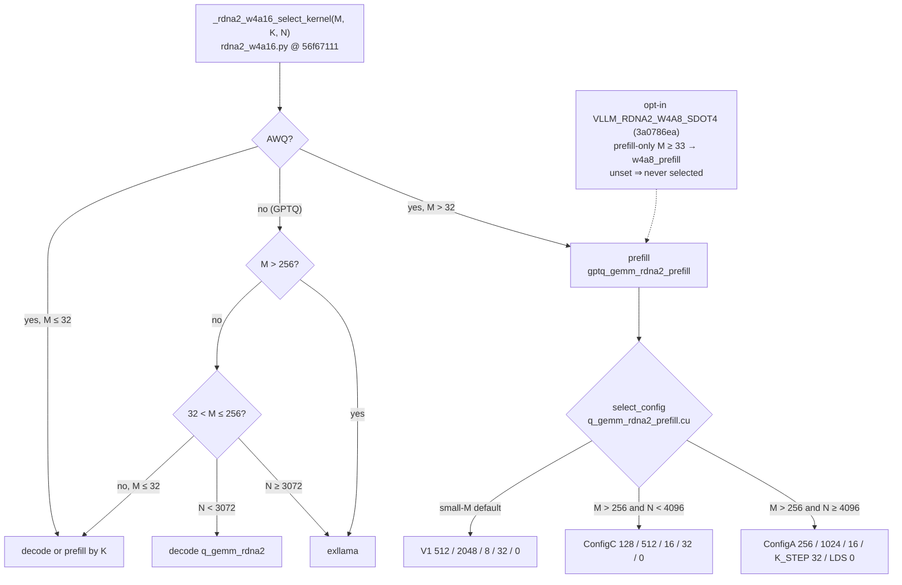
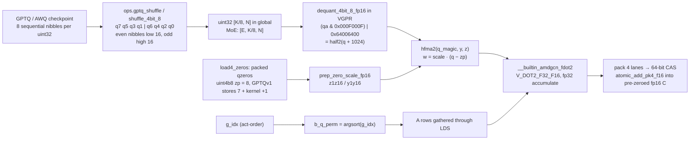

# W4A16 (GPTQ / AWQ / compressed-tensors) on gfx1030 — kernel-writer brief

## Current state at dest `rdna_extras` @ `a01f2637` (checked 2026-10-16)

- The prefill getenv hooks `VLLM_RDNA2_PREFILL_FORCE_CONFIG` and `VLLM_RDNA2_PREFILL_FORCE_SPLIT_K` are deleted. `launch_dispatch` calls `compute_split_k<Config>` directly for V1, C and A, and `select_config` has no override. `VLLM_RDNA2_PREFILL_DEBUG` is still read.[^w4-a01f-prefill][^c-ddb69e64]
- The unregistered `gptq_gemm_rdna2_prefill_direct` alias, its Python wrapper and its fake are deleted. The only prefill entry is `gptq_gemm_rdna2_prefill`.[^c-ddb69e64]
- The Python `awq_prefill` branch in `_rdna2_w4a16_gemm` and `_awq_prefill_available()` are deleted; AWQ prefill goes to `gptq_gemm_rdna2_prefill`, as the dispatcher table below already says.[^c-d77eede8]
- `RDNA2W4A16MoEExperts.process_weights_after_loading` (preallocated `_sorted_ids` / `_expert_ids` / `_topk_w_buf` routing scratch) is deleted; the commit says it was never invoked. `moe_align_block_size` no longer takes preallocated outputs and allocates them per call.[^c-d77eede8]
- No tile, `__launch_bounds__`, DOT builtin, LDS budget or CMake change in this range. Occupancy still comes first.[^a01f-cmp]

## Current state at dest `rdna_extras` @ `1dc3bac4` (checked 2026-10-11)

- *(Historical, `1dc3bac4`; deleted at `a01f2637`)* Prefill debug knobs `VLLM_RDNA2_PREFILL_FORCE_CONFIG` and `VLLM_RDNA2_PREFILL_FORCE_SPLIT_K` were still read in `q_gemm_rdna2_prefill.cu`.[^w4-tip-gates]
- MoE `block_size_m`: 1 at ≤ 4 tokens, otherwise 4, or the configured large size above a token threshold (`_resolve_block_size_m`).[^w4-tip-gates]
- W4A8 MoE stays hard-off under `VLLM_RDNA_MOE_RESIDENT` / `_SKINNY` (`resolve_w4a8_moe`).[^w4-tip-gates]
- `rdna2_graph_keepalive.cuh` and `q_gemm_rdna2_awq_prefill.cu` are absent. Lines citing them are historical (pinned SHAs).[^w4-tip-zeros]


Engine status: [engine/overview/coverage.md](../../engine/overview/coverage.md) (W4A16 row; the engine shape×mode page was never written). This page is the DOT, not ticket status.

## Extras modes (2026-08-23)

GPTQ / AWQ / WNA16 are **pack / zeros / group-size**, not a second GEMM. One HIP: `q_gemm_rdna2` / `moe_q_gemm_rdna2` — nibble unpack + ZP + `fdot2`. FA pin is **closed** (`(N,1)` inert). Fat-M / ConfigA leftover unchanged.[^f-56f67111-moe-q-gemm-rdna2-cu][^f-56f67111-q-gemm-rdna2-cu]

| Mode | What HIP does | gfx1030 [^f-b53a7a2-q-gemm-rdna2-common-cuh][^f-b53a7a2-moe-q-gemm-rdna2-cu] |
|---|---|---|
| GPTQ `uint4b8` | `zp=8` or GPTQv1 store `7` + kernel `+1` | Same `dequant_4bit_8_fp16` [^f-b53a7a2-q-gemm-rdna2-common-cuh][^f-b53a7a2-moe-q-gemm-rdna2-cu] |
| AWQ (group ZP) | Packed `qzeros` via `load4_zeros`; still `w = scale * (q - zp)` then `fdot2` | Dense Live is **loader**. *(Historical, `b53a7a2`)* MoE **Not done**: `moe_q_gemm` still synthesizes GPTQv1 zeros (`zero_offset=1`) [^f-b53a7a2-q-gemm-rdna2-common-cuh][^f-b53a7a2-moe-q-gemm-rdna2-cu]. **At `8bb8ff36`:** compressed-tensors W4A16 MoE loads the checkpoint's packed zeros and runs `zero_offset=0` (see the 2026-10-14 lock) [^f-8bb8ff36-moe-q-gemm-rdna2-cu][^f-8bb8ff36-ct-wna16-rdna2-py] |
| compressed-tensors WNA16 | Same if shuffled `[K/8,N]` `uint4b8` | Sequential `[K,N/8]` is **Leave** (repack or do not fire) [^f-b53a7a2-q-gemm-rdna2-common-cuh][^f-b53a7a2-moe-q-gemm-rdna2-cu] |
| `gs` 32 / 64 / 128 | Scale refresh assumes `gs ≥ 32` (`k += 32`) | Verify; do not invent which gs dense AWQ shipped [^f-b53a7a2-q-gemm-rdna2-common-cuh][^f-b53a7a2-moe-q-gemm-rdna2-cu] |
| `gs` 256 or −1 | Not in this HIP loop | **Not done** [^f-b53a7a2-q-gemm-rdna2-common-cuh][^f-b53a7a2-moe-q-gemm-rdna2-cu] |
| Triton GEMV / WMMA / `sdot8` | Wrong pack, no opcode, or W4A4 | **Leave** / **Dead** [^f-b53a7a2-q-gemm-rdna2-common-cuh][^f-b53a7a2-moe-q-gemm-rdna2-cu] |

Do not add a W4A16 occupancy child. Do not write a second MoE DOT for AWQ — ship packed zeros into the existing `moe_q_gemm` path.[^f-b53a7a2-q-gemm-rdna2-common-cuh][^f-b53a7a2-moe-q-gemm-rdna2-cu] Dest did exactly that at `8bb8ff36`: same kernel and `fdot2` loop, `zero_offset` became a runtime argument.[^c-8bb8ff36][^f-8bb8ff36-moe-q-gemm-rdna2-cu]

## f263172a split-K epilogue (2026-08-25)

Inner loop still nibble + ZP + `fdot2`. Not a new GEMM.[^c-f263172a]

| Split | Path | Why |
|---|---|---|
| `grid.z == 1` | packed-fp16 CAS atomic into zeroed `c` | one accumulator, no order [^c-f263172a] |
| `grid.z > 1` | plain fp32 store to `[z,m,n]` + `reduce_split_partials_kernel` (256-thr, z=0..Z-1, one `__float2half_rn`) | fp16 CAS was order-dependent (non-associative + race) [^c-f263172a] |

Prefill also shrinks `split_k` until `k_per_split % K_STEP == 0` (tail was reading past the window). Extra: `hipMallocAsync` `Z*M*N*fp32` per multi-split launch. Same DOT. Do not copy tok/s. Pin stays closed.[^c-f263172a]


## Prefill on extras (`56f67111`) — ConfigA dest; experiment configs deleted

Dest tip `opengfx1030/vllm-rdna` `rdna_extras` @ `56f67111` (after `441ec054` K_STEP/8 generalize + cleanup drop of measured-slower slots).[^c-56f67111][^c-441ec054]

`_rdna2_w4a16_select_kernel` (`rdna2_w4a16.py`):[^f-56f67111-rdna2-w4a16-py]

| (M, K, N) | Fires | Lock |
|---|---|---|
| AWQ, M > 32 | `prefill` (`gptq_gemm_rdna2_prefill`) | **Take** — never `awq_prefill` [^f-56f67111-q-gemm-rdna2-prefill-cu] |
| GPTQ, M > 256 | `exllama` | unchanged [^c-56f67111] |
| GPTQ, 32 < M ≤ 256, N ≥ 3072 | `exllama` | gate/up [^c-56f67111] |
| GPTQ, 32 < M ≤ 256, N < 3072 | decode `q_gemm_rdna2` | mid-M skinny-N [^f-56f67111-q-gemm-rdna2-cu] |
| M ≤ 32 | decode or `prefill` by K | same envelope [^c-56f67111] |

Dead object: `csrc/rocm/q_gemm_rdna2_awq_prefill.cu` removed from CMake + bindings (`1046782`). BLOCK_M=16 AWQ kernel was a chunked-prefill trap (non-aligned M) and slower than GPTQ prefill on the same shapes.[^c-1046782][^f-7779514b-q-gemm-rdna2-awq-prefill-cu]

`q_gemm_rdna2_prefill.cu` `select_config` (live @ `56f67111`):[^c-56f67111][^f-56f67111-q-gemm-rdna2-prefill-cu]

| Config | THREADS / N_TILE / M_TILE / K_STEP / LDS | Live picker [^c-56f67111] |
|---|---|---|
| V1 | 512 / 2048 / 8 / 32 / 0 | small-M default [^c-56f67111] |
| **A** | 256 / 1024 / 16 / **32** / 0 | **M > 256 && N ≥ 4096** (dest large-M) [^c-56f67111] |
| C | 128 / 512 / 16 / 32 / 0 | M > 256 && N < 4096; some small-M cells [^c-56f67111] |



*Selector and `select_config` rows exactly as in the two tables above (`56f67111`); the dashed W4A8 arm is the `3a0786ea` opt-in from the section below. `VLLM_RDNA2_PREFILL_FORCE_CONFIG` overrode the picker for debugging until it was deleted at `a01f2637`.*[^c-56f67111][^c-3a0786ea][^f-56f67111-q-gemm-rdna2-prefill-cu]

Silicon locks:
- **Keep ConfigA (`K_STEP=32`)** for large-M AWQ/GPTQ prefill. Register tiles (`LDS=0`), same `qdq_4_rdna2` + `fdot2`. AWQ still `zero_offset=0` via `use_v2_format`. Production path behavior-neutral vs `7ac98a26` / `441ec054`.[^c-7ac98a26][^c-441ec054]
- **Inner loop**: prefetch/compute use `K_STEP/8`; **per-j group refresh** (`k + 8*j == nextgroup`) so `K_STEP > groupsize` mid-block boundaries are correct (old ConfigH half-group bug class).[^c-56f67111]
- **Leave ConfigA_Large / ConfigP**: deleted at `56f67111` (not dormant). Measured slower than ConfigA (HBM not halved; THREADS=128 spill; ConfigP occupancy drop). Old ConfigH name remains gone.[^c-56f67111]
- *(Historical, `56f67111`; deleted at `a01f2637`)* Debug knobs kept: `VLLM_RDNA2_PREFILL_FORCE_CONFIG` (`0=V1`, `1=A`, `3=C`; slot 4 gone) and `VLLM_RDNA2_PREFILL_FORCE_SPLIT_K`. Natural split_k stays; commit notes epilogue is not the redesign target.[^c-56f67111]
- *(Historical, `56f67111`)* Persist zeros: `rdna2_graph_keepalive.cuh` on decode + prefill host wrappers (capture-safe C buffer). Op output aliased a shared persistent buffer, so tests had to `.clone()` across calls.[^f-56f67111-rdna2-graph-keepalive-cuh] **At `1dc3bac4`:** `rdna2_graph_keepalive.cuh` is gone; the decode and prefill wrappers allocate a fresh `torch::zeros` output per call (no aliasing). The grow-only `rdna2_scratch.cuh` (`Rdna2PersistBuf`) is for op-internal scratch only.[^w4-tip-zeros][^w4-tip-scratch]
- Leave Triton GEMV / W4A4 `sdot8` / resurrecting AWQ prefill unless it beats ConfigA *and* keeps correct numerics. Occupancy still first on FA. ticket-26 EXL3 production is now `mul1` (Blivion decision 2026-10-12, unsourced upstream).[^c-56f67111]


## extras lock 2026-09-24 (tip `e1315629`, PR #17) — MoE FP16 zero + resident skinny

Dest: `opengfx1030/vllm-rdna` `rdna_extras`. Companion skinny note: [skinny-gemm.md](../gemm-moe/skinny-gemm.md).[^c-e1315629]

### Take — `moe_q_gemm_rdna2` dequant order
Form signed INT4 **before** applying the group scale. `refresh_moe_group` calls `prep_zero_scale_fp16(zp, 1.0)` then `__hmul2` of dequantized half2 by `group_scales` ahead of `v_dot2` / `dot22_8_f`. Old path folded scale into the 1024/64 magic offsets and rounded quantized zero to a nonzero weight in fp16. GPTQv1 `zero_offset=1` and the `fdot2` inner loop are unchanged. *(Historical, `e1315629`)* MoE AWQ packed-zeros gap unchanged (still synthesizes GPTQv1 zeros).[^f-e1315629-mxfp4-dot2-common-cuh][^isa] Closed for compressed-tensors W4A16 MoE at `8bb8ff36` (2026-10-14 lock below); `zero_offset` is no longer a `constexpr 1` in the kernel.[^f-8bb8ff36-moe-q-gemm-rdna2-cu]

### Take — `moe_resident_int4_decode` (new object in skinny fatbin)
Resident shuffled `[E,K/8,N]` int32 + fp16 scales. `__builtin_amdgcn_fdot2`. LDS is only the 4-wave K-reduce (`[4][32]` float tiles), not an A tile. WG=128; M host-gated 1..4. CMake: `moe_resident_decode.cu` → `_rocm_C_skinny`. Opt-in envs default **off** (`VLLM_RDNA_MOE_RESIDENT`, `VLLM_RDNA_MOE_RESIDENT_SKINNY`).[^f-e1315629-moe-resident-decode-cu][^f-e1315629-envs-py]

### Leave
tok/s claims from the baseline-port docs; flipping resident envs on as dest; EXL3 DOT; FA / skinny `(1,1)` occupancy leftover; inventing VGPR counts.[^c-e1315629]

## extras lock 2026-09-30 (tip `3a0786ea`) — W4A8 opt-in + K_STEP repair

Dest: `opengfx1030/vllm-rdna` `rdna_extras`. Full W4A8 contract: [w4a8.md](w4a8.md). Prefill split detail: [silicon/formats/w4a16-prefill-config.md](../../silicon/formats/w4a16-prefill-config.md).[^c-3a0786ea]

### Take — W4A16 default unchanged
Env `VLLM_RDNA2_W4A8_SDOT4` unset ⇒ selector never returns `"w4a8_prefill"`; four W4A16 call sites textually unchanged. W4A8 is additive ops + CMake under `VLLM_ROCM_GFX1030`.[^c-3a0786ea]

### Take — K_STEP split-K repair (`q_gemm_rdna2_prefill.cu`)
Powers-of-two `legacy` split kept when K_STEP-aligned; else enumerate aligned splits ≤16. Audit: **8** previously-broken shapes repaired; **13** legacy-valid retunes reverted; **0** deviation on legacy-valid. Repair-only — not a re-tune. Same `fdot2` / ConfigA geometry.[^f-56f67111-q-gemm-rdna2-prefill-cu]

### Leave
W4A8 as dest default; tok/s from W4A8 or split-audit benches; inventing VGPR for dense W4A8.[^c-3a0786ea]

## extras lock 2026-10-06 (tip `c6d99ca3`) — MoE W4A16 prefill `block_size_m` 8

Dest: `opengfx1030/vllm-rdna` `rdna_extras`, `vllm/model_executor/layers/fused_moe/experts/rdna2_w4a16_moe.py`.[^f-c6d99ca3-rdna2-w4a16-moe-py]

### Take — dispatcher stops capping prefill at the decode tile
`moe_gptq_gemm_rdna2` already supported `block_size_m ∈ {1,2,4,8}` and routing buffers were sized for `_MAX_BLOCK_SIZE_M = 8`, but the dispatcher picked `1 if num_tokens <= 4 else 4`. New `_resolve_block_size_m`: `≤4` tokens ⇒ 1; `≥ VLLM_RDNA2_MOE_BSM_MIN_TOKENS` (default **512**) ⇒ `min(VLLM_RDNA2_MOE_BSM_LARGE, 8)` (default **8**); else 4. **Default-on** (env `VLLM_RDNA2_MOE_BSM_LARGE=0` restores the old cap). Kernel object, `fdot2` inner loop and CMake unchanged — Python tile selection only; `moe_align_block_size` padding follows the chosen `block_size_m`.[^f-c6d99ca3-moe-q-gemm-rdna2-cu][^f-c6d99ca3-rdna2-w4a16-moe-py]

This is the "MoE decode-only kernel at block_m=4 → block_m=8 Now" item from the 2026-10-06 Qwen4Exp speed audit. A real prefill-shaped MoE tile is still Later.[^c-c6d99ca3]

### Leave
Author tok/s / TTFT deltas; treating `block_size_m=8` as a prefill tile (it is still the decode-shaped kernel with 8 rows); inventing VGPR or LDS for the 8-row variant.[^c-c6d99ca3]

## extras lock 2026-10-14 (tip `8bb8ff36`, PR #98) — MoE W4A16 asymmetric zero points

Dest: `opengfx1030/vllm-rdna` `rdna_extras`. Supersedes the "MoE **Not done**" AWQ row above (`b53a7a2`) and the `e1315629` "packed-zeros gap unchanged" line for the compressed-tensors W4A16 MoE path.[^c-8bb8ff36][^pr98]

### Take — `zero_offset` is a runtime kernel argument
`moe_gemm_q4_kernel_rdna2` dropped `constexpr int zero_offset = 1` and takes `const int zero_offset` (1 = GPTQv1 stored zero − 1, 0 = raw zero). `refresh_moe_group` still builds the zero as `column_zeros[col] + zero_offset` before the signed-INT4 × group-scale × `fdot2` path. The op exposes it as `use_v2_format` (schema default `False`, so existing callers keep `zero_offset=1`); the host maps `use_v2_format ? 0 : 1`. `moe_w4a8_gemm_rdna2` already had `use_v2_format`; its internal fallback to `moe_gptq_gemm_rdna2` now forwards it.[^f-8bb8ff36-moe-q-gemm-rdna2-cu][^f-8bb8ff36-moe-w4a8-rdna2-cu][^f-8bb8ff36-torch-bindings]

### Take — occupancy and tiles unchanged
No `launch_bounds` / `waves_per_eu`, LDS tile, DOT builtin or CMake change in this delta: still `THREADS_X 256`, `BLOCK_KN_SIZE 256`, the `block_a[BLOCK_SIZE_M][BLOCK_KN_SIZE + LDS_PAD]` LDS stage and `__builtin_amdgcn_fdot2`; bf16 is still a hard `TORCH_CHECK(false)`. The new argument is one more uniform kernel argument. Its VGPR/SGPR effect was not measured; do not invent one.[^c-8bb8ff36][^f-8bb8ff36-moe-q-gemm-rdna2-cu]

### Take — compressed-tensors gate
`rocm_moe_rdna.is_supported` now declines only asymmetric checkpoints that are **not** 4-bit. Asymmetric 4-bit compressed-tensors MoE stays on `CompressedTensorsWNA16RDNA2MoEMethod`: the checkpoint's `weight_zero_point` is transposed to K-first `[E, groups, N/8]`, kept as `w13/w2_qzeros`, and `zero_v2=True` reaches both the W4A16 and the opt-in W4A8 calls. Symmetric checkpoints and the resident layouts still synthesize GPTQv1 zeros. Asymmetric 8-bit still falls back to the generic WNA16 MoE method.[^f-8bb8ff36-rocm-moe-rdna-py][^f-8bb8ff36-ct-wna16-rdna2-py]

### Leave
Author numbers from the PR's test run as a speed or accuracy claim; treating this as a new MoE DOT; assuming the GPTQ/AWQ MoE oracle (`RDNA2_W4A16` in `int_wna16.py`) also accepts zero points (this delta does not touch it).[^c-8bb8ff36]

Audience: someone writing custom HIP W4A16 dense + MoE kernels for gfx1030 (4× Radeon PRO V620; ROCm 7.2 when this brief was written — live pin is now ROCm 7.14.0, see [toolchain/pin/README.md](../../toolchain/pin/README.md)). This is a study of **vLLM main / recent PRs**, not a review of a private tree.[^c-c6d99ca3]

Rule: every concrete number is attributed. If a figure is not in a source that was opened, it is marked **unknown**.

Companions (already on disk; not re-derived):
- `silicon/arch-and-memory/architecture.md` — no WMMA, no MFMA, no bf16 matrix; `V_DOT2_F32_F16` is the mixed-precision inner product[^isa]
- `silicon/lds-and-tiles/lds-tiles.md` — 64-bank LDS math; occupancy table[^isa]
- `engine/serving-stack/vllm-sglang-map.md` — vLLM gates: `#ifdef VLLM_ROCM_GFX1100`, `on_gfx1x()` is gfx11/12 only[^c-c6d99ca3]

Date of this pass: **2026-08-17**. Sources were fetched from `https://raw.githubusercontent.com/vllm-project/vllm/main/...` and the PRs named below. Checked against a local vLLM source checkout.[^c-c6d99ca3]

How to read status words:

| Word | Meaning |
|---|---|
| **keep** | Same math / packing / opcode exists on gfx1030 [^c-c6d99ca3] |
| **drop** | Instruction or fragment layout does not exist on gfx1030 [^c-c6d99ca3] |
| **rewrite** | Idea is portable; the vLLM file is `#ifdef`/`on_gfx1x` gated and will not run as-is [^c-c6d99ca3] |
| **unknown** | Not in any page or file opened this pass |

---

## 0. One-pager — what the gfx1030 kernel must do

**Hardware you actually have** (do not pretend otherwise):

| Fact | Number | Source |
|---|---|---|
| Target | `gfx1030`, wave32, WGP mode | LLVM AMDGPUUsage; HIP default [^vpr-41394][^f-49fb2ee-q-gemm-rdna3-cu] |
| V620 | **72 CU**, 32 GB GDDR6, **128 MB** Infinity Cache, **512 GB/s**, 256-bit | AMD product page https://www.amd.com/en/products/accelerators/radeon-pro/amd-radeon-pro-v620.html ; AMD 2021-11-04 press; ROCm `gpu-arch-specs` https://rocm.docs.amd.com/en/docs-6.2.1/reference/gpu-arch-specs.html [^vpr-41394][^f-49fb2ee-q-gemm-rdna3-cu] |
| LDS | 128 KB/WGP, **64 KB/WG**, 64 banks | RDNA 2 ISA §2.3.1 [^isa] |
| VGPR | 1024/SIMD32, granule 16, 16 waves/SIMD | LLVM `IsaInfo`; GPUOpen Occupancy [^gpuopen] |
| Matrix | **no WMMA, no MFMA, no bf16 matrix** | GPUOpen WMMA table; RDNA 2 ISA feature list [^isa][^gpuopen] |
| Inner-product op | `V_DOT2_F32_F16` / `V_DOT2C_F32_F16` | RDNA 2 ISA 70648 “Feature Changes in RDNA2 Devices” + §12.10 opcode 19 [^isa] |
| bf16 DOT2 | **absent** (`V_DOT2_F32_BF16` is gfx11 `dot12-insts`) | RDNA 2 ISA feature list has no bf16 DOT; LLVM `__builtin_amdgcn_fdot2_f32_bf16` is `dot12-insts` [^isa][^clang-dot][^llvm-gfx1030] |

**What vLLM already ships (and will not help you on this card):**[^vpr-41394][^f-49fb2ee-q-gemm-rdna3-cu]

| Path | What it is | Gate | gfx1030 [^vpr-41394][^f-49fb2ee-q-gemm-rdna3-cu] |
|---|---|---|---|
| `gptq_gemm_rdna3` | Scalar DOT2 decode, ExLlama-shuffled `[K/8, N]` | `#ifdef VLLM_ROCM_GFX1100` + `__gfx1100__` | **not registered** [^vpr-41394][^f-49fb2ee-q-gemm-rdna3-cu] |
| `gptq_gemm_rdna3_wmma` | `v_wmma_f32_16x16x16_{f16,bf16}_w32` prefill | same + `__builtin_amdgcn_wmma_*` | **hardware-absent** [^vpr-41394][^f-49fb2ee-q-gemm-rdna3-cu] |
| `moe_gptq_gemm_rdna3` | Fused routing + dequant + DOT2, no WMMA | same | **not registered**; the *algorithm* is portable [^vpr-41394][^f-49fb2ee-q-gemm-rdna3-cu] |
| `RDNAHybridW4A16` | HIP `wvSplitK_int4_g` for `M≤5` + Triton prefill | `on_gfx1x()` = gfx11/12 | **gated off** [^f-56f67111-skinny-gemms-cu] |
| `wvSplitK_int4_g` device code | Skinny int4, `DOT2C` | `#if defined(__HIP__GFX1X__)` | **empty stub** on gfx1030 (file still *compiles* into `_rocm_C_skinny`) [^f-56f67111-skinny-gemms-cu][^isa] |
| `TritonW4A16LinearKernel` | Sequential-pack `[K, N/8]`, `tl.dot` | ROCm, no arch gate on `can_implement` | **runs**; tiles are gfx1151-tuned. PR **#52391** (open) only flips `on_gfx1x() or on_gfx10x()` so gfx1030 takes that same table [^vpr-52391] |

**The kernel you write must:**

1. **Store weights once**, ExLlama-shuffled, 8 nibbles / `uint32`. Same bits as `int8 [N, K/2]` or `int32 [N, K/8]` (hybrid) **or** `uint32 [K/8, N]` (dense RDNA3 / MoE). Do not mix sequential-N packing (`TritonW4A16`) with shuffled-K packing (`gptq_shuffle` / hybrid) without a load-time repack.[^vpr-41394][^f-49fb2ee-q-gemm-rdna3-cu]
2. **Read a nibble in VGPR**, not from a LUT in LDS. After shuffle: `(qa >> {0,4,8,12}) & 0x000F000F` then OR the fp16 magic `0x64006400`. That *is* the dequant. See §1–§2.[^vpr-41394][^f-49fb2ee-q-gemm-rdna3-cu]
3. **Dequant** `w = scale * (q - zp)` in **VGPR**. Accumulator is **fp32**. `zp = 8` for `uint4b8`; GPTQv1 stores `7` and the kernel adds `+1`. Group size **≥ 32** (the RDNA3 scalar loop only refreshes scales every 32 K).[^vpr-41394][^f-49fb2ee-q-gemm-rdna3-cu]
4. **Inner loop** = `__builtin_amdgcn_fdot2` → `V_DOT2_F32_F16` / `V_DOT2C_F32_F16`. hipcc 7.2 will **not** peephole `__hfma2` into DOT2 (comment in `q_gemm_rdna3.cu`). Issue the builtin.[^f-49fb2ee-q-gemm-rdna3-cu][^isa]
5. **Drop** every WMMA fragment, every `v_wmma_*`, every `__builtin_amdgcn_fdot2_f32_bf16`, every bf16 activation path. Force `--dtype float16`.[^clang-dot][^llvm-gfx1030]
6. **Decode (`M=1,2,4`)**: skinny / wvSplitK-style. Stage **A** in LDS (`K·M·2 ≤ 32 768` fp16 elems = 64 KB). Stream packed B. `THREADS=256` (8 waves), `BLOCK_KN=256`, 4 N-columns/thread, `M_COUNT∈{1,2,4}`. K-split via `gridDim.z`, 64-bit CAS into a pre-zeroed fp16 C. Target **≤ 64 VGPR** (16 waves/SIMD).[^f-56f67111-skinny-gemms-cu]
7. **Prefill (`M≥32`)**: tiled DOT2, **not** WMMA. Start **BM×BN×BK = 64×64×32**, WG=256, LDS ≤ 16 KB (2 WG/WGP). Step to **128×64×32** before 128×128. Do not copy the gfx1100 16×16 fragment layout.[^vpr-41394][^f-49fb2ee-q-gemm-rdna3-cu]
8. **MoE**: copy `moe_q_gemm_rdna3`’s *control flow* (sorted tokens → expert tile → dequant+DOT2 → packed CAS, `output_topk` fuses `moe_sum`). It never used WMMA. Drop the bf16 branch and the `__gfx1100__` guard. `BLOCK_SIZE_M=1` for decode, `4` for prefill (that is what the Python wrapper does).[^vpr-41394][^f-49fb2ee-q-gemm-rdna3-cu]
9. **Occupancy 0 is a real gfx1030 failure mode** (llama.cpp FA: 256 thr / 203 VGPR → `cudaOccupancyMaxActiveBlocksPerMultiprocessor=0`). Check with `llvm-calc-occupancy -mcpu=gfx1030` **and** a runtime occupancy query before shipping a 256-thread / 200-VGPR tile.[^vpr-41394][^f-49fb2ee-q-gemm-rdna3-cu]

That is the whole job. The rest of this note is the evidence.

---

### Dataflow at a glance



*Dense scalar path as described in §1.1–§2.4 (upstream `qdq_4_rdna3.cuh` / `q_gemm_rdna3.cu` at vLLM `49fb2ee`, PR #41394), which the gfx1030 `q_gemm_rdna2` keeps. The `g_idx` arm is upstream dense-HIP only; hybrid/skinny and Triton reject `g_idx` (§1.3). MoE forms signed INT4 before the group scale (`e1315629`), so its order differs from the `hfma2` box.*[^c-49fb2ee][^c-e1315629][^f-49fb2ee-qdq-4-rdna3-cuh][^f-49fb2ee-q-gemm-rdna3-cu][^f-e1315629-q-gemm-rdna2-cu][^vpr-41394]

## 1. Weight packing

Three on-disk layouts exist in vLLM. They are **not** interchangeable at kernel time.[^vpr-41394][^f-49fb2ee-q-gemm-rdna3-cu]

### 1.1 ExLlama shuffle — what both HIP paths actually eat

`qdq_4_rdna3.cuh` `shuffle_4bit_8` (device; same permutation as host `ops.gptq_shuffle`):[^f-49fb2ee-qdq-4-rdna3-cuh]

```
in:  q[7] q[6] q[5] q[4] q[3] q[2] q[1] q[0]   (LSB first, sequential GPTQ)
out: q[7] q[5] q[3] q[1] q[6] q[4] q[2] q[0]   (even in low 16, odd in high 16)
```

After shuffle, `q[2k]` sits at bits `[4k : 4k+3]` and `q[2k+1]` at `[16+4k : 16+4k+3]`, so **one mask `0x000F000F`** pulls a matching even/odd pair ready to bitcast to `half2`.[^vpr-41394][^f-49fb2ee-q-gemm-rdna3-cu]

Host-side equivalent, hybrid path (`rdna_hybrid_w4a16.py` `pack_int4_exllama_shuffle`):[^f-56f67111-rdna-hybrid-w4a16-py]

```
[N, K] uint4 → [N, K//8] int32
interleave order [0,2,4,6,1,3,5,7]:
  packed = v0 | (v2<<4) | (v4<<8) | (v6<<12)
         | (v1<<16) | (v3<<20) | (v5<<24) | (v7<<28)
```

Unshuffle shifts in the Triton skinny-format kernel: `shift[j] = (j//2)*4 + (j%2)*16` → `[0, 16, 4, 20, 8, 24, 12, 28]`. Same permutation.[^vpr-41394][^f-49fb2ee-q-gemm-rdna3-cu]

### 1.2 int8 `[N, K/2]` vs int32 `[N, K/8]` vs int32 `[K/8, N]`

| Layout | Who | Shape | Packed dim | View trick |
|---|---|---|---|---|
| Hybrid / skinny HIP | `RDNAHybridW4A16LinearKernel` | **int8 `[N, K/2]`** stored; HIP reads bytes; Triton does `.view(torch.int32)` → **int32 `[N, K/8]`** | K | Same allocation, two dtypes. Comment: “no dual weight storage.” [^vpr-41394][^f-49fb2ee-q-gemm-rdna3-cu] |
| Dense RDNA3 HIP + MoE | `RDNA3W4A16LinearKernel`, `moe_gptq_gemm_rdna3` | **uint32 `[K/8, N]`** (MoE: **`[E, K/8, N]`**) | K | `permute_param_layout_(input_dim=0, output_dim=1, packed_dim=0)` then `ops.gptq_shuffle` [^vpr-41394][^f-49fb2ee-q-gemm-rdna3-cu] |
| Portable Triton | `TritonW4A16LinearKernel` | **int32 `[K, N/8]`** | **N** | Sequential shifts `[0,4,…,28]`. **Different packing.** `process_weights_after_loading` unpacks `[N, K/8]` → `[N,K]` → transpose → repack `[K, N/8]`. [^vpr-41394][^f-49fb2ee-q-gemm-rdna3-cu] |

`wvSplitK_int4_g` host check (`skinny_gemms_int4.cu`): `Weight tensor must contain M*K/2 bytes for int4 packing`. It accepts either view as long as the **byte count** is `M·K/2`.[^f-56f67111-skinny-gemms-int4-cu][^f-56f67111-skinny-gemms-cu]

**How the HIP kernel reads a nibble** (dense RDNA3, after shuffle), `dequant_4bit_8_fp16`:[^vpr-41394][^f-49fb2ee-q-gemm-rdna3-cu]

```
q0 = (qa        & 0x000F000F) | 0x64006400   // half2(q0+1024, q1+1024)
q1 = (qa        & 0x00F000F0) | 0x64006400   // half2(q2*16+1024, q3*16+1024)
q2 = ((qa>>8)   & 0x000F000F) | 0x64006400
q3 = ((qa>>8)   & 0x00F000F0) | 0x64006400
```

Zeros (packed 4-bit, **not** shuffled the same way): `load4_zeros` in `q_gemm_rdna3.cu`:[^f-49fb2ee-q-gemm-rdna3-cu]

```
qcol  = n / 8
shift = (n & 7) * 4
d     = qzeros_row[qcol] >> shift
zeros[0..3] = d & 0xF, (d>>4)&0xF, (d>>8)&0xF, (d>>12)&0xF
```

`n` is a multiple of 4 (`n = offset_n + t*4`), so four consecutive output columns live in one or two `uint32`s.[^vpr-41394][^f-49fb2ee-q-gemm-rdna3-cu]

### 1.3 Group size, zero-points, `uint4b8`

| Item | Dense RDNA3 HIP | Hybrid / skinny | Triton W4A16 | MoE RDNA3 [^vpr-41394][^f-49fb2ee-q-gemm-rdna3-cu] |
|---|---|---|---|---|
| Group sizes | `group_size > 0` and `K % gs == 0`; **loop assumes `gs ≥ 32`** (`q_gemm_rdna3.cu` comment: refresh at `k += 32`) | **32, 64, 128** (`SUPPORTED_GROUP_SIZES`) | `-1, 32, 64, 128, 256` | `gs` from `K / groups`; same ≥32 assumption [^f-49fb2ee-q-gemm-rdna3-cu] |
| Symmetric | `scalar_types.uint4b8` only (`RDNA3W4A16LinearKernel.SUPPORTED_QUANT_TYPES`) | `uint4b8` (bias=8) and `uint4` | same two | synthesizes zeros for `uint4b8` [^vpr-41394][^f-49fb2ee-q-gemm-rdna3-cu] |
| Asymmetric zp | not in `SUPPORTED_QUANT_TYPES` | raw zp `[N, K/G]` in act dtype; `(nibble - zp_raw) * scale` | packed `qzeros [K/G, N/8]` | synthesizes only [^vpr-41394][^f-49fb2ee-q-gemm-rdna3-cu] |
| GPTQv1 `+1` | `zero_offset = use_v2_format ? 0 : 1`; Python stores `bias-1 = 7` | baked into magic `0x64086408` when `HAS_ZERO_POINTS=false` | `ZP_BIAS=8`, `HAS_ZP=False` for `uint4b8` | **hardcoded `zero_offset = 1`** [^vpr-41394][^f-49fb2ee-q-gemm-rdna3-cu] |
| `g_idx` / act-order | yes (`b_q_perm = argsort(g_idx)`); A gathered through LDS | **rejected** (`does not support g_idx`) | **rejected** | none [^vpr-41394][^f-49fb2ee-q-gemm-rdna3-cu] |

GPTQv1 wart is documented in `rdna3_w4a16.py`: “the kernel adds 1 to the stored zero, so we encode `(bias - 1)`.” Same sentence in `compressed_tensors_moe_wna16_rdna3.py` `_synthesize_qzeros`.[^f-49fb2ee-rdna3-w4a16-py][^f-49fb2ee-compressed-tensors-moe-wna16-rdna3-py]

compressed-tensors checkpoint (Triton docstring): `weight_packed [N, K/8]`, `weight_scale [N, K/G]`, `weight_zero_point [N/8, K/G]`. AWQ often arrives `(K, N)` with `output_dim=1`; hybrid transposes to `(N, K)` before shuffle.[^vpr-41394][^f-49fb2ee-q-gemm-rdna3-cu]

**gfx1030 keep:** shuffle, both views of the same bytes, `uint4b8` + optional raw zp, `gs ∈ {32,64,128}`. **Do not** invent a third pack. If you want one buffer for a future Triton fallback, store **int8 `[N, K/2]` shuffled** (hybrid) and have the DOT2 kernel consume it as `uint32*`.[^vpr-41394][^f-49fb2ee-q-gemm-rdna3-cu]

---

## 2. Dequant math

### 2.1 The equation

Everywhere that was opened:

```
w_fp16 = scale * (q_uint4 - zp)
```

- Symmetric `uint4b8`: `zp = 8` (or GPTQv1 stored 7 + kernel `+1`).[^vpr-41394][^f-49fb2ee-q-gemm-rdna3-cu]
- Asymmetric: `zp` per group, either packed nibble or raw fp16.[^vpr-41394][^f-49fb2ee-q-gemm-rdna3-cu]

No kernel in this set dequants in LDS on the **scalar / skinny** path. Dequant is **VGPR bit-trick → `half2` / `float`**, then DOT2. The **WMMA** path is the exception: it dequants a 16×16 B tile **into LDS**, then builds a WMMA B-fragment from LDS (`q_gemm_rdna3_wmma.cu` `b_lds[16][16]`). That LDS staging exists to feed WMMA, not because dequant needs SRAM. **Drop it on gfx1030.**[^f-49fb2ee-q-gemm-rdna3-wmma-cu]

### 2.2 fp16 bit-trick (keep)

`prep_zero_scale_fp16` + `dequant_4bit_8_fp16` (`qdq_4_rdna3.cuh`):[^f-49fb2ee-qdq-4-rdna3-cuh]

```
half(-1024 - zero) via bits 0xE400 | zero
z1z16[0] = scale * (-1024 - zero)     // low pairs
z1z16[1] = scale * (-64   - zero)     // high pairs (the *16 path)
y1y16[0] = scale
y1y16[1] = scale / 16
dq = hfma2(q_magic, y, z)             // (q+1024)*scale + scale*(-1024-zero)
```

Why `*16` on the high nibble: `0x00F000F0 | 0x64006400` places the nibble in the fp16 mantissa four bits up. fp16 mantissa is 10 bits, so a 4-bit shift still fits. **bf16 mantissa is 7 bits — this trick overflows.** That is why every bf16 path uses `0x43004300` (= bf16(128)) and a 4-bit *right*-shift per pair (`qdq_4_rdna3.cuh` header comment).[^f-49fb2ee-qdq-4-rdna3-cuh]

WMMA fp16 uses a **precise** variant in the WMMA TU only (`prep_zero_scale_fp16_precise`): subtract `(1024+zero)` as an integer first (exact in `[1024,2047]`), then multiply by scale. Classic FMA form can lose ~0.025/cell at `scale=0.1` because `fp16(scale)` and `fp16((1024+zero)*scale)` do not cancel. They kept the precise form **out** of `qdq_4_rdna3.cuh` because growing the shared header changed hipcc register decisions and **regressed decode tk/s** even when the new functions were unused (`q_gemm_rdna3_wmma.cu` lines 63–68). Lesson: do not casually add helpers to a header the decode TU includes.[^f-49fb2ee-qdq-4-rdna3-cuh][^f-49fb2ee-q-gemm-rdna3-wmma-cu]

### 2.3 Where the math lives; accum dtype

| Path | Dequant location | Accum | Store |
|---|---|---|---|
| Scalar `gemm_q4_kernel_rdna3` fp16 | VGPR (`half2 dq[4][4]`) | **fp32** via `fdot2` | pack 4 lanes → 64-bit CAS `atomic_add_pk4_f16` into pre-zeroed `half` C [^f-56f67111-q-gemm-rdna2-common-cuh] |
| Scalar bf16 | VGPR, widen to fp32 | fp32 FMA or `fdot2_f32_bf16` | 64-bit CAS `atomic_add_pk4_bf16` [^clang-dot][^llvm-gfx1030] |
| Skinny `wvSplitK_int4_*` fp16 | VGPR, same magic | fp32 `fdot2`, then `* scale` | one lane (`threadIdx.x == THRDS-1`) writes after DPP reduce [^f-56f67111-skinny-gemms-cu] |
| WMMA | dequant B → **LDS** 16×16, A from global | WMMA **fp32** fragment (8 VGPR/lane wave32) | direct write if `K_SPLIT==1`, else 32-bit packed CAS [^vpr-41394][^f-49fb2ee-q-gemm-rdna3-cu] |
| Triton both | in-registers, `tl.dot(..., out_dtype=tl.float32)` | fp32 | store as act dtype [^vpr-41394][^f-49fb2ee-q-gemm-rdna3-cu] |

gfx11 has **no** `v_global_atomic_pk_add_{f16,bf16}` (`q_gemm_rdna3.cu` header). gfx1030 does not either (those landed gfx940 / gfx1250 per the same comment). Keep the CAS loop.[^f-49fb2ee-q-gemm-rdna3-cu]

### 2.4 What to run on gfx1030

```
// keep
dq = dequant_4bit_8_fp16(qa, z1z16, y1y16);          // VGPR
acc = __builtin_amdgcn_fdot2(dq[i], a2, acc, false); // fp32

// drop
__builtin_amdgcn_fdot2_f32_bf16(...);                // no opcode
__builtin_amdgcn_wmma_f32_16x16x16_{f16,bf16}_w32;   // no opcode
bf16 activations; software bf16 GEMM is the #38107 single-digit-tok/s path
```

---

## 3. Inner loop on gfx1100: DOT2 vs WMMA

### 3.1 Exact opcodes

| Use | Opcode / intrinsic | Where |
|---|---|---|
| fp16 scalar / MoE / skinny | `V_DOT2_F32_F16` (VOP3P) or `V_DOT2C_F32_F16` (VOP2 carry form) via `__builtin_amdgcn_fdot2(half2, half2, float, clamp=false)` | `q_gemm_rdna3.cu` `dot22_8_f`; `moe_q_gemm_rdna3.cu`; `skinny_gemms_int4.cu` `DOT2C` [^f-49fb2ee-q-gemm-rdna3-cu][^f-49fb2ee-moe-q-gemm-rdna3-cu][^f-56f67111-skinny-gemms-int4-cu][^f-56f67111-mxfp4-dot2-common-cuh][^isa] |
| bf16 scalar / skinny | `__builtin_amdgcn_fdot2_f32_bf16` → `v_dot2_f32_bf16` (VOP3P, gfx11 `dot12-insts`) | same files, `#else` of `half` [^isa][^clang-dot][^llvm-gfx1030] |
| bf16 fallback if no packed FMA | widen `<<16` + `v_fma_f32` | `q_gemm_rdna3.cu` comment: “no `v_pk_fma_bf16` on gfx11” [^f-49fb2ee-q-gemm-rdna3-cu] |
| Prefill / fat | `__builtin_amdgcn_wmma_f32_16x16x16_f16_w32` / `_bf16_w32` → `v_wmma_f32_16x16x16_{f16,bf16}` | `q_gemm_rdna3_wmma.cu` `wmma_mma` [^f-49fb2ee-q-gemm-rdna3-wmma-cu] |
| ISA math of DOT2 | `D.f32 = S0.f16[0]*S1.f16[0] + S0.f16[1]*S1.f16[1] + S2.f32` | RDNA 2 ISA §12.10 opcode **19** `V_DOT2_F32_F16` [^isa] |

RDNA 2 ISA 70648 “Feature Changes in RDNA2 Devices” lists `V_DOT2_F32_F16 / V_DOT2C_F32_F16` and the integer DOT2/4/8 family. **No bf16 DOT, no WMMA.**[^isa]

hipcc 7.2 does **not** emit `v_dot2_f32_f16` from `__hfma2 + cast + add`. The file quotes a disassembly: `0 v_dot2_f32_f16` vs `256 v_cvt_f32_f16 + 218 v_add_f32` in the `M_COUNT=8` kernel before they switched to the builtin. **Issue the builtin on gfx1030 too.**[^isa]

### 3.2 Dispatch (current `gptq_gemm_rdna3`)

From `q_gemm_rdna3.cu` host entry + `q_gemm_rdna3_wmma.cu` launcher comments:[^f-49fb2ee-q-gemm-rdna3-cu][^f-49fb2ee-q-gemm-rdna3-wmma-cu]

```
if (bf16 && M >= 16) or (fp16 && M >= 64):
    WMMA  (requires N%16==0, K%16==0)
      M >= 128           → 128×64, 8 waves, K=32 or 16 / iter
      64 ≤ M < 128, N≥64 → 64×64, 4 waves, 4 WMMA/wave/K-iter
      M ≥ 64, 32≤N<64    → 64×32, 4 waves
      M ≥ 64, N<32       → 64×16, 4 waves
      32 ≤ M < 64        → 32×16, 2 waves, double-buffered LDS
      M < 32             → 16×16, 1 wave
else:
    scalar
      M==1     → M_COUNT=1
      M≤3      → M_COUNT=2
      M≤7      → M_COUNT=4
      else     → M_COUNT=8   // up to M=15; M≥16 “should” have gone WMMA
```

Hybrid is a **different** split: `M ≤ 5` and `K*M ≤ 32768` → `wvSplitK_int4_g`; else Triton skinny-format.[^f-56f67111-skinny-gemms-cu]

### 3.3 Why WMMA for fat, DOT2 for skinny

Quoted / derived from the files, not invented:

1. **Tile waste.** WMMA is 16×16×16. At `M=1` you compute 16 rows and throw 15 away. Scalar `M_COUNT=1` does one row.[^vpr-41394][^f-49fb2ee-q-gemm-rdna3-cu]
2. **Dequant vs MMA ratio.** Scalar fp16 “bit-trick dequant beats WMMA below M=64” (`q_gemm_rdna3.cu` header point 4). Each WMMA still needs 16×16 dequants into LDS; at small M that dominates.[^f-49fb2ee-q-gemm-rdna3-cu]
3. **CU saturation / K-split.** Scalar: `THREADS_X=256`, `BLOCK_KN_SIZE=256`, `gridDim.z = K/256`, each thread owns 4 N columns, output via atomics. They tried `BLOCK_KN=512`: bf16 +5–10% at large M, **fp16 decode +40% worse** on qkv 4096² (`32 → 45 μs` at M=1) because `16 waves/block × 16 blocks` only filled **~8 of 96 CUs** on a 7900 XTX. Reverted to 256.[^vpr-41394][^f-49fb2ee-q-gemm-rdna3-cu]
4. **WMMA needs K-split to fill the chip** at moderate M: “at `gridDim.z=4`, K=4096, WMMA jumps from 17% to ~67% wave-slot saturation” (`q_gemm_rdna3_wmma.cu`).[^f-49fb2ee-q-gemm-rdna3-wmma-cu]
5. **Peak.** GPUOpen: RX 6950 XT **256** FP16 FLOPS/clk/CU (packed DOT/FMA); RX 7900 XTX **512** via WMMA. Fat GEMM is the first place the 2× shows up. Skinny is memory-bound; extra FLOPS do not pay for fragment setup.[^gpuopen]
6. **Separate TUs.** Putting WMMA in the same translation unit as the scalar kernel “silently miscompiled the M=1 path” (hipcc TU-level register / SGPR heuristics). Keep decode and prefill in **two files** even on gfx1030.[^vpr-41394][^f-49fb2ee-q-gemm-rdna3-cu]

### 3.4 WMMA fragment facts you must **not** port

From `q_gemm_rdna3_wmma.cu` + GPUOpen WMMA article (already in the LDS brief):[^f-49fb2ee-q-gemm-rdna3-wmma-cu][^gpuopen]

- Tile **16×16×16 only**. A/B: 16 elems/lane (8 VGPR fp16). C: 8 VGPR wave32, unpacked, fp32.[^vpr-41394][^f-49fb2ee-q-gemm-rdna3-cu]
- Wave32: lanes **0–15 must equal 16–31** on A and B fragments.[^vpr-41394][^f-49fb2ee-q-gemm-rdna3-cu]
- A column-major, B/C/D row-major. C: `lane_lo` = column; lanes 0–15 even M rows, 16–31 odd.[^vpr-41394][^f-49fb2ee-q-gemm-rdna3-cu]
- `~16 cycles` per WMMA on wave32 (file comment).[^vpr-41394][^f-49fb2ee-q-gemm-rdna3-cu]
- No fp16/bf16-accum 16×16×16 they want; always fp32 C.[^vpr-41394][^f-49fb2ee-q-gemm-rdna3-cu]

None of that has an analogue on gfx1030.[^vpr-41394][^f-49fb2ee-q-gemm-rdna3-cu]

---

## 4. gfx1030 port — drop / keep / rewrite

| Piece | Action | Why |
|---|---|---|
| `V_DOT2_F32_F16` / `V_DOT2C` / `__builtin_amdgcn_fdot2` | **keep** | RDNA 2 ISA feature list + §12.10 [^isa] |
| ExLlama shuffle + `0x64006400` fp16 dequant | **keep** | Pure integer/fp16; no gfx11 ISA [^vpr-41394][^isa] |
| `uint4b8` zp=8, GPTQv1 `+1`, `gs≥32` | **keep** | Format, not silicon [^vpr-41394][^isa] |
| `THREADS_X=256`, `BLOCK_KN=256`, 4 N/thread, `M_COUNT∈{1,2,4,8}` | **keep as the decode seed** | Measured on gfx1100 for CU saturation; V620 is 72 CU not 96, so **re-measure** before changing 256 [^vpr-41394][^isa] |
| LDS pad `+8` on A (`BLOCK_KN+8`) | **keep the idea** | Bank math; see §7. File comment uses `%32` (CU-mode / 32-bank). On WGP 64-bank the stride is `264 half = 132 dwords`, `(m*132)%64 = (m*4)%64` — still distinct for `M_COUNT≤8` [^isa] |
| 64-bit CAS into fp16 C | **keep** | No packed atomic add on gfx10 either [^vpr-41394][^isa] |
| `v_wmma_*`, 16×16 fragments, lane replication | **drop** | Hardware-absent [^vpr-41394][^isa] |
| `__builtin_amdgcn_fdot2_f32_bf16`, `0x43004300` bf16 path | **drop** | No bf16 DOT2; GPUOpen BF16 `N/A` on RDNA2; vLLM #38107 [^gpuopen][^clang-dot][^llvm-gfx1030][^viss-38107] |
| `v_pk_fma_bf16` | **drop** | Not on gfx11 either; definitely not on gfx10 [^vpr-41394][^isa] |
| VOPD / `v_dual_dot2acc_*` | **drop** | RDNA 3 ISA §7.6; LLVM `FeatureVOPDInsts` gfx11+ [^vpr-41394][^isa] |
| `#if defined(__gfx1100__)` / `VLLM_ROCM_GFX1100` | **rewrite** | CMake only adds the three `.cu` when `VLLM_GPU_ARCHES MATCHES "gfx1100"` [^vpr-41394][^isa] |
| `RDNAHybridW4A16` / `on_gfx1x()` | **rewrite** | `can_implement` refuses non-gfx11/12 [^vpr-41394][^isa] |
| `wvSplitK_int4_g` **device** kernels | **rewrite** | Body is `#if defined(__HIP__GFX1X__)`; gfx1030 compiles the **empty stub** [^f-56f67111-skinny-gemms-cu] |
| Triton `tl.dot` W4A16 | **optional fallback** | Works today; tiles are gfx1151’s. PR #52391 only enables the gfx1151 table on `on_gfx10x()` — **not a gfx1030 tune** [^vpr-52391] |
| `V_DOT8_I32_I4` | **not this format** | ISA has it (1024 IU4 ops/clk/CU, GPUOpen). W4A16 scales are fp16; integer DOT8 does not apply the per-group scale. llama.cpp `sdot4` is a different quant. [^isa][^gpuopen] |

Compile line for a private kernel:

```
hipcc --offload-arch=gfx1030 -O3 ...
# default wave32 + WGP. Measure -mcumode only if LDS-bound.
```

Do not compile the vLLM WMMA TU for gfx1030. hipcc will error on `__builtin_amdgcn_wmma_*`.[^vpr-41394][^isa]

---

## 5. Tile / occupancy on gfx1030

### 5.1 Occupancy budget (wave32)

LLVM `getTotalNumVGPRs=1024`, granule 16, 16 slots/SIMD (companion brief). V620 = **72 CU = 36 WGP** (AMD product page 72 CU; WGP = CU/2).[^vpr-41394][^f-49fb2ee-q-gemm-rdna3-cu]

| VGPR/lane | Waves/SIMD | Waves/WGP | 256-thr WGs/WGP (8 waves) [^vpr-41394][^f-49fb2ee-q-gemm-rdna3-cu] |
|---|---|---|---|
| 64 | 16 | 64 | 8 (LDS will cap first) [^vpr-41394][^f-49fb2ee-q-gemm-rdna3-cu] |
| 128 | 8 | 32 | 4 [^vpr-41394][^f-49fb2ee-q-gemm-rdna3-cu] |
| 256 | 4 | 16 | 2 [^vpr-41394][^f-49fb2ee-q-gemm-rdna3-cu] |

SGPRs do not limit occupancy on GFX10+ (LLVM + GPUOpen). LDS 64 KB/WG, 128 KB/WGP. Two WGs/WGP ⇒ each WG ≤ 32 KB after 1 KB rounding.[^isa][^gpuopen]

`llvm-calc-occupancy -mcpu=gfx1030 --wg-size=256 --vgprs=N --lds=K` before arguing.[^vpr-41394][^f-49fb2ee-q-gemm-rdna3-cu]

### 5.2 Decode `M=1,2,4` — skinny, not tiled

**Do not** launch a 64×64 WMMA-shaped tile. Follow the scalar RDNA3 geometry, fp16 only:[^vpr-41394][^f-49fb2ee-q-gemm-rdna3-cu]

| Knob | Value | Source |
|---|---|---|
| `THREADS_X` / `BLOCK_KN_SIZE` | **256** | `q_gemm_rdna3.cu`; 512 was measured worse for fp16 decode [^f-49fb2ee-q-gemm-rdna3-cu] |
| N per thread | **4** | `n = offset_n + t*4`; N must be `% 8 == 0` (64-bit CAS) [^vpr-41394][^f-49fb2ee-q-gemm-rdna3-cu] |
| `M_COUNT` | 1 / 2 / 4 for M=1 / ≤3 / ≤7 | same file [^vpr-41394][^f-49fb2ee-q-gemm-rdna3-cu] |
| Grid | `(ceil(N/1024), ceil(M/M_COUNT), ceil(K/256))` | `BLOCK_KN*4 = 1024` N-cols/block [^vpr-41394][^f-49fb2ee-q-gemm-rdna3-cu] |
| LDS A | `M_COUNT × (256+8) × 2 B` = **528 / 1056 / 2112 B** | `LDS_PAD=8` [^vpr-41394][^f-49fb2ee-q-gemm-rdna3-cu] |
| C in VGPR | `M_COUNT × 4` fp32 = 4 / 8 / 16 | plus ~8–24 for addresses / `half2 dq` (range, not measured) [^vpr-41394][^f-49fb2ee-q-gemm-rdna3-cu] |
| Target VGPR | **≤ 64** (16 waves/SIMD) | occupancy table [^vpr-41394][^f-49fb2ee-q-gemm-rdna3-cu] |
| A staging | LDS for fp16 even at M=1 (`USE_LDS_A` is true for `half`) | file: bf16 M=1 skips LDS; you have no bf16 [^vpr-41394][^f-49fb2ee-q-gemm-rdna3-cu] |
| K*M LDS cap if you take the hybrid skinny shape | **32768** fp16 elems (64 KB) | `LDS_CAPACITY_ELEMENTS` in `rdna_hybrid_w4a16.py` [^f-56f67111-rdna-hybrid-w4a16-py] |

Skinny `wvSplitK_int4_g` geometry (gfx11/12; **rewrite** for gfx1030):[^f-56f67111-skinny-gemms-cu]

| Knob | Value | Source |
|---|---|---|
| Block | `(THRDS=32, 16)` = **16 waves**, 512 threads | `WVSPLITK_INT4G_LAUNCH` [^vpr-41394][^f-49fb2ee-q-gemm-rdna3-cu] |
| `A_CHUNK` | 16 | template [^vpr-41394][^f-49fb2ee-q-gemm-rdna3-cu] |
| `YTILE` / `UNRL` | 1–4 / 1–4 from `N_in` and `sYT` | `WVSPLIT_INT4G_TILE` [^vpr-41394][^f-49fb2ee-q-gemm-rdna3-cu] |
| `N_in` (batch) | 1..5 | `MAX_SKINNY_BATCH_SIZE = 5` [^vpr-41394][^f-49fb2ee-q-gemm-rdna3-cu] |
| Grid | `CuCount` (one block per CU, persistent over N) | `dim3 grid(CuCount)` [^vpr-41394][^f-49fb2ee-q-gemm-rdna3-cu] |
| Reduce | DPP `row_shr` + `__shfl_xor(16)` wave32 | `REDUCE_SUM_DPP_WAVE32` — **this DPP sequence is written for gfx11**; verify DPP encodings on gfx1030 before copying [^vpr-41394][^f-49fb2ee-q-gemm-rdna3-cu] |
| LDS | whole A, `64 KB / 2` as `half` capacity | `#define LDS_SIZE 64*1024` [^vpr-41394][^f-49fb2ee-q-gemm-rdna3-cu] |

On a 72-CU V620, persistent `grid=CuCount` is the right skinny idea (same as gfx1100’s 96-CU launch). The **empty `__HIP__GFX1X__` stub** means you cannot call the vLLM symbol and expect work.[^vpr-41394][^f-49fb2ee-q-gemm-rdna3-cu]

**Recommended decode seed (compile-and-measure, not a claimed peak):**

```
wave32, WGP, WG=256
M_COUNT = M          # 1, 2, or 4
BLOCK_KN = 256
N_tile   = 1024      # 256 threads × 4 cols
LDS      = M_COUNT × 264 × 2 B
VGPR cap = 64
opcode   = __builtin_amdgcn_fdot2
A in LDS, B streamed as int4×4 (int4 vector = 16 B = 32 nibbles = 32 K)
software-pipeline 4 weight loads (the file already does this)
```

If `K=4096, M=1` and you only launch `ceil(N/1024)*16` blocks, that is `N/1024*16` wavefront-blocks. For `N=4096` → 64 blocks. 72 CUs ⇒ some CUs idle. That is the 256-vs-512 lesson inverted: **too few blocks**. Prefer `BLOCK_KN=256` (more `gridDim.z`) over 512.[^vpr-41394][^f-49fb2ee-q-gemm-rdna3-cu]

### 5.3 Prefill `M≥32` — tiled DOT2, not WMMA

vLLM’s fat path is WMMA. Yours cannot be. Two legal starting points, both sourced as *seeds*:[^vpr-41394][^f-49fb2ee-q-gemm-rdna3-cu]

**A. VALU GEMM recipes** (`rdna2-lds-tiles.md` §recipes 1–2), applied to W4A16 by keeping A fp16 and treating B as packed (LDS bytes for B ÷ 4 if you store packed, or same as fp16 if you dequant into LDS):[^vpr-41394][^f-49fb2ee-q-gemm-rdna3-cu]

| # | BM × BN × BK | WG | LDS if both tiles fp16 | 2 WG/WGP | C fp32/thread [^vpr-41394][^f-49fb2ee-q-gemm-rdna3-cu] |
|---|---|---|---|---|---|
| 1 | **64 × 64 × 32** | 256 | 8 KB | yes (double 16 KB) | 16 [^vpr-41394][^f-49fb2ee-q-gemm-rdna3-cu] |
| 2 | **128 × 64 × 32** | 256 | 12 KB | yes (double 24 KB) | 32 [^vpr-41394][^f-49fb2ee-q-gemm-rdna3-cu] |
| 3 | 128 × 128 × 32 | 256 | 16 KB | tight with pad+double | 64 → you are in the 128-VGPR / 8-wave regime [^vpr-41394][^f-49fb2ee-q-gemm-rdna3-cu] |

Inner loop: load A (`half2`) + dequant 8 B-nibbles → 4× `fdot2` per output. Unroll K by 16 or 32 to cover the **5-cycle VALU dest latency** (RDNA architecture deck).[^vpr-41394][^f-49fb2ee-q-gemm-rdna3-cu]

**B. Triton table that PR #52391 will select on gfx1030** (`triton_w4a16.py`, gfx1151 numbers, **not** measured on V620):[^f-56f67111-triton-w4a16-py][^vpr-52391]

| M | BLOCK_M, BLOCK_N, BLOCK_K [^vpr-41394][^f-49fb2ee-q-gemm-rdna3-cu] |
|---|---|
| ≤ 32 | 32, 32, 64 [^vpr-41394][^f-49fb2ee-q-gemm-rdna3-cu] |
| ≤ 64 | 64, 64, 32 [^vpr-41394][^f-49fb2ee-q-gemm-rdna3-cu] |
| else | 128, 32, 64 [^vpr-41394][^f-49fb2ee-q-gemm-rdna3-cu] |

Then `BLOCK_K = min(BLOCK_K, group_size)` (PR #39705: `BLOCK_K > gs` silently applies the wrong scale). Hybrid’s gfx1151 table is richer (per-shape overrides, `num_warps`); gfx1030 is **not** in that table. PR #52391’s own V620 bench (open PR body):[^vpr-39705][^vpr-52391]

| Model | Kernel | c=1 | c=8 | c=32 [^vpr-41394][^f-49fb2ee-q-gemm-rdna3-cu] |
|---|---|---:|---:|---:|
| Qwen2.5-7B-GPTQ | Triton W4A16 | 8.01 | 39.68 | — [^vpr-41394][^f-49fb2ee-q-gemm-rdna3-cu] |
| Qwen2.5-7B-GPTQ | Exllama | 10.23 | 51.51 | — [^vpr-41394][^f-49fb2ee-q-gemm-rdna3-cu] |
| Qwen3.6-27B-GPTQ-W4A16-G32 | Triton W4A16 | 6.44 | 15.83 | 26.74 [^vpr-41394][^f-49fb2ee-q-gemm-rdna3-cu] |
| Qwen3.6-27B-GPTQ-W4A16-G32 | Exllama | 18.49 | 21.15 | 46.42 [^vpr-41394][^f-49fb2ee-q-gemm-rdna3-cu] |

So on this user’s hardware, **stock Triton W4A16 loses to ExLlama at decode**. A custom DOT2 decode kernel is the first win; a custom tiled prefill kernel is the second. Do not ship the gfx1151 tile table as “gfx1030-tuned.”[^vpr-41394][^f-49fb2ee-q-gemm-rdna3-cu]

**Skinny vs tiled, one sentence:** `M≤4` and `K·M` fits 64 KB → skinny (A in LDS, persistent CU grid, no B tile). `M≥32` → 2-D tiled DOT2 with A and (packed or dequant) B in LDS. `5<M<32` is the messy band: RDNA3 uses scalar `M_COUNT=8` or WMMA 16×16; on gfx1030 start with `M_COUNT=8` scalar and only write a 32×32 tile if that saturates badly.[^vpr-41394][^f-49fb2ee-q-gemm-rdna3-cu]

### 5.4 VGPR guess for the decode kernel (labelled as such)

Not a measured RGA dump. Arithmetic from the source:[^vpr-41394][^f-49fb2ee-q-gemm-rdna3-cu]

- `block_c[M_COUNT][4]` fp32 → 4 / 8 / 16 VGPR[^vpr-41394][^f-49fb2ee-q-gemm-rdna3-cu]
- `half2 dq[4][4]` live during the j-loop → 16 VGPR (or recycled)[^vpr-41394][^f-49fb2ee-q-gemm-rdna3-cu]
- `int4 b_w[4]` prefetch → 16 VGPR[^vpr-41394][^f-49fb2ee-q-gemm-rdna3-cu]
- pointers / `k` / group state → ~8[^vpr-41394][^f-49fb2ee-q-gemm-rdna3-cu]

Total in the **40–64** band is plausible at `M_COUNT≤4` if you `#pragma unroll 1` the column loop the way the bf16 path does. Crossing 64 VGPR drops you from 16 to 8 waves/SIMD. **Measure.**[^vpr-41394][^f-49fb2ee-q-gemm-rdna3-cu]

---

## 6. MoE — `moe_gptq_gemm_rdna3`

### 6.1 What the fused kernel actually does

File: `csrc/rocm/moe_q_gemm_rdna3.cu`. Python: `compressed_tensors_moe_wna16_rdna3.py`.[^f-49fb2ee-moe-q-gemm-rdna3-cu][^f-49fb2ee-compressed-tensors-moe-wna16-rdna3-py]

One launch per GEMM (w1, then w2). **No WMMA.** Same dequant + `fdot2` + 64-bit CAS as the dense scalar kernel, plus:[^vpr-44075][^f-49fb2ee-moe-q-gemm-rdna3-cu]

```
token_block = blockIdx.x
expert_id   = expert_ids[token_block]          // -1 → return
A row       = sorted_token_ids[base + m] / top_k
B           = b_q_weight[expert_id]            // [E, K/8, N]
```

Grid: `(num_token_blocks, ceil(N/1024), ceil(K/256))`, block 256.[^vpr-44075][^f-49fb2ee-moe-q-gemm-rdna3-cu]

`BLOCK_SIZE_M ∈ {1,2,4,8}` (C++ switch). Python picks **1 if `num_tokens≤4` else 4**.[^vpr-44075][^f-49fb2ee-moe-q-gemm-rdna3-cu]

w1: `a [M,K] → c [M·top_k, N_gate]` (pre-zeroed). Optional `topk_weights[token_id]` multiply.[^vpr-44075][^f-49fb2ee-moe-q-gemm-rdna3-cu]

w2: `output_topk = top_k` so `out_row = token_id / output_topk` — several experts CAS into the same hidden row. That **is** `moe_sum`. Saves a kernel and the `w2_out` buffer.[^vpr-44075][^f-49fb2ee-moe-q-gemm-rdna3-cu]

Weights: `ops.gptq_shuffle` per expert; zeros synthesized as `uint4b8.bias-1=7` packed `[E, groups, N/8]`. **`zero_offset` hardcoded to 1** (GPTQv1 only).[^vpr-44075][^f-49fb2ee-moe-q-gemm-rdna3-cu]

LDS: only A, `BLOCK_SIZE_M × (256+8) × 2 B` = 528 B (M=1) … 4.2 KB (M=8). **No expert-weight tile in LDS.** B is streamed. “LDS for expert tiles” in the question is **not** what this kernel does.[^vpr-44075][^f-49fb2ee-moe-q-gemm-rdna3-cu]

bf16 `BLOCK_SIZE_M==1` skips LDS and reads A from global (same InstCombine-opacity trick). **Drop that branch.**[^vpr-44075][^f-49fb2ee-moe-q-gemm-rdna3-cu]

### 6.2 What breaks without WMMA

**Nothing in this file.** It never called WMMA. Prefill MoE at large token counts stays on `BLOCK_SIZE_M=4` or 8 DOT2; that is already the gfx1100 design. The thing that breaks on gfx1030 today is the **build gate**, not the ISA:[^vpr-44075][^f-49fb2ee-moe-q-gemm-rdna3-cu]

- CMake: `.cu` only if `VLLM_GPU_ARCHES MATCHES "gfx1100"`[^vpr-44075][^f-49fb2ee-moe-q-gemm-rdna3-cu]
- `torch_bindings.cpp`: `#ifdef VLLM_ROCM_GFX1100`[^f-56f67111-torch-bindings-cpp]
- Device: `#if defined(__HIPCC__) && defined(__gfx1100__)`[^vpr-44075][^f-49fb2ee-moe-q-gemm-rdna3-cu]
- Python: `hasattr(torch.ops._rocm_C, "moe_gptq_gemm_rdna3")` then `_try_get_rocm_moe_method()`[^vpr-44075][^f-49fb2ee-moe-q-gemm-rdna3-cu]

A gfx1030 port is: compile the **scalar** MoE TU with `__gfx1030__`, delete bf16, keep fp16 `fdot2`, keep CAS, keep `output_topk`. Do **not** add a WMMA MoE “to match dense prefill.”[^vpr-44075][^f-49fb2ee-moe-q-gemm-rdna3-cu]

### 6.3 Routing cost

`moe_align_block_size` still runs on host/device before the GEMM (Python). The HIP kernel does not sort. Padding waste at `BLOCK_SIZE_M=8` on decode is why they force `BLOCK_SIZE_M=1` for `num_tokens≤4` (“eliminates ~75% of padding waste”, PR #44075).[^vpr-44075]

---

## 7. Known pitfalls

### 7.1 Occupancy 0 (llama.cpp, gfx1030/1031)

https://github.com/ggml-org/llama.cpp/issues/24672 and https://github.com/ggml-org/llama.cpp/discussions/23310 [^vpr-41394][^f-49fb2ee-q-gemm-rdna3-cu]

| Config | Threads | VGPR | LDS | Compiler occ. | `cudaOccupancyMaxActiveBlocksPerMultiprocessor` [^vpr-41394][^f-49fb2ee-q-gemm-rdna3-cu] |
|---|---|---|---|---|---|
| decode `<256,256,1,8>` | 128 | 102 | 21 504 B | 6 waves/SIMD | **2** (runs) [^vpr-41394][^f-49fb2ee-q-gemm-rdna3-cu] |
| prefill `<256,256,4,8>` | 256 | 203 | 37 888 B | 4 waves/SIMD | **0** (assert) [^vpr-41394][^f-49fb2ee-q-gemm-rdna3-cu] |

Compiler occupancy is not launchable occupancy. A 256-thread / ~200 VGPR kernel can be unloadable on gfx1030 even when LDS is 38 KB (well under the 64 KB workgroup cap). Stay at 128 threads or at most 128 VGPR until a runtime occupancy query returns at least 1.[^vpr-41394][^f-49fb2ee-q-gemm-rdna3-cu]

### 7.2 Bank conflicts on packed int4

- Sequential `int` / `half2` along K, wave32, WGP: `bank = (addr/4)%64` → 32 distinct banks, **conflict-free** (LDS brief §1.5).[^vpr-41394][^f-49fb2ee-q-gemm-rdna3-cu]
- `half` scalar walk: 2-way (never do this).[^vpr-41394][^f-49fb2ee-q-gemm-rdna3-cu]
- Column walk of a tile whose leading dwords `% 64 == 0`: 32-way disaster. Packed int4 stored as `uint32 [K/8, N]` with `b_ptr += size_n` per K-step: if you then **read a column of A from LDS** at stride `BLOCK_KN` dwords, that is the GEMM-A column problem. RDNA3’s `LDS_PAD=8` makes the A row stride 264 half = 132 dwords. File comment claims `(m*132)%32 = (m*4)%32`. On **64-bank WGP** it is `(m*132)%64 = (m*4)%64`. Still unique for `m<16`. Do not delete the pad.[^isa]
- XOR/swizzle is still legal (CK formula in the LDS brief). Not used in `q_gemm_rdna3.cu`.[^f-49fb2ee-q-gemm-rdna3-cu]
- Dequant LUT in **scalar/constant cache**, indexed by nibble per lane: llama.cpp #24438 (gfx1151, but the mechanism is RDNA-family K$): “per-lane nibble index into a dequant LUT serialized the whole inner loop 32-ways.” The bit-trick exists so you **never** do that. Do not “simplify” dequant to a 16-entry table in `__constant__`.[^lc-24438]

### 7.3 Other foot-guns from these files / issues

| Pitfall | Source |
|---|---|
| `BLOCK_K > group_size` → wrong scale, silent corruption | vLLM PR #39705, `triton_w4a16.py` clamp [^f-56f67111-triton-w4a16-py][^vpr-39705] |
| hipcc does not emit `v_dot2` from `hfma2` | `q_gemm_rdna3.cu` [^f-49fb2ee-q-gemm-rdna3-cu][^isa] |
| Growing `qdq_4_rdna3.cuh` regresses the decode TU | `q_gemm_rdna3_wmma.cu` [^f-49fb2ee-qdq-4-rdna3-cuh][^f-49fb2ee-q-gemm-rdna3-wmma-cu] |
| WMMA + scalar in one TU miscompiles M=1 | same [^vpr-41394][^f-49fb2ee-q-gemm-rdna3-cu] |
| `BLOCK_KN=512` starves CUs on decode | `q_gemm_rdna3.cu` [^f-49fb2ee-q-gemm-rdna3-cu] |
| bf16 `dtype=auto` accepted (`capability (10,3) ≥ 8.0`) then emulated | vLLM #38107; `rocm.py` [^viss-38107] |
| `on_gfx1x()` is gfx11/12, **not** gfx1030; `is_navi()` string-matches `gfx1` inside `gfx1030` | map brief; `rocm.py` [^vpr-41394][^f-49fb2ee-q-gemm-rdna3-cu] |
| Hybrid / skinny int4 device code is `#if __HIP__GFX1X__` | `skinny_gemms_int4.cu` [^f-56f67111-skinny-gemms-int4-cu] |
| gfx1151 can **run** gfx1100 WMMA objects and produce **garbage** (layout) | lemonade-sdk/vllm-rocm#24 — do not “just remove the ifdef” [^lemonade-24] |
| GPTQv1 `+1` / store `7` | `rdna3_w4a16.py`, MoE `_synthesize_qzeros` [^f-49fb2ee-rdna3-w4a16-py] |
| MoE kernel is GPTQv1-only (`zero_offset=1`) | `moe_q_gemm_rdna3.cu` [^f-49fb2ee-moe-q-gemm-rdna3-cu] |
| Triton sequential `[K,N/8]` ≠ shuffled `[K/8,N]` | two `process_weights_after_loading` implementations [^vpr-41394][^f-49fb2ee-q-gemm-rdna3-cu] |
| PR #52391 Triton tiles on gfx1030 are **gfx1151’s**; ExLlama already beats them on V620 | PR body table [^vpr-52391] |
| `s_waitcnt`: LDS is `lgkmcnt`, loads `vmcnt`, stores `vscnt` | RDNA deck; do not `vmcnt(0)` in the K loop [^vpr-41394][^f-49fb2ee-q-gemm-rdna3-cu] |

---

## 8. Unknowns (do not invent)

| Question | Status |
|---|---|
| Measured VGPR / occupancy of `gemm_q4_kernel_rdna3` on gfx1030 | never compiled for this arch [^vpr-41394][^f-49fb2ee-q-gemm-rdna3-cu] |
| Whether `BLOCK_KN=256` is still right on 72 CU (it was picked on 96 CU gfx1100) | unknown; 512 was worse on 96 CU decode [^vpr-41394][^f-49fb2ee-q-gemm-rdna3-cu] |
| gfx1030-tuned Triton `BLOCK_*` | PR #52391 reuses gfx1151; no sweep in that PR [^vpr-52391] |
| DPP `0x118/0x114/0x112/0x111` wave32 reduce correctness on gfx1030 | encodings are RDNA-family; **not verified** against the 70648 DPP table this pass [^vpr-41394][^f-49fb2ee-q-gemm-rdna3-cu] |
| `ds_read_b128` cycle count on gfx1030 | unknown (LDS brief) [^vpr-41394][^f-49fb2ee-q-gemm-rdna3-cu] |
| Whether a stock `vllm/vllm-openai-rocm` wheel contains gfx1030 objects | unknown (map brief) [^vpr-41394][^f-49fb2ee-q-gemm-rdna3-cu] |
| Peak % of 256 FP16 FLOPS/clk/CU for a W4A16 DOT2 kernel | no microbench this pass [^vpr-41394][^f-49fb2ee-q-gemm-rdna3-cu] |
| `V_DOT8_I32_I4` as a W4A16 inner loop (integer accum + late scale) | not used by vLLM; numerics vs per-group fp16 scale **unknown** [^isa] |

---

## 9. Sources actually opened

### vLLM, this pass (local source checkout)
1. https://raw.githubusercontent.com/vllm-project/vllm/main/csrc/rocm/q_gemm_rdna3.cu
2. https://raw.githubusercontent.com/vllm-project/vllm/main/csrc/rocm/q_gemm_rdna3_wmma.cu
3. https://raw.githubusercontent.com/vllm-project/vllm/main/csrc/rocm/moe_q_gemm_rdna3.cu
4. https://raw.githubusercontent.com/vllm-project/vllm/main/csrc/rocm/qdq_4_rdna3.cuh
5. https://raw.githubusercontent.com/vllm-project/vllm/main/csrc/rocm/torch_bindings.cpp
6. https://raw.githubusercontent.com/vllm-project/vllm/main/csrc/rocm/skinny_gemms_int4.cu
7. https://raw.githubusercontent.com/vllm-project/vllm/main/csrc/rocm/CMakeLists.txt (repo root `CMakeLists.txt` HIP `_rocm_C` block) *(this URL 404s: there is no `csrc/rocm/CMakeLists.txt`; the block is in the root `CMakeLists.txt`)*
8. https://raw.githubusercontent.com/vllm-project/vllm/main/vllm/model_executor/kernels/linear/mixed_precision/rdna3_w4a16.py
9. https://raw.githubusercontent.com/vllm-project/vllm/main/vllm/model_executor/kernels/linear/mixed_precision/rdna_hybrid_w4a16.py
10. https://raw.githubusercontent.com/vllm-project/vllm/main/vllm/model_executor/kernels/linear/mixed_precision/triton_w4a16.py
11. https://raw.githubusercontent.com/vllm-project/vllm/main/vllm/model_executor/layers/quantization/compressed_tensors/compressed_tensors_moe/compressed_tensors_moe_wna16_rdna3.py *(gone from `main` since this pass; pinned copy at vLLM `49fb2ee` in the footnotes)*
12. https://github.com/vllm-project/vllm/pull/41394 — dense RDNA3 W4A16 (DOT2 + WMMA)
13. https://github.com/vllm-project/vllm/pull/44075 — fused MoE W4A16
14. https://github.com/vllm-project/vllm/pull/40977 — HybridW4A16
15. https://github.com/vllm-project/vllm/pull/39705 — `BLOCK_K ≤ group_size`
16. https://github.com/vllm-project/vllm/pull/52391 — `on_gfx10x()`, Triton table reused, docs/docker; **open**
17. https://github.com/vllm-project/vllm/issues/38107 — gfx1030 bf16
18. https://github.com/lemonade-sdk/vllm-rocm/issues/24 — gfx1151 WMMA garbage

### ISA / silicon
19. AMD “RDNA 2” ISA 70648 — AMD RDNA2 ISA 70648 PDF (feature list; §12.10 `V_DOT2_F32_F16` opcode 19)
20. GPUOpen WMMA on RDNA 3 — https://gpuopen.com/learn/wmma_on_rdna3/ (no WMMA/MFMA/bf16-matrix on RDNA2; 256 vs 512 FP16)
21. LLVM `__builtin_amdgcn_fdot2` / `fdot2_f32_bf16` (`dot10-insts` / `dot12-insts`) — https://github.com/llvm/llvm-project/commit/ba1b867cea3ed91d228b1468a8ba21213f57ea4a
22. AMD Radeon PRO V620 — https://www.amd.com/en/products/accelerators/radeon-pro/amd-radeon-pro-v620.html (72 CU, 32 GB, 128 MB IC, 512 GB/s)
23. AMD 2021-11-04 V620 press — https://www.amd.com/en/newsroom/press-releases/2021-11-4-amd-radeon-pro-v620-gpu-delivers-powerful-multi-.html
24. ROCm gpu-arch-specs — https://rocm.docs.amd.com/en/docs-6.2.1/reference/gpu-arch-specs.html (V620 row: gfx1030, 72 CU, LDS 128, IC 128, L2 4, L0 16)

### llama.cpp
25. https://github.com/ggml-org/llama.cpp/issues/24672 — occupancy 0
26. https://github.com/ggml-org/llama.cpp/discussions/23310 — 203 VGPR / 256 thr table
27. https://github.com/ggml-org/llama.cpp/issues/24438 — K$ LUT serialization (gfx1151 write-up; mechanism warning)

### Local companions
28. `silicon/arch-and-memory/architecture.md`
29. `silicon/lds-and-tiles/lds-tiles.md`
30. `engine/serving-stack/vllm-sglang-map.md`

## AWQ prefill scalar fp16 atomic (dest `7779514b`)

`q_gemm_rdna2_common.cuh` adds `atomic_add_f16(half*, half)` — CAS-loop on `unsigned short` via `atomicCAS`. HIP on gfx1030 does **not** expose `atomicAdd(__half*, __half)`. Used for the N-tile **tail** of `q_gemm_rdna2_awq_prefill.cu` (bulk path still packed `atomic_add_pk4_f16`). Inner loop still nibble + `zero_offset=0` + `fdot2`. Binding tags `awq_gemm_rdna2_prefill` with `needs_exact_strides`. Not occupancy.[^f-7779514b-q-gemm-rdna2-common-cuh][^f-7779514b-q-gemm-rdna2-awq-prefill-cu]


## MoE epilogue dual-mode (dest tip `30b0bd4e`)

`moe_gptq_gemm_rdna2` shares `moe_accum_rdna2.cuh` with W4A8 MoE. Default epilogue remains packed-fp16 CAS into pre-zeroed `c`. Opt-in `VLLM_RDNA2_MOE_FP32_ACCUM=1` uses fp32 atomics into a persistent scratch + one cast (graph-safe `hipMemsetAsync` zero). Inner loop still `__builtin_amdgcn_fdot2`. No tile / LDS / launch_bounds change. See [w4a8.md](w4a8.md#moe-epilogue-accum-tip-30b0bd4e). Do not copy tok/s.[^f-30b0bd4e-moe-accum-rdna2-cuh][^f-30b0bd4e-moe-q-gemm-rdna2-cu][^f-30b0bd4e-envs-py]

[^f-56f67111-moe-q-gemm-rdna2-cu]: opengfx1030/vllm-rdna `csrc/rocm/moe_q_gemm_rdna2.cu` @ [`56f67111`](https://github.com/opengfx1030/vllm-rdna/blob/56f67111dd87847c5e92e14a7076fec2c9ab6f22/csrc/rocm/moe_q_gemm_rdna2.cu).
[^f-56f67111-q-gemm-rdna2-cu]: opengfx1030/vllm-rdna `csrc/rocm/q_gemm_rdna2.cu` @ [`56f67111`](https://github.com/opengfx1030/vllm-rdna/blob/56f67111dd87847c5e92e14a7076fec2c9ab6f22/csrc/rocm/q_gemm_rdna2.cu).
[^f-b53a7a2-q-gemm-rdna2-common-cuh]: BlivionIaG/vllm `csrc/rocm/q_gemm_rdna2_common.cuh` @ [`b53a7a2`](https://github.com/BlivionIaG/vllm/blob/b53a7a2c2bdf0739daa459ffff169c53a9a0f49e/csrc/rocm/q_gemm_rdna2_common.cuh).
[^f-b53a7a2-moe-q-gemm-rdna2-cu]: BlivionIaG/vllm `csrc/rocm/moe_q_gemm_rdna2.cu` @ [`b53a7a2`](https://github.com/BlivionIaG/vllm/blob/b53a7a2c2bdf0739daa459ffff169c53a9a0f49e/csrc/rocm/moe_q_gemm_rdna2.cu).
[^c-f263172a]: BlivionIaG/vllm commit [`f263172a`](https://github.com/BlivionIaG/vllm/commit/f263172a45b55f78cdfa1b4fef4b3be5c2aad09c) (2026-08-25) — "fix(rocm): deterministic W4A16 epilogue for multi-K-split launches".
[^c-56f67111]: opengfx1030/vllm-rdna commit [`56f67111`](https://github.com/opengfx1030/vllm-rdna/commit/56f67111dd87847c5e92e14a7076fec2c9ab6f22) (2026-09-11) — "cleanup(w4a16): drop measured-slower experiment configs, keep debug knobs".
[^c-441ec054]: opengfx1030/vllm-rdna commit [`441ec054`](https://github.com/opengfx1030/vllm-rdna/commit/441ec054b49ec952502f1b0172fa4339150c97c3) (2026-09-11) — "refactor(w4a16): generalize prefill inner loop, add dormant ConfigA_Large slot".
[^f-56f67111-rdna2-w4a16-py]: opengfx1030/vllm-rdna `vllm/model_executor/kernels/linear/mixed_precision/rdna2_w4a16.py` @ [`56f67111`](https://github.com/opengfx1030/vllm-rdna/blob/56f67111dd87847c5e92e14a7076fec2c9ab6f22/vllm/model_executor/kernels/linear/mixed_precision/rdna2_w4a16.py).
[^f-56f67111-q-gemm-rdna2-prefill-cu]: opengfx1030/vllm-rdna `csrc/rocm/q_gemm_rdna2_prefill.cu` @ [`56f67111`](https://github.com/opengfx1030/vllm-rdna/blob/56f67111dd87847c5e92e14a7076fec2c9ab6f22/csrc/rocm/q_gemm_rdna2_prefill.cu).
[^c-1046782]: opengfx1030/vllm-rdna commit [`1046782`](https://github.com/opengfx1030/vllm-rdna/commit/1046782fb8c4c3dde6607a98434d624c59fab015) (2026-09-11) — "cleanup: remove dead AWQ prefill kernel and binding".
[^f-7779514b-q-gemm-rdna2-awq-prefill-cu]: opengfx1030/vllm-rdna `csrc/rocm/q_gemm_rdna2_awq_prefill.cu` @ [`7779514b`](https://github.com/opengfx1030/vllm-rdna/blob/7779514b449c358c14cb58c739cc33cd7efca3b4/csrc/rocm/q_gemm_rdna2_awq_prefill.cu).
[^c-3a0786ea]: opengfx1030/vllm-rdna commit [`3a0786ea`](https://github.com/opengfx1030/vllm-rdna/commit/3a0786eaa70f37890b729ff4943e5cc9a0cb68c0) (2026-09-30) — "merge(rdna2): land w4a8-wiring onto rdna_extras (W4A8 opt-in; W4A16 default unchanged)".
[^c-7ac98a26]: opengfx1030/vllm-rdna commit [`7ac98a26`](https://github.com/opengfx1030/vllm-rdna/commit/7ac98a264ed2e3834284c0cef69ce2f2a08fd807) (2026-09-11) — "fix: revert ConfigH (K_STEP=64) — broken for M > 256, keep ConfigA".
[^f-56f67111-rdna2-graph-keepalive-cuh]: opengfx1030/vllm-rdna `csrc/rocm/rdna2_graph_keepalive.cuh` @ [`56f67111`](https://github.com/opengfx1030/vllm-rdna/blob/56f67111dd87847c5e92e14a7076fec2c9ab6f22/csrc/rocm/rdna2_graph_keepalive.cuh).
[^c-e1315629]: opengfx1030/vllm-rdna commit [`e1315629`](https://github.com/opengfx1030/vllm-rdna/commit/e131562936f9c6f27c26449b00aaaeeb34159b4c) (2026-09-23) — "Merge pull request #17 from GeorgeMA-Strong/codex/v620-baseline-port-20260922".
[^f-e1315629-mxfp4-dot2-common-cuh]: opengfx1030/vllm-rdna `csrc/rocm/mxfp4_dot2_common.cuh` @ [`e1315629`](https://github.com/opengfx1030/vllm-rdna/blob/e131562936f9c6f27c26449b00aaaeeb34159b4c/csrc/rocm/mxfp4_dot2_common.cuh).
[^isa]: AMD, *"RDNA 2" Instruction Set Architecture Reference Guide* (doc 70648): "Feature Changes in RDNA2 Devices" dot-product list; VOP2 opcodes 2 `V_DOT2C_F32_F16` / 13 `V_DOT4C_I32_I8`; VOP3P opcodes 19–25 `V_DOT2_F32_F16` … `V_DOT8_U32_U4`; LDS "128kB memory per workgroup processor split up into 64 banks of dword-wide RAMs"; "a single workgroup may allocate up to 64kB of LDS". <https://docs.amd.com/v/u/en-US/rdna2-shader-instruction-set-architecture>
[^f-e1315629-moe-resident-decode-cu]: opengfx1030/vllm-rdna `csrc/rocm/moe_resident_decode.cu` @ [`e1315629`](https://github.com/opengfx1030/vllm-rdna/blob/e131562936f9c6f27c26449b00aaaeeb34159b4c/csrc/rocm/moe_resident_decode.cu).
[^f-e1315629-envs-py]: opengfx1030/vllm-rdna `vllm/envs.py` @ [`e1315629`](https://github.com/opengfx1030/vllm-rdna/blob/e131562936f9c6f27c26449b00aaaeeb34159b4c/vllm/envs.py).
[^f-c6d99ca3-rdna2-w4a16-moe-py]: opengfx1030/vllm-rdna `vllm/model_executor/layers/fused_moe/experts/rdna2_w4a16_moe.py` @ [`c6d99ca3`](https://github.com/opengfx1030/vllm-rdna/blob/c6d99ca30580f0ce6a97a168fa53bf9c6ee6b2af/vllm/model_executor/layers/fused_moe/experts/rdna2_w4a16_moe.py).
[^f-c6d99ca3-moe-q-gemm-rdna2-cu]: opengfx1030/vllm-rdna `csrc/rocm/moe_q_gemm_rdna2.cu` @ [`c6d99ca3`](https://github.com/opengfx1030/vllm-rdna/blob/c6d99ca30580f0ce6a97a168fa53bf9c6ee6b2af/csrc/rocm/moe_q_gemm_rdna2.cu).
[^c-c6d99ca3]: opengfx1030/vllm-rdna commit [`c6d99ca3`](https://github.com/opengfx1030/vllm-rdna/commit/c6d99ca30580f0ce6a97a168fa53bf9c6ee6b2af) (2026-10-06) — "fix(rdna2): HC HIP stream correctness + MoE prefill tile".
[^vpr-41394]: vLLM PR #41394 — Native W4A16 kernel for AMD RDNA3 (gfx1100). <https://github.com/vllm-project/vllm/pull/41394>
[^f-49fb2ee-q-gemm-rdna3-cu]: vllm-project/vllm `csrc/rocm/q_gemm_rdna3.cu` @ [`49fb2ee`](https://github.com/vllm-project/vllm/blob/49fb2ee3481246ce88224220442c6ef30f88b209/csrc/rocm/q_gemm_rdna3.cu).
[^gpuopen]: GPUOpen, *How to accelerate AI applications on RDNA 3 using WMMA* — per-CU FLOPS/clock table (RX 6950 XT: FP16 256, BF16 N/A, IU8 512, IU4 1024; RX 7900 XTX: FP16/BF16 512). <https://gpuopen.com/learn/wmma_on_rdna3/>
[^clang-dot]: Clang `BuiltinsAMDGPU.td` @ llvm-project `eb61ef62df` L448–L459: `fdot2` = `dot10-insts`, `fdot2_f32_bf16` = `dot12-insts`, `sdot4`/`sdot8` = `dot1-insts`, `udot4`/`udot8` = `dot7-insts`, `sudot4`/`sudot8` = `dot8-insts`. <https://github.com/llvm/llvm-project/blob/eb61ef62df4fd5151c4c379302f636ac430bc32d/clang/include/clang/Basic/BuiltinsAMDGPU.td#L448-L459>
[^llvm-gfx1030]: LLVM `AMDGPU.td` @ `eb61ef62df` L2278–L2292, `FeatureISAVersion10_3_0` (gfx1030): `FeatureDot1/2/5/6/7/10Insts`, no `Dot8`/`Dot12`, `FeatureMaxWavesPerEU16`. <https://github.com/llvm/llvm-project/blob/eb61ef62df4fd5151c4c379302f636ac430bc32d/llvm/lib/Target/AMDGPU/AMDGPU.td#L2278-L2292>
[^f-56f67111-skinny-gemms-cu]: opengfx1030/vllm-rdna `csrc/rocm/skinny_gemms.cu` @ [`56f67111`](https://github.com/opengfx1030/vllm-rdna/blob/56f67111dd87847c5e92e14a7076fec2c9ab6f22/csrc/rocm/skinny_gemms.cu).
[^vpr-52391]: vLLM PR #52391 — Enable gfx1030 (RDNA2) as a recognized RDNA arch (open). <https://github.com/vllm-project/vllm/pull/52391>
[^c-49fb2ee]: vllm-project/vllm commit [`49fb2ee`](https://github.com/vllm-project/vllm/commit/49fb2ee3481246ce88224220442c6ef30f88b209) (2026-08-17) — "\[ROCm\]\[CI\] add Aiter ops tests (#52208)".
[^f-49fb2ee-qdq-4-rdna3-cuh]: vllm-project/vllm `csrc/rocm/qdq_4_rdna3.cuh` @ [`49fb2ee`](https://github.com/vllm-project/vllm/blob/49fb2ee3481246ce88224220442c6ef30f88b209/csrc/rocm/qdq_4_rdna3.cuh).
[^f-e1315629-q-gemm-rdna2-cu]: opengfx1030/vllm-rdna `csrc/rocm/q_gemm_rdna2.cu` @ [`e1315629`](https://github.com/opengfx1030/vllm-rdna/blob/e131562936f9c6f27c26449b00aaaeeb34159b4c/csrc/rocm/q_gemm_rdna2.cu).
[^f-56f67111-rdna-hybrid-w4a16-py]: opengfx1030/vllm-rdna `vllm/model_executor/kernels/linear/mixed_precision/rdna_hybrid_w4a16.py` @ [`56f67111`](https://github.com/opengfx1030/vllm-rdna/blob/56f67111dd87847c5e92e14a7076fec2c9ab6f22/vllm/model_executor/kernels/linear/mixed_precision/rdna_hybrid_w4a16.py).
[^f-56f67111-skinny-gemms-int4-cu]: opengfx1030/vllm-rdna `csrc/rocm/skinny_gemms_int4.cu` @ [`56f67111`](https://github.com/opengfx1030/vllm-rdna/blob/56f67111dd87847c5e92e14a7076fec2c9ab6f22/csrc/rocm/skinny_gemms_int4.cu).
[^f-49fb2ee-rdna3-w4a16-py]: vllm-project/vllm `vllm/model_executor/kernels/linear/mixed_precision/rdna3_w4a16.py` @ [`49fb2ee`](https://github.com/vllm-project/vllm/blob/49fb2ee3481246ce88224220442c6ef30f88b209/vllm/model_executor/kernels/linear/mixed_precision/rdna3_w4a16.py).
[^f-49fb2ee-compressed-tensors-moe-wna16-rdna3-py]: vllm-project/vllm `vllm/model_executor/layers/quantization/compressed_tensors/compressed_tensors_moe/compressed_tensors_moe_wna16_rdna3.py` @ [`49fb2ee`](https://github.com/vllm-project/vllm/blob/49fb2ee3481246ce88224220442c6ef30f88b209/vllm/model_executor/layers/quantization/compressed_tensors/compressed_tensors_moe/compressed_tensors_moe_wna16_rdna3.py).
[^f-49fb2ee-q-gemm-rdna3-wmma-cu]: vllm-project/vllm `csrc/rocm/q_gemm_rdna3_wmma.cu` @ [`49fb2ee`](https://github.com/vllm-project/vllm/blob/49fb2ee3481246ce88224220442c6ef30f88b209/csrc/rocm/q_gemm_rdna3_wmma.cu).
[^f-56f67111-q-gemm-rdna2-common-cuh]: opengfx1030/vllm-rdna `csrc/rocm/q_gemm_rdna2_common.cuh` @ [`56f67111`](https://github.com/opengfx1030/vllm-rdna/blob/56f67111dd87847c5e92e14a7076fec2c9ab6f22/csrc/rocm/q_gemm_rdna2_common.cuh).
[^f-49fb2ee-moe-q-gemm-rdna3-cu]: vllm-project/vllm `csrc/rocm/moe_q_gemm_rdna3.cu` @ [`49fb2ee`](https://github.com/vllm-project/vllm/blob/49fb2ee3481246ce88224220442c6ef30f88b209/csrc/rocm/moe_q_gemm_rdna3.cu).
[^f-56f67111-mxfp4-dot2-common-cuh]: opengfx1030/vllm-rdna `csrc/rocm/mxfp4_dot2_common.cuh` @ [`56f67111`](https://github.com/opengfx1030/vllm-rdna/blob/56f67111dd87847c5e92e14a7076fec2c9ab6f22/csrc/rocm/mxfp4_dot2_common.cuh).
[^viss-38107]: vLLM issue #38107 — abnormally bad performance on gfx1030 (bf16 path). <https://github.com/vllm-project/vllm/issues/38107>
[^f-56f67111-triton-w4a16-py]: opengfx1030/vllm-rdna `vllm/model_executor/kernels/linear/mixed_precision/triton_w4a16.py` @ [`56f67111`](https://github.com/opengfx1030/vllm-rdna/blob/56f67111dd87847c5e92e14a7076fec2c9ab6f22/vllm/model_executor/kernels/linear/mixed_precision/triton_w4a16.py).
[^vpr-39705]: vLLM PR #39705 — Fix triton_w4a16 scales mismatch when BLOCK_K > group_size. <https://github.com/vllm-project/vllm/pull/39705>
[^vpr-44075]: vLLM PR #44075 — Fused MoE W4A16 HIP kernel for AMD RDNA3. <https://github.com/vllm-project/vllm/pull/44075>
[^f-56f67111-torch-bindings-cpp]: opengfx1030/vllm-rdna `csrc/rocm/torch_bindings.cpp` @ [`56f67111`](https://github.com/opengfx1030/vllm-rdna/blob/56f67111dd87847c5e92e14a7076fec2c9ab6f22/csrc/rocm/torch_bindings.cpp).
[^lc-24438]: llama.cpp issue #24438 — ROCm/HIP MoE token-gen at ~40% bandwidth on gfx1151 (per-lane nibble LUT serialization). <https://github.com/ggml-org/llama.cpp/issues/24438>
[^lemonade-24]: lemonade-sdk/vllm-rocm issue #24 — `gptq_gemm_rdna3` produces incorrect output on gfx1151. <https://github.com/lemonade-sdk/vllm-rocm/issues/24>
[^f-7779514b-q-gemm-rdna2-common-cuh]: opengfx1030/vllm-rdna `csrc/rocm/q_gemm_rdna2_common.cuh` @ [`7779514b`](https://github.com/opengfx1030/vllm-rdna/blob/7779514b449c358c14cb58c739cc33cd7efca3b4/csrc/rocm/q_gemm_rdna2_common.cuh).
[^f-30b0bd4e-moe-accum-rdna2-cuh]: opengfx1030/vllm-rdna `csrc/rocm/moe_accum_rdna2.cuh` @ [`30b0bd4e`](https://github.com/opengfx1030/vllm-rdna/blob/30b0bd4e3604a6ea678244a0df74e452ac05fee6/csrc/rocm/moe_accum_rdna2.cuh).
[^f-30b0bd4e-moe-q-gemm-rdna2-cu]: opengfx1030/vllm-rdna `csrc/rocm/moe_q_gemm_rdna2.cu` @ [`30b0bd4e`](https://github.com/opengfx1030/vllm-rdna/blob/30b0bd4e3604a6ea678244a0df74e452ac05fee6/csrc/rocm/moe_q_gemm_rdna2.cu).
[^f-30b0bd4e-envs-py]: opengfx1030/vllm-rdna `vllm/envs.py` @ [`30b0bd4e`](https://github.com/opengfx1030/vllm-rdna/blob/30b0bd4e3604a6ea678244a0df74e452ac05fee6/vllm/envs.py).
[^w4-tip-zeros]: `torch::zeros` output in `csrc/rocm/q_gemm_rdna2.cu` L349 and `csrc/rocm/q_gemm_rdna2_prefill.cu` L660, dest at 1dc3bac4. https://github.com/opengfx1030/vllm-rdna/blob/1dc3bac4cda3201a1b4fb345e044578e84a272cf/csrc/rocm/q_gemm_rdna2.cu#L349 ; https://github.com/opengfx1030/vllm-rdna/blob/1dc3bac4cda3201a1b4fb345e044578e84a272cf/csrc/rocm/q_gemm_rdna2_prefill.cu#L660
[^w4-tip-scratch]: `csrc/rocm/rdna2_scratch.cuh` L1-L20 (grow-only scratch for op-internal workspaces that never leave the op), dest at 1dc3bac4. https://github.com/opengfx1030/vllm-rdna/blob/1dc3bac4cda3201a1b4fb345e044578e84a272cf/csrc/rocm/rdna2_scratch.cuh#L1-L20
[^w4-tip-gates]: `VLLM_RDNA2_PREFILL_FORCE_CONFIG` / `_FORCE_SPLIT_K` in `csrc/rocm/q_gemm_rdna2_prefill.cu` L548, L578; `_resolve_block_size_m` and `resolve_w4a8_moe` in `vllm/model_executor/layers/fused_moe/experts/rdna2_w4a16_moe.py` L57-L88, dest at 1dc3bac4. https://github.com/opengfx1030/vllm-rdna/blob/1dc3bac4cda3201a1b4fb345e044578e84a272cf/csrc/rocm/q_gemm_rdna2_prefill.cu#L548-L580 ; https://github.com/opengfx1030/vllm-rdna/blob/1dc3bac4cda3201a1b4fb345e044578e84a272cf/vllm/model_executor/layers/fused_moe/experts/rdna2_w4a16_moe.py#L57-L88
[^c-8bb8ff36]: opengfx1030/vllm-rdna commit [`8bb8ff36`](https://github.com/opengfx1030/vllm-rdna/commit/8bb8ff36cdb2e885553a151a824706d2d920fe3a) (2026-10-14 11:45 Europe/Paris) — "Merge pull request #98 from opengfx1030/feat/rdna2-moe-asym-zp", merging [`6f5edc41`](https://github.com/opengfx1030/vllm-rdna/commit/6f5edc41a1d7eef6451d3a7b758284bbe7e2c23f) "feat(rdna2): native W4A16 MoE for asymmetric compressed-tensors checkpoints". `compare 15e9e7ad...8bb8ff36` touches `csrc/rocm/moe_q_gemm_rdna2.cu` (+18/−14), `moe_w4a8_rdna2.cu` (+1/−1), `ops.h`, `torch_bindings.cpp`, two compressed-tensors MoE Python files, `_custom_ops.py` and one test; no `CMakeLists.txt` change.
[^pr98]: opengfx1030/vllm-rdna PR #98: <https://github.com/opengfx1030/vllm-rdna/pull/98>
[^f-8bb8ff36-moe-q-gemm-rdna2-cu]: `csrc/rocm/moe_q_gemm_rdna2.cu` @ `8bb8ff36`: `refresh_moe_group` adds `column_zeros[col] + zero_offset` (L63–L73); kernel arg `const int zero_offset` "1: GPTQv1 (stored zero - 1), 0: raw zero" (L104); `THREADS_X 256` / `BLOCK_KN_SIZE 256` (L53–L54), `__shared__ T block_a[BLOCK_SIZE_M][BLOCK_KN_SIZE + LDS_PAD]` (L127); host passes `use_v2_format ? 0 : 1` (L427, L440); bf16 still `TORCH_CHECK(false, ...)` (L442–L449). <https://github.com/opengfx1030/vllm-rdna/blob/8bb8ff36cdb2e885553a151a824706d2d920fe3a/csrc/rocm/moe_q_gemm_rdna2.cu>
[^f-8bb8ff36-moe-w4a8-rdna2-cu]: `csrc/rocm/moe_w4a8_rdna2.cu` @ `8bb8ff36`: `use_v2_format` selects `zero_offset` (L33–L34); the internal fallback now forwards `use_v2_format` to `moe_gptq_gemm_rdna2` (L432–L435). <https://github.com/opengfx1030/vllm-rdna/blob/8bb8ff36cdb2e885553a151a824706d2d920fe3a/csrc/rocm/moe_w4a8_rdna2.cu>
[^f-8bb8ff36-torch-bindings]: `csrc/rocm/torch_bindings.cpp` @ `8bb8ff36`: `moe_gptq_gemm_rdna2` schema ends `bool fp32_accum=True, bool use_v2_format=False` (L281). <https://github.com/opengfx1030/vllm-rdna/blob/8bb8ff36cdb2e885553a151a824706d2d920fe3a/csrc/rocm/torch_bindings.cpp#L272-L282>
[^f-8bb8ff36-ct-wna16-rdna2-py]: `compressed_tensors_moe_wna16_rdna2.py` @ `8bb8ff36`: asymmetric checkpoints also transpose `w13/w2_weight_zero_point` to K-first (L81–L82); `_zero_v2 = not symmetric` keeps the checkpoint zeros as `w13/w2_qzeros`, else synthesizes (L123–L145); `zero_v2` reaches both W4A16 and W4A8 calls (L304, L320, L351, L368). <https://github.com/opengfx1030/vllm-rdna/blob/8bb8ff36cdb2e885553a151a824706d2d920fe3a/vllm/model_executor/layers/quantization/compressed_tensors/compressed_tensors_moe/compressed_tensors_moe_wna16_rdna2.py>
[^f-8bb8ff36-rocm-moe-rdna-py]: `rocm_moe_rdna.is_supported` @ `8bb8ff36`: `if not weight_quant.symmetric and weight_quant.num_bits != 4` → fall back (L16–L30). <https://github.com/opengfx1030/vllm-rdna/blob/8bb8ff36cdb2e885553a151a824706d2d920fe3a/vllm/model_executor/layers/quantization/compressed_tensors/compressed_tensors_moe/rocm_moe_rdna.py#L16-L30>
[^w4-a01f-prefill]: `select_config` at L517 and `launch_dispatch` at L537-L563 (direct `compute_split_k<ConfigV1/C/A>` at L544, L551, L559); the only getenv left is `VLLM_RDNA2_PREFILL_DEBUG` at L509, dest at a01f2637. https://github.com/opengfx1030/vllm-rdna/blob/a01f26374e4ce6e8b8072c6bd0ef81ebd2387e0a/csrc/rocm/q_gemm_rdna2_prefill.cu#L505-L563
[^c-ddb69e64]: opengfx1030/vllm-rdna commit `ddb69e64` "cleanup(rocm): drop W4A16 prefill experiment hooks" (PR #104). https://github.com/opengfx1030/vllm-rdna/commit/ddb69e64f4941085dc2fb76bacd86096511c8fdf
[^c-d77eede8]: opengfx1030/vllm-rdna commit `d77eede8` "cleanup(rdna): drop unread MoE scratch and dead AWQ/RMSNorm paths" (PR #105). https://github.com/opengfx1030/vllm-rdna/commit/d77eede82442b355b181bbdef42af5459f0b7c6b
[^a01f-cmp]: opengfx1030/vllm-rdna compare `aff5c736`…`a01f2637` (PRs #100–#106, merged 2026-10-16, tip read 17:41 Paris): https://github.com/opengfx1030/vllm-rdna/compare/aff5c736688b7ed6206f63ea03b3b58477c591b1...a01f26374e4ce6e8b8072c6bd0ef81ebd2387e0a
