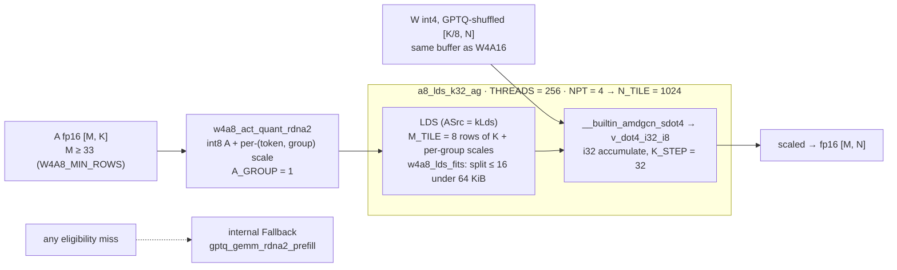

# W4A8 (int4 × int8 sdot4) on gfx1030 — kernel contract

Dest tip: `opengfx1030/vllm-rdna` `rdna_extras` @ **`30b0bd4e`** (W4A8 wiring @ `3a0786ea`; MoE epilogue dual-mode below).[^c-30b0bd4e][^c-3a0786ea]

Companion explore sketch (pre-land): [sdot4-explore.md](sdot4-explore.md). W4A16 default path: [w4a16.md](w4a16.md). Prefill split repair: [silicon/formats/w4a16-prefill-config.md](../../silicon/formats/w4a16-prefill-config.md). Not W4A4 `sdot8` ([w4a4.md](w4a4.md)).

## Status

| Path | Completeness | Gate |
|---|---|---|
| Dense prefill GEMM | **Live / opt-in** | `VLLM_RDNA2_W4A8_SDOT4=1` [^f-30b0bd4e-envs-py][^f-30b0bd4e-w4a8-wiring-md] |
| MoE fused GEMM | **Live / opt-in** | same env; **hard-off** under resident MoE [^f-30b0bd4e-envs-py][^f-30b0bd4e-w4a8-wiring-md] |
| Default serve | **Fallback = W4A16** | env unset → dispatcher unchanged [^f-30b0bd4e-envs-py][^f-30b0bd4e-w4a8-wiring-md] |

Unset `VLLM_RDNA2_W4A8_SDOT4` ⇒ W4A16 default **unchanged**. Do not copy tok/s.[^f-30b0bd4e-envs-py][^f-30b0bd4e-w4a8-wiring-md]

## Take — dense (`w4a8_sdot4_rdna2.cu` / `.cuh`)

- **Math:** packed int4 W (same GPTQ-shuffled `[K/8,N]` buffer as W4A16) × int8 A → `__builtin_amdgcn_sdot4` / `v_dot4_i32_i8`. **Not** `fdot2`. **Not** `sdot8` (that is W4A4).[^isa]
- **Wired tile name:** `a8_lds_k32_ag` (explore config id 8): `THREADS=256`, `NPT=4` → `N_TILE=1024`, `K_STEP=32`, `M_TILE=8`, `ASrc=kLds`, `A_GROUP=1` (per-(token, group) A scales).[^f-30b0bd4e-w4a8-sdot4-rdna2-cu]
- **Prefill-only:** host / selector gate `M >= 33` (`kW4a8MinRows` / `W4A8_MIN_ROWS`). Decode (`M < 33`) keeps W4A16 arms.[^f-30b0bd4e-w4a8-sdot4-rdna2-cu][^f-30b0bd4e-w4a8-sdot4-rdna2-cuh][^f-30b0bd4e-w4a8-sdot4-rdna2-cu]
- **Eligibility (also C++):** gfx1030, fp16 A, `K % 32 == 0`, `K % group_size == 0`, group ∈ {32,64,128}, LDS fit via `w4a8_lds_fits` (some group- + K_STEP-aligned split ≤ 16 fits `M_TILE=8` rows of K + per-group scales under **64 KiB** LDS).[^f-30b0bd4e-w4a8-sdot4-rdna2-cu]
- **Internal Fallback:** `w4a8_gemm_rdna2` always returns a populated `[M,N]` fp16 tensor; on any miss it calls `gptq_gemm_rdna2_prefill` in-process. Python forward does not branch on a sentinel.[^f-30b0bd4e-q-gemm-rdna2-prefill-cu][^f-30b0bd4e-w4a8-sdot4-rdna2-cu]
- **Launch:** `__launch_bounds__(C::THREADS)` → 256 for the wired config. Occupancy still FA-first elsewhere.[^f-30b0bd4e-w4a8-sdot4-rdna2-cu][^f-30b0bd4e-w4a8-sdot4-rdna2-cuh][^f-30b0bd4e-w4a8-sdot4-rdna2-cu]
- **Ops / build:** `w4a8_act_quant_rdna2`, `w4a8_gemm_rdna2` in `ops.h` + `torch_bindings.cpp` under `VLLM_ROCM_GFX1030`; `csrc/rocm/w4a8_sdot4_rdna2.cu` in the gfx1030 `VLLM_ROCM_EXT_SRC` block.[^f-30b0bd4e-ops-h][^f-30b0bd4e-torch-bindings-cpp][^f-30b0bd4e-w4a8-sdot4-rdna2-cu]

### Wired tile at a glance

*Every number is from the "Take — dense" bullets above (`w4a8_sdot4_rdna2.cu` / `.cuh` at `30b0bd4e`, landed `3a0786ea`). Eligibility: gfx1030, fp16 A, `K % 32 == 0`, `K % group_size == 0`, group ∈ {32, 64, 128}. Not `fdot2`, not `sdot8`.*[^c-30b0bd4e][^c-3a0786ea][^f-30b0bd4e-w4a8-sdot4-rdna2-cu]

## Take — MoE (`moe_w4a8_rdna2.cu`)

- Drop-in for `moe_gptq_gemm_rdna2` (+ trailing `use_v2_format`); accumulates into pre-zeroed `c`.[^f-30b0bd4e-moe-q-gemm-rdna2-cu]
- Same opt-in env. **`resolve_w4a8_moe()` hard-off** when `VLLM_RDNA_MOE_RESIDENT` or `VLLM_RDNA_MOE_RESIDENT_SKINNY` (resident packing owns the weight buffers). Resident call sites pass `w4a8=False`.[^f-30b0bd4e-moe-w4a8-rdna2-cu][^f-30b0bd4e-envs-py]
- Act quant once over the batch via dense `w4a8_act_quant_kernel` (`a8_lds_k32_ag` layout); GEMM grid `(num_token_blocks, ceil(N/1024), ceil(K/256))`, 256 threads, `K_STEP=32`, `BLOCK_M ∈ {1,2,4,8}`.[^f-30b0bd4e-w4a8-sdot4-rdna2-cu]
- Stages block `BLOCK_M × 256` int8 into **2 KiB** LDS (avoids SGPR spill from live per-row A pointers).[^f-30b0bd4e-moe-w4a8-rdna2-cu][^f-30b0bd4e-moe-w4a8-rdna2-cu][^f-30b0bd4e-w4a8-moe-wiring-md]
- Internal Fallback → `moe_gptq_gemm_rdna2`. CMake: `moe_w4a8_rdna2.cu` in the same gfx1030 block; binding under `VLLM_ROCM_GFX1030`.[^f-30b0bd4e-moe-w4a8-rdna2-cu][^f-30b0bd4e-moe-q-gemm-rdna2-cu]

## ISA (MoE audit @ tip; opcode shared with dense)

From `bench_results/2026-09-29_w4a8-moe/isa_evidence.txt` (gfx1030, ROCm 7.14, clang 23) — **opcode / spill only**, ignore any bench ms:[^f-30b0bd4e-isa-evidence-txt]

| Check | Result |
|---|---|
| `v_dot4c_i32_i8` (sdot4) | present (nonzero count in dump) [^isa] |
| `v_dot2_f32_f16` (fdot2) | **0** on this MoE object [^isa] |
| SGPR/VGPR spill / scratch / private_segment | **0** [^f-30b0bd4e-w4a8-sdot4-rdna2-cuh][^f-30b0bd4e-w4a8-sdot4-rdna2-cu][^f-30b0bd4e-isa-evidence-txt] |

Dense GEMM uses the same `ex::sdot4` → `__builtin_amdgcn_sdot4` in `w4a8_sdot4_rdna2.cuh`. Do not invent dense VGPR/IC numbers here.[^f-30b0bd4e-w4a8-sdot4-rdna2-cuh]

## MoE epilogue accum (tip `30b0bd4e`)

Shared helper `csrc/rocm/moe_accum_rdna2.cuh` for **both** `moe_gptq_gemm_rdna2` (W4A16) and `moe_w4a8_gemm_rdna2` (W4A8). Inner DOT unchanged (`sdot4` on this path; W4A16 MoE stays `fdot2`).[^f-30b0bd4e-moe-accum-rdna2-cuh][^f-30b0bd4e-moe-q-gemm-rdna2-cu][^f-30b0bd4e-w4a8-sdot4-rdna2-cu][^f-30b0bd4e-moe-w4a8-rdna2-cu]

| Mode | Gate | Mechanism |
|---|---|---|
| **Default** | `VLLM_RDNA2_MOE_FP32_ACCUM` unset / false | packed-fp16 CAS-64 (`atomic_add_pk4_f16`) into caller pre-zeroed `c` [^f-30b0bd4e-q-gemm-rdna2-common-cuh][^f-30b0bd4e-envs-py] |
| **Opt-in** | `VLLM_RDNA2_MOE_FP32_ACCUM=1` or per-call `fp32_accum=True` | `atomicAdd` fp32 into persistent per-(rows,N,device) scratch + one `fp32→fp16` cast. On gfx1030 this is **4 CAS-32 loops per row** (`global_atomic_cmpswap`), not a native fp32 atomic — the source comment's "native `v_global_atomic_add_f32` / no CAS" is gfx11+ ISA ([atomic-occupancy.md](../../silicon/occupancy/atomic-occupancy.md)). Result is still correct. [^f-30b0bd4e-envs-py] |

Scratch is allocated eager (before capture); per-call zero is `hipMemsetAsync` (capture-legal). Schema default on the C++ binding may read `fp32_accum=True`; **production default is the env = false** via `_custom_ops.py`. Do not copy A/B ms or tok/s. sdot4 tile / 2 KiB LDS / resident hard-off unchanged.[^f-30b0bd4e--custom-ops-py]

## Leave

- tok/s / ms from wiring docs or micro A/B tables
- Flipping the env on as dest default
- `sdot8` / W4A4, WMMA, FP8-as-integer DOT
- Mixing this path with resident MoE skinny packing
- EXL3 `-cb 3inst` changes

## Sources (tip `30b0bd4e`; W4A8 land `3a0786ea`)

- `csrc/rocm/w4a8_sdot4_rdna2.cu`, `w4a8_sdot4_rdna2.cuh`
- `csrc/rocm/moe_w4a8_rdna2.cu`
- `csrc/rocm/moe_accum_rdna2.cuh`
- `vllm/_custom_ops.py` / `vllm/envs.py` (`VLLM_RDNA2_MOE_FP32_ACCUM`)
- `csrc/rocm/ops.h`, `torch_bindings.cpp`, `CMakeLists.txt` (gfx1030 block)
- `vllm/.../rdna2_w4a16.py`, `.../rdna2_w4a16_moe.py`, `.../rdna2_moe_resident.py`
- `docs/rdna2/w4a8-wiring.md`, `docs/rdna2/w4a8-moe-wiring.md` (gate language only)
- `bench_results/2026-09-29_w4a8-moe/isa_evidence.txt`

[^c-30b0bd4e]: opengfx1030/vllm-rdna commit [`30b0bd4e`](https://github.com/opengfx1030/vllm-rdna/commit/30b0bd4e3604a6ea678244a0df74e452ac05fee6) (2026-10-01) — "test(exl3): backport loader unit tests + mul1 tile reformat".
[^c-3a0786ea]: opengfx1030/vllm-rdna commit [`3a0786ea`](https://github.com/opengfx1030/vllm-rdna/commit/3a0786eaa70f37890b729ff4943e5cc9a0cb68c0) (2026-09-30) — "merge(rdna2): land w4a8-wiring onto rdna_extras (W4A8 opt-in; W4A16 default unchanged)".
[^f-30b0bd4e-envs-py]: opengfx1030/vllm-rdna `vllm/envs.py` @ [`30b0bd4e`](https://github.com/opengfx1030/vllm-rdna/blob/30b0bd4e3604a6ea678244a0df74e452ac05fee6/vllm/envs.py).
[^f-30b0bd4e-w4a8-wiring-md]: opengfx1030/vllm-rdna `docs/rdna2/w4a8-wiring.md` @ [`30b0bd4e`](https://github.com/opengfx1030/vllm-rdna/blob/30b0bd4e3604a6ea678244a0df74e452ac05fee6/docs/rdna2/w4a8-wiring.md).
[^isa]: AMD, *"RDNA 2" Instruction Set Architecture Reference Guide* (doc 70648): "Feature Changes in RDNA2 Devices" dot-product list; VOP2 opcodes 2 `V_DOT2C_F32_F16` / 13 `V_DOT4C_I32_I8`; VOP3P opcodes 19–25 `V_DOT2_F32_F16` … `V_DOT8_U32_U4`; LDS "128kB memory per workgroup processor split up into 64 banks of dword-wide RAMs"; "a single workgroup may allocate up to 64kB of LDS". <https://docs.amd.com/v/u/en-US/rdna2-shader-instruction-set-architecture>
[^f-30b0bd4e-w4a8-sdot4-rdna2-cu]: opengfx1030/vllm-rdna `csrc/rocm/w4a8_sdot4_rdna2.cu` @ [`30b0bd4e`](https://github.com/opengfx1030/vllm-rdna/blob/30b0bd4e3604a6ea678244a0df74e452ac05fee6/csrc/rocm/w4a8_sdot4_rdna2.cu).
[^f-30b0bd4e-w4a8-sdot4-rdna2-cuh]: opengfx1030/vllm-rdna `csrc/rocm/w4a8_sdot4_rdna2.cuh` @ [`30b0bd4e`](https://github.com/opengfx1030/vllm-rdna/blob/30b0bd4e3604a6ea678244a0df74e452ac05fee6/csrc/rocm/w4a8_sdot4_rdna2.cuh).
[^f-30b0bd4e-q-gemm-rdna2-prefill-cu]: opengfx1030/vllm-rdna `csrc/rocm/q_gemm_rdna2_prefill.cu` @ [`30b0bd4e`](https://github.com/opengfx1030/vllm-rdna/blob/30b0bd4e3604a6ea678244a0df74e452ac05fee6/csrc/rocm/q_gemm_rdna2_prefill.cu).
[^f-30b0bd4e-ops-h]: opengfx1030/vllm-rdna `csrc/rocm/ops.h` @ [`30b0bd4e`](https://github.com/opengfx1030/vllm-rdna/blob/30b0bd4e3604a6ea678244a0df74e452ac05fee6/csrc/rocm/ops.h).
[^f-30b0bd4e-torch-bindings-cpp]: opengfx1030/vllm-rdna `csrc/rocm/torch_bindings.cpp` @ [`30b0bd4e`](https://github.com/opengfx1030/vllm-rdna/blob/30b0bd4e3604a6ea678244a0df74e452ac05fee6/csrc/rocm/torch_bindings.cpp).
[^f-30b0bd4e-moe-q-gemm-rdna2-cu]: opengfx1030/vllm-rdna `csrc/rocm/moe_q_gemm_rdna2.cu` @ [`30b0bd4e`](https://github.com/opengfx1030/vllm-rdna/blob/30b0bd4e3604a6ea678244a0df74e452ac05fee6/csrc/rocm/moe_q_gemm_rdna2.cu).
[^f-30b0bd4e-moe-w4a8-rdna2-cu]: opengfx1030/vllm-rdna `csrc/rocm/moe_w4a8_rdna2.cu` @ [`30b0bd4e`](https://github.com/opengfx1030/vllm-rdna/blob/30b0bd4e3604a6ea678244a0df74e452ac05fee6/csrc/rocm/moe_w4a8_rdna2.cu).
[^f-30b0bd4e-w4a8-moe-wiring-md]: opengfx1030/vllm-rdna `docs/rdna2/w4a8-moe-wiring.md` @ [`30b0bd4e`](https://github.com/opengfx1030/vllm-rdna/blob/30b0bd4e3604a6ea678244a0df74e452ac05fee6/docs/rdna2/w4a8-moe-wiring.md).
[^f-30b0bd4e-isa-evidence-txt]: opengfx1030/vllm-rdna `bench_results/2026-09-29_w4a8-moe/isa_evidence.txt` @ [`30b0bd4e`](https://github.com/opengfx1030/vllm-rdna/blob/30b0bd4e3604a6ea678244a0df74e452ac05fee6/bench_results/2026-09-29_w4a8-moe/isa_evidence.txt).
[^f-30b0bd4e-moe-accum-rdna2-cuh]: opengfx1030/vllm-rdna `csrc/rocm/moe_accum_rdna2.cuh` @ [`30b0bd4e`](https://github.com/opengfx1030/vllm-rdna/blob/30b0bd4e3604a6ea678244a0df74e452ac05fee6/csrc/rocm/moe_accum_rdna2.cuh).
[^f-30b0bd4e-q-gemm-rdna2-common-cuh]: opengfx1030/vllm-rdna `csrc/rocm/q_gemm_rdna2_common.cuh` @ [`30b0bd4e`](https://github.com/opengfx1030/vllm-rdna/blob/30b0bd4e3604a6ea678244a0df74e452ac05fee6/csrc/rocm/q_gemm_rdna2_common.cuh).
[^f-30b0bd4e--custom-ops-py]: opengfx1030/vllm-rdna `vllm/_custom_ops.py` @ [`30b0bd4e`](https://github.com/opengfx1030/vllm-rdna/blob/30b0bd4e3604a6ea678244a0df74e452ac05fee6/vllm/_custom_ops.py).
