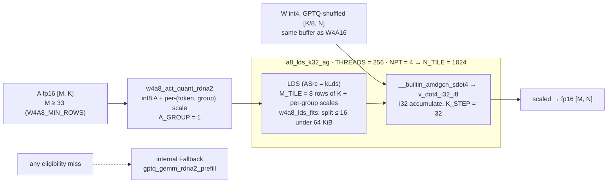

# W4A8 (int4 × int8 sdot4) on gfx1030 — kernel contract

## Current state at dest `rdna_extras` @ `7773dc62` (checked 2026-11-03)

Commit `f310ab8c` adds an **opt-in v2 W4A8 MoE GEMM**, `moe_w4a8_gemm_kernel_v2`, next to the shipped kernel. Defaults are unchanged: with `VLLM_RDNA_W4A8_KBLOCK` and `VLLM_RDNA2_W4A8_BLOCK_M` both unset (0), the shipped kernel runs.[^w4a8-7773-env][^w4a8-7773-py]

- **Same arithmetic and ISA.** `__launch_bounds__(256)`, 4 N columns per thread, `K_STEP=32`, int8 A against nibble-unpacked int4 W through `ex::sdot4`, per-(token, group) fp32 flush, router weight in fp32. Group sizes 32/64/128.[^w4a8-7773-kernel]
- **K per block is a launch argument.** `VLLM_RDNA_W4A8_KBLOCK` > 0 picks v2 with that many K positions per block; `-1` means the whole K range; 0 or unset keeps the shipped kernel. `resolve_k_block` clamps to K, caps at `32768 / BLOCK_M` so the A window stays within 32 KiB, and rounds down to whole groups. The env is read on every call.[^w4a8-7773-host]
- **LDS.** The A window (`BLOCK_M × k_block` int8) is dynamic LDS (`extern __shared__`, launch size `BLOCK_M * k_block` bytes), stored chunk-major `[chunk][row]` so one step's rows are contiguous; plus two `BLOCK_M`-int row tables in static LDS. The shipped kernel's fixed 2 KiB A stage (`BLOCK_M × 256` at tile 8) is unchanged.[^w4a8-7773-kernel][^w4a8-7773-host]
- **Tiles.** v2 takes `BLOCK_M` 4, 8 or 16; 16 exists only in v2 and selects it automatically. `VLLM_RDNA2_W4A8_BLOCK_M` (0/4/8/16, anything else raises) forces the MoE tile rows for token counts that take the W4A8 kernel.[^w4a8-7773-host][^w4a8-7773-py]
- **Epilogue.** When one block owns its outputs (one K block and no top-k reduce) v2 writes with plain stores (`moe_store_row`); otherwise it issues up to 8 rows' loads first, then their CAS-64s, and retries only losers (`moe_accum_rows`). Same atomic granularity as `moe_accum_row`; the fp32 and Q32 modes keep the per-row helper.[^w4a8-7773-accum]
- **Registers (repo's reading of the compiled objects, not re-verified here).** `docs/rdna2/tuning.md` reports 121 VGPRs for v2 at tile 8 against 168 for the shipped kernel, and 170 for v2 at tile 16. Check occupancy with the [occupancy pages](../../silicon/occupancy/) before turning tile 16 on.[^w4a8-7773-env]
- **No CMake or gfx-list change**; v2 has an empty-body stub in the non-RDNA2 device pass like v1.[^w4a8-7773-kernel]

Micro-bench timings are in the commit and `tuning.md`, not copied here. The repo notes a serve arm against the shipped tile 8 is still queued.[^w4a8-7773-env]

## Current state at dest `rdna_extras` @ `3c270858` (checked 2026-11-03)

No W4A8 `.cu` change. The `flashnext-mtp2` recipe now sets `VLLM_RDNA2_W4A8_SDOT4=1`, so `27b-awq` (dense, M >= 33) and `flashnext-mtp2` (MoE, at least 512 tokens) both serve the int8-activation sdot4 prefill GEMMs by default; decode stays W4A16. The env is still opt-in outside recipes: unset means W4A16. Serve A/B numbers are in the commit message and `docs/rdna2/tuning.md`, not copied here.[^w4a8-3c27]

*Historical @ `b7402893`:* `27b-awq` was the only recipe that turned W4A8 on.

## Current state at dest `rdna_extras` @ `b7402893` (checked 2026-10-29)

No W4A8 kernel change. `w4a8_sdot4_rdna2.cu` only updates its forward declaration of `gptq_gemm_rdna2_prefill` with the new `deterministic = false` argument; the sdot4 tiles, LDS and dispatch are as at `8015ea48`.[^w4a8-b740] The new deterministic dense W4A16 opt-in refuses to run with W4A8 enabled ([../gemm-moe/rdna2-moe-offload-q32.md](../gemm-moe/rdna2-moe-offload-q32.md)).[^w4a8-b740-py] The `8015ea48` section below is still current.

## Current state at dest `rdna_extras` @ `8015ea48` (checked 2026-10-26)

The `27b-awq` recipe now sets `W4A8=1`, so serving that recipe through `tools/rdna/serve_rdna.sh` exports `VLLM_RDNA2_W4A8_SDOT4=1` by default and runs the int8-activation sdot4 prefill GEMMs (M >= 33; decode stays W4A16). `W4A8=0` falls back to the W4A16 prefill GEMMs. The env itself is still opt-in outside recipes: unset means W4A16. The same recipe also leaves `MAXBAT` empty so the launcher derives the prefill token budget from the KV/SSM dtype, and sets `VLLM_RDNA_DECODE_STALL_MS=0`. No W4A8 `.cu` file changed in this range.[^w4a8-8015]

## Historical: dest `rdna_extras` @ `1dc3bac4` (checked 2026-10-11, superseded at `8015ea48`)

*(historical @ `1dc3bac4`)* Still opt-in. `VLLM_RDNA2_W4A8_SDOT4` is unset unless a recipe sets `W4A8`, and the only recipe that names it sets `W4A8=0`. The MoE path is still hard-off under resident MoE. Both `.cu` files are still in the gfx1030 build. The MoE accumulation default is still packed-fp16 CAS (`VLLM_RDNA2_MOE_FP32_ACCUM` default false).[^w4a8-tip]

Dest tip: `opengfx1030/vllm-rdna` `rdna_extras` @ **`30b0bd4e`** (W4A8 wiring @ `3a0786ea`; MoE epilogue dual-mode below).[^c-30b0bd4e][^c-3a0786ea]

Companion explore sketch (pre-land): [sdot4-explore.md](sdot4-explore.md). W4A16 default path: [w4a16.md](w4a16.md). Prefill split repair: [silicon/formats/w4a16-prefill-config.md](../../silicon/formats/w4a16-prefill-config.md). Not W4A4 `sdot8` ([w4a4.md](w4a4.md)).

## Status

| Path | Completeness | Gate |
|---|---|---|
| Dense prefill GEMM | **Live / opt-in** | `VLLM_RDNA2_W4A8_SDOT4=1` [^f-30b0bd4e-envs-py][^f-30b0bd4e-w4a8-wiring-md] |
| MoE fused GEMM | **Live / opt-in** | same env; **hard-off** under resident MoE [^f-30b0bd4e-envs-py][^f-30b0bd4e-w4a8-wiring-md] |
| Default serve | **Fallback = W4A16** | env unset → dispatcher unchanged [^f-30b0bd4e-envs-py][^f-30b0bd4e-w4a8-wiring-md] |

Unset `VLLM_RDNA2_W4A8_SDOT4` ⇒ W4A16 default **unchanged**. Do not copy tok/s.[^f-30b0bd4e-envs-py][^f-30b0bd4e-w4a8-wiring-md]

## Take — dense (`w4a8_sdot4_rdna2.cu` / `.cuh`)

- **Math:** packed int4 W (same GPTQ-shuffled `[K/8,N]` buffer as W4A16) × int8 A → `__builtin_amdgcn_sdot4` / `v_dot4_i32_i8`. **Not** `fdot2`. **Not** `sdot8` (that is W4A4).[^isa]
- **Wired tile name:** `a8_lds_k32_ag` (explore config id 8): `THREADS=256`, `NPT=4` → `N_TILE=1024`, `K_STEP=32`, `M_TILE=8`, `ASrc=kLds`, `A_GROUP=1` (per-(token, group) A scales).[^f-30b0bd4e-w4a8-sdot4-rdna2-cu]
- **Prefill-only:** host / selector gate `M >= 33` (`kW4a8MinRows` / `W4A8_MIN_ROWS`). Decode (`M < 33`) keeps W4A16 arms.[^f-30b0bd4e-w4a8-sdot4-rdna2-cu][^f-30b0bd4e-w4a8-sdot4-rdna2-cuh][^f-30b0bd4e-w4a8-sdot4-rdna2-cu]
- **Eligibility (also C++):** gfx1030, fp16 A, `K % 32 == 0`, `K % group_size == 0`, group ∈ {32,64,128}, LDS fit via `w4a8_lds_fits` (some group- + K_STEP-aligned split ≤ 16 fits `M_TILE=8` rows of K + per-group scales under **64 KiB** LDS).[^f-30b0bd4e-w4a8-sdot4-rdna2-cu]
- **Internal Fallback:** `w4a8_gemm_rdna2` always returns a populated `[M,N]` fp16 tensor; on any miss it calls `gptq_gemm_rdna2_prefill` in-process. Python forward does not branch on a sentinel.[^f-30b0bd4e-q-gemm-rdna2-prefill-cu][^f-30b0bd4e-w4a8-sdot4-rdna2-cu]
- **Launch:** `__launch_bounds__(C::THREADS)` → 256 for the wired config. Occupancy still FA-first elsewhere.[^f-30b0bd4e-w4a8-sdot4-rdna2-cu][^f-30b0bd4e-w4a8-sdot4-rdna2-cuh][^f-30b0bd4e-w4a8-sdot4-rdna2-cu]
- **Ops / build:** `w4a8_act_quant_rdna2`, `w4a8_gemm_rdna2` in `ops.h` + `torch_bindings.cpp` under `VLLM_ROCM_GFX1030`; `csrc/rocm/w4a8_sdot4_rdna2.cu` in the gfx1030 `VLLM_ROCM_EXT_SRC` block.[^f-30b0bd4e-ops-h][^f-30b0bd4e-torch-bindings-cpp][^f-30b0bd4e-w4a8-sdot4-rdna2-cu]

### Wired tile at a glance

*Every number is from the "Take — dense" bullets above (`w4a8_sdot4_rdna2.cu` / `.cuh` at `30b0bd4e`, landed `3a0786ea`). Eligibility: gfx1030, fp16 A, `K % 32 == 0`, `K % group_size == 0`, group ∈ {32, 64, 128}. Not `fdot2`, not `sdot8`.*[^c-30b0bd4e][^c-3a0786ea][^f-30b0bd4e-w4a8-sdot4-rdna2-cu]

## Take — MoE (`moe_w4a8_rdna2.cu`)

- Drop-in for `moe_gptq_gemm_rdna2` (+ trailing `use_v2_format`); accumulates into pre-zeroed `c`.[^f-30b0bd4e-moe-q-gemm-rdna2-cu]
- Same opt-in env. **`resolve_w4a8_moe()` hard-off** when `VLLM_RDNA_MOE_RESIDENT` or `VLLM_RDNA_MOE_RESIDENT_SKINNY` (resident packing owns the weight buffers). Resident call sites pass `w4a8=False`.[^f-30b0bd4e-moe-w4a8-rdna2-cu][^f-30b0bd4e-envs-py]
- Act quant once over the batch via dense `w4a8_act_quant_kernel` (`a8_lds_k32_ag` layout); GEMM grid `(num_token_blocks, ceil(N/1024), ceil(K/256))`, 256 threads, `K_STEP=32`, `BLOCK_M ∈ {1,2,4,8}`.[^f-30b0bd4e-w4a8-sdot4-rdna2-cu]
- *(shipped kernel; see the `7773dc62` section for the opt-in v2 with up to 32 KiB dynamic LDS)* Stages block `BLOCK_M × 256` int8 into **2 KiB** LDS (avoids SGPR spill from live per-row A pointers).[^f-30b0bd4e-moe-w4a8-rdna2-cu][^f-30b0bd4e-moe-w4a8-rdna2-cu][^f-30b0bd4e-w4a8-moe-wiring-md]
- Internal Fallback → `moe_gptq_gemm_rdna2`. CMake: `moe_w4a8_rdna2.cu` in the same gfx1030 block; binding under `VLLM_ROCM_GFX1030`.[^f-30b0bd4e-moe-w4a8-rdna2-cu][^f-30b0bd4e-moe-q-gemm-rdna2-cu]

## ISA (MoE audit @ tip; opcode shared with dense)

From `bench_results/2026-09-29_w4a8-moe/isa_evidence.txt` (gfx1030, ROCm 7.14, clang 23) — **opcode / spill only**, ignore any bench ms:[^f-30b0bd4e-isa-evidence-txt]

| Check | Result |
|---|---|
| `v_dot4c_i32_i8` (sdot4) | present (nonzero count in dump) [^isa] |
| `v_dot2_f32_f16` (fdot2) | **0** on this MoE object [^isa] |
| SGPR/VGPR spill / scratch / private_segment | **0** [^f-30b0bd4e-w4a8-sdot4-rdna2-cuh][^f-30b0bd4e-w4a8-sdot4-rdna2-cu][^f-30b0bd4e-isa-evidence-txt] |

Dense GEMM uses the same `ex::sdot4` → `__builtin_amdgcn_sdot4` in `w4a8_sdot4_rdna2.cuh`. Do not invent dense VGPR/IC numbers here.[^f-30b0bd4e-w4a8-sdot4-rdna2-cuh]

## MoE epilogue accum (tip `30b0bd4e`)

Shared helper `csrc/rocm/moe_accum_rdna2.cuh` for **both** `moe_gptq_gemm_rdna2` (W4A16) and `moe_w4a8_gemm_rdna2` (W4A8). Inner DOT unchanged (`sdot4` on this path; W4A16 MoE stays `fdot2`).[^f-30b0bd4e-moe-accum-rdna2-cuh][^f-30b0bd4e-moe-q-gemm-rdna2-cu][^f-30b0bd4e-w4a8-sdot4-rdna2-cu][^f-30b0bd4e-moe-w4a8-rdna2-cu]

| Mode | Gate | Mechanism |
|---|---|---|
| **Default** | `VLLM_RDNA2_MOE_FP32_ACCUM` unset / false | packed-fp16 CAS-64 (`atomic_add_pk4_f16`) into caller pre-zeroed `c` [^f-30b0bd4e-q-gemm-rdna2-common-cuh][^f-30b0bd4e-envs-py] |
| **Opt-in** | `VLLM_RDNA2_MOE_FP32_ACCUM=1` or per-call `fp32_accum=True` | `atomicAdd` fp32 into persistent per-(rows,N,device) scratch + one `fp32→fp16` cast. On gfx1030 this is **4 CAS-32 loops per row** (`global_atomic_cmpswap`), not a native fp32 atomic — the source comment's "native `v_global_atomic_add_f32` / no CAS" is gfx11+ ISA ([atomic-occupancy.md](../../silicon/occupancy/atomic-occupancy.md)). Result is still correct. [^f-30b0bd4e-envs-py] |

Scratch is allocated eager (before capture); per-call zero is `hipMemsetAsync` (capture-legal). Schema default on the C++ binding may read `fp32_accum=True`; **production default is the env = false** via `_custom_ops.py`. Do not copy A/B ms or tok/s. sdot4 tile / 2 KiB LDS / resident hard-off unchanged.[^f-30b0bd4e--custom-ops-py]

## Leave

- tok/s / ms from wiring docs or micro A/B tables
- Flipping the env on globally (the `27b-awq` recipe turns it on at `8015ea48`; the env default stays off)
- `sdot8` / W4A4, WMMA, FP8-as-integer DOT
- Mixing this path with resident MoE skinny packing
- EXL3 `-cb 3inst` changes

## Sources (tip `30b0bd4e`; W4A8 land `3a0786ea`)

[^w4a8-7773-kernel]: `csrc/rocm/moe_w4a8_rdna2.cu` @ `7773dc6230f91fae56c50d69bb9c1e4ebdacdf83`, v2 kernel L273-L496 (LDS window L309, stub L498). https://github.com/opengfx1030/vllm-rdna/blob/7773dc6230f91fae56c50d69bb9c1e4ebdacdf83/csrc/rocm/moe_w4a8_rdna2.cu#L273-L501
[^w4a8-7773-host]: `csrc/rocm/moe_w4a8_rdna2.cu` @ `7773dc6230f91fae56c50d69bb9c1e4ebdacdf83`, `w4a8_kblock_request` / `resolve_k_block` / `launch_kernel_v2` L641-L683, eligibility and v2 selection L775-L792. https://github.com/opengfx1030/vllm-rdna/blob/7773dc6230f91fae56c50d69bb9c1e4ebdacdf83/csrc/rocm/moe_w4a8_rdna2.cu#L641-L683 ; https://github.com/opengfx1030/vllm-rdna/blob/7773dc6230f91fae56c50d69bb9c1e4ebdacdf83/csrc/rocm/moe_w4a8_rdna2.cu#L775-L792
[^w4a8-7773-accum]: `csrc/rocm/moe_accum_rdna2.cuh` @ `7773dc6230f91fae56c50d69bb9c1e4ebdacdf83`, `moe_store_row` L86 and `moe_accum_rows` L114. https://github.com/opengfx1030/vllm-rdna/blob/7773dc6230f91fae56c50d69bb9c1e4ebdacdf83/csrc/rocm/moe_accum_rdna2.cuh#L83-L168
[^w4a8-7773-env]: `docs/rdna2/tuning.md` @ `7773dc6230f91fae56c50d69bb9c1e4ebdacdf83`, `VLLM_RDNA_W4A8_KBLOCK` row L415 (commits `f310ab8c`, `7773dc62`). https://github.com/opengfx1030/vllm-rdna/blob/7773dc6230f91fae56c50d69bb9c1e4ebdacdf83/docs/rdna2/tuning.md#L415
[^w4a8-7773-py]: `compressed_tensors_moe_wna16_rdna2.py` @ `7773dc6230f91fae56c50d69bb9c1e4ebdacdf83` L66-L75 and L393-L394. https://github.com/opengfx1030/vllm-rdna/blob/7773dc6230f91fae56c50d69bb9c1e4ebdacdf83/vllm/model_executor/layers/quantization/compressed_tensors/compressed_tensors_moe/compressed_tensors_moe_wna16_rdna2.py#L66-L75

[^w4a8-3c27]: `tools/rdna/recipes/flashnext-mtp2.env` L44-L49 and the `VLLM_RDNA2_W4A8_SDOT4` row in `docs/rdna2/tuning.md` L370, both @ `3c2708585cf78dca851867d38140a4a28faa7a4c`; set by commit `b8863048`. https://github.com/opengfx1030/vllm-rdna/blob/3c2708585cf78dca851867d38140a4a28faa7a4c/tools/rdna/recipes/flashnext-mtp2.env#L44-L49 ; https://github.com/opengfx1030/vllm-rdna/blob/3c2708585cf78dca851867d38140a4a28faa7a4c/docs/rdna2/tuning.md#L370

- `csrc/rocm/w4a8_sdot4_rdna2.cu`, `w4a8_sdot4_rdna2.cuh`
- `csrc/rocm/moe_w4a8_rdna2.cu`
- `csrc/rocm/moe_accum_rdna2.cuh`
- `vllm/_custom_ops.py` / `vllm/envs.py` (`VLLM_RDNA2_MOE_FP32_ACCUM`)
- `csrc/rocm/ops.h`, `torch_bindings.cpp`, `CMakeLists.txt` (gfx1030 block)
- `vllm/.../rdna2_w4a16.py`, `.../rdna2_w4a16_moe.py`, `.../rdna2_moe_resident.py`
- `docs/rdna2/w4a8-wiring.md`, `docs/rdna2/w4a8-moe-wiring.md` (gate language only)
- `bench_results/2026-09-29_w4a8-moe/isa_evidence.txt`

[^c-30b0bd4e]: opengfx1030/vllm-rdna commit [`30b0bd4e`](https://github.com/opengfx1030/vllm-rdna/commit/30b0bd4e3604a6ea678244a0df74e452ac05fee6) (2026-10-01) — "test(exl3): backport loader unit tests + mul1 tile reformat".
[^c-3a0786ea]: opengfx1030/vllm-rdna commit [`3a0786ea`](https://github.com/opengfx1030/vllm-rdna/commit/3a0786eaa70f37890b729ff4943e5cc9a0cb68c0) (2026-09-30) — "merge(rdna2): land w4a8-wiring onto rdna_extras (W4A8 opt-in; W4A16 default unchanged)".
[^f-30b0bd4e-envs-py]: opengfx1030/vllm-rdna `vllm/envs.py` @ [`30b0bd4e`](https://github.com/opengfx1030/vllm-rdna/blob/30b0bd4e3604a6ea678244a0df74e452ac05fee6/vllm/envs.py).
[^f-30b0bd4e-w4a8-wiring-md]: opengfx1030/vllm-rdna `docs/rdna2/w4a8-wiring.md` @ [`30b0bd4e`](https://github.com/opengfx1030/vllm-rdna/blob/30b0bd4e3604a6ea678244a0df74e452ac05fee6/docs/rdna2/w4a8-wiring.md).
[^isa]: AMD, *"RDNA 2" Instruction Set Architecture Reference Guide* (doc 70648): "Feature Changes in RDNA2 Devices" dot-product list; VOP2 opcodes 2 `V_DOT2C_F32_F16` / 13 `V_DOT4C_I32_I8`; VOP3P opcodes 19–25 `V_DOT2_F32_F16` … `V_DOT8_U32_U4`; LDS "128kB memory per workgroup processor split up into 64 banks of dword-wide RAMs"; "a single workgroup may allocate up to 64kB of LDS". <https://docs.amd.com/v/u/en-US/rdna2-shader-instruction-set-architecture>
[^f-30b0bd4e-w4a8-sdot4-rdna2-cu]: opengfx1030/vllm-rdna `csrc/rocm/w4a8_sdot4_rdna2.cu` @ [`30b0bd4e`](https://github.com/opengfx1030/vllm-rdna/blob/30b0bd4e3604a6ea678244a0df74e452ac05fee6/csrc/rocm/w4a8_sdot4_rdna2.cu).
[^f-30b0bd4e-w4a8-sdot4-rdna2-cuh]: opengfx1030/vllm-rdna `csrc/rocm/w4a8_sdot4_rdna2.cuh` @ [`30b0bd4e`](https://github.com/opengfx1030/vllm-rdna/blob/30b0bd4e3604a6ea678244a0df74e452ac05fee6/csrc/rocm/w4a8_sdot4_rdna2.cuh).
[^f-30b0bd4e-q-gemm-rdna2-prefill-cu]: opengfx1030/vllm-rdna `csrc/rocm/q_gemm_rdna2_prefill.cu` @ [`30b0bd4e`](https://github.com/opengfx1030/vllm-rdna/blob/30b0bd4e3604a6ea678244a0df74e452ac05fee6/csrc/rocm/q_gemm_rdna2_prefill.cu).
[^f-30b0bd4e-ops-h]: opengfx1030/vllm-rdna `csrc/rocm/ops.h` @ [`30b0bd4e`](https://github.com/opengfx1030/vllm-rdna/blob/30b0bd4e3604a6ea678244a0df74e452ac05fee6/csrc/rocm/ops.h).
[^f-30b0bd4e-torch-bindings-cpp]: opengfx1030/vllm-rdna `csrc/rocm/torch_bindings.cpp` @ [`30b0bd4e`](https://github.com/opengfx1030/vllm-rdna/blob/30b0bd4e3604a6ea678244a0df74e452ac05fee6/csrc/rocm/torch_bindings.cpp).
[^f-30b0bd4e-moe-q-gemm-rdna2-cu]: opengfx1030/vllm-rdna `csrc/rocm/moe_q_gemm_rdna2.cu` @ [`30b0bd4e`](https://github.com/opengfx1030/vllm-rdna/blob/30b0bd4e3604a6ea678244a0df74e452ac05fee6/csrc/rocm/moe_q_gemm_rdna2.cu).
[^f-30b0bd4e-moe-w4a8-rdna2-cu]: opengfx1030/vllm-rdna `csrc/rocm/moe_w4a8_rdna2.cu` @ [`30b0bd4e`](https://github.com/opengfx1030/vllm-rdna/blob/30b0bd4e3604a6ea678244a0df74e452ac05fee6/csrc/rocm/moe_w4a8_rdna2.cu).
[^f-30b0bd4e-w4a8-moe-wiring-md]: opengfx1030/vllm-rdna `docs/rdna2/w4a8-moe-wiring.md` @ [`30b0bd4e`](https://github.com/opengfx1030/vllm-rdna/blob/30b0bd4e3604a6ea678244a0df74e452ac05fee6/docs/rdna2/w4a8-moe-wiring.md).
[^f-30b0bd4e-isa-evidence-txt]: opengfx1030/vllm-rdna `bench_results/2026-09-29_w4a8-moe/isa_evidence.txt` @ [`30b0bd4e`](https://github.com/opengfx1030/vllm-rdna/blob/30b0bd4e3604a6ea678244a0df74e452ac05fee6/bench_results/2026-09-29_w4a8-moe/isa_evidence.txt).
[^f-30b0bd4e-moe-accum-rdna2-cuh]: opengfx1030/vllm-rdna `csrc/rocm/moe_accum_rdna2.cuh` @ [`30b0bd4e`](https://github.com/opengfx1030/vllm-rdna/blob/30b0bd4e3604a6ea678244a0df74e452ac05fee6/csrc/rocm/moe_accum_rdna2.cuh).
[^f-30b0bd4e-q-gemm-rdna2-common-cuh]: opengfx1030/vllm-rdna `csrc/rocm/q_gemm_rdna2_common.cuh` @ [`30b0bd4e`](https://github.com/opengfx1030/vllm-rdna/blob/30b0bd4e3604a6ea678244a0df74e452ac05fee6/csrc/rocm/q_gemm_rdna2_common.cuh).
[^f-30b0bd4e--custom-ops-py]: opengfx1030/vllm-rdna `vllm/_custom_ops.py` @ [`30b0bd4e`](https://github.com/opengfx1030/vllm-rdna/blob/30b0bd4e3604a6ea678244a0df74e452ac05fee6/vllm/_custom_ops.py).
[^w4a8-tip]: `VLLM_RDNA2_W4A8_SDOT4` is only exported by `tools/rdna/serve_rdna.sh` L172-L174 when the recipe sets `W4A8` (`27b-awq.env` L37 sets `W4A8=0`); `resolve_w4a8_moe` L80-L88 in `rdna2_w4a16_moe.py`; `w4a8_sdot4_rdna2.cu` / `moe_w4a8_rdna2.cu` in the gfx1030 CMake list. All at dest 1dc3bac4. https://github.com/opengfx1030/vllm-rdna/blob/1dc3bac4cda3201a1b4fb345e044578e84a272cf/tools/rdna/serve_rdna.sh#L172-L174 ; https://github.com/opengfx1030/vllm-rdna/blob/1dc3bac4cda3201a1b4fb345e044578e84a272cf/tools/rdna/recipes/27b-awq.env#L37 ; https://github.com/opengfx1030/vllm-rdna/blob/1dc3bac4cda3201a1b4fb345e044578e84a272cf/vllm/model_executor/layers/fused_moe/experts/rdna2_w4a16_moe.py#L80-L88 ; https://github.com/opengfx1030/vllm-rdna/blob/1dc3bac4cda3201a1b4fb345e044578e84a272cf/CMakeLists.txt#L1519-L1550
[^w4a8-8015]: `tools/rdna/recipes/27b-awq.env` L13-L24 (W4A8 comment), L46 (`MAXBAT=`), L49 (`W4A8=1`), L90 (`VLLM_RDNA_DECODE_STALL_MS=0`); `tools/rdna/serve_rdna.sh` L125-L147 (derived `MAXBAT`), L242-L243 (`W4A8` -> `VLLM_RDNA2_W4A8_SDOT4`); flipped by commit e272acab via PR #140; dest at 8015ea485b7f6c0298d8f98ce6e824ce1c444c45. https://github.com/opengfx1030/vllm-rdna/blob/8015ea485b7f6c0298d8f98ce6e824ce1c444c45/tools/rdna/recipes/27b-awq.env#L13-L90 ; https://github.com/opengfx1030/vllm-rdna/blob/8015ea485b7f6c0298d8f98ce6e824ce1c444c45/tools/rdna/serve_rdna.sh#L125-L243 ; https://github.com/opengfx1030/vllm-rdna/compare/005db0325d5bfdff3fc7f8a7843893a48158f5bd...8015ea485b7f6c0298d8f98ce6e824ce1c444c45
[^w4a8-b740]: [w4a8_sdot4_rdna2.cu:49–53](https://github.com/opengfx1030/vllm-rdna/blob/b74028935393d1e21f73f80f65f506c9ea4639af/csrc/rocm/w4a8_sdot4_rdna2.cu#L49-L53) @ b74028935393d1e21f73f80f65f506c9ea4639af; the file is +2/−2 lines in [`8015ea48...b7402893`](https://github.com/opengfx1030/vllm-rdna/compare/8015ea485b7f6c0298d8f98ce6e824ce1c444c45...b74028935393d1e21f73f80f65f506c9ea4639af).
[^w4a8-b740-py]: [rdna2_w4a16.py:151–153](https://github.com/opengfx1030/vllm-rdna/blob/b74028935393d1e21f73f80f65f506c9ea4639af/vllm/model_executor/kernels/linear/mixed_precision/rdna2_w4a16.py#L151-L153) @ b74028935393d1e21f73f80f65f506c9ea4639af.
