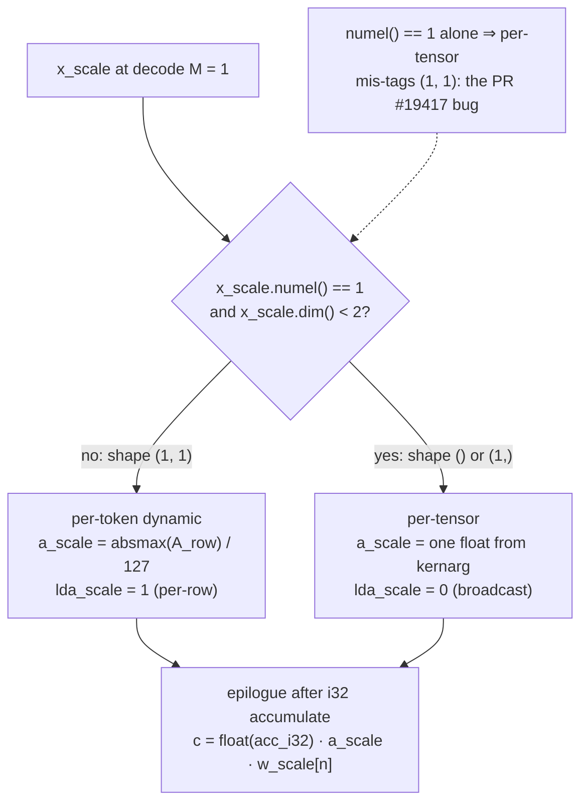

# W8A8 + mxfp4 on gfx1030 — kernel-writer brief

Audience: someone writing custom HIP W8A8 (dense + MoE) and mxfp4 kernels for gfx1030 (4× Radeon PRO V620; ROCm 7.2 when this brief was written — live pin is now ROCm 7.14.0, see [toolchain/matrix.md](../../toolchain/matrix.md)). This is a study of **vLLM / llama.cpp / AITER / ISA**, not a review of a private tree.

Rule: every concrete number is attributed. If a figure is not in a source that was opened, it is marked **unknown**. Do not contradict the companions.

Companions (already on disk; not re-derived):
- `silicon/architecture.md` — no WMMA, no MFMA, no FP8/FP4 unit; packed DOT only
- `kernels/quant/w4a16.md` — DOT2 decode/prefill geometry you reuse for mxfp4-after-unpack
- `silicon/hip-craft.md` — `sdot4` / `sdot8` / `fdot2` builtins, waitcnt, occupancy
- `silicon/cache-policy.md` — IC fit: 7B W8A8 misses unsharded; 27B W8A8 ~7 MiB over at TP=4
- `silicon/lds-tiles.md` — recipe 9: **64×64×64 i8**
- `engine/serving-stack/vllm-sglang-map.md` — vLLM has **no** DP4A dispatch on gfx1030; AITER gated CDNA3+

Date of this pass: **2026-08-17**. How to read status words: **keep** / **drop** / **rewrite** / **unknown** — same meanings as the W4A16 brief.

---

## 0. One-pager A — W8A8 dense + MoE (`__builtin_amdgcn_sdot4` → `v_dot4_i32_i8`)

**Hardware you actually have** (do not pretend otherwise):

| Fact | Number | Source |
|---|---|---|
| Target | `gfx1030`, wave32, WGP mode | LLVM AMDGPUUsage; HIP default [^isa][^clang-dot] |
| V620 | **72 CU**, 32 GB GDDR6, **128 MB** IC, **512 GB/s** | AMD V620 product page; cache brief §4.1 [^isa][^clang-dot] |
| Matrix | **no WMMA, no MFMA, no FP8, no FP4 unit** | GPUOpen WMMA table; RDNA 2 ISA feature list [^isa][^gpuopen] |
| IU8 peak | **512** ops/clk/CU (RX 6950 XT class) | GPUOpen https://gpuopen.com/learn/wmma_on_rdna3/ — same 512 on RDNA3; WMMA does **not** beat DOT4 on INT8 [^gpuopen] |
| Inner op | `__builtin_amdgcn_sdot4(a,b,c,false)` → `v_dot4c_i32_i8` / `v_dot4_i32_i8` | llama.cpp `ggml_cuda_dp4a`; RDNA 2 ISA 70648 §12.10 opcode 22 + VOP2 opcode 13 [^isa][^lc-common] |
| Unsigned twin | `__builtin_amdgcn_udot4` → `v_dot4_u32_u8` | ISA opcode 23; LLVM `dot7-insts` [^isa][^clang-dot][^llvm-gfx1030] |
| gfx1100 mixed-sign | `__builtin_amdgcn_sudot4` → `v_dot4_i32_iu8` | llama.cpp RDNA3 branch; LLVM `dot8-insts` **gfx11+**. **Not on gfx1030.** [^isa][^clang-dot][^llvm-gfx1030] |

**What vLLM / AITER already ship (and will not help you on this card):**[^isa][^clang-dot]

| Path | What it is | Gate | gfx1030 [^isa][^clang-dot] |
|---|---|---|---|
| AITER `gemm_a8w8_CK` / `_ASM` / bpreshuffle | CDNA MFMA INT8/FP8 | `@if_aiter_supported` / `get_cdna_version()>2` | **gated off** (map brief) [^isa][^clang-dot] |
| AITER ASM `shuffle_weight(..., layout=(32,16))` | MFMA 32×16 fragment | same | **drop** — packing for a matrix core you do not have [^aiter-a8w8-op] |
| vLLM `AiterInt8ScaledMMLinearKernel` | wraps AITER | same | **gated off** [^vllm-aiter-mm] |
| vLLM `gptq_gemm_rdna3` | W4A16 DOT2, not W8A8 | `#ifdef VLLM_ROCM_GFX1100` | not this format [^isa][^clang-dot] |
| llama.cpp `ggml_cuda_dp4a` | the existence proof | `CDNA \|\| RDNA2` → `sdot4` | **keep the opcode**, rewrite the tile [^lc-common] |

**The kernel you write must:**

1. **Store weights once** as packed **4×i8 per `uint32` / `int`**, K-contiguous. `K % 4 == 0` (pad). Preferred on-disk: **int8 `[N, K]`** (AITER Triton `gemm_a8w8` `w` shape) viewed as `int32 `[N, K/4]``. Do **not** apply AITER ASM `(32,16)` shuffle.[^aiter-a8w8-triton][^aiter-a8w8-op]
2. **Quantize activations** to signed i8. At decode **`M=1`**: prefer **per-token dynamic** (one absmax over the K-vector → scale shape `(1,1)`). That is **not** per-tensor. Per-tensor is a **scalar** (`numel==1` **and** `dim<2` — vLLM PR #19417). See §3.[^vpr-19417]
3. **Inner loop** = `__builtin_amdgcn_sdot4` into **i32 accum**, then epilogue `C_fp16 = C_i32 * a_scale * w_scale`. Issue the builtin (same hipcc lesson as `fdot2` in the W4A16 brief).[^aiter-a8w8-triton]
4. **Decode (`M=1,2,4`)**: skinny. Stage **A** in LDS (`K·M` bytes; `K=4096, M=1` → 4 KB). Stream packed B. Seed: `THREADS=256`, `BLOCK_KN=256`, 4 N-cols/thread, K-split `gridDim.z`. Target **≤ 64 VGPR**.[^isa][^clang-dot]
5. **Prefill (`M≥32`)**: tiled sdot4, **not** WMMA. Seed **BM×BN×BK = 64×64×64 i8**, WG=256, LDS 8 KB (LDS-tiles recipe 9). Step to 128×64×64 before 128×128.[^isa][^clang-dot]
6. **MoE**: copy `moe_q_gemm_rdna3` *control flow* (sorted tokens → expert tile → sdot4 → packed CAS, `output_topk` fuses `moe_sum`). `BLOCK_SIZE_M=1` for decode. Drop bf16 and `__gfx1100__`.[^isa][^clang-dot]
7. **IC**: 7B W8A8 **misses unsharded** (193 MiB > 128 MiB). 27B W8A8 at **TP=4 is ~7 MiB over** (135 vs 128 MiB). Nontemporal the miss; default-load the fit. Numbers in §9 / cache brief §4.[^isa][^clang-dot]

That is the whole W8A8 job. Evidence below.[^isa][^clang-dot]

---

## 1. One-pager B — mxfp4 E2M1 + E8M0 group-32 (unpack → fp16 → DOT2)

**What the format is** (OCP MX v1.0; cache brief §4.2):[^ocp-mx]

| Item | Value | Source |
|---|---|---|
| Element | FP4 **E2M1** (4 bit): mags `{0, 0.5, 1, 1.5, 2, 3, 4, 6}` + sign | OCP MX v1.0; vLLM PR **#46676** `qdq_mxfp4_rdna3.cuh` [^ocp-mx][^vpr-46676] |
| Scale | **E8M0**, one byte per **group of 32**, **no zero-point** | same; `2^(s8-127)` [^ocp-mx] |
| Bytes / param | 4.25 bit = 17 B / 32 | 32×4 + 8 = 136 bit [^vpr-46676][^ocp-mx] |
| On-disk (compressed-tensors) | `uint8 [N, K/2]` (2 codes/byte) + `uint8 [N, K/32]` E8M0 | PR #46676 `Rdna3MxFp4LinearKernel` [^ocp-mx][^vpr-46676] |
| Kernel view (RDNA3 HIP) | `uint32 [K/8, N]` (8 sequential K nibbles / dword) + `uint8 [K/32, N]` | same PR `process_weights_after_loading` [^vpr-46676][^ocp-mx] |
| Hardware MX / FP4 unit | **none** on gfx1030 (and none on gfx1100) | PR #46676: “There's no FP4 tensor core on RDNA3”; map brief `supports_mx()` false [^vpr-46676] |

**What vLLM PR #46676 actually does** (open, draft, gfx1100-gated — opened 2026-08-17):[^vpr-46676]

- Ops: `mxfp4_gemm_rdna3` (dense), `moe_mxfp4_gemm_rdna3` (fused MoE).[^vpr-46676][^ocp-mx]
- Unpack is **pure integer**: E2M1 → fp16/bf16 field copy; E8M0 is an **exponent add**, not a multiply. Header `csrc/rocm/qdq_mxfp4_rdna3.cuh` “contains no intrinsics at all” (Lafunamor review on the PR).[^ocp-mx][^vpr-46676]
- Compute on gfx1100: scalar LUT+FMA for `M≤8`, **WMMA 16×16×16** above that. **Drop every WMMA fragment on gfx1030.**[^vpr-46676][^ocp-mx]
- Quark `w_mxfp4_a_mxfp4` (W4A4): “gfx1100 has no native FP4 compute, so these degrade to **weight-only (bf16 activations)**.” On gfx1030: **dequant A to fp16, or refuse.** No bf16 path (GPUOpen BF16 `N/A`; vLLM #38107).[^gpuopen][^viss-38107]

**The kernel you write must:**

1. **Repack** `[N, K/2] uint8` → `uint32 [K/8, N]` by `view(int32).t()` (PR #46676). `K % 32 == 0`. Do not ExLlama-shuffle — that is W4A16.[^vpr-46676]
2. **Unpack in VGPR** with the quoted `mxfp4_e2m1_to_fp16_bits` + `mxfp4_apply_e8m0_bits` (§6). Then **`__builtin_amdgcn_fdot2`** into fp32. That is the W4A16 inner product on dequanted `half2`.[^vpr-46676]
3. **`sdot8` is not a drop-in** on raw E2M1 nibbles. `V_DOT8_I32_I4` treats bits as **signed i4 (−8..7)** (ISA §12.10 opcode 24). E2M1 codebook is `{0,±0.5,±1,±1.5,±2,±3,±4,±6}`. Feeding the packed dword to `sdot8` computes the wrong math. Use sdot8 only if you **re-quantize** dequanted values to integer i4 (a different format). Default: **unpack → fp16 → DOT2**.[^isa][^vpr-46676]
4. **Decode `M=1`**: copy the PR’s scalar geometry (`THREADS=256`, `BLOCK_KN=256`, 4 N-cols, K-split, A in LDS, 16-entry mag LUT **or** the bit-trick). Replace the scalar FMA inner product with `fdot2` on `half2` pairs (8 nibbles → 4× `fdot2`). Drop the gfx1100 “LUT is 2.8× over arithmetic” claim until you measure on V620.[^vpr-46676][^ocp-mx]
5. **Prefill**: tiled DOT2, seed **64×64×32** fp16-after-unpack (W4A16 brief §5.3). Not WMMA 16×16.[^vpr-46676][^ocp-mx]
6. **MoE**: `moe_mxfp4_gemm_rdna3` control flow (same as W4A16 MoE) with DOT2, not WMMA-16. `BLOCK_SIZE_M=1` for decode. TP>1: do **not** fuse `output_topk` (PR #46676 TP correctness).[^vpr-46676]
7. **Quark W4A4**: `supports_mx()` is false. Either ignore the activation key and run W4A16-style (PR’s `act_key = None` when no MX) on **fp16** activations, or **refuse** the checkpoint. Do not emit FP4 activations.[^vpr-46676][^ocp-mx]

---

## 2. DOT4 / DOT8 — ISA, builtins, sdot4 vs udot4 vs sudot4

### 2.1 RDNA 2 ISA 70648 (AMD RDNA2 ISA 70648 PDF)

Feature list (“Feature Changes in RDNA2 Devices”):[^isa][^clang-dot]

```
Dot product ALU operations added accelerate inferencing and deep-learning:
  V_DOT2_F32_F16 / V_DOT2C_F32_F16
  V_DOT2_I32_I16 / V_DOT2_U32_U16
  V_DOT4_I32_I8 / V_DOT4C_I32_I8
  V_DOT4_U32_U8
  V_DOT8_I32_I4
  V_DOT8_U32_U4
```

VOP2 opcode 13 `V_DOT4C_I32_I8` (carry / dest-is-accum):[^isa]

```
D.i32 =
   S0.i8[0] * S1.i8[0] +
   S0.i8[1] * S1.i8[1] +
   S0.i8[2] * S1.i8[2] +
   S0.i8[3] * S1.i8[3] + D.i32.
```

VOP3P opcode 22 `V_DOT4_I32_I8` (explicit S2 accum) — same four products + `S2.i32`.[^isa]

Opcode 23 `V_DOT4_U32_U8` — unsigned bytes + `S2.u32`.[^isa]

Opcode 24 `V_DOT8_I32_I4` — eight signed nibble products + `S2.i32`.[^isa]

Opcode 25 `V_DOT8_U32_U4` — unsigned nibbles.[^isa]

These are **per-lane packed DOT**, not wave-cooperative tiles (architecture brief §5.1).[^isa][^clang-dot]

### 2.2 GPUOpen WMMA-on-RDNA3 table (opened)

https://gpuopen.com/learn/wmma_on_rdna3/ [^isa][^clang-dot]

| Type | RX 6950 XT (RDNA 2) FLOPS/clock/CU | RX 7900 XTX (RDNA 3) FLOPS/clock/CU [^isa][^clang-dot] |
|---|---|---|
| FP16 | **256** | **512** [^isa][^clang-dot] |
| BF16 | **N/A** | **512** [^isa][^clang-dot] |
| IU8 | **512** | **512** [^gpuopen] |
| IU4 | **1024** | **1024** [^gpuopen] |

IU8/IU4 on RDNA2 **are the DOT4/DOT8 rates**. RDNA3 WMMA does not raise IU8/IU4. A W8A8 kernel on gfx1030 is not leaving 2× on the table vs gfx1100 for INT8 math; it is leaving WMMA-shaped *tiling*, not INT8 FLOPS.[^gpuopen]

### 2.3 Builtins (HIP-craft §5.1; Clang `BuiltinsAMDGPU`)

```c
int          __builtin_amdgcn_sdot4(int a, int b, int c, bool clamp);              // dot1-insts
unsigned int __builtin_amdgcn_udot4(unsigned a, unsigned b, unsigned c, bool clamp); // dot7-insts
int          __builtin_amdgcn_sdot8(int a, int b, int c, bool clamp);              // dot1-insts
unsigned int __builtin_amdgcn_udot8(unsigned a, unsigned b, unsigned c, bool clamp); // dot7-insts
// NOT on gfx1030:
int          __builtin_amdgcn_sudot4(bool a_sign, int a, bool b_sign, int b, int c, bool clamp); // dot8-insts, gfx11
```

LLVM gfx1030 lowering (`llvm.amdgcn.sdot4.ll`, HIP-craft): `sdot4(clamp=false)` → `v_dot4c_i32_i8` or `v_dot4_i32_i8`.[^isa]

### 2.4 llama.cpp — the portable pattern (opened)

https://github.com/ggml-org/llama.cpp/blob/6f165c1c/ggml/src/ggml-cuda/common.cuh [^isa][^clang-dot]

```c
static __device__ __forceinline__ int ggml_cuda_dp4a(const int a, const int b, int c) {
#if defined(GGML_USE_HIP)
#if defined(CDNA) || defined(RDNA2) || defined(__gfx906__)
    c = __builtin_amdgcn_sdot4(a, b, c, false);
#elif defined(RDNA3) || defined(RDNA4)
    c = __builtin_amdgcn_sudot4(true, a, true, b, c, false);
```

Commit **#8629** (`46e47417`, 2024-07-23): “Allow all RDNA2 archs to use sdot4 intrinsic” — the old gate was `__gfx1030__` only and **regressed gfx1031/1032**. Use `RDNA2` / `gfx103x`, not a single SKU ifdef.[^c-46e47417][^lc-8629]

`GGML_CUDA_CC_RDNA2 = OFFSET_AMD + 0x1030` comment: “RX 6000, **minimum for dp4a**.”[^isa][^clang-dot]

### 2.5 Which builtin for W8A8

| Quant | Builtin | Why |
|---|---|---|
| Symmetric signed i8 (typical LLM, range −127..127) | **`sdot4`** | Matches llama.cpp; ISA signed bytes [^isa][^clang-dot] |
| Unsigned u8 | `udot4` | ISA `V_DOT4_U32_U8` [^isa] |
| Mixed-sign (one side u8, one i8) | **not on gfx1030** | that is `sudot4` / `v_dot4_i32_iu8` (gfx11) [^isa][^clang-dot][^llvm-gfx1030] |
| “Just call sudot4, hipcc will map it” | **drop** | `dot8-insts` is gfx11; gfx1030 will not compile the builtin [^clang-dot][^llvm-gfx1030] |

`clamp=false` for GEMM accum (same as `fdot2`). Saturating clamp is for a different numeric contract.[^isa][^clang-dot]

---

## 3. W8A8 packing and activation quant

### 3.1 4×i8 / dword, `K % 4 == 0`

One `sdot4` consumes two `int`s = 4 lanes of i8 along K. Therefore:[^aiter-a8w8-triton][^vllm-aiter-mm][^vpr-19417]

```
K_packed = K / 4          // must be exact
dword[k4] =  a[4*k4+0]
          | (a[4*k4+1] << 8)
          | (a[4*k4+2] << 16)
          | (a[4*k4+3] << 24)    // little-endian; matches ISA S0.i8[0] = low byte
```

Pad K up to a multiple of 4 (and of 32 if you also want a 128 B line of 32 dwords). AITER Triton `gemm_a8w8` assumes `x.shape[1] == w.shape[1]` with raw K; the kernel’s `BLOCK_SIZE_K` is a multiple of the pack.[^aiter-a8w8-triton]

**Layouts to keep** (AITER *Triton* `gemm_a8w8`, opened https://github.com/ROCm/aiter/blob/6e2052b0/aiter/ops/triton/gemm/basic/gemm_a8w8.py):[^aiter-a8w8-triton]

```
x      : (M, K)     int8
w      : (N, K)     int8     # “internally transposed” to (K, N) inside the wrapper
x_scale: (M, 1) or (M,)      # per-token
w_scale: (1, N) or (N,)      # per-channel
Y = (X @ W^T) * (x_scale * w_scale)
```

vLLM `AiterInt8ScaledMMLinearKernel` (opened `scaled_mm/aiter.py`): same math; `w_q` is stored `[K, N]` and passed as `w_q.t()` → `[N, K]`. Allowed scale pairs **only**:[^vllm-aiter-mm]

- per-tensor A **and** per-tensor B, or
- per-token A **and** per-channel B.

Symmetric only (`azp_adj is None`).[^vllm-aiter-mm]

**Layouts to drop** (AITER ASM / CK, opened `aiter/ops/gemm_op_a8w8.py`):[^aiter-a8w8-triton][^vllm-aiter-mm][^vpr-19417]

```
WQ must be shuffle, you can use
  weightshuffle = shuffle_weight(weight, layout=(32,16))
# B:[N, K] i8 -> shuffle layout(32,16)
```

That `(32,16)` is an **MFMA fragment pack**. Do not copy it onto gfx1030. Keep linear `[N, K]` i8 (or the `int32 [N, K/4]` view of the same bytes).[^aiter-a8w8-op]

### 3.2 Per-token vs per-tensor — decode `M=1`

This is the foot-gun vLLM already hit.[^aiter-a8w8-triton][^vllm-aiter-mm][^vpr-19417]

**vLLM PR #19417** (AITER W8A8 PTPC integrate), quote of the bug:[^vpr-19417]

> `x_scale.shape` is the edge case that the condition fails to catch. This is when there is **1 token** and it is a **per-token** scaled weight. `x_scale` has the shape `(num_tokens, num_of_scale_value)`: `torch.Size([1, 1])`.[^aiter-a8w8-triton]

Their fix: `per_tensor_activations = (x_scale.numel() == 1) and x_scale.dim() < 2`.[^aiter-a8w8-triton]

| Scheme | Scale tensor at `M=1` | How the scale is born | Decode cost | Accuracy [^aiter-a8w8-triton][^vllm-aiter-mm][^vpr-19417] |
|---|---|---|---|---|
| **Per-token dynamic** (PTPC A-side) | **`(1, 1)`** — a 2-D vector of length 1 | `scale = absmax(x[0, :]) / 127` (or `/ 127.5`) over **this** token | one K-reduction, ~K=4k compares. Cheap vs the GEMV | tracks the live row [^aiter-a8w8-triton][^vllm-aiter-mm][^vpr-19417] |
| **Per-tensor static** | **scalar** `()` or `(1,)` | checkpoint / calibration | **zero** extra reduction | clips if this token’s range ≠ the tensor scale [^aiter-a8w8-triton][^vllm-aiter-mm][^vpr-19417] |
| **Per-tensor dynamic** | scalar computed from the whole activation tensor | at `M=1` this **equals** per-token dynamic | same as per-token | same as per-token **only at M=1** [^aiter-a8w8-triton][^vllm-aiter-mm][^vpr-19417] |



*Test and epilogue copied from the fix and the snippet above (vLLM PR #19417). The `lda_scale` argument is this page's recommendation for our HIP kernel, not an upstream API.*[^vpr-19417]

**Write this in the kernel / host quant:**

```
// decode M=1
if (per_token) {
    // shape (1,1) — do NOT take the per-tensor epilogue that broadcasts a scalar
    a_scale = absmax(A_row) / 127.f;
} else {
    a_scale = static_tensor_scale;   // one float from kernarg
}
// weights: per-channel w_scale[N]  (PTPC)  or  one w_scale (per-tensor)
// epilogue, after i32 accum:
c_fp = (float)acc_i32 * a_scale * w_scale[n];
```

At `M=1` the **arithmetic** of per-token-dynamic and per-tensor-dynamic is the same (one scale). The **dispatch** is not: a host that does `if x_scale.numel()==1: per_tensor` will mis-tag `(1,1)` and then apply a channel-broadcast or a CK path that expects a 0-D scale (PR #19417). Your HIP kernel should take `a_scale` as `float*` + `lda_scale` (0 = broadcast scalar, 1 = per-row).[^aiter-a8w8-triton][^vpr-19417]

**Why prefer per-token at decode anyway**

- PTPC-FP8 blog (https://vllm.ai/blog/2025-02-24-ptpc-fp8-rocm): per-token A + per-channel W is the accuracy win vs per-tensor/per-tensor. Same shapes apply to INT8 W8A8 (AITER `x_scale (M,1)`, `w_scale (1,N)`).[^ptpc][^aiter-a8w8-triton]
- The extra work at `M=1` is one absmax over K. The GEMV reads the whole weight shard. Do not “optimize” decode by forcing per-tensor static unless the checkpoint is static-only.[^aiter-a8w8-triton][^vllm-aiter-mm][^vpr-19417]
- Static per-tensor is what some compressed-tensors W8A8 checkpoints store. Honour the checkpoint; do not invent a second scale.[^aiter-a8w8-triton][^vllm-aiter-mm][^vpr-19417]

**Per-channel W** is free in the epilogue (one `w_scale[n]` per output column you already own). Do not fold `w_scale` into the i8 weights at load time unless you accept a second copy.[^aiter-a8w8-triton]

### 3.3 Activation quant kernel (host or fused)

For dynamic per-token i8:[^aiter-a8w8-triton][^vllm-aiter-mm][^vpr-19417]

```
scale = max(abs(x)) / 127
q     = round(x / scale)   // sat to [-127,127]  (or [-128,127] if you accept the asymmetric hole)
```

Fuse it in front of the GEMV at `M=1` (one row) so you do not launch a second kernel. Prefill: a separate quant kernel over `M` rows is fine; keep scales in SMEM / kernarg, not a 100 MB `__constant__`.[^aiter-a8w8-triton][^vllm-aiter-mm][^vpr-19417]

Asymmetric AZP (zero-point): AITER INT8 path **rejects** it (`only supports symmetric`). If you need AZP, it is your kernel; gfx1030 does not care. Default: **symmetric**.[^aiter-a8w8-triton][^vllm-aiter-mm][^vpr-19417]

---

## 4. W8A8 tiles and inner loop on gfx1030

### 4.1 Occupancy (same table as W4A16 / HIP-craft)

V620 = **72 CU = 36 WGP**. Wave32: 1024 VGPR/SIMD, granule 16, 16 slots (LLVM `IsaInfo`).[^isa][^gpuopen][^f-49fb2ee-q-gemm-rdna3-cu]

| VGPR/lane | Waves/SIMD | 256-thr WGs/WGP (8 waves) [^isa][^gpuopen][^f-49fb2ee-q-gemm-rdna3-cu] |
|---|---|---|
| 64 | 16 | 8 (LDS caps first) [^isa][^gpuopen][^f-49fb2ee-q-gemm-rdna3-cu] |
| 128 | 8 | 4 [^isa][^gpuopen][^f-49fb2ee-q-gemm-rdna3-cu] |
| 256 | 4 | 2 [^isa][^gpuopen][^f-49fb2ee-q-gemm-rdna3-cu] |

`llvm-calc-occupancy -mcpu=gfx1030 --wg-size=256 --vgprs=N --lds=K` then `hipOccupancyMaxActiveBlocksPerMultiprocessor`. llama.cpp #24672: 256 thr / 203 VGPR → runtime occupancy **0**.[^lc-24672]

### 4.2 Decode `M=1,2,4` — skinny sdot4

Do **not** launch a 64×64 tile. Mirror W4A16 scalar geometry (W4A16 brief §5.2), swapping `fdot2` for `sdot4` and `half` A for `int8` A:[^isa][^gpuopen][^f-49fb2ee-q-gemm-rdna3-cu]

| Knob | Value | Source |
|---|---|---|
| `THREADS` / `BLOCK_KN` | **256** | W4A16 `q_gemm_rdna3.cu`; 512 starved CUs on gfx1100 decode [^f-49fb2ee-q-gemm-rdna3-cu] |
| N per thread | **4** | same; 4× `sdot4` accumulators [^isa][^gpuopen][^f-49fb2ee-q-gemm-rdna3-cu] |
| `M_COUNT` | 1 / 2 / 4 | same [^isa][^gpuopen][^f-49fb2ee-q-gemm-rdna3-cu] |
| Grid | `(ceil(N/1024), ceil(M/M_COUNT), ceil(K/256))` | `256×4 = 1024` N-cols/block [^isa][^gpuopen][^f-49fb2ee-q-gemm-rdna3-cu] |
| LDS A | `M_COUNT × (256+8)` **bytes** (i8) = 264 / 528 / 1056 B | `LDS_PAD=8` from W4A16; i8 is ½ the W4A16 A tile [^isa][^gpuopen][^f-49fb2ee-q-gemm-rdna3-cu] |
| C in VGPR | `M_COUNT × 4` i32 | plus pack registers [^isa][^gpuopen][^f-49fb2ee-q-gemm-rdna3-cu] |
| Opcode | `__builtin_amdgcn_sdot4(..., false)` | §2 [^isa][^gpuopen][^f-49fb2ee-q-gemm-rdna3-cu] |
| A staging | LDS even at M=1 | W4A16 `USE_LDS_A` for half; same idea [^isa][^gpuopen][^f-49fb2ee-q-gemm-rdna3-cu] |
| Output | epilogue scale → fp16; 64-bit CAS if K-split | no packed fp16 atomic on gfx10 (W4A16 brief) [^isa][^gpuopen][^f-49fb2ee-q-gemm-rdna3-cu] |

```
// inner K, one thread, 4 N columns
int acc[4] = {0,0,0,0};
int a4 = *packed_A++;                 // 4 activations along K
int b4[4] = load4_B();                // 4 columns × 4 K
#pragma unroll
for (int col = 0; col < 4; ++col)
    acc[col] = __builtin_amdgcn_sdot4(a4, b4[col], acc[col], false);
```

Software-pipeline 4 B-loads (W4A16 already does this). `s_waitcnt vmcnt` on loads, `lgkmcnt` on LDS A; do not `vmcnt(0)` for stores (HIP-craft §2).[^isa][^gpuopen][^f-49fb2ee-q-gemm-rdna3-cu]

If `K=4096, M=1, N=4096` → `grid = (4, 1, 16)` = 64 blocks. 72 CUs ⇒ some idle. Prefer `BLOCK_KN=256` (more `gridDim.z`) over 512 — same lesson as W4A16.[^isa][^gpuopen][^f-49fb2ee-q-gemm-rdna3-cu]

### 4.3 Prefill — tile seed **64×64×64 i8**

LDS-tiles recipe 9 (opened, not re-derived):[^isa][^gpuopen][^f-49fb2ee-q-gemm-rdna3-cu]

| # | BM × BN × BK | WG | LDS (A+B i8, no pad) | 2 WG/WGP | C i32/thread [^isa][^gpuopen][^f-49fb2ee-q-gemm-rdna3-cu] |
|---|---|---|---|---|---|
| 9 | **64 × 64 × 64** | 256 | 4 KB + 4 KB = **8 KB** | yes (double 16 KB) | 16 [^isa][^gpuopen][^f-49fb2ee-q-gemm-rdna3-cu] |
| — | 128 × 64 × 64 | 256 | 8 + 4 = 12 KB | yes | 32 [^isa][^gpuopen][^f-49fb2ee-q-gemm-rdna3-cu] |
| — | 128 × 128 × 64 | 256 | 8 + 8 = 16 KB | tight with pad+double | 64 → 128-VGPR band [^isa][^gpuopen][^f-49fb2ee-q-gemm-rdna3-cu] |

Why BK=64 (not 32): 64 i8 = 16 dwords = one 64 B IC line per 16 consecutive K, and 64×i8 = 2× the K of the FP16 64×64×32 tile at the **same 8 KB**. Sequential `int` along K, wave32, WGP: `bank = (addr/4)%64` → 32 distinct banks, **conflict-free** (LDS-tiles §1.5).[^isa][^gpuopen][^f-49fb2ee-q-gemm-rdna3-cu]

Inner loop: load `int` A + `int` B from LDS (`alignas(16)` for `ds_read_b128` — HIP-craft §1.4), 16× `sdot4` per output per K-step of 64. Unroll enough to cover **5-cycle VALU dest** (RDNA deck).[^isa][^gpuopen][^f-49fb2ee-q-gemm-rdna3-cu]

`__shared__ alignas(16) int ldsA[BM * (BK/4) + PAD];` with `PAD` such that the leading dword stride is **not** `≡ 0 (mod 64)`.[^isa][^gpuopen][^f-49fb2ee-q-gemm-rdna3-cu]

### 4.4 gfx1030 port table

| Piece | Action | Why |
|---|---|---|
| `sdot4` / `v_dot4c_i32_i8` | **keep** | ISA + llama.cpp #8629 [^isa][^lc-8629] |
| `udot4` | **keep if u8** | ISA opcode 23 [^isa][^gpuopen][^f-49fb2ee-q-gemm-rdna3-cu] |
| `sudot4` / `v_dot4_i32_iu8` | **drop** | gfx11 `dot8-insts` [^isa][^clang-dot][^llvm-gfx1030] |
| 4×i8/dword, `K%4==0`, `[N,K]` i8 | **keep** | AITER Triton packing [^aiter-a8w8-triton] |
| AITER `(32,16)` shuffle / bpreshuffle / CK MFMA | **drop** | CDNA fragment [^aiter-a8w8-op] |
| `THREADS=256`, `BLOCK_KN=256`, 4 N/thread | **keep as decode seed** | W4A16; re-measure on 72 CU [^isa][^gpuopen][^f-49fb2ee-q-gemm-rdna3-cu] |
| 64×64×64 i8 prefill | **keep as seed** | LDS-tiles recipe 9 [^isa][^gpuopen][^f-49fb2ee-q-gemm-rdna3-cu] |
| WMMA IU8 16×16×16 | **drop** | hardware-absent [^gpuopen] |
| AITER `gemm_a8w8_*` call | **drop** | gated `cdna_version>2` [^isa][^gpuopen][^f-49fb2ee-q-gemm-rdna3-cu] |
| bf16 output | **drop** | GPUOpen N/A; force fp16 [^gpuopen] |

```
hipcc --offload-arch=gfx1030 -O3 ...
# default wave32 + WGP. Measure -mcumode only if LDS-bound.
```

---

## 5. W8A8 MoE

No first-class vLLM W8A8 MoE HIP on gfx1030 (map brief: AITER fused-MoE gated; `moe_gptq_gemm_rdna3` is W4A16). Write the W4A16 MoE control flow with sdot4:[^vpr-44075][^vpr-46676]

From `moe_q_gemm_rdna3.cu` / W4A16 brief §6 (portable; never used WMMA):[^f-49fb2ee-moe-q-gemm-rdna3-cu]

```
token_block = blockIdx.x
expert_id   = expert_ids[token_block]          // -1 → return
A row       = sorted_token_ids[base + m] / top_k
B           = b_q_weight[expert_id]            // [E, K/4, N] int32  (W8A8 pack)
```

Grid: `(num_token_blocks, ceil(N/1024), ceil(K/256))`, block 256.[^vpr-44075][^vpr-46676]

`BLOCK_SIZE_M = 1` if `num_tokens≤4` else 4 (Python wrapper of PR #44075: “eliminates ~75% of padding waste”).[^vpr-44075]

w2 `output_topk = top_k` fuses `moe_sum` **only at TP=1**. PR #46676 (mxfp4, same epilogue) found TP>1 corrupts the down-proj because each rank holds a partial that the layer all-reduces. Same bug if you copy it for W8A8. Detect `tp_world_size>1` and write unreduced rows.[^vpr-46676]

LDS: A only, `BLOCK_SIZE_M × (256+8)` bytes. **No expert-weight tile in LDS** (W4A16 MoE does not either).[^vpr-44075][^vpr-46676]

---

## 6. mxfp4 unpack — quote of opened code

vLLM PR **#46676** file `csrc/rocm/qdq_mxfp4_rdna3.cuh` (raw from the PR head, opened this pass). Header comment, verbatim intent:[^vpr-46676]

> MXFP4 dequant for RDNA3: E2M1 weight (mags `{0,.5,1,1.5,2,3,4,6}`) + E8M0 block scale (`2^(s8-127)`, group of 32), no zero-point. E2M1→{bf16,fp16} is a field copy (only 0 and the 0.5 subnormal are special); the E8M0 scale folds in as an exponent add `bits += (s8-127)<<MANT_BITS`, no multiply.[^ocp-mx][^vpr-46676]

Quoted functions (fp16 path only — **drop the bf16 twins on gfx1030**):[^vpr-46676][^ocp-mx]

```c
// Pure-integer E2M1 -> float bits of the unscaled magnitude (no HIP types).
// bf16: bias 127, mant top bit 6. fp16: bias 15, mant top bit 9.
MXFP4_HD uint16_t mxfp4_e2m1_bits(uint32_t nib, uint32_t exp_bias,
                                  uint32_t mant_pos) {
  const uint32_t sign = (nib & 0x8u) << 12;
  const uint32_t em = nib & 0x7u; // exp(2) | mant(1)
  const uint32_t e = em >> 1;
  const uint32_t m = em & 1u;
  // Normal: E = e-1+exp_bias, M = m at top. The 0.5 subnormal (e==0,m==1)
  // reuses that exponent with M forced to 0; the zero code clears to 0x0000.
  const uint32_t out_exp = (e + exp_bias - 1u) << (mant_pos + 1u);
  const uint32_t out_mant = (e != 0u ? m : 0u) << mant_pos;
  return (uint16_t)(em == 0u ? sign : (sign | out_exp | out_mant));
}

MXFP4_HD uint16_t mxfp4_e2m1_to_fp16_bits(uint32_t nib) {
  return mxfp4_e2m1_bits(nib, /*exp_bias=*/15u, /*mant_pos=*/9u);
}

// Apply the E8M0 scale as an exponent add (zero stays zero).
MXFP4_HD uint16_t mxfp4_apply_e8m0_bits(uint16_t bits, int32_t bias_u16) {
  return (bits & 0x7FFFu) == 0u ? bits : (uint16_t)((int32_t)bits + bias_u16);
}

// E8M0 byte -> additive exponent bias. mant_bits = 7 (bf16) or 10 (fp16).
MXFP4_HD int32_t mxfp4_e8m0_bias(uint32_t s8, uint32_t mant_bits) {
  return ((int32_t)s8 - 127) << mant_bits;
}

// Unpack 8 codes from a packed uint32 (nibble i = K position k0+i, low nibble
// = even K). All 8 share one E8M0 block since K is tiled in multiples of 32.
MXFP4_D void dequant_mxfp4_8_fp16(uint32_t qa, int32_t bias_u16,
                                  half (&dq)[8]) {
  #pragma unroll
  for (int i = 0; i < 8; i++) {
    dq[i] = mxfp4_nib_to_fp16((qa >> (4 * i)) & 0xFu, bias_u16);
  }
}
```

Scalar path in the same PR (decode) uses a **16-entry mag LUT** in LDS and a **multiply** by `uint_as_float(s8 << 23)` instead of the exponent add — comment: “Decode is compute-bound on gfx1100, so this is ~2.8× over the arithmetic decode.” That 2.8× is a **gfx1100** measurement. On gfx1030, prefer the **bit-trick + `fdot2`** first (no LDS LUT; W4A16 brief §7.2: a per-lane nibble LUT in K$ serialized the inner loop — llama.cpp #24438). Measure before adopting the LUT.[^lc-24438]

**Packing** (PR `Rdna3MxFp4LinearKernel.process_weights_after_loading`):[^vpr-46676][^ocp-mx]

```
# layer.weight: [N, K/2] uint8, two E2M1 codes per byte (low nibble at even K)
# layer.weight_scale: [N, K/32] uint8 E8M0
b_q     = w.contiguous().view(torch.int32).t().contiguous()   # [K/8, N]
b_scale = scale.t().contiguous()                              # [K/32, N]
# requires N%16==0 && K%32==0  (WMMA leftover — on gfx1030 keep K%32==0;
# N%8==0 is enough for 64-bit CAS / 4-col threads)
```

MoE: `[E, N, K/2] u8` → `[E, K/8, N] int32` via the same view+transpose per expert (`repack_experts_rdna3`). GPT-OSS only: deinterleave gate/up rows.[^vpr-46676][^ocp-mx]

---

## 7. mxfp4 inner loop on gfx1030

### 7.1 After unpack: DOT2, not sdot8, not WMMA

```
// keep
half dq[8];
dequant_mxfp4_8_fp16(qa, mxfp4_e8m0_bias(s8, /*fp16 mant*/10u), dq);
acc = __builtin_amdgcn_fdot2(*(half2*)&dq[0], a2_0, acc, false);
acc = __builtin_amdgcn_fdot2(*(half2*)&dq[2], a2_1, acc, false);
acc = __builtin_amdgcn_fdot2(*(half2*)&dq[4], a2_2, acc, false);
acc = __builtin_amdgcn_fdot2(*(half2*)&dq[6], a2_3, acc, false);

// drop
__builtin_amdgcn_wmma_f32_16x16x16_f16_w32;   // PR #46676 prefill; no opcode
__builtin_amdgcn_fdot2_f32_bf16;              // no opcode
__builtin_amdgcn_sdot8(qa, a_i4, acc, false); // WRONG math on E2M1 bits
```

Why sdot8 is listed in the HIP-craft one-pager as an mxfp4 option: that note assumed “dequant / unpack to packed **i4**.” OCP MXFP4 is **not** integer i4. If you first map each E2M1 code through the codebook into a *new* i4 payload and quantize A to i4, you have invented a W4A4-integer format — that is not the checkpoint. **Default path is unpack→fp16→DOT2.**[^ocp-mx][^vpr-46676]

### 7.2 Decode / prefill seeds

Reuse W4A16 §5 (same A dtype after unpack):[^vpr-46676][^ocp-mx]

| Regime | Seed | Notes |
|---|---|---|
| `M=1,2,4` | skinny, `BLOCK_KN=256`, 4 N/thread, A in LDS, `fdot2` | PR #46676 scalar uses FMA+LUT; you issue `fdot2` [^vpr-46676] |
| `M≥32` | tiled DOT2 **64×64×32** then 128×64×32 | W4A16 §5.3; LDS holds A fp16 + packed B (or dequant B into LDS only if you must) [^vpr-46676][^ocp-mx] |
| `5<M<32` | scalar `M_COUNT=8` first | PR uses WMMA from M=16; you cannot [^vpr-46676][^ocp-mx] |

PR dispatch on gfx1100: `use_scalar = size_m <= 8` else WMMA. On gfx1030 the “else” is tiled DOT2, not WMMA. Do not copy `compute_wmma_k_split` / `kTargetBlocksXY = 1500` (96 CU 7900 XTX). V620 is 72 CU.[^vpr-46676][^ocp-mx]

### 7.3 MoE (`moe_mxfp4_gemm_rdna3`)

Same skeleton as §5, weights `[E, K/8, N]` uint32 + `[E, K/32, N]` E8M0. Scalar tiles `{1,2,4,8}`; WMMA-16 tile in the PR is **drop**. Python `_select_block_size_m`: `1` or `4` below 16 tokens, `16` above — change the `16` branch to `8` (scalar) on gfx1030.[^ocp-mx]

`output_topk` fuse: TP1 only (PR body, verified garbled at TP2).[^vpr-46676][^ocp-mx]

---

## 8. Quark W4A4 — no FP4 activations on gfx1030

PR #46676, section “Quark / W4A4 on a platform with no native FP4”:[^vpr-46676]

> AMD Quark MXFP4 checkpoints are often `w_mxfp4_a_mxfp4` (W4A4 — weights *and* activations FP4). gfx1100 has no native FP4 compute, so these degrade to weight-only (bf16 activations), exactly like the existing ROCm Triton-unfused fallback already does.[^vpr-46676][^ocp-mx]

PR patch `quark_moe.py`:[^f-49fb2ee-quark-moe-py]

```
elif self.ocp_mx_scheme == "w_mxfp4_a_mxfp4":
    # W4A4, or weight-only when the platform has no native FP4 (gfx1100).
    act_key = kMxfp4Dynamic if current_platform.supports_mx() else None
```

Map brief: `supports_mx()` is **false** on gfx1030 (and on gfx1100). `supports_fp8()` is also false.[^vpr-46676][^ocp-mx]

`Rdna3MxFp4LinearKernel.can_implement`: if `activation_quant_key` is set it **warns and ignores** (“weight-only (A16) kernel”).[^vpr-46676][^ocp-mx]

**gfx1030 policy (stricter than the PR):**[^vpr-46676][^ocp-mx]

| Checkpoint | Action |
|---|---|
| MXFP4 weights, fp16/bf16 activations (W4A16) | **keep**, force `--dtype float16`, unpack→DOT2 [^vpr-46676][^ocp-mx] |
| Quark `w_mxfp4_a_mxfp4` (W4A4) | **dequant A to fp16** (ignore act quant key) **or refuse**. Do not run a software FP4×FP4 DOT. Do not use bf16 as the “A16” stand-in. [^vpr-46676][^ocp-mx] |
| Quark `w_mxfp4_a_fp8` | **refuse** or dequant A to fp16. No FP8 unit (`supports_fp8()` false). [^vpr-46676][^ocp-mx] |
| AITER `AITER_MXFP4_MXFP4` CK | **gated off** (CDNA4 / gfx950) [^vpr-46676][^ocp-mx] |

There is no “emulate FP4 activations with sdot8” path in the opened PR. Inventing one is a new quant, not Quark MX.[^vpr-46676][^ocp-mx]

---

## 9. Infinity Cache fit — already in the cache brief

Do not re-derive. Copy the **conclusions** with their sources (cache brief §4.3–§4.4). IC = **128 × 1024² = 134,217,728 B**. Models: Llama 2 7B (`hidden=4096`, `inter=11008`, 32 layers, MHA); Gemma 2 27B (`embed=4608`, `hidden_dim=36864`, 46 layers). W8A8 = 1 byte/param; scales ignored (~80–200 KB).[^v620]

| Model | Format | Bytes / layer | vs 128 MiB IC [^v620] |
|---|---|---|---|
| Llama 2 7B | W8A8 | 202,383,360 (**193.01 MiB**) | **1.51× — miss unsharded** [^v620] |
| Llama 2 7B | mxfp4 | 107,516,160 (102.54 MiB) | **0.80× — fits** [^v620] |
| Gemma 2 27B | W8A8 | 566,249,472 (540.02 MiB) | **4.22× — miss** [^v620] |
| Gemma 2 27B | mxfp4 | 300,820,032 (286.88 MiB) | **2.24× — miss** [^v620] |

TP=4 (this box), shard ≈ ¼ of the layer:[^v620]

| Model | Format | Bytes / GPU | vs 128 MiB IC [^v620] |
|---|---|---|---|
| Llama 2 7B | W8A8 | 50,595,840 (**48.25 MiB**) | **fits (0.38×)** [^v620] |
| Llama 2 7B | mxfp4 | 26,879,040 (25.63 MiB) | **fits (0.20×)** [^v620] |
| Gemma 2 27B | W8A8 | 141,562,368 (**135.00 MiB**) | **1.05× — miss (6.9 MiB over)** [^v620] |
| Gemma 2 27B | mxfp4 | 75,205,008 (71.72 MiB) | **fits (0.56×)** [^v620] |

Policy (cache brief §4.4):[^v620]

- **7B W8A8 unsharded**: stream (`__builtin_nontemporal_load` on weights). Do not pretend the layer lives in IC.[^v620]
- **7B W8A8 TP=4**: default loads, **keep**. ~80 MiB leftover for KV.[^v620]
- **27B W8A8 TP=4**: **stream** (nontemporal weights) or drop to W4/mxfp4. “~7 MiB over” plus scales + `x` + I$ will evict. Do not mark it persist.[^v620]
- **7B / 27B mxfp4 TP=4**: default loads, keep.[^v620]

There is **no** persist / MALL NOALLOC / prefetch-into-IC bit on gfx1030 (cache brief §0). Fit + reuse + don’t thrash is the whole mechanism.[^v620]

---

## 10. AITER W8A8 — packing only, do not copy MFMA

AITER official GPU table is gfx90a / gfx942 / gfx950 (map brief). vLLM `is_aiter_found_and_supported()` requires `get_cdna_version() > 2`.[^aiter-a8w8-triton][^vllm-aiter-mm][^vpr-19417]

**Copy:**

- Tensor shapes and scale convention (§3.1): `[M,K]×[N,K]` i8, `x_scale (M,1)`, `w_scale (1,N)`, `Y = (X @ W^T) * (x_scale * w_scale)`.[^aiter-a8w8-triton]
- The two legal scale pairings (per-tensor/per-tensor or per-token/per-channel).
- Symmetric i8, `K` equal on both sides.[^aiter-a8w8-triton][^vllm-aiter-mm][^vpr-19417]

**Do not copy:**

| Piece | Why |
|---|---|
| `shuffle_weight(w, layout=(32,16))` | MFMA 32×16 pack (`gemm_a8w8_ASM` docstring) [^aiter-a8w8-op] |
| `gemm_a8w8_CK` / `gemm_a8w8_bpreshuffle` / FlyDSL | CK/MFMA / gfx1250 WMMA [^aiter-a8w8-triton][^vllm-aiter-mm][^vpr-19417] |
| `mfma_scaled` gluon pipeline (AITER #3307) | CDNA4 [^aiter-a8w8-triton][^vllm-aiter-mm][^vpr-19417] |
| `vmem-to-lds-load-insts` async copy | AITER #3336: gfx940/941/942/950 only [^aiter-a8w8-triton][^vllm-aiter-mm][^vpr-19417] |
| bf16-only ASM output | HIP-craft: RDNA2 bf16 = ❌ [^aiter-a8w8-triton][^vllm-aiter-mm][^vpr-19417] |
| “must give bias” ASM contract | not a silicon requirement [^aiter-a8w8-triton][^vllm-aiter-mm][^vpr-19417] |

If you need a reference implementation of **sdot4** GEMM, llama.cpp `ggml_cuda_dp4a` + its Q8_0 kernels are the RDNA2-native ones, not AITER.[^lc-common]

---

## 11. Known pitfalls

| Pitfall | Source |
|---|---|
| `x_scale.shape==(1,1)` tagged as per-tensor at decode | vLLM PR #19417 [^aiter-a8w8-triton][^vpr-19417] |
| `sudot4` on gfx1030 | llama.cpp RDNA3 branch; LLVM `dot8-insts` [^clang-dot][^llvm-gfx1030] |
| AITER `(32,16)` shuffle on a DOT4 kernel | `gemm_op_a8w8.py` ASM notes [^aiter-a8w8-op] |
| `sdot8` on raw E2M1 nibbles | ISA i4 ≠ E2M1 codebook [^vpr-46676] |
| WMMA / `v_wmma_*` from PR #46676 | hardware-absent; hipcc will error [^vpr-46676] |
| bf16 activations / `dtype=auto` | GPUOpen N/A; vLLM #38107 [^gpuopen][^viss-38107] |
| Quark W4A4 run as real A4 | PR #46676 degrades to A16; gfx1030 must use **fp16** A16 or refuse [^vpr-46676] |
| `output_topk` fused reduce under TP>1 | PR #46676 MoE TP bug [^vpr-46676] |
| Occupancy 0 at 256 thr / ~200 VGPR | llama.cpp #24672 / #23310 [^lc-24672][^lc-23310] |
| K$ / LDS nibble LUT serializing the inner loop | llama.cpp #24438; prefer bit-trick [^lc-24438] |
| `BLOCK_K` not a multiple of MX group 32 | PR #46676 `K%32==0`; W4A16 #39705 analogue [^vpr-46676][^vpr-39705] |
| hipcc not emitting `v_dot4` from four `i8` muls | parallel to W4A16 `hfma2`→no-`dot2`; **issue the builtin** [^isa] |
| `is_navi()` / `"gfx1" in arch` | matches gfx1030 by accident (map brief) [^vpr-46676][^isa] |
| I$ 32 KB + unrolled 128×128 epilogue | HIP-craft §4.3 [^vpr-46676][^isa] |
| 7B W8A8 “fits in IC” without TP | cache brief: **193 > 128 MiB** [^vpr-46676][^isa] |
| 27B W8A8 TP=4 “close enough” | **6.9 MiB over**; stream it [^vpr-46676][^isa] |

---

## 12. Unknowns (do not invent)

| Question | Status |
|---|---|
| Measured sdot4 tok/s or % of 512 IU8 ops/clk/CU on V620 | no microbench this pass [^gpuopen] |
| Whether `BLOCK_KN=256` is still right on 72 CU for W8A8 | unknown; inherited from gfx1100 W4A16 [^vpr-46676][^isa] |
| gfx1030-tuned 64×64×64 vs 128×64×64 | seeds only [^vpr-46676][^isa] |
| Whether hipcc 7.2 ever peepholes i8 MAC → `v_dot4c` | unknown; do not rely on it [^isa] |
| PR #46676 LUT “2.8×” on gfx1030 | gfx1100-only claim [^vpr-46676] |
| `ds_read_b128` cycle count | unknown (LDS-tiles) [^vpr-46676][^isa] |
| IC TB/s | unknown (architecture brief §9) [^vpr-46676][^isa] |
| A stock vLLM wheel containing gfx1030 sdot4 / mxfp4 objects | **no** — neither kernel is registered for gfx1030 [^vpr-46676][^isa] |
| Numeric error of “ignore Quark A4, run A16” vs a real W4A4 | PR treats it as acceptable on gfx1100; **unmeasured** on gfx1030 [^vpr-46676][^isa] |
| `V_DOT8` after integer requant of MXFP4 | not used by vLLM; numerics **unknown** [^isa] |

---

## 13. Sources actually opened

### vLLM PR #46676 (this pass)
1. https://github.com/vllm-project/vllm/pull/46676 — body (no FP4 tensor core; Quark W4A4 → weight-only; TP `output_topk` bug; benches on 7900 XTX)
2. https://api.github.com/repos/vllm-project/vllm/pulls/46676/files — `qdq_mxfp4_rdna3.cuh`, `mxfp4_gemm_rdna3.cu`, `moe_mxfp4_gemm_rdna3.cu`, `mxfp4/rocm.py`, `rdna3_mxfp4_moe.py`, `quark_moe.py` act_key patch

### llama.cpp
3. https://github.com/ggml-org/llama.cpp/blob/6f165c1c/ggml/src/ggml-cuda/common.cuh — `ggml_cuda_dp4a`
4. https://github.com/ggml-org/llama.cpp/commit/46e47417aa4f18c08738afd4d9a3e838e97ca03f — #8629 all-RDNA2 `sdot4`

### ISA / silicon
5. AMD “RDNA 2” ISA 70648 — AMD RDNA2 ISA 70648 PDF (feature list; VOP2 `V_DOT4C_I32_I8`; VOP3P opcodes 22–25)
6. GPUOpen WMMA on RDNA 3 — https://gpuopen.com/learn/wmma_on_rdna3/ (IU8 512, IU4 1024, BF16 N/A, no WMMA on RDNA2)
7. LLVM / Clang builtins — HIP-craft §5; https://reviews.llvm.org/D127904 (`sudot4` = `dot8-insts`); https://reviews.llvm.org/D158468 (gfx11 maps `sdot4`→`sudot4`; gfx1030 keeps `sdot4`)

### AITER (packing only)
8. https://github.com/ROCm/aiter/blob/6e2052b0/aiter/ops/triton/gemm/basic/gemm_a8w8.py — `[M,K]×[N,K]`, `x_scale (M,1)`, `w_scale (1,N)`
9. https://github.com/ROCm/aiter/blob/6e2052b0/aiter/ops/gemm_op_a8w8.py — ASM `shuffle_weight(..., layout=(32,16))` (**do not copy**)
10. https://github.com/vllm-project/vllm/blob/e9f331d7/vllm/model_executor/kernels/linear/scaled_mm/aiter.py — PT/PT or token/channel only; symmetric
11. https://github.com/vllm-project/vllm/pull/19417 — `(1,1)` is per-token, not per-tensor

### IC / tiles / map
12. `silicon/cache-policy.md` §4.3–§4.4 — 7B W8A8 193.01 MiB miss; 27B W8A8 TP=4 135.00 MiB / **6.9 MiB over**
13. `silicon/lds-tiles.md` recipe 9 — **64×64×64 i8**
14. `kernels/quant/w4a16.md` — DOT2 decode/prefill geometry reused after mxfp4 unpack
15. `silicon/hip-craft.md` — builtins, waitcnt, occupancy 0
16. `engine/serving-stack/vllm-sglang-map.md` — no vLLM DP4A / mxfp4 / AITER on gfx1030
17. `silicon/architecture.md` — DOT feature list, no WMMA/MFMA
18. OCP MX v1.0 — https://www.opencompute.org/documents/ocp-microscaling-formats-mx-v1-0-spec-final-pdf (via cache brief)
19. PTPC-FP8 blog — https://vllm.ai/blog/2025-02-24-ptpc-fp8-rocm (per-token A / per-channel W rationale)
20. AMD V620 — https://www.amd.com/en/products/accelerators/radeon-pro/amd-radeon-pro-v620.html (72 CU, 128 MB IC)

---

## 14. Compile-and-measure checklist (both kernels)

```
hipcc --offload-arch=gfx1030 -O3
export HIP_FORCE_DEV_KERNARG=1

# attributes
__launch_bounds__(256)
__attribute__((amdgpu_flat_work_group_size(256,256), amdgpu_waves_per_eu(4,8)))
__shared__ alignas(16) ...

# occupancy
llvm-calc-occupancy -mcpu=gfx1030 --wg-size=256 --vgprs=N --lds=K
hipOccupancyMaxActiveBlocksPerMultiprocessor(...)   # must be > 0

# W8A8 inner
acc = __builtin_amdgcn_sdot4(a4, b4, acc, false);   // not sudot4

# mxfp4 inner
dequant_mxfp4_8_fp16(...);
acc = __builtin_amdgcn_fdot2(dq_h2, a_h2, acc, false);

# decode M=1 act quant
// per-token: scale shape (1,1), lda_scale=1
// per-tensor: scalar, lda_scale=0
// never: numel==1 ⇒ per-tensor
```

[^isa]: AMD, *"RDNA 2" Instruction Set Architecture Reference Guide* (doc 70648): "Feature Changes in RDNA2 Devices" dot-product list; VOP2 opcodes 2 `V_DOT2C_F32_F16` / 13 `V_DOT4C_I32_I8`; VOP3P opcodes 19–25 `V_DOT2_F32_F16` … `V_DOT8_U32_U4`; LDS "128kB memory per workgroup processor split up into 64 banks of dword-wide RAMs"; "a single workgroup may allocate up to 64kB of LDS". <https://docs.amd.com/v/u/en-US/rdna2-shader-instruction-set-architecture>
[^clang-dot]: Clang `BuiltinsAMDGPU.td` @ llvm-project `eb61ef62df` L448–L459: `fdot2` = `dot10-insts`, `fdot2_f32_bf16` = `dot12-insts`, `sdot4`/`sdot8` = `dot1-insts`, `udot4`/`udot8` = `dot7-insts`, `sudot4`/`sudot8` = `dot8-insts`. <https://github.com/llvm/llvm-project/blob/eb61ef62df4fd5151c4c379302f636ac430bc32d/clang/include/clang/Basic/BuiltinsAMDGPU.td#L448-L459>
[^gpuopen]: GPUOpen, *How to accelerate AI applications on RDNA 3 using WMMA* — per-CU FLOPS/clock table (RX 6950 XT: FP16 256, BF16 N/A, IU8 512, IU4 1024; RX 7900 XTX: FP16/BF16 512). <https://gpuopen.com/learn/wmma_on_rdna3/>
[^lc-common]: llama.cpp `ggml/src/ggml-cuda/common.cuh` @ `6f165c1c` — `ggml_cuda_dp4a` (`RDNA2` → `__builtin_amdgcn_sdot4`, `RDNA3/4` → `sudot4`). <https://github.com/ggml-org/llama.cpp/blob/6f165c1c64f77024686dc969c3de6f030f274add/ggml/src/ggml-cuda/common.cuh>
[^llvm-gfx1030]: LLVM `AMDGPU.td` @ `eb61ef62df` L2278–L2292, `FeatureISAVersion10_3_0` (gfx1030): `FeatureDot1/2/5/6/7/10Insts`, no `Dot8`/`Dot12`, `FeatureMaxWavesPerEU16`. <https://github.com/llvm/llvm-project/blob/eb61ef62df4fd5151c4c379302f636ac430bc32d/llvm/lib/Target/AMDGPU/AMDGPU.td#L2278-L2292>
[^aiter-a8w8-op]: ROCm/aiter `aiter/ops/gemm_op_a8w8.py` @ `6e2052b0` — ASM `shuffle_weight(..., layout=(32,16))`. <https://github.com/ROCm/aiter/blob/6e2052b0bdd0abacb1386bcddef00fb4fab583d5/aiter/ops/gemm_op_a8w8.py>
[^vllm-aiter-mm]: vLLM `vllm/model_executor/kernels/linear/scaled_mm/aiter.py` @ `e9f331d7`. <https://github.com/vllm-project/vllm/blob/e9f331d72e90f34614363101528afe6c6fcdf7c5/vllm/model_executor/kernels/linear/scaled_mm/aiter.py>
[^aiter-a8w8-triton]: ROCm/aiter `aiter/ops/triton/gemm/basic/gemm_a8w8.py` @ `6e2052b0`. <https://github.com/ROCm/aiter/blob/6e2052b0bdd0abacb1386bcddef00fb4fab583d5/aiter/ops/triton/gemm/basic/gemm_a8w8.py>
[^vpr-19417]: vLLM PR #19417 — Integrate AITER gemm w8a8 ptpc. <https://github.com/vllm-project/vllm/pull/19417>
[^ocp-mx]: Open Compute Project, *OCP Microscaling Formats (MX) v1.0 Specification* — MXFP4 = E2M1 elements with one shared E8M0 scale per 32-element block. <https://www.opencompute.org/documents/ocp-microscaling-formats-mx-v1-0-spec-final-pdf>
[^vpr-46676]: vLLM PR #46676 — Native HIP MXFP4 (dense + MoE) for RDNA3 (open). <https://github.com/vllm-project/vllm/pull/46676>
[^viss-38107]: vLLM issue #38107 — abnormally bad performance on gfx1030 (bf16 path). <https://github.com/vllm-project/vllm/issues/38107>
[^c-46e47417]: ggml-org/llama.cpp commit [`46e47417`](https://github.com/ggml-org/llama.cpp/commit/46e47417aa4f18c08738afd4d9a3e838e97ca03f) (2024-07-23) — "Allow all RDNA2 archs to use sdot4 intrinsic (#8629)".
[^lc-8629]: llama.cpp commit `46e47417` (PR #8629, 2024-07-23) — "Allow all RDNA2 archs to use sdot4 intrinsic". <https://github.com/ggml-org/llama.cpp/commit/46e47417aa4f18c08738afd4d9a3e838e97ca03f>
[^ptpc]: vLLM blog, *PTPC-FP8 on ROCm* (2025-02-24). <https://vllm.ai/blog/2025-02-24-ptpc-fp8-rocm>
[^f-49fb2ee-q-gemm-rdna3-cu]: vllm-project/vllm `csrc/rocm/q_gemm_rdna3.cu` @ [`49fb2ee`](https://github.com/vllm-project/vllm/blob/49fb2ee3481246ce88224220442c6ef30f88b209/csrc/rocm/q_gemm_rdna3.cu).
[^lc-24672]: llama.cpp issue #24672 — FA asserts `max_blocks_per_sm > 0` on RDNA2 (gfx1031). <https://github.com/ggml-org/llama.cpp/issues/24672>
[^vpr-44075]: vLLM PR #44075 — Fused MoE W4A16 HIP kernel for AMD RDNA3. <https://github.com/vllm-project/vllm/pull/44075>
[^f-49fb2ee-moe-q-gemm-rdna3-cu]: vllm-project/vllm `csrc/rocm/moe_q_gemm_rdna3.cu` @ [`49fb2ee`](https://github.com/vllm-project/vllm/blob/49fb2ee3481246ce88224220442c6ef30f88b209/csrc/rocm/moe_q_gemm_rdna3.cu).
[^lc-24438]: llama.cpp issue #24438 — ROCm/HIP MoE token-gen at ~40% bandwidth on gfx1151 (per-lane nibble LUT serialization). <https://github.com/ggml-org/llama.cpp/issues/24438>
[^f-49fb2ee-quark-moe-py]: vllm-project/vllm `vllm/model_executor/layers/quantization/quark/quark_moe.py` @ [`49fb2ee`](https://github.com/vllm-project/vllm/blob/49fb2ee3481246ce88224220442c6ef30f88b209/vllm/model_executor/layers/quantization/quark/quark_moe.py).
[^v620]: AMD Radeon PRO V620 product page (72 CU, 32 GB GDDR6, 128 MB Infinity Cache, 512 GB/s). <https://www.amd.com/en/products/accelerators/radeon-pro/amd-radeon-pro-v620.html>
[^lc-23310]: llama.cpp discussion #23310 — RDNA2 FA: `cudaOccupancyMaxActiveBlocksPerMultiprocessor` returns 0 (VGPR/LDS table). <https://github.com/ggml-org/llama.cpp/discussions/23310>
[^vpr-39705]: vLLM PR #39705 — Fix triton_w4a16 scales mismatch when BLOCK_K > group_size. <https://github.com/vllm-project/vllm/pull/39705>
