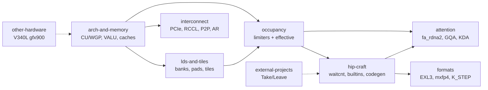

# Silicon

How gfx1030 (RDNA 2, Navi 21, V620) actually works, and what HIP can control. Every page carries a `## Sources` section with footnotes; claims that could not be sourced are marked `(unsourced)`.

| Folder | What lives there |
|---|---|
| [arch-and-memory/](arch-and-memory/README.md) | CU/WGP/SIMD32 layout, VALU and packed DOT, the cache hierarchy (L0/GL1/L2/Infinity Cache/GDDR6) and what HIP can set on it. (5 pages) |
| [lds-and-tiles/](lds-and-tiles/README.md) | LDS pool, 64-bank mapping, padding vs XOR swizzle, and the GEMM/attention tile seeds that follow from them. (3 pages) |
| [occupancy/](occupancy/README.md) | Hard limiters (VGPR, LDS, barriers, WG size, wave size, WGP/CU mode) and the effective-occupancy pages: things that are not a PIX MaxWaves row but park or starve waves inside a held slot. (24 pages) |
| [hip-craft/](hip-craft/README.md) | waitcnt, scopes, kernarg, builtins, the codegen stack we use (HIP + DOT) and graph-capture rules. (3 pages) |
| [attention/](attention/README.md) | `fa_rdna2` launch bounds and LDS/VGPR budget, GQA subgroup dispatch, FlashKDA on gfx1030. (3 pages) |
| [formats/](formats/README.md) | Silicon-side notes for EXL3, DSv4 Flash mxfp4, and the W4A16 prefill K_STEP config. Format contracts live in [../kernels/](../kernels/README.md). (3 pages) |
| [interconnect/](interconnect/README.md) | 4x V620 over PCIe 4.0: RCCL, P2P, PLX switch and MMIO, the custom one-shot all-reduce, DeepEP mapping and the hetero MoE layout. (5 pages) |
| [external-projects/](external-projects/README.md) | Third-party kernels, forks and recipes read against gfx1030: what we Take, what we Leave. (9 pages) |
| [other-hardware/](other-hardware/README.md) | V340L (Vega10 gfx900) notes. Vega routing belongs to GFX900_manager; these pages only record why it is not a V620 drop-in. (2 pages) |

## Silicon tip watermark

Silicon pages are read through dest `rdna_extras` tip **`b7402893`** (`b74028935393d1e21f73f80f65f506c9ea4639af`, read 2026-10-29).[^c-b7402893] Silicon delta from `8015ea48`: new gfx1030 kernels for the `rdna_hint_flex` per-row INT2/4/8 format (`fdot2` F16 mode, `sdot4` I8 mode; [../kernels/quant/rdna-hint-flex.md](../kernels/quant/rdna-hint-flex.md)); a Q32 int64 epilogue on the W4A16 kernels for MoE expert offload ([../kernels/gemm-moe/rdna2-moe-offload-q32.md](../kernels/gemm-moe/rdna2-moe-offload-q32.md)); GDN FP32 norm partials and K2 offload stages ([../kernels/persistent/monokernel-gfx1030-dest.md](../kernels/persistent/monokernel-gfx1030-dest.md)); a 2 KiB static-LDS bitonic sort in QSA index expansion; and the `rdna_ar` peer-access sticky-error order ([interconnect/rdna-allreduce.md](interconnect/rdna-allreduce.md)).[^c-b7402893-cmp]

*(Historical, `64d59b89`, read 2026-10-12)* Silicon pages are read through dest `rdna_extras` tip **`64d59b89`** (`64d59b8942d3b982f1d91f0f3e625dfda4418106`, read 2026-10-12).[^c-64d59b89] The per-page "current state" locks cite `1dc3bac4`. From `1dc3bac4` to `64d59b89` the only `csrc/` change is the host-only W4A8 MoE workspace fix `f2cc25ca`: no kernel body, LDS, `__launch_bounds__` or DOT change, so those locks still hold at the tip.[^c-1dc3bac4][^c-f2cc25ca] New this pass: the two-shot removal commit on [interconnect/rdna-allreduce.md](interconnect/rdna-allreduce.md) and the `rdna/common` arch traits on [hip-craft/hip-craft.md](hip-craft/hip-craft.md) §5.5.[^c-611063c6][^c-3e9ca702]

## Start here

1. [arch-and-memory/architecture.md](arch-and-memory/architecture.md): CU / WGP / caches
2. [hip-craft/hip-craft.md](hip-craft/hip-craft.md): waitcnt, occupancy workflow, builtins
3. [occupancy/occupancy-composite.md](occupancy/occupancy-composite.md): how the limiters fold into one number
4. [lds-and-tiles/lds-tiles.md](lds-and-tiles/lds-tiles.md): 64-bank formula and tile seeds
5. [attention/fa-occupancy.md](attention/fa-occupancy.md): `fa_rdna2` launch_bounds / LDS
6. [interconnect/rccl-p2p.md](interconnect/rccl-p2p.md): 4x V620, RCCL, P2P

## Related pages in other folders

| Page | Contents |
|---|---|
| [../kernels/linear-attn/gdn-decode.md](../kernels/linear-attn/gdn-decode.md) | GDN decode HIP `(2,4)`, no LDS |
| [../kernels/linear-attn/gdn-prefill.md](../kernels/linear-attn/gdn-prefill.md) | GDN prefill 5 HIP; kkt no `fdot2`; wy ~58 KB LDS |
| [../kernels/aot-glue/layernorm.md](../kernels/aot-glue/layernorm.md) | HIP AOT RMSNorm, tiny LDS, no DOT; not FA leftover |
| [../kernels/quant/w4a8.md](../kernels/quant/w4a8.md) | W4A8 `sdot4` Live opt-in @ `3a0786ea`; MoE accum dual-mode @ `30b0bd4e`; W4A16 default unchanged |
| [../kernels/models/qwen4exp-flash-next-hip.md](../kernels/models/qwen4exp-flash-next-hip.md) | Flash-Next HIP glue T46–T49 + mrope fixes @ 5c3c0c6f |
| [../toolchain/pin/README.md](../toolchain/pin/README.md) | Live ROCm pin (source of truth) |

## Sources

Apart from the tip watermark (footnoted below), this is an index page. Primary sources are cited with footnotes and a `## Sources` section on each linked page.

[^c-64d59b89]: opengfx1030/vllm-rdna commit [`64d59b89`](https://github.com/opengfx1030/vllm-rdna/commit/64d59b8942d3b982f1d91f0f3e625dfda4418106) — merge of PR #84, dest `rdna_extras` tip read 2026-10-12. `git diff --stat 1dc3bac4cda3201a1b4fb345e044578e84a272cf 64d59b8942d3b982f1d91f0f3e625dfda4418106 -- csrc CMakeLists.txt` lists only `csrc/rocm/moe_w4a8_rdna2.cu`.
[^c-1dc3bac4]: opengfx1030/vllm-rdna commit [`1dc3bac4`](https://github.com/opengfx1030/vllm-rdna/commit/1dc3bac4cda3201a1b4fb345e044578e84a272cf) (2026-10-11) — "Merge feat/ple-int4: INT4 PLE table on the upstream PLE path (#49)".
[^c-f2cc25ca]: opengfx1030/vllm-rdna commit [`f2cc25ca`](https://github.com/opengfx1030/vllm-rdna/commit/f2cc25ca927d0f3c6b0754d6f3982b3608746716) (2026-10-11) — "fix(rdna2): W4A8 MoE per-call workspace, 512-token threshold, microbench". The `.cu` change replaces the per-shape cached workspace with a per-call `at::empty` in the host launcher; the kernels are unchanged.
[^c-611063c6]: opengfx1030/vllm-rdna commit [`611063c6`](https://github.com/opengfx1030/vllm-rdna/commit/611063c62a400ba96e15e8168e2b2418494fdfdd) (2026-10-09) — "fix(rdna): remove the two-shot all-reduce from rdna_ar".
[^c-3e9ca702]: opengfx1030/vllm-rdna commit [`3e9ca702`](https://github.com/opengfx1030/vllm-rdna/commit/3e9ca702a10da840d29cbbc0f20872980e99c4a8) (2026-10-08) — "refactor(rdna): csrc/rocm/rdna layout skeleton, move DSV4 kernels to rdna/dsv4".
[^c-b7402893]: opengfx1030/vllm-rdna commit [`b7402893`](https://github.com/opengfx1030/vllm-rdna/commit/b74028935393d1e21f73f80f65f506c9ea4639af) — merge of PR #147, dest `rdna_extras` tip read 2026-10-29.
[^c-b7402893-cmp]: Compare [`8015ea48...b7402893`](https://github.com/opengfx1030/vllm-rdna/compare/8015ea485b7f6c0298d8f98ce6e824ce1c444c45...b74028935393d1e21f73f80f65f506c9ea4639af) (59 commits). `csrc/rocm` files changed: `moe_accum_rdna2.cuh`, `moe_q_gemm_rdna2.cu`, `mono_gdn_rdna2.cu`, `mono_k2_rdna2.cu`, `ops.h`, `q_gemm_rdna2.cu`, `q_gemm_rdna2_common.cuh`, `q_gemm_rdna2_prefill.cu`, `qsa_rdna2.cu`, `rdna_allreduce.cu`, `torch_bindings.cpp`, `w4a8_sdot4_rdna2.cu`; added `rdna_expert_cache.cu`, `rdna_hint_flex_rdna2.cu`.
