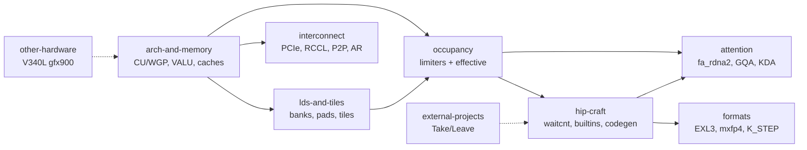

# Silicon

How gfx1030 (RDNA 2, Navi 21, V620) actually works, and what HIP can control. Every page carries a `## Sources` section with footnotes; claims that could not be sourced are marked `(unsourced)`.

| Folder | What lives there |
|---|---|
| [arch-and-memory/](arch-and-memory/README.md) | CU/WGP/SIMD32 layout, VALU and packed DOT, the cache hierarchy (L0/GL1/L2/Infinity Cache/GDDR6) and what HIP can set on it. (5 pages) |
| [lds-and-tiles/](lds-and-tiles/README.md) | LDS pool, 64-bank mapping, padding vs XOR swizzle, and the GEMM/attention tile seeds that follow from them. (3 pages) |
| [occupancy/](occupancy/README.md) | Hard limiters (VGPR, LDS, barriers, WG size, wave size, WGP/CU mode) and the effective-occupancy pages: things that are not a PIX MaxWaves row but park or starve waves inside a held slot. (24 pages) |
| [hip-craft/](hip-craft/README.md) | waitcnt, scopes, kernarg, builtins, the codegen stack we use (HIP + DOT) and graph-capture rules. (3 pages) |
| [attention/](attention/README.md) | `fa_rdna2` launch bounds and LDS/VGPR budget, GQA subgroup dispatch, FlashKDA on gfx1030. (3 pages) |
| [formats/](formats/README.md) | Silicon-side notes for EXL3, DSv4 Flash mxfp4, and the W4A16 prefill K_STEP config. Format contracts live in [../kernels/](../kernels/README.md). (3 pages) |
| [interconnect/](interconnect/README.md) | 4x V620 over PCIe 4.0: RCCL, P2P, PLX switch and MMIO, the custom one-shot all-reduce, DeepEP mapping and the hetero MoE layout. (5 pages) |
| [external-projects/](external-projects/README.md) | Third-party kernels, forks and recipes read against gfx1030: what we Take, what we Leave. (8 pages) |
| [other-hardware/](other-hardware/README.md) | V340L (Vega10 gfx900) notes. Vega routing belongs to GFX900_manager; these pages only record why it is not a V620 drop-in. (2 pages) |

## Start here

1. [arch-and-memory/architecture.md](arch-and-memory/architecture.md): CU / WGP / caches
2. [hip-craft/hip-craft.md](hip-craft/hip-craft.md): waitcnt, occupancy workflow, builtins
3. [occupancy/occupancy-composite.md](occupancy/occupancy-composite.md): how the limiters fold into one number
4. [lds-and-tiles/lds-tiles.md](lds-and-tiles/lds-tiles.md): 64-bank formula and tile seeds
5. [attention/fa-occupancy.md](attention/fa-occupancy.md): `fa_rdna2` launch_bounds / LDS
6. [interconnect/rccl-p2p.md](interconnect/rccl-p2p.md): 4x V620, RCCL, P2P

## Related pages in other folders

| Page | Contents |
|---|---|
| [../kernels/gdn-decode.md](../kernels/gdn-decode.md) | GDN decode HIP `(2,4)`, no LDS |
| [../kernels/gdn-prefill.md](../kernels/gdn-prefill.md) | GDN prefill 5 HIP; kkt no `fdot2`; wy ~58 KB LDS |
| [../kernels/layernorm.md](../kernels/layernorm.md) | HIP AOT RMSNorm, tiny LDS, no DOT; not FA leftover |
| [../kernels/w4a8.md](../kernels/w4a8.md) | W4A8 `sdot4` Live opt-in @ `3a0786ea`; MoE accum dual-mode @ `30b0bd4e`; W4A16 default unchanged |
| [../kernels/qwen4exp-flash-next-hip.md](../kernels/qwen4exp-flash-next-hip.md) | Flash-Next HIP glue T46–T49 + mrope fixes @ 5c3c0c6f |
| [../toolchain/pin/README.md](../toolchain/pin/README.md) | Live ROCm pin (source of truth) |

## Sources

This is an index page; it makes no technical claims of its own. Primary sources are cited with footnotes and a `## Sources` section on each linked page.
