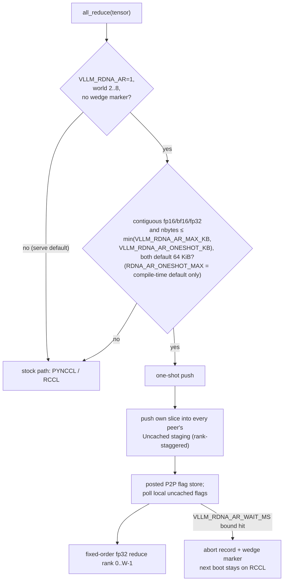

# gfx1030 push one-shot all-reduce (`rdna_ar`) — silicon lock

## Current state at dest tip `1dc3bac4` (checked 2026-10-11)

This section supersedes the two-shot and persist-out rows further down; those are kept as history.

| Item | State at `1dc3bac4` |
|---|---|
| Algorithm | **One-shot push only.** The two-shot kernel was removed: it returned zeros above the one-shot gate and made the boot self-test disable the whole backend.[^dest-envs-1dc3][^dest-cuh-1dc3][^dest-py-1dc3] |
| Gate | **Runtime setting: `VLLM_RDNA_AR_ONESHOT_KB`** (KiB, default 64), read by the host at init and by the Python gate; eligible messages are ≤ min(`VLLM_RDNA_AR_MAX_KB`, `VLLM_RDNA_AR_ONESHOT_KB`), both 64 KiB by default; larger messages go to RCCL.[^dest-cu-env-1dc3][^dest-py-gate-1dc3][^dest-envs-1dc3] `RDNA_AR_ONESHOT_MAX` (65536) is a **compile-time constant** in `rdna_allreduce.cuh`: it is only the default that `VLLM_RDNA_AR_ONESHOT_KB` overrides, not a setting you can change at serve time.[^dest-cuh-1dc3] |
| Dtypes | fp16, bf16, fp32 (`at::kHalf`, `at::kFloat`, `at::kBFloat16`).[^dest-envs-1dc3][^dest-cu-elig-1dc3] |
| Two-shot requests | `VLLM_RDNA_AR_ALGO=twoshot`, or a `MAX_KB` above the one-shot gate, is ignored with one warning.[^dest-py-1dc3] |
| Output buffer | Each call returns a **fresh output tensor** (`at::empty_like`). Since `00fcc97f` (PR #47), the old shared persistent buffer (`rdna2_persist_zeros`) is gone: it was clobbered by the next all-reduce while callers still held the result (the embedding output kept as the decoder residual).[^extras-rdna-allreduce-cu][^dest-00fcc97f] |
| Wait bound | Each one-shot wait is bounded in wall-clock time by `VLLM_RDNA_AR_WAIT_MS` (default `RDNA_AR_WAIT_MS` = 120000 ms), replacing the old poll-count cap (`VLLM_RDNA_AR_SPIN_CAP` / `RDNA_AR_SPIN_CAP` no longer exist at the tip); waits over `RDNA_AR_SLOW_MS` (2000 ms) that complete are logged as a late peer.[^dest-cuh-wait-1dc3][^dest-py-1dc3] |
| Default | Off: `VLLM_RDNA_AR` defaults to `"0"` and is not implied by `VLLM_FORCE_CUSTOM_ALL_REDUCE`.[^dest-envs-1dc3] |

## Historical: extras lock 2026-09-28 — tip `bfd5286d` (`101a16c8` / prior `22d6e346`+`c782696a`)

Dest: `opengfx1030/vllm-rdna` `rdna_extras`. Occupancy still first (FA prefill leftover). No tok/s.

| Item | Lock |
|---|---|
| `RDNA_AR_ONESHOT_MAX` | **65536** (64 KiB) compile-time default in `csrc/rocm/rdna_allreduce.cuh` — was 32768; env-less callers stay one-shot ≤ 64 KiB. Runtime override is `VLLM_RDNA_AR_ONESHOT_KB` (still true at `1dc3bac4`). [^dest-cuh-1dc3][^dest-cu-env-1dc3] |
| Default path | *(historical, two-shot removed at `1dc3bac4`)* One-shot ≤ 64 KiB, RCCL above. Two-shot only if explicitly opted in (wide `VLLM_RDNA_AR_MAX_KB` without matching oneshot / algo override). Serve scripts + library `max_kb` default back to **64**. |
| Two-shot kernel | *(historical, removed at `1dc3bac4`)* Was present (`rdna_ar_twoshot`: push reduce-scatter + allgather, abort phases 3/4, bf16, flag row `RDNA_AR_FLAG_STRIDE`). |
| Two-shot race | *(historical, kernel removed at `1dc3bac4`)* Peer-flag handshake wedges under co-tenant PCIe load (`rdna_ar_check` / wedge marker → RCCL). **Later/rework** — not dest-safe. Do not re-arm wide gate until phases 2/4 fixed. |
| Gate | Still opt-in `VLLM_RDNA_AR=1`; serve default stays PYNCCL. No DOT / FA `__launch_bounds__` / LDS tile. |

Prior protocol lock (Uncached staging, VRAM flags, on-device seq, T44b abort, push fanout) below still holds for the one-shot path.

---

Date: **2026-09-18**. Dest tip: `opengfx1030/vllm-rdna` `rdna_extras` @ `3b59ee16` (PR #13 leap T44b). Prior silicon lock tip: `a4060647`. Occupancy still first (FA prefill leftover). Do **not** copy tok/s.[^commit-3b59ee16][^commit-a4060647]

Companions: [rccl-p2p.md](rccl-p2p.md) (why stock custom AR is off), [leapdragon.md](../external-projects/leapdragon.md) (push vs pull GB/s, Uncached), [graph-capture.md](../hip-craft/graph-capture.md) (no frozen seq in kernarg), [plx-p2p-mmio.md](plx-p2p-mmio.md) (root-complex burst / fabric knobs).

## Status

| Item | Lock |
|---|---|
| Files | `csrc/rocm/rdna_allreduce.cuh` (kernel), `csrc/rocm/rdna_allreduce.cu` (host), `ops.h` / `torch_bindings.cpp`, `vllm/distributed/device_communicators/rdna_all_reduce.py`, hook in `cuda_communicator.py` [^extras-rdna-allreduce-cu][^extras-rdna-all-reduce-py] |
| CMake | `rdna_allreduce.cu` in base `VLLM_ROCM_EXT_SRC` (not the gfx1030-only append list) |
| Gate | **Opt-in.** `VLLM_RDNA_AR=1` + world 2..8. Default env remains `"0"`. Serve default stays PYNCCL / stock path; `VLLM_FORCE_CUSTOM_ALL_REDUCE` does **not** arm this. |
| Attribution | Protocol / abort-record / wedge marker from leapdragon/vllm-rdna2-qwen T44/T44b (Aron Hsiao). Persist-out (`rdna2_persist_zeros`; *historical*, replaced by a fresh output per call in `00fcc97f`), integer device index, PIX logging, default-off are this fork. |
| DOT / LDS / launch_bounds | **None of the FA leftover.** Tiny `__shared__ int` only (seq + abort). No `fdot2`, no tile pad, no `__launch_bounds__`. |

## Protocol (T44b @ tip `3b59ee16`)

Keeps the WS2 / leapdragon findings, with the 2026-08-30 / T44b flag + abort updates:

1. **Push, never pull** — each rank writes its slice into every peer’s staging slot (`src = our rank`). Peer order is rank-staggered: `j = (rank + k) % world`.
2. **Staging is Uncached** — `hipExtMallocWithFlags(..., hipDeviceMallocUncached)`. Coarse-grained peer stores otherwise leave the owner reading stale L2.
3. **Flags live in each rank’s OWN uncached device memory** — 4 KiB flag page appended to the same Uncached staging alloc (`RDNA_AR_FLAG_PAGE`). Peer announce is one posted P2P store into `peers.flags[j][rank]`; we poll **local** uncached slots (no PCIe read traffic on the wait). Host-coherent `shm_open` flag page is **gone** (signature keeps `shm_name` but ignores it).[^m-78e84a272cf-csrc-rocm-rdna-allreduce-cuh]
4. **Seq on-device** — `seqbuf` atomic load+1 inside the kernel; never a kernarg (graph-capture safe). Dual parity staging: `stage[(parity * W + src) * max_elems + i]`.
5. **Bounded wait + T44b abort record** — *(historical at `3b59ee16`: `VLLM_RDNA_AR_SPIN_CAP`, default `RDNA_AR_SPIN_CAP` 2e6 polls; neither name exists at `1dc3bac4`, where the bound is wall-clock `VLLM_RDNA_AR_WAIT_MS`, default 120000 ms[^dest-cuh-wait-1dc3])*; first block to hit the bound `atomicCAS`es device `timeout` and writes a 64-bit code into a **host-mapped** `report` (plain store, no PCIe atomics). Python `rdna_ar_timeout_info` / `rdna_ar_check()` read with a plain host load (no D2H sync). Poll backoff: `__builtin_amdgcn_s_sleep(8)`. (ISA: ≈ 448–512 clocks out of arbitration; slot stays reserved — [wave-priority-occupancy.md](../occupancy/wave-priority-occupancy.md).)
6. **Wedge marker** — on abort, write `VLLM_CACHE_ROOT/rdna_ar_wedged` and fail the step; next boot stays on RCCL until the marker is deleted.
7. **Fixed-order fp32 reduce** — rank 0 .. W−1 accumulate in `float`, then store `T` (`half` or `float`). Bit-identical across ranks for TP.

Abort code layout (bits) at `1dc3bac4`: `0-7` aborted flag; `8-11` phase (`1` = own grid barrier, `2` = peer flag missing); `12-15` peer; `16-31` measured wall-clock wait in 16 ms units (saturating); `32-63` sequence. *(At `3b59ee16`, bits 16-31 were spins/1024, labelled "~ms"; historical.)*[^dest-cuh-abort-1dc3]

World max: `RDNA_AR_MAX_WORLD = 8`. Launch: **256** threads[^dest-cu-launch-1dc3]; blocks auto by payload size, capped by `VLLM_RDNA_AR_BLOCKS`. `VLLM_RDNA_AR_PACE` (0..127) paces strided pushes. `VLLM_RDNA_AR_MAX_KB` default **64** (decode-sized; prefill stays on RCCL/CUSTOM).

Eligibility at `1dc3bac4`: contiguous fp16 / bf16 / fp32, `nbytes ≤` the one-shot gate (min of `VLLM_RDNA_AR_MAX_KB` and `VLLM_RDNA_AR_ONESHOT_KB`).[^dest-cu-elig-1dc3][^dest-py-gate-1dc3] Larger / other dtypes stay on stock RCCL path. When armed, eligible tensors dispatch **ahead of** stock CUSTOM / PYNCCL.

*Diagram: Dispatch split and the one-shot protocol as written in the Status, Protocol and eligibility paragraphs above (tip `3b59ee16`), updated to dest `1dc3bac4`: one-shot only; the gate is the runtime env `VLLM_RDNA_AR_ONESHOT_KB` (capped by `VLLM_RDNA_AR_MAX_KB`), both 64 KiB by default, RCCL above; `RDNA_AR_ONESHOT_MAX` is only the compiled-in default. Two-shot no longer exists.*[^extras-rdna-allreduce-cu][^commit-3b59ee16][^dest-cuh-1dc3]

## What this is not

- Not a replacement for FA occupancy work.
- Not the production default on V620 TP=4 PIX — leave `VLLM_RDNA_AR=0`; PYNCCL remains the dest-safe Uncached-P2P backend for mixed prefill/decode.
- Not XGMI / Instinct custom AR; vLLM’s gfx94/95 custom + QuickReduce stay off on V620 ([rccl-p2p.md](rccl-p2p.md)).
- Do not paste T44 µs figures or leapdragon tok/s into dest claims; cite source comments only when needed, and keep our own benches separate.

## Take / Leave

| | |
|---|---|
| **Take** | Uncached staging + **VRAM uncached flags** + on-device seq + push fanout + fixed-order reduce + T44b host-mapped abort record / `rdna_ar_check()` / wedge marker. Fabric knobs (`BLOCKS` / `PACE`; wall-clock `WAIT_MS` replaced `SPIN_CAP`). Default `MAX_KB=64`. Fresh output per call (persist-out is historical since `00fcc97f`). |
| **Leave** | Default-on; host-coherent flag page; mid-serve silent spin-to-cap without wedge fail; any claimed µs/GB/s until remeasured on this 4×/8× 88096 box; auto-arming because P2P is on. |

## Sources

Primary sources for this page, cited inline as footnotes:

[^extras-rdna-allreduce-cu]: `csrc/rocm/rdna_allreduce.cu`, opengfx1030/vllm-rdna rdna_extras at 1dc3bac4 (2026-10-11 tip); the page may describe an older commit named inline. https://github.com/opengfx1030/vllm-rdna/blob/1dc3bac4cda3201a1b4fb345e044578e84a272cf/csrc/rocm/rdna_allreduce.cu
[^commit-3b59ee16]: opengfx1030/vllm-rdna commit `3b59ee16e553`. https://github.com/opengfx1030/vllm-rdna/commit/3b59ee16e553168b1e3809c9a141088662171448 (exists, verified via GitHub API 2026-10-11)
[^commit-a4060647]: opengfx1030/vllm-rdna commit `a4060647cfbb`. https://github.com/opengfx1030/vllm-rdna/commit/a4060647cfbb32d3b907eba6018501bb8b251d22 (exists, verified via GitHub API 2026-10-11)
[^extras-rdna-all-reduce-py]: `vllm/distributed/device_communicators/rdna_all_reduce.py`, opengfx1030/vllm-rdna rdna_extras at 1dc3bac4 (2026-10-11 tip); the page may describe an older commit named inline. https://github.com/opengfx1030/vllm-rdna/blob/1dc3bac4cda3201a1b4fb345e044578e84a272cf/vllm/distributed/device_communicators/rdna_all_reduce.py
[^m-78e84a272cf-csrc-rocm-rdna-allreduce-cuh]: github.com/opengfx1030/vllm-rdna/blob/1dc3bac4cda3201a1b4fb345e044578e84a272cf/csrc/rocm/rdna_allreduce.cuh. https://github.com/opengfx1030/vllm-rdna/blob/1dc3bac4cda3201a1b4fb345e044578e84a272cf/csrc/rocm/rdna_allreduce.cuh (checked 2026-10-11)
[^dest-envs-1dc3]: `vllm/envs.py`, `VLLM_RDNA_AR` comment block, opengfx1030/vllm-rdna at 1dc3bac4. https://github.com/opengfx1030/vllm-rdna/blob/1dc3bac4cda3201a1b4fb345e044578e84a272cf/vllm/envs.py#L1469-L1476
[^dest-cuh-1dc3]: `csrc/rocm/rdna_allreduce.cuh`, `RDNA_AR_ONESHOT_MAX` and its comment, opengfx1030/vllm-rdna at 1dc3bac4. https://github.com/opengfx1030/vllm-rdna/blob/1dc3bac4cda3201a1b4fb345e044578e84a272cf/csrc/rocm/rdna_allreduce.cuh#L58-L70
[^dest-py-1dc3]: `vllm/distributed/device_communicators/rdna_all_reduce.py` module docstring, opengfx1030/vllm-rdna at 1dc3bac4. https://github.com/opengfx1030/vllm-rdna/blob/1dc3bac4cda3201a1b4fb345e044578e84a272cf/vllm/distributed/device_communicators/rdna_all_reduce.py#L15-L30
[^dest-00fcc97f]: opengfx1030/vllm-rdna commit 00fcc97f "fix(rocm): rdna_ar returns a fresh output tensor per all-reduce" (PR #47; an ancestor of 1dc3bac4). https://github.com/opengfx1030/vllm-rdna/commit/00fcc97ff5015158da93f52bd32f2c70757f0f8a
[^dest-cu-env-1dc3]: `csrc/rocm/rdna_allreduce.cu` `getenv("VLLM_RDNA_AR_ONESHOT_KB")` overriding `oneshot_max = RDNA_AR_ONESHOT_MAX`, opengfx1030/vllm-rdna at 1dc3bac4. https://github.com/opengfx1030/vllm-rdna/blob/1dc3bac4cda3201a1b4fb345e044578e84a272cf/csrc/rocm/rdna_allreduce.cu#L84-L93
[^dest-py-gate-1dc3]: `resolve_gate_kb()` in `vllm/distributed/device_communicators/rdna_all_reduce.py` (`VLLM_RDNA_AR_ONESHOT_KB`, `_ONESHOT_DEFAULT_KB = 64`), opengfx1030/vllm-rdna at 1dc3bac4. https://github.com/opengfx1030/vllm-rdna/blob/1dc3bac4cda3201a1b4fb345e044578e84a272cf/vllm/distributed/device_communicators/rdna_all_reduce.py#L52-L80
[^dest-cuh-wait-1dc3]: `RDNA_AR_WAIT_MS` / `RDNA_AR_SLOW_MS` and their comment in `csrc/rocm/rdna_allreduce.cuh`, opengfx1030/vllm-rdna at 1dc3bac4. https://github.com/opengfx1030/vllm-rdna/blob/1dc3bac4cda3201a1b4fb345e044578e84a272cf/csrc/rocm/rdna_allreduce.cuh#L51-L65
[^dest-cuh-abort-1dc3]: abort-record comment and `rdna_ar_ms_code` in `csrc/rocm/rdna_allreduce.cuh`, opengfx1030/vllm-rdna at 1dc3bac4. https://github.com/opengfx1030/vllm-rdna/blob/1dc3bac4cda3201a1b4fb345e044578e84a272cf/csrc/rocm/rdna_allreduce.cuh#L72-L96
[^dest-cu-launch-1dc3]: `rdna_ar_oneshot<T><<<nblocks, 256, 0, stream>>>` in `csrc/rocm/rdna_allreduce.cu`, opengfx1030/vllm-rdna at 1dc3bac4. https://github.com/opengfx1030/vllm-rdna/blob/1dc3bac4cda3201a1b4fb345e044578e84a272cf/csrc/rocm/rdna_allreduce.cu#L196
[^dest-cu-elig-1dc3]: dtype check (`kHalf` / `kFloat` / `kBFloat16`) and `at::empty_like` output in `csrc/rocm/rdna_allreduce.cu`, opengfx1030/vllm-rdna at 1dc3bac4. https://github.com/opengfx1030/vllm-rdna/blob/1dc3bac4cda3201a1b4fb345e044578e84a272cf/csrc/rocm/rdna_allreduce.cu#L215-L231
