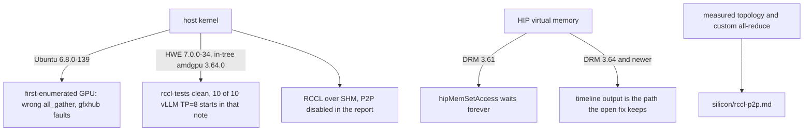

# RCCL gates

Date: **2026-10-11**. Arch gating, env knobs, and the host kernel version that has to be true before an RCCL result means anything.

Topology, PCIe P2P bandwidth, and custom all-reduce policy for the 4× V620 box are [silicon/rccl-p2p.md](../../silicon/rccl-p2p.md). This page does not restate them. The intact 2026-09-03 scan of the then-open Navi PR is [../log/comms-notes.md](../log/comms-notes.md).

## Bring-up



### Ubuntu 6.8, DRM 3.64

[rocm-systems#12145](https://github.com/ROCm/rocm-systems/issues/12145) (open) reports silent RCCL `all_gather` corruption on the first-enumerated GPU of an 8× V620 (gfx1030) host, SHM transport, plus gfxhub page faults (TCP read of address 0) when SHM is disabled. `HSA_DISABLE_CACHE=1` made the harness clean. The follow-up on that issue: the same host, cards, and binaries on Ubuntu HWE **7.0.0-34** (in-tree amdgpu **3.64.0**) got `#wrong 0` from rccl-tests and 0/200 bad ranks, where **6.8.0-139** had failed. vLLM TP=8 startup died in 29 of 43 launches on 6.8.0-139 and came up 10 of 10 on 7.0.0-34. The vLLM version also changed between those boots, which the note states.[^rccl12145]

[legacy-rocm-build#6565](https://github.com/ROCm/legacy-rocm-build/issues/6565) (open) is the gfx1100 thread of the same symptom. `lucbruni-amd` (2026-10-06) calls it a regression in Ubuntu's 6.8 kernel driver and asks for a rerun on the 24.04 HWE kernel, plus `uname -r` and `modinfo -n amdgpu`.[^rccl6565]

[rocm-systems#9820](https://github.com/ROCm/rocm-systems/issues/9820) / [#9821](https://github.com/ROCm/rocm-systems/pull/9821) are the HIP virtual-memory hang on DRM older than 3.64. That path is [runtime/](../runtime/README.md). It is the same DRM number, and it is a different bug from the RCCL SHM corruption.[^vmm9820]

Check the host kernel before treating a bad collective as an RCCL or engine bug. No dest change.

## Arch gating at the Navi-optimizations merge

[rocm-systems#11035](https://github.com/ROCm/rocm-systems/pull/11035) merged 2026-09-10, merge commit `9f8b805fd8fb459ea8a81ea52f41acda41bf2f97`. The 7.14.0 release notes are dated 2026-07-15, so this merge is later than that release.[^navi11035][^rn7140] A diff of tag `rocm-7.14.0`'s RCCL tree was not done this pass (unsourced).

`connect.cc` at that merge commit:

```c
const bool isGfx_110x_120x = IsArchMatch(comm->topo->nodes[GPU].nodes[0].gpu.gcn, "gfx110") ||
                             IsArchMatch(comm->topo->nodes[GPU].nodes[0].gpu.gcn, "gfx120");
const bool p2pDisabled = ncclParamP2pDisable();
const bool intraGraphGen = rcclParamIntraGraphGen() || (p2pDisabled && isGfx_110x_120x);
const bool interGraphGen = rcclParamInterGraphGen();
const bool disableRingDiversity = isGfx_110x_120x && !p2pDisabled;
```

The automatic ring generator is gfx110/gfx120 and only when P2P is disabled. `rcclParamIntraGraphGen()` is OR'd in front of that arch test, so the parameter itself is not arch-checked in this expression.[^connect] The PR body says the knobs default off, that Navi's default is 2 channels, and that the author considers about 4% on P2P/IPC and about 10% on the SHM path possible. Those percentages are the author's, not a measurement from this wiki.[^navi11035] The environment-variable spellings and the numeric channel defaults (the 2026-09-03 scan's `RCCL_INIT_CHANNELS` / 56 / 6) were not re-found in `param.cc` or `rccl_vars.h` at this merge commit (unsourced). They remain in the [archived scan](../log/comms-notes.md).

`rcclGetTuningIndexForArch` at the same commit maps **gfx1030 → 0**, the same index as gfx906, gfx908, and gfx90a. gfx1100, gfx1101, and gfx1102 map to 10. gfx1151 maps to 9. gfx1200 and gfx1201 map to 7.[^tuning] The 2026-09-03 scan of the open PR said gfx1102 stayed at 0; the merged file read this pass has gfx1102 at 10. gfx1030 is still the generic row. Filling a gfx1030 row is separate tuning work and needs `NCCL_DEBUG_SUBSYS=TUNING` measurements first. Measured topology stays in [silicon/rccl-p2p.md](../../silicon/rccl-p2p.md).

`ncclTopoPreset` at that commit warns when `nChannels` is outside `[1, MAXCHANNELS]` and when a graph's channel count is below `comm->nChannels`.[^connect]

Do not flip `VLLM_RDNA_AR` or `FORCE_CUSTOM_ALL_REDUCE` from this page. Custom all-reduce policy is the silicon page.

## Sources

[^rccl12145]: rocm-systems#12145, open. https://github.com/ROCm/rocm-systems/issues/12145
[^rccl6565]: legacy-rocm-build#6565, open, `lucbruni-amd` comment 2026-10-06. https://github.com/ROCm/legacy-rocm-build/issues/6565
[^vmm9820]: rocm-systems#9820. https://github.com/ROCm/rocm-systems/issues/9820
[^navi11035]: rocm-systems#11035, merged 2026-09-10, merge commit `9f8b805fd8fb459ea8a81ea52f41acda41bf2f97`. https://github.com/ROCm/rocm-systems/pull/11035
[^rn7140]: ROCm 7.14.0 release notes, dated 2026-07-15. https://rocm.docs.amd.com/en/docs-7.14.0/about/release-notes.html
[^connect]: `projects/rccl/src/graph/connect.cc` at `9f8b805fd8fb459ea8a81ea52f41acda41bf2f97`. https://github.com/ROCm/rocm-systems/blob/9f8b805fd8fb459ea8a81ea52f41acda41bf2f97/projects/rccl/src/graph/connect.cc
[^tuning]: `projects/rccl/src/graph/tuning.cc` at the same commit, `rcclGetTuningIndexForArch`. https://github.com/ROCm/rocm-systems/blob/9f8b805fd8fb459ea8a81ea52f41acda41bf2f97/projects/rccl/src/graph/tuning.cc
