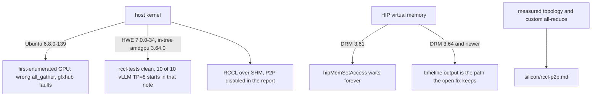

# RCCL gates

Date: **2026-10-11**. Host-kernel gate, arch gating, NCCL-compat environment variables, and HIP/RCCL bugs that show up when P2P setup fails or a collective is pathologically slow.

Topology, PCIe P2P bandwidth, and custom all-reduce policy for the 4× V620 box are [silicon/interconnect/rccl-p2p.md](../../silicon/interconnect/rccl-p2p.md). This page does not restate them. The intact 2026-09-03 scan of the then-open Navi PR is [../log/comms-notes.md](../log/comms-notes.md).

## Bring-up



### Ubuntu 6.8, DRM 3.64

[rocm-systems#12145](https://github.com/ROCm/rocm-systems/issues/12145) (open) reports silent RCCL `all_gather` corruption on the first-enumerated GPU of an 8× V620 (gfx1030) host, SHM transport, plus gfxhub page faults (TCP read of address 0) when SHM is disabled. `HSA_DISABLE_CACHE=1` made the harness clean. The follow-up on that issue: the same host, cards, and binaries on Ubuntu HWE **7.0.0-34** (in-tree amdgpu **3.64.0**) got `#wrong 0` from rccl-tests and 0/200 bad ranks, where **6.8.0-139** had failed. vLLM TP=8 startup died in 29 of 43 launches on 6.8.0-139 and came up 10 of 10 on 7.0.0-34. The vLLM version also changed between those boots, which the note states.[^rccl12145]

[legacy-rocm-build#6565](https://github.com/ROCm/legacy-rocm-build/issues/6565) (open) is the gfx1100 thread of the same symptom. `lucbruni-amd` (2026-10-06) calls it a regression in Ubuntu's 6.8 kernel driver and asks for a rerun on the 24.04 HWE kernel, plus `uname -r` and `modinfo -n amdgpu`.[^rccl6565]

[rocm-systems#9820](https://github.com/ROCm/rocm-systems/issues/9820) / [#9821](https://github.com/ROCm/rocm-systems/pull/9821) are the HIP virtual-memory hang on DRM older than 3.64. That path is [runtime/](../runtime/README.md). It is the same DRM number, and it is a different bug from the RCCL SHM corruption.[^vmm9820]

Check the host kernel before treating a bad collective as an RCCL or engine bug. No dest change.

## Arch gating at the Navi-optimizations merge

[rocm-systems#11035](https://github.com/ROCm/rocm-systems/pull/11035) merged 2026-09-10, merge commit `9f8b805fd8fb459ea8a81ea52f41acda41bf2f97`. The 7.14.0 release notes are dated 2026-07-15, so this merge is later than that release.[^navi11035][^rn7140] A diff of tag `rocm-7.14.0`'s RCCL tree was not done this pass (unsourced).

`connect.cc` at that merge commit:

```c
const bool isGfx_110x_120x = IsArchMatch(comm->topo->nodes[GPU].nodes[0].gpu.gcn, "gfx110") ||
                             IsArchMatch(comm->topo->nodes[GPU].nodes[0].gpu.gcn, "gfx120");
const bool p2pDisabled = ncclParamP2pDisable();
const bool intraGraphGen = rcclParamIntraGraphGen() || (p2pDisabled && isGfx_110x_120x);
const bool interGraphGen = rcclParamInterGraphGen();
const bool disableRingDiversity = isGfx_110x_120x && !p2pDisabled;
```

The automatic ring generator is gfx110/gfx120 and only when P2P is disabled. `rcclParamIntraGraphGen()` is OR'd in front of that arch test, so the parameter itself is not arch-checked in this expression.[^connect] The PR body says the knobs default off, that Navi's default is 2 channels, and that the author considers about 4% on P2P/IPC and about 10% on the SHM path possible. Those percentages are the author's, not a measurement from this wiki.[^navi11035] The environment-variable spellings and the numeric channel defaults (the 2026-09-03 scan's `RCCL_INIT_CHANNELS` / 56 / 6) were not re-found in `param.cc` or `rccl_vars.h` at this merge commit (unsourced). They remain in the [archived scan](../log/comms-notes.md).

`rcclGetTuningIndexForArch` at the same commit maps **gfx1030 → 0**, the same index as gfx906, gfx908, and gfx90a. gfx1100, gfx1101, and gfx1102 map to 10. gfx1151 maps to 9. gfx1200 and gfx1201 map to 7.[^tuning] The 2026-09-03 scan of the open PR said gfx1102 stayed at 0; the merged file read this pass has gfx1102 at 10. gfx1030 is still the generic row. Filling a gfx1030 row is separate tuning work and needs `NCCL_DEBUG_SUBSYS=TUNING` measurements first. Measured topology stays in [silicon/interconnect/rccl-p2p.md](../../silicon/interconnect/rccl-p2p.md).

`ncclTopoPreset` at that commit warns when `nChannels` is outside `[1, MAXCHANNELS]` and when a graph's channel count is below `comm->nChannels`.[^connect]

Do not flip `VLLM_RDNA_AR` or `FORCE_CUSTOM_ALL_REDUCE` from this page. Custom all-reduce policy is the silicon page.

## NCCL-compat environment variables

RCCL accepts the NCCL names. The rows below are the current NVIDIA environment-variables page, read 2026-10-11. That page is not pinned to the NCCL version a given RCCL build tracks. Where AMD prints its own number, the citation is the RCCL 2.27.7 usage tips on the docs-7.2.0 tree.[^ncclenv][^rccltips]

Which `NCCL_P2P_LEVEL` cutoff matches a given host is measured topology on [silicon/interconnect/rccl-p2p.md](../../silicon/interconnect/rccl-p2p.md). This table does not assign one.

| Variable | What the opened page says |
|---|---|
| `NCCL_P2P_DISABLE` | Set to `1` to disable the P2P transport (direct GPU-to-GPU access over NVLink or PCI). [rccl-tests#162](https://github.com/ROCm/rccl-tests/issues/162) and [legacy-rocm-build#6576](https://github.com/ROCm/legacy-rocm-build/issues/6576) record that switch as the workaround they ran. |
| `NCCL_P2P_LEVEL` | Since 2.3.4. Maximum distance at which NCCL still uses P2P. Strings: `LOC` never; `NVL` when GPUs are on NVLink; `PIX` same PCI switch; `PXB` through PCI switches (possibly multiple hops); `PHB` same NUMA node, traffic through the CPU; `SYS` across NUMA nodes. Legacy integers, discouraged: `LOC` 0, `PIX` 1, `PXB` 2, `PHB` 3, `SYS` 4. Values above 4 are read as `SYS`. `NVL` has no legacy integer. |
| `NCCL_SHM_DISABLE` | Set to `1` to disable shared-memory transport. The page says NCCL then uses the network (InfiniBand or IP sockets) between CPU sockets. It does not say the process hangs. One gfx1201 report of a hang after this variable is [ROCR-Runtime#355](https://github.com/ROCm/ROCR-Runtime/issues/355), in the bug section. |
| `NCCL_IB_DISABLE` | Set to `1` to stop NCCL using InfiniBand Verbs (and, on Windows, NetworkDirect). Fallback named on the page is another transport, for example IP sockets. A single-node checklist that sets this is on the silicon page. |
| `NCCL_MIN_NCHANNELS` | Minimum channel count (more CUDA blocks). Deprecated in NCCL 2.17 in favor of `NCCL_MIN_CTAS`; if both are set, the higher value wins. Default is platform dependent; the page allows up to 32 from NCCL 2.5 on. |
| `NCCL_DEBUG` | `VERSION`, `WARN`, `INFO` (debug information), `TRACE`. `ATTN` is since 2.32. |
| `NCCL_DEBUG_SUBSYS` | Since 2.3.4. Comma-separated filter for `NCCL_DEBUG=INFO`. Default is `INIT,BOOTSTRAP,ENV`. Supported names include `INIT`, `P2P`, `SHM`, `NET`, `GRAPH`, `TUNING`, and `ALL`. |

On an 8× MI300X system the same RCCL 2.27.7 tips say RCCL already uses **32** channels when two MI300X accelerators are in use and **24** when four are, and they give `export NCCL_MIN_NCHANNELS=32` as the example for raising the floor. Those numbers are scoped to MI300X on that page. They are not a gfx1030 default.[^rccltips]

MSCCL on that page is enabled by default on MI300X. Other platforms use `RCCL_MSCCL_FORCE_ENABLE=1`. MSCCL++ is `RCCL_MSCCLPP_ENABLE=1`, with `RCCL_MSCCLPP_THRESHOLD` defaulting to 1 MB. The tips page does not mention `RCCL_MSCCL_ENABLE`.[^rccltips]

Symmetric memory and the GIN device API are the ROCm 10.0 section below. vLLM's custom all-reduce gate stays on [silicon/interconnect/rccl-p2p.md](../../silicon/interconnect/rccl-p2p.md).

## HIP and RCCL bugs

These are reports on other GPUs. None of them is a published V620 rccl-tests table. Whether this box hits the same path is a measurement; the peer matrix is the silicon page.

### `hipIpcGetMemHandle` invalid argument

[rccl-tests#162](https://github.com/ROCm/rccl-tests/issues/162) (closed) is 4× Radeon AI PRO R9700 (gfx1201), Ubuntu 24.04.3, kernel `6.14.0-36-generic`, RCCL `2.27.7-HEAD:84d2752`, HIP `7.1.52802`, ROCm `7.1.1`. `all_reduce_perf -b 8 -e 128M -f 2 -g 4` logs `src/transport/p2p.cc:256 NCCL WARN hipIpcGetMemHandle failed : invalid argument`. `huanrwan-amd` (2025-12-13) asked for a rerun with `NCCL_P2P_DISABLE=1`. The reporter's follow-up log with that variable set prints the four R9700 devices and small-message rows with `#wrong 0`. A standalone `hipIpcGetMemHandle` program from the same reporter returned `invalid argument`; the AMD reply said that program succeeded on their machine and asked about large BAR and the `amd-smi` driver string `amdgpu version: 6.14.0-37`. Not a gfx1030 report.[^rccl162]

[rccl#1454](https://github.com/ROCm/rccl/issues/1454) (closed) is titled "RCCL is compleatly broken in most configurations." The system line is 3× MI100 (gfx908), EPYC 7452, Ubuntu 24.04 and Arch, kernel 6.12.3, ROCm 6.2.4, RCCL 2.20.5. A rank line in the Note 1 log is an AMD Radeon RX 6800 XT next to an AMD Instinct MI100. The body's matrix marks rccl-tests broken when `CONFIG_HSA_AMD_P2P` and `CONFIG_DMABUF_MOVE_NOTIFY` are both `y` (IOMMU disabled, enabled, and pass-through), and not broken when both are `n`. Those logs include `p2p.cc:235 NCCL WARN hipIpcGetMemHandle failed : invalid argument`. `NCCL_P2P_DISABLE` does not appear in the issue body or the comments read this pass. `LunNova` (2024-12-15) writes that `HSA_ENABLE_IPC_MODE_LEGACY` defaults to 1 and that `hipIpcGetMemHandle` then fails on mainline drivers because it calls the out-of-tree `hsaKmtShareMemory` API, and suggests `HSA_ENABLE_IPC_MODE_LEGACY=0`. A later bot comment says the issue was migrated to rocm-systems#2779.[^rccl1454]

### P2P selected, about 215 ms per collective

[legacy-rocm-build#6576](https://github.com/ROCm/legacy-rocm-build/issues/6576) (open) is the issue at `https://github.com/ROCm/ROCm/issues/6576` (same body). Dual Radeon Pro W7800 48 GB (gfx1100) at `03:00.0` and `07:00.0`, Gen4 x8/x8, large BAR, Ubuntu 24.04, kernel `6.8.0-136`, RCCL 2.28.3 in a ROCm 7.13 container and RCCL 2.27.7 on a ROCm 7.2.3 host. `rocm-smi --showtopo` reports Weight 40, Hops 2, Link PCIE, and the report says RCCL still selects direct P2P/IPC (`via P2P/IPC`, `isAllDirectP2p 1`).

With `NCCL_P2P_DISABLE=1` the same collectives are 30–41 µs for small sizes and 26 GB/s at 33 MB. With P2P selected, the report's figure is a fixed ~215 ms per collective. A vLLM TP=2 probe goes from 42.43 s to 0.029 s for 8 tokens (1477×). The report gives ~5.3 s/step on a 12-layer model (24 × 221 ms) and ~27 s on a 64-layer model (128 × 211 ms). It also says the ROCm 7.2.3 host, single-process two-GPU rccl-tests with P2P enabled, crashes with an illegal memory access and an amdgpu UTCL2 page fault on the second GPU, and that the slowdown still happens with `amd_iommu=off`. The reporter's reading of the stall (one GPU at 100%, the other at 0%, host idle; "~215 ms ≈ 20+ MES process quanta") is the reporter's, not an AMD root-cause note.[^rccl6576]

The workaround recorded in that issue is `NCCL_P2P_DISABLE=1`. On 4× V620, time both transports before treating a slow collective as a kernel bug. The peer matrix for this box is [silicon/interconnect/rccl-p2p.md](../../silicon/interconnect/rccl-p2p.md).

### Device copy and IPC open

[HIP#3352](https://github.com/ROCm/HIP/issues/3352) is a PoC whose comment says the `hipMemcpy2D` from one device pointer to another "will crash" and that "Calls to isPeerCanAccess return 0." The posted stack frame is `hipMemcpy2D` in `libamdhip64.so.5`. The issue body does not name `hipDeviceCanAccessPeer`, `SIGSEGV`, or `hipMemcpyDtoD`.[^hip3352]

[ROCR-Runtime#355](https://github.com/ROCm/ROCR-Runtime/issues/355) is 2× Radeon AI PRO R9700 (gfx1201), ROCm 7.2.3. After the platform fixes listed in the issue, `hipDeviceCanAccessPeer(0,1)` is 1 and `hipMemcpyPeer` succeeded at 10.2 GB/s (512 MB, PCIe Gen3 x16 through dual PLX). Legacy `hipIpcGetMemHandle` returns `hipErrorInvalidValue`. With `HSA_ENABLE_IPC_MODE_LEGACY=0`, get succeeds and `hipIpcOpenMemHandle` returns `hipErrorInvalidDevicePointer` (17). The same write-up's table records `NCCL_SHM_DISABLE=1` as a forced-P2P attempt that hung the node.[^rocr355]

### MSCCL during graph capture

[vLLM#24160](https://github.com/vllm-project/vllm/issues/24160) (closed) is 8× MI355, torch `2.8.0+rocm7.0.0`, vLLM `0.10.1rc2`, Llama 405B. The log line is `alloc.h:317 NCCL WARN Cuda failure 'out of memory'`. The reporter says it happens during CUDA graph capture, and that replacing the PYNCCL allreduce with quick allreduce or with torch's allreduce made the OOM stop. Comments by `zejunchen-zejun` (2025-09-04 and 2025-09-05) give the workaround `export RCCL_MSCCL_ENABLE=0`. That variable name is the comment's; it is not on the RCCL 2.27.7 tips page opened above. The host is MI355, not gfx1030. The tips page's default is MI300X, and other platforms turn MSCCL on with `RCCL_MSCCL_FORCE_ENABLE=1`.[^vllm24160][^rccltips]

[vLLM#18805](https://github.com/vllm-project/vllm/issues/18805) (closed) is the issue #24160 links, and it is a different report: RX 7900 XTX (gfx1100), PyTorch `2.8.0.dev20250526+rocm6.4`, vLLM logging `nccl==2.22.3` from `librccl.so.1`, then `NCCL error: unhandled cuda error`. The body does not contain `RCCL_MSCCL_ENABLE` or an out-of-memory line.[^vllm18805]

## ROCm 10.0 RCCL and GIN

The ROCm 10.0 blog, dated August 27, 2026, by Liam Berry, Saad Rahim, Anshul Gupta, and Evan Groenke, says RCCL advances its upstream NCCL merge from **2.28.3 to 2.30.4** and adds symmetric memory for tightly coupled multi-GPU peer-to-peer, a GPU-initiated networking (GIN) device API that starts network transfers over GDA and SDMA instead of bouncing through the CPU, one-sided host APIs, and Pythonic APIs. The same paragraph also names large-scale bootstrap improvements, fault-tolerance enhancements, copy-engine collectives, hierarchical AllGather, and direct collectives.[^rocm10blog]

The blog does not publish a V620 or gfx1030 GIN bandwidth. This page does not add one. PIX BAR `hipMemcpyPeer` on the V620 stays in [silicon/interconnect/deepep-v620.md](../../silicon/interconnect/deepep-v620.md). Live dest stays **7.14.0**.

## Sources

[^rccl12145]: rocm-systems#12145, open. https://github.com/ROCm/rocm-systems/issues/12145
[^rccl6565]: legacy-rocm-build#6565, open, `lucbruni-amd` comment 2026-10-06. https://github.com/ROCm/legacy-rocm-build/issues/6565
[^vmm9820]: rocm-systems#9820. https://github.com/ROCm/rocm-systems/issues/9820
[^navi11035]: rocm-systems#11035, merged 2026-09-10, merge commit `9f8b805fd8fb459ea8a81ea52f41acda41bf2f97`. https://github.com/ROCm/rocm-systems/pull/11035
[^rn7140]: ROCm 7.14.0 release notes, dated 2026-07-15. https://rocm.docs.amd.com/en/docs-7.14.0/about/release-notes.html
[^connect]: `projects/rccl/src/graph/connect.cc` at `9f8b805fd8fb459ea8a81ea52f41acda41bf2f97`. https://github.com/ROCm/rocm-systems/blob/9f8b805fd8fb459ea8a81ea52f41acda41bf2f97/projects/rccl/src/graph/connect.cc
[^tuning]: `projects/rccl/src/graph/tuning.cc` at the same commit, `rcclGetTuningIndexForArch`. https://github.com/ROCm/rocm-systems/blob/9f8b805fd8fb459ea8a81ea52f41acda41bf2f97/projects/rccl/src/graph/tuning.cc
[^ncclenv]: NVIDIA NCCL environment variables, current docs page, read 2026-10-11. Not pinned to an NCCL release. https://docs.nvidia.com/deeplearning/nccl/user-guide/docs/env.html
[^rccltips]: RCCL usage tips, docs-7.2.0 tree, page header "RCCL 2.27.7 Documentation", read 2026-10-11. https://rocm.docs.amd.com/projects/rccl/en/docs-7.2.0/how-to/rccl-usage-tips.html
[^rccl162]: rccl-tests#162, closed, plus comments by `huanrwan-amd` (2025-12-13) and `ZiguanWang` (2025-12-15, 2025-12-16). https://github.com/ROCm/rccl-tests/issues/162
[^rccl1454]: rccl#1454, closed, including the `LunNova` comment of 2024-12-15 and the migration comment to rocm-systems#2779. https://github.com/ROCm/rccl/issues/1454
[^rccl6576]: legacy-rocm-build#6576, open. `https://github.com/ROCm/ROCm/issues/6576` returns the same body. https://github.com/ROCm/legacy-rocm-build/issues/6576
[^hip3352]: HIP#3352, PoC comment and `hipMemcpy2D` stack. https://github.com/ROCm/HIP/issues/3352
[^rocr355]: ROCR-Runtime#355. https://github.com/ROCm/ROCR-Runtime/issues/355
[^vllm24160]: vllm#24160, closed, including `zejunchen-zejun` comments 2025-09-04 and 2025-09-05. https://github.com/vllm-project/vllm/issues/24160
[^vllm18805]: vllm#18805, closed. https://github.com/vllm-project/vllm/issues/18805
[^rocm10blog]: "ROCm 10.0: A Decade of Open Compute, Built for the Age of Agentic AI", August 27, 2026, Liam Berry, Saad Rahim, Anshul Gupta, Evan Groenke. Read 2026-10-11. https://rocm.blogs.amd.com/ecosystems-and-partners/rocm-x-blog/README.html
