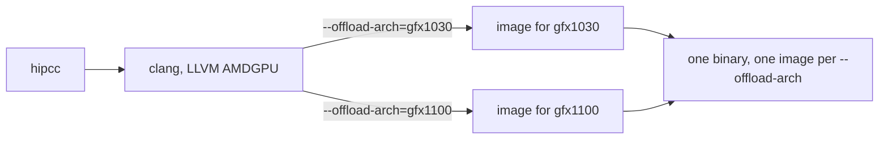

# Compiler

Date: **2026-10-13**. Audience: someone compiling HIP for **gfx1030** (live dest), with later **gfx1100** and **gfx900** translation units.

What DPP, `ds_bpermute`, and `amdgpu_waves_per_eu` do on the gfx1030 ISA is in [silicon/occupancy/dpp-crosslane-occupancy.md](../../silicon/occupancy/dpp-crosslane-occupancy.md), [silicon/occupancy/vgpr-occupancy.md](../../silicon/occupancy/vgpr-occupancy.md), and [silicon/hip-craft/hip-craft.md](../../silicon/hip-craft/hip-craft.md). This page keeps flags and compiler-version bugs. The nightly SHA log is [../log/compiler-scans.md](../log/compiler-scans.md).

## Flags

ROCm 7.14.0 ships two HIP compiler interfaces, `hipcc` and `amdclang++`. Both use LLVM with the AMDGPU backend. `hipcc` links the HIP runtime for you. `amdclang++` needs `--hip-link` (or `-lamdhip64`). When no GPU is named, `hipcc` targets the GPUs it finds on the machine; `amdclang++` defaults to gfx803.[^rocmcc]

`--offload-arch=<target>` is the HIP offload target id. The 7.14.0 compiler reference says it may be passed more than once, and the same page's multi-image section shows one compiled image per `--offload-arch` inside one binary (`--offload-arch=gfx906` together with `--offload-arch=gfx908` is the documented shape).[^rocmcc] The live project line stays:

```text
hipcc --offload-arch=gfx1030 -O3
```

Pass `gfx1100` as its own `--offload-arch` when that translation unit is in the bundle. RCCL's device-compile parser rejects the generic ids `gfx10-3-generic` and `gfx11-generic` (it divides the digits after `gfx` and then misses the SGPR-limit table).[^rccl10701] Use the specific ids.

**hipcc is on its way out.** An AMD engineer opened rocm-examples#566 on 2026-10-30 saying ROCm is "migrating away from `hipcc` and `hipconfig` across the ROCm organization": projects should call `amdclang++` directly and use CMake's HIP language support in place of `hipconfig`.[^hipccmig] The issue lists what a straight swap loses. `HIPCC_COMPILE_FLAGS_APPEND` is read only by hipcc, so with `amdclang++` an `--offload-arch` passed that way is silently dropped and the build falls back to the default target. The issue also calls `hipcc --genco` a hipcc-only option. hipcc's machine auto-detection becomes `--offload-arch=native`. The issue's replacement line is `amdclang++ --hip-path=${ROCM_PATH} --hip-device-lib-path=${ROCM_PATH}/lib/llvm/amdgcn/bitcode -x hip --offload-arch=gfx1100 ...`, and `hipcc --hipcc-verbose=7 <args>` prints the clang command hipcc builds today.[^hipccmig] For our builds: keep the `hipcc` line above while ROCm ships it, but write new build files so `--offload-arch=gfx1030` (and `gfx1100` / `gfx900` where needed) is passed explicitly on the compile line, never only through `HIPCC_COMPILE_FLAGS_APPEND` or auto-detection. As of 2026-11-04 we found no ROCm release note that removes hipcc; the issue is the only source here.



On RDNA, rocmcc documents `-mwavefrontsize64` / `-mno-wavefrontsize64` and `-mcumode` (CU mode versus WGP mode).[^rocmcc] HIP's language extensions say AMD devices return `warpSize` 64 on gfx9 and 32 on gfx10 and above, and that HIP does not support `warpSize` of 64 on gfx10 and above. The same page says the `mwavefrontsize64` compiler option is not supported by the HIP runtime.[^hipwarp] What WGP versus CU mode does to LDS and the SIMD map is [silicon/hip-craft/hip-craft.md](../../silicon/hip-craft/hip-craft.md). Do not add `-mwavefrontsize64` or `-mcumode` on the live gfx1030 line.

`-Rpass-analysis=kernel-resource-usage` is how the spill notes below were read. `--save-temps` keeps the assembly.

## Gotcha — `amdgpu_waves_per_eu` can miscompile on clang 22

Clang documents `__attribute__((amdgpu_waves_per_eu(min[, max])))` as an optimization hint. The backend may limit SGPRs, VGPRs, and group or private memory so that at least `min` and at most `max` waves fit on an execution unit. It warns when it cannot meet the request. Passing `0, 0` means no extra limit.[^clangwpe] The gfx1030 reading of "EU" (one SIMD32) and the VGPR ladder are [silicon/occupancy/vgpr-occupancy.md](../../silicon/occupancy/vgpr-occupancy.md). This page only records where that hint produced wrong answers.

Strata [#1180](https://github.com/Niko1221/Strata/issues/1180) (open; the occupancy cap is switched off in engine 0.1.40.2 when `__clang_major__ >= 22`): a gfx11 WMMA MoE prefill kernel built with `amdgpu_waves_per_eu(8)` returned wrong results on **gfx1100** with ROCm 7.10 / AMD clang 22. Relative RMS against the kernel's own int8-rounded model was 6.544e-02. With the barrier present, the cap at 8 failed 0/20 runs and the cap at 1 passed 20/20.[^strata1180] The same issue also had a missing `__syncthreads()` after a double-buffered LDS write, which failed about 45% of runs on that machine; the two defects are independent in the report.[^strata1180]

On gfx1151 with ROCm 7.14.1 / `AMD clang version 23.0.0git`, a follow-up measured the cap at 8 and the cap at 1 on engine 0.1.40.2. Both passed `hip_prefill_fused_iq` with the same worst error against the FP64 reference (2.942e-02) and zero failures. Fused kernel time per layer at 8192 tokens dropped with the cap at 8: IQ2_S/Q2_0 41.92 → 40.21 ms (−4.1%), IQ2_XXS/Q2_0 38.29 → 32.44 ms (−15.3%), IQ3_S/IQ4_NL 40.48 → 34.99 ms (−13.6%), IQ3_XXS/IQ4_NL 39.88 → 33.63 ms (−15.7%).[^strata1180c] So the cap is a per-compiler, per-arch result. Clang 22 on gfx1100 computed wrong values; clang 23 on gfx1151 computed the same parity result faster. Gate any cap on a parity run and on `-Rpass-analysis=kernel-resource-usage` for the compiler you actually ship. A `__clang_major__` cutoff is how 0.1.40.2 turned the fast path off on clang 23 as well.[^strata1180c]

No repro on the 7.14.0 dest is written here. No pin change.

## Gotcha — `__shfl_xor` keeps a bounds check

CLR `__shfl_xor` has a lane bounds check that should fold away when `width == warpSize`. [rocm-systems#11618](https://github.com/ROCm/rocm-systems/pull/11618) (closed 2026-10-14 without merge) said LLVM cannot prove `__lane_id() < warpSize`, so the check survives as `v_cndmask`. The PR masks the lane id with `warpSize - 1`. On a wave32 butterfly (`k32.hip`, five steps) compiled with ROCm 10.0 / LLVM 23, gfx1030 and gfx1100 each go from 32 `v_*` and 5 `v_cndmask` to 11 `v_*` and 0 `v_cndmask`. gfx90a (`k64.hip`) goes from 40 / 6 to 17 / 0. With `width = 8` the `v_cndmask` count is unchanged.[^shfl11618] What a shuffle costs in pipes and waitcnt on gfx1030 is [silicon/occupancy/dpp-crosslane-occupancy.md](../../silicon/occupancy/dpp-crosslane-occupancy.md).

#11618 was closed as superseded by a compiler fix: upstream [llvm-project#232066](https://github.com/llvm/llvm-project/pull/232066) (merged 2026-10-14, `c9355b8eb0e2`) tightens the InstCombine range of `mbcnt` so `__lane_id()` is known to be in `[0, 64)`, which folds the `__shfl_xor` bounds check when width is the wave size.[^shfl11618][^llvm232066] Whether ROCm's `amd-staging` LLVM or any TheRock pin carries it was not checked this pass. Until a pin we build has it, `--save-temps` and a search for `v_cndmask` in a full-wave reduction is the check. No pin change.

## Gotcha — cross-workgroup flags in WGP mode

[pytorch#198208](https://github.com/pytorch/pytorch/pull/198208) described a race that made `torch.compile` silently return wrong 64-bit split-scan results (`cumsum` on `int64`, `float64`, and promoted `int32`/`bool`) on RDNA: reproduced on gfx1151, gfx1200 and gfx1101, not on CDNA or NVIDIA. The decoupled look-back publishes a block's payload with a plain store plus a release flag, and the reader does an acquire on the flag and then a plain load. Triton runs the atomic on one lane, so the acquire's `buffer_gl0_inv` executes inside a one-lane exec-masked region, while every wave loads the payload. In WGP mode a workgroup of more than two waves spans both CUs of a WGP, which have separate L0 caches, so waves on the CU that never ran the invalidate read a stale line.[^pt198208] The PR was closed on 2026-10-14 because the problem was already fixed by [triton#10906](https://github.com/triton-lang/triton/pull/10906) (merged 2026-07-31), which PyTorch main has with Triton 3.9.[^pt198208] triton#10906 itself restricts an AMD barrier lowering to CDNA because it caused this numeric drift on RDNA3 and RDNA4.[^tri10906]

The PR's reports are gfx11 and gfx12. The WGP layout it relies on (two CUs, separate L0) is the same on gfx1030, which also runs WGP mode by default ([runtime/](../runtime/README.md)); see [silicon/occupancy/l0-gl1-occupancy.md](../../silicon/occupancy/l0-gl1-occupancy.md). For our HIP kernels that pass data between workgroups through flags (split-K reductions, look-back scans, persistent queues): make sure every wave that reads the payload is ordered after an acquire that invalidates its own CU's L0, not just the lane that polled the flag. On Triton, use 3.9 or later before trusting split-scan results on RDNA.

## Gotcha — pass DPP operands as bits

`__builtin_amdgcn_mov_dpp` is integer-typed. bitsandbytes [#2089](https://github.com/bitsandbytes-foundation/bitsandbytes/pull/2089) (open) reports that passing a `float` through it on ROCm 6.4.4 / clang 19 emitted numeric float↔int conversions. On RX 7900 GRE / gfx1100 the `Linear4bit` warp reduction had relative L1 error 0.125295 before the patch and 0.002051 after wrapping the value in `__float_as_uint` / `__uint_as_float`. A patched ROCm 10 / clang 23 build passed the same three tests.[^bnb2089] The bit pattern DPP moves, and which DPP controls exist on gfx1030, are [silicon/occupancy/dpp-crosslane-occupancy.md](../../silicon/occupancy/dpp-crosslane-occupancy.md). Keep the bitcast so the result does not depend on the compiler's implicit conversion. No pin change.

## Gotcha — full unroll can spill VGPRs on RDNA

llama.cpp [#29910](https://github.com/ggml-org/llama.cpp/pull/29910) (open) reports Q2_K MMQ spills from a full `#pragma unroll` plus a staged temporary. The PR's table: gfx1030 DP4A 836 → 0 spills, gfx1100 MMA 1387 → 0, after gentler unroll. gfx906 pp2048 at ubatch 512 went from 204.92 t/s to 571.23 t/s in that table.[^llama29910] Unroll factor is a register-pressure knob. Sweep it and read `VGPRs Spill` / `ScratchSize` from `-Rpass-analysis=kernel-resource-usage` per arch.

The spill job in llama.cpp's `hip-quality-check.yml` on master (read 2026-10-11) rebuilds with `-DGPU_TARGETS=gfx908` and runs `scripts/hip/gcn-cdna-vgpr-check.py`. A separate `-Werror` build uses gfx942. The spill gate's GPU target in that job is gfx908.[^hipci] RDNA spills are outside that job. The script parses the remarks log, so a fork can point the same check at `gfx1030`, `gfx1100`, and `gfx900`. No pin change.

## Gotcha — `__byte_perm` is a byte-index loop

At rocm-systems `65575fbbe6f73b9d9d96bfbcb523c856709e664c`, HIP `__byte_perm` in `amd_device_functions.h` stores `x` and `y` into an 8-byte array and indexes it four times from nibbles of the selector (`c[i] & 0x07` and `(c[i] & 0x70) >> 4`).[^byteperm] It is not one `v_perm_b32`.

llama.cpp [#29927](https://github.com/ggml-org/llama.cpp/pull/29927) (open) replaces `__byte_perm` with `__builtin_amdgcn_perm` on the Q1_0 unpack path. On Instinct MI50 (gfx906) the PR reports tg128 66.99 → 128.96 t/s.[^llama29927] How the builtin's selector bytes differ from HIP's nibble index was not re-opened this pass (unsourced). Check the ISA with `--save-temps` before treating the two as the same operation. No pin change.

## Gotcha — a dynamic stack gets 1 KB per thread

[rocm-libraries#12473](https://github.com/ROCm/rocm-libraries/issues/12473) (closed 2026-10-12 by the docs-only PR [#12638](https://github.com/ROCm/rocm-libraries/pull/12638)): hipThreads calls user code through a function pointer, so the compiler cannot size the callee's frame and marks the kernel `.uses_dynamic_stack: true`. The runtime then gives each thread only `hipLimitStackSize`, 1024 bytes by default. Overflow gave no diagnostic: either `HSA_STATUS_ERROR_EXCEPTION` or silent corruption of a neighbouring wave's scratch and an intermittent hang. In the same report, an ordinary kernel with a 4096-byte local compiled to `.private_segment_fixed_size: 4112` and `.uses_dynamic_stack: false` and ran fine under the same 1 KB limit. The field report was on MI350 (gfx950), ROCm 10.1 RC1.[^ht12473][^ht12638]

For our forks: if a kernel calls through a function pointer, read `.uses_dynamic_stack` in its code-object metadata (the dump in [silicon/occupancy/occupancy-dump.md](../../silicon/occupancy/occupancy-dump.md) shows it). If it is true, make the call direct or raise `hipLimitStackSize` to a size you have worked out. This page has no gfx1030 repro.

## Gotcha — `-g` can change the generated code

[TheRock#9294](https://github.com/ROCm/TheRock/issues/9294) (open) reports a gfx1100 kernel (W7900, ROCm 7.1.1, AMD clang 20) that hits `HIP error 700` (illegal memory access) when built with `-g` at `-O1`, `-O2` or `-O3`, and runs correctly from the same source without `-g`.[^tr9294] An AMD LLVM developer replied that `-g` currently does change codegen, that internal bugs track it, and named spilling `exec` to describe its unwinding as one cause.[^tr9294] For our forks: do correctness parity and performance runs on the same flags you ship, and treat a crash that only appears with `-g` as a possible compiler difference before you blame the kernel. This page has no gfx1030 repro.

## Gotcha — `llvm-mc` misprints the K of `v_fmamk` / `v_fmaak`

[llvm-project#237158](https://github.com/llvm/llvm-project/issues/237158) (open): the AMDGPU disassembler decodes the 32-bit K constant that follows `v_fmamk_*` / `v_fmaak_*` as if it were a 9-bit source-operand code. K = `0xff` crashes it in the `_f16` forms; K = `0x80` to `0xf8` prints an inline constant's value instead of K, so the printed text reassembles to a different word. The reporter saw it with LLVM 22.1.8 on gfx1151, gfx1100, gfx1200 and, for the f32 forms, gfx1030; a commenter reproduced it on LLVM main. The assembler encodes correctly.[^llvm237158] For ISA reviews: when a disassembled `v_fmamk`/`v_fmaak` shows a small K, check the raw dword before trusting it, and do not round-trip disassembly back through the assembler.

## Gotcha — `mulhs` on 24-bit types returns the wrong bits

[llvm-project#237718](https://github.com/llvm/llvm-project/issues/237718) (open, filed 2026-11-01) reports that the AMDGPU `performMulhsCombine` has no width check, so a signed high multiply on a non-i32 type (for example `_BitInt(24)`, also i7/i8/i16/i64 of sign-extended 24-bit values) lowers to `v_mul_hi_i32_i24`, which returns bits 32..47 of the product instead of bits N..2N-1. The reporter's `h24(2^22, 2^22)` returns 4096 instead of 1048576 on `-mcpu=gfx900` trunk and lists every target with 24-bit multiplies, including gfx1100.[^llvm237718] The report scopes the bug to `mulhs` of types other than i32. Avoid `_BitInt` high-multiply idioms in our kernels until a fix lands.

## Gotcha — the first kernel launch reseeds `rand()`

[TheRock#9865](https://github.com/ROCm/TheRock/issues/9865) (open, filed 2026-11-10) reports that with the TheRock pip SDK on Linux (HIP 7.16.26385, gfx1100) the first kernel launch in a process calls `srand()` with a random seed, so an app that seeded `rand()` for reproducible runs gets a different stream every run. The backtrace in the report goes `hipLaunchKernel` → `amd_comgr_do_action` → `llvm::sys::fs::createUniqueDirectory` → `llvm::sys::Process::GetRandomNumber()` → glibc `srandom`; the SDK's `libLLVM.so.24.0git` imports `srand` and not `arc4random`, which the reporter attributes to building against a glibc older than 2.36. Ubuntu 24.04's distro comgr (`libLLVM-17.so.1`) imports `arc4random` and is not affected.[^tr9865] The issue names only gfx1100, but the path is comgr on the host, so it should not depend on the GPU target (inferred, not measured on gfx1030). For our test harnesses: seed `rand()` after the first kernel launch, or use a C++ `<random>` engine you own, until the SDK's LLVM stops using `srand`.

## Gotcha — ROCm 7.1 `__half2float` returns the negated value (SDWA peephole)

[ROCm/llvm-project#5478](https://github.com/ROCm/llvm-project/issues/5478) (open, filed 2026-11-17, no replies yet) reports that the ROCm 7.1 compiler (AMD clang 20.0.0git, roc-7.1.0 25425) miscompiles an fp16 → fp32 cast in a grid-stride loop at `-O2` and `-O3`: `__half2float(0x3C00)` returns -1.0 instead of 1.0, and 63,490 of the 65,536 half bit patterns come out wrong. The `si-peephole-sdwa` pass folds a `V_BFE_I32` + `V_CVT_F32_F16_e64` pair into `v_cvt_f32_f16_sdwa ... -v9`, setting the NEG source modifier that the source never asked for. The reporter ran the reproducer on an **RX 6800 (gfx1030)** and got the wrong values; inline asm with the same encoded instruction confirmed the hardware applies the NEG bit. Results are correct at `-O1`, with `-mllvm -amdgpu-sdwa-peephole=0`, and with ROCm 7.2 (clang 22). Which commit fixed it was not checked.[^llvm5478]

For us: the live dest is **7.14.0**, newer than the 7.2 the reporter found clean, so no dest action (not re-run on 7.14 here). If a gfx1030 or gfx900 build still uses a ROCm 7.1 compiler and fp16 → fp32 casts look sign-flipped, rebuild with ≥ 7.2 or add `-mllvm -amdgpu-sdwa-peephole=0` and rerun parity. The report does not test gfx900 or gfx1100.

## Gotcha — gfx11 codegen can differ run to run (VOPD post-RA scheduling)

[ROCm/llvm-project#4513](https://github.com/ROCm/llvm-project/issues/4513) reports that compiling the same LLVM IR twice with the same compiler and flags gave different machine code. The post-RA machine scheduler got byte-identical MIR and picked a different order depending on the addresses the compiler process received (stable with ASLR off), and `s_waitcnt` placement followed. For one production kernel the two schedules differed by 6.3% in wall-clock time. The reporter bisected the first appearance to ROCm nightly 10.1.0a20260818 and saw 2 variants at `-O2`/`-O3` (1 at `-O1`) on gfx1100, gfx1151 and gfx1201. `-mllvm -amdgpu-enable-vopd=0` removed the variation, but the reporter says that may only hide the cause.[^llvm4513] An AMD developer pointed to [llvm-project#232317](https://github.com/llvm/llvm-project/pull/232317) ("[AMDGPU][VOPD] Make VOPD pairing load-overlap check deterministic", merged 2026-10-19), then closed the issue on 2026-11-19 saying it has been fixed.[^llvm4513][^llvm232317] Which ROCm nightly first carries the fix was not checked.

For us: on gfx1100 with a 10.1-era compiler, a few-percent A/B difference between two builds of the same source can be this, not your change. Diff the ISA of both builds before trusting the number. VOPD (dual-issue) is RDNA3+, so gfx1030 and gfx900 should not hit this path; that is our reading, the report has no gfx10 or gfx9 data (unsourced).

## Gotcha — Triton 3.9 true16 spills bf16-output GEMMs on gfx11

[triton#12469](https://github.com/triton-lang/triton/issues/12469) (open) reports that Triton 3.9 enables true16 on gfx11 and that an LLVM AMDGPU selection FIXME can then use extra 32-bit registers per packed pair, up to 3x the VGPRs of Triton 3.8 in the worst case. The reporter (gfx1151) says Triton `main` no longer reproduces it after an LLVM bump that includes llvm-project#221960, but the FIXME is still there; a maintainer offered to disable true16 on the 3.9 branch if needed.[^tri12469] A 2026-11-19 comment narrows it on gfx1101 (triton-windows 3.9.0.post30, AITER `gemm_a16w16`, bf16 output, Windows only): 128×256×64 / 8 warps spills 54 VGPRs with true16 on and 0 with it off (0 on 3.8), and 128×128×64 / 4 warps spills 56 vs 0. Only bf16 output conversion triggers it; fp16 in and out or fp32 out adds no spills. Per kernel, `llvm_fn_attrs="target-features=-real-true16"` works for bf16 output but fails to assemble for fp16 output. In 7 of 10 timed shapes true16 on was about 2–5% slower (median on/off ratio 1.023–1.045); on N=3072, K=12288 it was faster (ratios 0.951 and 0.890).[^tri12469]

For us: on gfx1100 with Triton 3.9, check the spill count in the AMDGPU metadata of bf16-output GEMM tiles that sit at 256 VGPRs before blaming the kernel. The report has no gfx1100 or Linux data, and Triton does not target gfx900 here.

## Gotcha — raw `rcp` / `rsq` / `sqrt` builtins on gfx1030 are not IEEE

The pantheonsim GPU-simulator project compared its model against an RX 6800 and RX 6700 XT (gfx1030/gfx1031) and filed what differs. Measured on those cards, `v_rcp_f64`, `v_rsq_f64` and `v_sqrt_f64` return about 24 significant bits (22 to 26 over 2^27 random operands; `v_sqrt_f64(1.0)` is 1 + 2^-24), not a correctly rounded double. Compiled `sqrt()` / `1.0/x` agree because the compiler refines the result with FMAs, but code that calls `__builtin_amdgcn_rcp` / `__builtin_amdgcn_rsq` on doubles, or hand assembly, gets the raw bits.[^pan728] On the same card, `v_rcp_f32`, `v_rsq_f32`, `v_sqrt_f32`, `v_exp_f32` and `v_log_f32` flush denormal operands and results (for example `v_rcp_f32` of a denormal gives +inf).[^pan722] A separate rocjitsu report on gfx1036 also says the f64 forms are not correctly rounded but describes the precision differently (see [tools/](../tools/README.md)), so treat the exact bit count as unsettled. For gfx1030 kernels: use the raw builtins only where about 24 bits and denormal flush are acceptable (softmax `exp`, norm `rsq` in f32), and use the library `sqrt` / `rsqrt` or add a Newton step for f64 and for reference kernels. No other RDNA target was measured.

## `-O0` integer divide, and wave64

[TheRock#7751](https://github.com/ROCm/TheRock/issues/7751) is **closed**. The issue body reports that ROCm 7.2.4 and 7.14 miscompile i32 `udiv` / `urem` at `-O0` on gfx1034 (float reciprocal instead of the integer path). The same kernels were correct at `-O1`/`-O2`/`-O3`, and correct at `-O0` on ROCm 6.4.3. `schung-amd` commented that they reproduced it on gfx1100, and later that it should be fixed in current nightlies via llvm-project#201186 and llvm-project#202753.[^tr7751] Live extras stay `-O3` on 7.14.0.

[TheRock#7909](https://github.com/ROCm/TheRock/issues/7909) is **open**. It asks for an official HIP path for architecture-specific wave64 kernels and says `-mwavefrontsize64` is deprecated.[^tr7909] gfx1030's HIP `warpSize` is 32.[^hipwarp] Do not flip the dest to wave64 from that issue. The request log is in [../log/compiler-scans.md](../log/compiler-scans.md).

## Sources

[^rocmcc]: ROCm compiler reference, docs-7.14.0 (`hipcc` vs `amdclang++`, `--offload-arch`, wavefront and CU-mode flags, multi-image example). https://rocm.docs.amd.com/projects/llvm-project/en/docs-7.14.0/reference/rocmcc.html
[^hipwarp]: HIP C++ language extensions, docs-7.14.0, `warpSize` section. https://rocm.docs.amd.com/projects/HIP/en/docs-7.14.0/how-to/hip_cpp_language_extensions.html
[^clangwpe]: Clang attribute reference, `amdgpu_waves_per_eu`. https://clang.llvm.org/docs/AttributeReference.html#amdgpu-waves-per-eu
[^strata1180]: Strata#1180, issue body (gfx1100, ROCm 7.10 / clang 22, rel RMS 6.544e-02, 0/20 vs 20/20). https://github.com/Niko1221/Strata/issues/1180
[^strata1180c]: Strata#1180 comment, gfx1151, ROCm 7.14.1, `AMD clang version 23.0.0git`, engine 0.1.40.2. https://github.com/Niko1221/Strata/issues/1180
[^shfl11618]: rocm-systems#11618, closed 2026-10-14 without merge; `mrowan137` closing comment points to llvm-project#232066. https://github.com/ROCm/rocm-systems/pull/11618
[^llvm232066]: llvm-project#232066, "[AMDGPU] Tighten mbcnt result range in InstCombine", merged 2026-10-14 20:46 UTC. https://github.com/llvm/llvm-project/pull/232066
[^pt198208]: pytorch#198208, closed 2026-10-14 without merge; description (root cause, archs) and `amd-maradosa` closing comment (fixed by triton#10906, in main with Triton 3.9). https://github.com/pytorch/pytorch/pull/198208
[^tri10906]: triton#10906, "[AMD] Restrict BarrierOpConversion to CDNA to avoid ROCm numeric drift on RDNA", merged 2026-07-31. https://github.com/triton-lang/triton/pull/10906
[^bnb2089]: bitsandbytes#2089, open. https://github.com/bitsandbytes-foundation/bitsandbytes/pull/2089
[^llama29910]: llama.cpp#29910, open. https://github.com/ggml-org/llama.cpp/pull/29910
[^hipci]: llama.cpp `.github/workflows/hip-quality-check.yml` on `master`, read 2026-10-11. The "Check for major VGPR spills" step sets `-DGPU_TARGETS=gfx908`. https://github.com/ggml-org/llama.cpp/blob/master/.github/workflows/hip-quality-check.yml
[^byteperm]: `amd_device_functions.h` at rocm-systems `65575fbbe6f73b9d9d96bfbcb523c856709e664c`. https://github.com/ROCm/rocm-systems/blob/65575fbbe6f73b9d9d96bfbcb523c856709e664c/projects/clr/hipamd/include/hip/amd_detail/amd_device_functions.h
[^llama29927]: llama.cpp#29927, open. https://github.com/ggml-org/llama.cpp/pull/29927
[^tr7751]: TheRock#7751, closed. https://github.com/ROCm/TheRock/issues/7751
[^tr7909]: TheRock#7909, open. https://github.com/ROCm/TheRock/issues/7909
[^rccl10701]: rocm-systems#10701, closed without merge 2026-10-12; whether a fix landed elsewhere was not checked. https://github.com/ROCm/rocm-systems/pull/10701
[^ht12473]: rocm-libraries#12473, closed, issue body (metadata excerpts, 1024-byte default, MI350 field report). https://github.com/ROCm/rocm-libraries/issues/12473
[^tr9294]: TheRock#9294, open; issue body (flag table) and `slinder1` comment of 2026-09-23 on `-g` codegen changes. https://github.com/ROCm/TheRock/issues/9294
[^ht12638]: rocm-libraries#12638, merged 2026-10-12, docs only. https://github.com/ROCm/rocm-libraries/pull/12638
[^llvm237158]: llvm-project#237158, open, issue body and `dcwire` comment (reproduced on LLVM 24.0.0git main). https://github.com/llvm/llvm-project/issues/237158
[^llvm237718]: llvm-project#237718, open, issue body (reproducer, gfx900 asm, affected targets). https://github.com/llvm/llvm-project/issues/237718
[^hipccmig]: ROCm/rocm-examples#566, "Migrate examples off hipcc (hipcc → amdclang++)", opened 2026-10-30 by david-salinas (AMD), open on 2026-11-04. https://github.com/ROCm/rocm-examples/issues/566
[^tr9865]: TheRock#9865, open, filed 2026-11-10 16:29 UTC; issue body (reproducer, gdb backtrace, `nm -D` output, distro comgr comparison). https://github.com/ROCm/TheRock/issues/9865
[^llvm5478]: ROCm/llvm-project#5478, open, filed 2026-11-17 05:42 UTC by saqibkh; issue body (MIR before/after `si-peephole-sdwa`, repro.hip, RX 6800 gfx1030 result, 7.2 clean). https://github.com/ROCm/llvm-project/issues/5478
[^llvm4513]: ROCm/llvm-project#4513, closed 2026-11-19 15:55 UTC; issue body (ASLR dependence, 6.3%, bisect to 10.1.0a20260818, `-amdgpu-enable-vopd=0`, scope gfx1100/gfx1151/gfx1201) and `shiltian` comments of 2026-11-03 and 2026-11-19. https://github.com/ROCm/llvm-project/issues/4513
[^llvm232317]: llvm-project#232317, "[AMDGPU][VOPD] Make VOPD pairing load-overlap check deterministic", merged 2026-10-19 07:39 UTC. https://github.com/llvm/llvm-project/pull/232317
[^tri12469]: triton#12469, open; issue body (woct0rdho, gfx1151, Triton 3.9 true16, llvm-project#221960 on main), `antiagainst` comment 2026-10-30, `Ragua1` comment 2026-11-19 22:58 UTC (gfx1101 spill table, per-kernel switch, timing). https://github.com/triton-lang/triton/issues/12469
[^pan728]: pantheongpu/pantheonsim#728, open, updated 2026-11-23 (gfx1030/gfx1031 measured f64 rcp/rsq/sqrt about 24 bits; compiler FMA refinement; raw builtins). https://github.com/pantheongpu/pantheonsim/issues/728
[^pan722]: pantheongpu/pantheonsim#722, open, updated 2026-11-23 (RX 6800 gfx1030 special-operand table: f32 rcp/rsq/sqrt/exp/log flush denormals). https://github.com/pantheongpu/pantheonsim/issues/722
