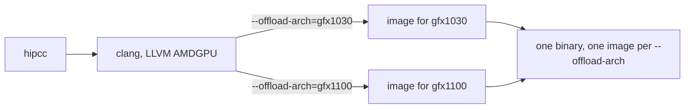

# Compiler

Date: **2026-10-13**. Audience: someone compiling HIP for **gfx1030** (live dest), with later **gfx1100** and **gfx900** translation units.

What DPP, `ds_bpermute`, and `amdgpu_waves_per_eu` do on the gfx1030 ISA is in [silicon/occupancy/dpp-crosslane-occupancy.md](../../silicon/occupancy/dpp-crosslane-occupancy.md), [silicon/occupancy/vgpr-occupancy.md](../../silicon/occupancy/vgpr-occupancy.md), and [silicon/hip-craft/hip-craft.md](../../silicon/hip-craft/hip-craft.md). This page keeps flags and compiler-version bugs. The nightly SHA log is [../log/compiler-scans.md](../log/compiler-scans.md).

## Flags

ROCm 7.14.0 ships two HIP compiler interfaces, `hipcc` and `amdclang++`. Both use LLVM with the AMDGPU backend. `hipcc` links the HIP runtime for you. `amdclang++` needs `--hip-link` (or `-lamdhip64`). When no GPU is named, `hipcc` targets the GPUs it finds on the machine; `amdclang++` defaults to gfx803.[^rocmcc]

`--offload-arch=<target>` is the HIP offload target id. The 7.14.0 compiler reference says it may be passed more than once, and the same page's multi-image section shows one compiled image per `--offload-arch` inside one binary (`--offload-arch=gfx906` together with `--offload-arch=gfx908` is the documented shape).[^rocmcc] The live project line stays:

```text
hipcc --offload-arch=gfx1030 -O3
```

Pass `gfx1100` as its own `--offload-arch` when that translation unit is in the bundle. RCCL's device-compile parser rejects the generic ids `gfx10-3-generic` and `gfx11-generic` (it divides the digits after `gfx` and then misses the SGPR-limit table).[^rccl10701] Use the specific ids.



On RDNA, rocmcc documents `-mwavefrontsize64` / `-mno-wavefrontsize64` and `-mcumode` (CU mode versus WGP mode).[^rocmcc] HIP's language extensions say AMD devices return `warpSize` 64 on gfx9 and 32 on gfx10 and above, and that HIP does not support `warpSize` of 64 on gfx10 and above. The same page says the `mwavefrontsize64` compiler option is not supported by the HIP runtime.[^hipwarp] What WGP versus CU mode does to LDS and the SIMD map is [silicon/hip-craft/hip-craft.md](../../silicon/hip-craft/hip-craft.md). Do not add `-mwavefrontsize64` or `-mcumode` on the live gfx1030 line.

`-Rpass-analysis=kernel-resource-usage` is how the spill notes below were read. `--save-temps` keeps the assembly.

## Gotcha — `amdgpu_waves_per_eu` can miscompile on clang 22

Clang documents `__attribute__((amdgpu_waves_per_eu(min[, max])))` as an optimization hint. The backend may limit SGPRs, VGPRs, and group or private memory so that at least `min` and at most `max` waves fit on an execution unit. It warns when it cannot meet the request. Passing `0, 0` means no extra limit.[^clangwpe] The gfx1030 reading of "EU" (one SIMD32) and the VGPR ladder are [silicon/occupancy/vgpr-occupancy.md](../../silicon/occupancy/vgpr-occupancy.md). This page only records where that hint produced wrong answers.

Strata [#1180](https://github.com/Niko1221/Strata/issues/1180) (open; the occupancy cap is switched off in engine 0.1.40.2 when `__clang_major__ >= 22`): a gfx11 WMMA MoE prefill kernel built with `amdgpu_waves_per_eu(8)` returned wrong results on **gfx1100** with ROCm 7.10 / AMD clang 22. Relative RMS against the kernel's own int8-rounded model was 6.544e-02. With the barrier present, the cap at 8 failed 0/20 runs and the cap at 1 passed 20/20.[^strata1180] The same issue also had a missing `__syncthreads()` after a double-buffered LDS write, which failed about 45% of runs on that machine; the two defects are independent in the report.[^strata1180]

On gfx1151 with ROCm 7.14.1 / `AMD clang version 23.0.0git`, a follow-up measured the cap at 8 and the cap at 1 on engine 0.1.40.2. Both passed `hip_prefill_fused_iq` with the same worst error against the FP64 reference (2.942e-02) and zero failures. Fused kernel time per layer at 8192 tokens dropped with the cap at 8: IQ2_S/Q2_0 41.92 → 40.21 ms (−4.1%), IQ2_XXS/Q2_0 38.29 → 32.44 ms (−15.3%), IQ3_S/IQ4_NL 40.48 → 34.99 ms (−13.6%), IQ3_XXS/IQ4_NL 39.88 → 33.63 ms (−15.7%).[^strata1180c] So the cap is a per-compiler, per-arch result. Clang 22 on gfx1100 computed wrong values; clang 23 on gfx1151 computed the same parity result faster. Gate any cap on a parity run and on `-Rpass-analysis=kernel-resource-usage` for the compiler you actually ship. A `__clang_major__` cutoff is how 0.1.40.2 turned the fast path off on clang 23 as well.[^strata1180c]

No repro on the 7.14.0 dest is written here. No pin change.

## Gotcha — `__shfl_xor` keeps a bounds check

CLR `__shfl_xor` has a lane bounds check that should fold away when `width == warpSize`. [rocm-systems#11618](https://github.com/ROCm/rocm-systems/pull/11618) (open) says LLVM cannot prove `__lane_id() < warpSize`, so the check survives as `v_cndmask`. The PR masks the lane id with `warpSize - 1`. On a wave32 butterfly (`k32.hip`, five steps) compiled with ROCm 10.0 / LLVM 23, gfx1030 and gfx1100 each go from 32 `v_*` and 5 `v_cndmask` to 11 `v_*` and 0 `v_cndmask`. gfx90a (`k64.hip`) goes from 40 / 6 to 17 / 0. With `width = 8` the `v_cndmask` count is unchanged.[^shfl11618] What a shuffle costs in pipes and waitcnt on gfx1030 is [silicon/occupancy/dpp-crosslane-occupancy.md](../../silicon/occupancy/dpp-crosslane-occupancy.md).

Until that PR is in a pin we build, `--save-temps` and a search for `v_cndmask` in a full-wave reduction is the check. No pin change.

## Gotcha — pass DPP operands as bits

`__builtin_amdgcn_mov_dpp` is integer-typed. bitsandbytes [#2089](https://github.com/bitsandbytes-foundation/bitsandbytes/pull/2089) (open) reports that passing a `float` through it on ROCm 6.4.4 / clang 19 emitted numeric float↔int conversions. On RX 7900 GRE / gfx1100 the `Linear4bit` warp reduction had relative L1 error 0.125295 before the patch and 0.002051 after wrapping the value in `__float_as_uint` / `__uint_as_float`. A patched ROCm 10 / clang 23 build passed the same three tests.[^bnb2089] The bit pattern DPP moves, and which DPP controls exist on gfx1030, are [silicon/occupancy/dpp-crosslane-occupancy.md](../../silicon/occupancy/dpp-crosslane-occupancy.md). Keep the bitcast so the result does not depend on the compiler's implicit conversion. No pin change.

## Gotcha — full unroll can spill VGPRs on RDNA

llama.cpp [#29910](https://github.com/ggml-org/llama.cpp/pull/29910) (open) reports Q2_K MMQ spills from a full `#pragma unroll` plus a staged temporary. The PR's table: gfx1030 DP4A 836 → 0 spills, gfx1100 MMA 1387 → 0, after gentler unroll. gfx906 pp2048 at ubatch 512 went from 204.92 t/s to 571.23 t/s in that table.[^llama29910] Unroll factor is a register-pressure knob. Sweep it and read `VGPRs Spill` / `ScratchSize` from `-Rpass-analysis=kernel-resource-usage` per arch.

The spill job in llama.cpp's `hip-quality-check.yml` on master (read 2026-10-11) rebuilds with `-DGPU_TARGETS=gfx908` and runs `scripts/hip/gcn-cdna-vgpr-check.py`. A separate `-Werror` build uses gfx942. The spill gate's GPU target in that job is gfx908.[^hipci] RDNA spills are outside that job. The script parses the remarks log, so a fork can point the same check at `gfx1030`, `gfx1100`, and `gfx900`. No pin change.

## Gotcha — `__byte_perm` is a byte-index loop

At rocm-systems `65575fbbe6f73b9d9d96bfbcb523c856709e664c`, HIP `__byte_perm` in `amd_device_functions.h` stores `x` and `y` into an 8-byte array and indexes it four times from nibbles of the selector (`c[i] & 0x07` and `(c[i] & 0x70) >> 4`).[^byteperm] It is not one `v_perm_b32`.

llama.cpp [#29927](https://github.com/ggml-org/llama.cpp/pull/29927) (open) replaces `__byte_perm` with `__builtin_amdgcn_perm` on the Q1_0 unpack path. On Instinct MI50 (gfx906) the PR reports tg128 66.99 → 128.96 t/s.[^llama29927] How the builtin's selector bytes differ from HIP's nibble index was not re-opened this pass (unsourced). Check the ISA with `--save-temps` before treating the two as the same operation. No pin change.

## Gotcha — a dynamic stack gets 1 KB per thread

[rocm-libraries#12473](https://github.com/ROCm/rocm-libraries/issues/12473) (closed 2026-10-12 by the docs-only PR [#12638](https://github.com/ROCm/rocm-libraries/pull/12638)): hipThreads calls user code through a function pointer, so the compiler cannot size the callee's frame and marks the kernel `.uses_dynamic_stack: true`. The runtime then gives each thread only `hipLimitStackSize`, 1024 bytes by default. Overflow gave no diagnostic: either `HSA_STATUS_ERROR_EXCEPTION` or silent corruption of a neighbouring wave's scratch and an intermittent hang. In the same report, an ordinary kernel with a 4096-byte local compiled to `.private_segment_fixed_size: 4112` and `.uses_dynamic_stack: false` and ran fine under the same 1 KB limit. The field report was on MI350 (gfx950), ROCm 10.1 RC1.[^ht12473][^ht12638]

For our forks: if a kernel calls through a function pointer, read `.uses_dynamic_stack` in its code-object metadata (the dump in [silicon/occupancy/occupancy-dump.md](../../silicon/occupancy/occupancy-dump.md) shows it). If it is true, make the call direct or raise `hipLimitStackSize` to a size you have worked out. This page has no gfx1030 repro.

## `-O0` integer divide, and wave64

[TheRock#7751](https://github.com/ROCm/TheRock/issues/7751) is **closed**. The issue body reports that ROCm 7.2.4 and 7.14 miscompile i32 `udiv` / `urem` at `-O0` on gfx1034 (float reciprocal instead of the integer path). The same kernels were correct at `-O1`/`-O2`/`-O3`, and correct at `-O0` on ROCm 6.4.3. `schung-amd` commented that they reproduced it on gfx1100, and later that it should be fixed in current nightlies via llvm-project#201186 and llvm-project#202753.[^tr7751] Live extras stay `-O3` on 7.14.0.

[TheRock#7909](https://github.com/ROCm/TheRock/issues/7909) is **open**. It asks for an official HIP path for architecture-specific wave64 kernels and says `-mwavefrontsize64` is deprecated.[^tr7909] gfx1030's HIP `warpSize` is 32.[^hipwarp] Do not flip the dest to wave64 from that issue. The request log is in [../log/compiler-scans.md](../log/compiler-scans.md).

## Sources

[^rocmcc]: ROCm compiler reference, docs-7.14.0 (`hipcc` vs `amdclang++`, `--offload-arch`, wavefront and CU-mode flags, multi-image example). https://rocm.docs.amd.com/projects/llvm-project/en/docs-7.14.0/reference/rocmcc.html
[^hipwarp]: HIP C++ language extensions, docs-7.14.0, `warpSize` section. https://rocm.docs.amd.com/projects/HIP/en/docs-7.14.0/how-to/hip_cpp_language_extensions.html
[^clangwpe]: Clang attribute reference, `amdgpu_waves_per_eu`. https://clang.llvm.org/docs/AttributeReference.html#amdgpu-waves-per-eu
[^strata1180]: Strata#1180, issue body (gfx1100, ROCm 7.10 / clang 22, rel RMS 6.544e-02, 0/20 vs 20/20). https://github.com/Niko1221/Strata/issues/1180
[^strata1180c]: Strata#1180 comment, gfx1151, ROCm 7.14.1, `AMD clang version 23.0.0git`, engine 0.1.40.2. https://github.com/Niko1221/Strata/issues/1180
[^shfl11618]: rocm-systems#11618, open. https://github.com/ROCm/rocm-systems/pull/11618
[^bnb2089]: bitsandbytes#2089, open. https://github.com/bitsandbytes-foundation/bitsandbytes/pull/2089
[^llama29910]: llama.cpp#29910, open. https://github.com/ggml-org/llama.cpp/pull/29910
[^hipci]: llama.cpp `.github/workflows/hip-quality-check.yml` on `master`, read 2026-10-11. The "Check for major VGPR spills" step sets `-DGPU_TARGETS=gfx908`. https://github.com/ggml-org/llama.cpp/blob/master/.github/workflows/hip-quality-check.yml
[^byteperm]: `amd_device_functions.h` at rocm-systems `65575fbbe6f73b9d9d96bfbcb523c856709e664c`. https://github.com/ROCm/rocm-systems/blob/65575fbbe6f73b9d9d96bfbcb523c856709e664c/projects/clr/hipamd/include/hip/amd_detail/amd_device_functions.h
[^llama29927]: llama.cpp#29927, open. https://github.com/ggml-org/llama.cpp/pull/29927
[^tr7751]: TheRock#7751, closed. https://github.com/ROCm/TheRock/issues/7751
[^tr7909]: TheRock#7909, open. https://github.com/ROCm/TheRock/issues/7909
[^rccl10701]: rocm-systems#10701, closed without merge 2026-10-12; whether a fix landed elsewhere was not checked. https://github.com/ROCm/rocm-systems/pull/10701
[^ht12473]: rocm-libraries#12473, closed, issue body (metadata excerpts, 1024-byte default, MI350 field report). https://github.com/ROCm/rocm-libraries/issues/12473
[^ht12638]: rocm-libraries#12638, merged 2026-10-12, docs only. https://github.com/ROCm/rocm-libraries/pull/12638
