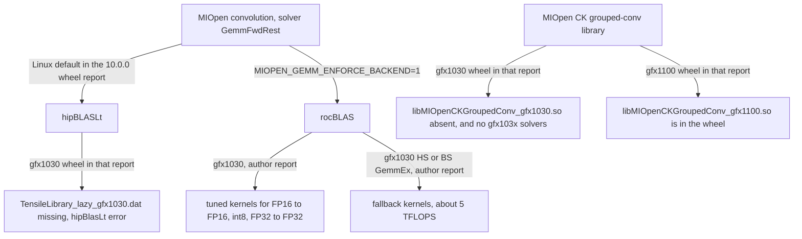

# Libraries

Date: **2026-10-13**. Which GEMM or convolution library runs on gfx1030 versus gfx1100. Live dest stays ROCm **7.14.0** ([pin](../pin/README.md)). Nightly library-pin scans are [../log/pin-scans.md](../log/pin-scans.md).

## Who serves the GEMM

### MIOpen `GemmFwdRest` on gfx1030

[TheRock#8729](https://github.com/ROCm/TheRock/issues/8729) (open) started as a missing `libMIOpenCKGroupedConv_gfx1030.so` in the ROCm 10.0.0 `rocm-sdk-device-gfx1030` wheel. The gfx1100 wheel in that report does ship `libMIOpenCKGroupedConv_gfx1100.so`.[^tr8729]

AMD (`BradPepersAMD`, 2026-10-08) reproduced the conv on gfx1030 with those wheels and wrote that the missing CK library is not the failure: the warning prints on runs that pass, and MIOpen has no CK grouped-conv solvers for gfx103x. The failure is `GemmFwdRest`, which handles the conv as one GEMM. On Linux, MIOpen sends that GEMM to **hipBLASLt**, and hipBLASLt has no gfx1030 kernels (`gemm_v2.cpp:346: hipBlasLt error encountered`, and `TensileLibrary_lazy_gfx1030.dat` cannot be read). Default find mode logs the error and falls back to another solver. `MIOPEN_FIND_MODE=FAST` fails at every N tested with `miopenStatusInternalError`. `MIOPEN_GEMM_ENFORCE_BACKEND=1` sends the GEMM to **rocBLAS** and passed in that repro, matching `F.linear`.[^tr8729c]

Workaround on gfx1030: `MIOPEN_GEMM_ENFORCE_BACKEND=1`. Dropping `MIOPEN_FIND_MODE=FAST` also avoided the failure in that comment. No pin change.

### rocBLAS HS/BS on gfx1030

Strata [#1123](https://github.com/Niko1221/Strata/pull/1123) (open) says the rocBLAS installed for gfx1030 (ROCm `10.2.0a20260930`, and ROCm 10.0.0 / rocBLAS 5.6.0) has tuned kernels for FP16→FP16, int8, and FP32→FP32. `hipblasGemmEx` with FP16 or BF16 inputs and FP32 output (HS/BS) hits fallback kernels at about 5 TFLOPS. On an RX 6800, a 12K-token prompt went from 343 tok/s on that default path to 534 tok/s when both inputs were widened to FP32 SGEMM, and to 619 tok/s on the pure FP16 route.[^st1123] Those are the PR author's numbers. On gfx1030, benchmark the GemmEx type combination the fork actually calls.

Strata [#1167](https://github.com/Niko1221/Strata/pull/1167) (open) adds `tools/hip/tune_rocblas` and a per-shape solution-index table (`tools/hip/gfx1030-rocblas-5.6.0.8d1ae90e.txt`) for the FP16 prompt route. On RX 6900 XT, ROCm 10.0.0 / rocBLAS 5.6.0.8d1ae90e, the author's A/B median gain was +13.3% at 833–1084 prompt tokens and +11.1% at 3065–4376 tokens. The 435–540 token bucket was flat (prompt read token by token, no prompt GEMM).[^st1167]

### hipBLASLt on gfx1100

hipBLASLt is the Linux MIOpen GEMM backend in the gfx1030 triage above, and the gfx1100 10.0.0 wheel in that issue does ship the CK grouped-conv library the gfx1030 wheel lacks.[^tr8729][^tr8729c] The 10.1.0 component table lists hipBLASLt 1.4.1 for Instinct, Radeon, and Ryzen without a per-arch exclusion line.[^rn1010]

[rocm-libraries#10720](https://github.com/ROCm/rocm-libraries/pull/10720) (open, updated in the PR text through the gfx11 WMMA case) says TensileLite's automatic LDS pad for gfx10/gfx11 WMMA fp16/bf16 kernels is an even number of instruction widths, so it cannot change bank-conflict parity. The PR says gfx12 is unaffected. It matters for gfx1100 hipBLASLt GEMMs that stage 16-bit WMMA operands through LDS.[^lt10720] gfx1030 has no hipBLASLt kernel file in the 10.0.0 wheel report above.[^tr8729c]

### Tensile `MaxLgkmcnt`

[rocm-libraries#6996](https://github.com/ROCm/rocm-libraries/pull/6996) (open) says Tensile hard-codes `MaxLgkmcnt` to 15. The PR's assembler check accepts `s_waitcnt lgkmcnt(63)` on gfx1100 and rejects `lgkmcnt(64)`. The change touches Tensile asm caps that rocBLAS gfx1030 kernels use.[^ten6996]

### rocKE / hipDNN generic targets

[rocm-libraries#13150](https://github.com/ROCm/rocm-libraries/pull/13150) (merged 2026-10-16 00:05 UTC; not yet in a TheRock pin as of this pass) builds RDNA WMMA SDPA once as `gfx11-generic` (gfx1100, gfx1101, gfx1102, gfx1103, gfx1150, gfx1151, gfx1152, gfx1153) and `gfx12-generic` (gfx1200, gfx1201). The PR does not list gfx1030 or gfx900.[^ke13150] [rocm-libraries#13129](https://github.com/ROCm/rocm-libraries/pull/13129) (open) lets hipDNN kernel descriptors name those generic targets.[^dnn13129] A specific processor id still wins when the caller sets one; the PR says `base_arch_from_target_id()` is unchanged.[^ke13150]

### Nightly rocBLAS xml wrapper

[rocm-libraries#12240](https://github.com/ROCm/rocm-libraries/issues/12240) (open) says Linux gfx103X rocBLAS nightly shards can be marked failed with zero gtest failures because of the xml wrapper. Open the log before treating a red gfx103X rocBLAS nightly as a kernel regression.[^xml12240]

### hipCUB scan temp-storage alignment

[rocPRIM#778](https://github.com/ROCm/rocPRIM/issues/778) (open) reports that `hipcub::DeviceScan::ExclusiveScan` returns `hipSuccess` and silently wrong sums when `d_temp_storage` is misaligned. On a Radeon Pro W7800 (gfx1100) with ROCm 7.2.0, a pointer offset by 4 bytes failed 14 to 18 of 200 iterations; the same storage rounded up to 256 bytes failed 0 of 200. Every wrong region started on a 1024-element tile boundary, with a whole tile lost or counted twice. The issue notes that CUB on CUDA does not require an aligned temp pointer.[^prim778] If a kernel carves scan scratch out of a larger arena, round the offset to 256 bytes. gfx1030 was not tested in the report.

### XLA on gfx1030

[openxla/xla#50464](https://github.com/openxla/xla/issues/50464) (open) says `gfx1030` is in XLA's supported list but `has_hipblaslt()` is false for it, and the GEMM rewriter no longer falls back to rocBLAS. The reporter measured on MI100 (gfx908): fp64 dots fail to compile, and fp16/fp32 dots run as Triton fusions at about 16% of rocBLAS speed. The gfx1030 claim comes from the same code path, not a gfx1030 run.[^xla50464] This matches the gfx1030 hipBLASLt gap above; JAX matmuls on V620 need a measurement before anyone relies on them.

### PyTorch SDPA at head_dim > 256 on gfx11

[ComfyUI-WanVideoWrapper#2053](https://github.com/kijai/ComfyUI-WanVideoWrapper/issues/2053) (open): on gfx1100 (RX 7900 XTX, torch 2.13.0), `F.scaled_dot_product_attention` with head_dim 384 still dispatches to AOTriton's fused kernels. With aotriton 0.13.x (the ROCm 10.0.0 stable wheel and 10.1/10.2 nightlies) the result is silently wrong: relative error about 1.1 against the MATH backend, all values finite, so NaN or Inf checks miss it. With aotriton 0.14.50 in the ROCm 10.1.0 stable wheel the call fails with `hipErrorProfilerNotInitialized`. head_dim 64, 128, 192 and 256 were correct on every build. The working guard routes head_dim > 256 to `SDPBackend.MATH`.[^wan2053] An AOTriton maintainer wrote in April that head_dim > 256 is disabled on purpose on all gfx11, because of LDS and register-file limits and Triton codegen trouble at `BLOCK_DMODEL=512`, and would be revisited later.[^aot168]

[pytorch#200999](https://github.com/pytorch/pytorch/issues/200999) (closed 2026-10-15) reproduced the same silent error on an RX 7900 XT with plain `F.scaled_dot_product_attention`. A PyTorch maintainer wrote that mainline already has the fix, commit `fba88a5dd7c5` ("Cap SDPA head dim at 256 on gfx11xx for AOTriton 0.11 and later"), that 2.14.1 missed it, and that it will ship in PyTorch 2.15.[^pt200999][^ptfba88a5]

For gfx1100 code that calls torch SDPA on 2.14.x or older, add that guard for head_dim > 256 rather than trusting the dispatcher. Which SDPA backend gfx1030 gets at that size was not checked this pass (unsourced).

### PyTorch nightly wheels and gfx900

[TheRock#9066](https://github.com/ROCm/TheRock/issues/9066) (open, filed 2026-10-16) says the multi-arch PyTorch nightly wheel builds fail, so no nightly wheels are produced. PyTorch commit `31a88272c8` (pytorch#200307, a CK-Tile group GEMM backend) compiles `ck_tile_group_gemm.hip` for every arch in `PYTORCH_ROCM_ARCH`, including gfx900, gfx906, gfx90c and gfx1010-1012, and CK-Tile's `get_compiler_target()` returns void for those.[^tr9066] This is a build break on the nightly line, not a 7.14.0 dest change. Anyone building PyTorch from source for gfx900 after that commit should expect the same failure until it is gated.

### kpack: bundled math libraries lose their device code

ROCm installs that use kpack split device code out of the libraries into `<rocm>/.kpack/*_lib_<arch>.kpack` archives. [Strata#5060](https://github.com/Niko1221/Strata/issues/5060) (open, filed 2026-11-03, gfx1100) shows that the bundled `librocblas.so.5`, `libhipblaslt.so.1` and `librocsolver.so.0` then carry an empty `.hip_fatbin` and a `.rocm_kpack_ref` path relative to the library, such as `../.kpack/blas_lib_@GFXARCH@.kpack`. When an app copies those libraries into its own folder without the `.kpack` archives, most calls still work through the Tensile files, but the first kernel rocBLAS keeps in its own fat binary fails with `hipErrorInvalidKernelFile`, and `AMD_LOG_LEVEL=1` prints "Could not find device type specific kpack code objects".[^st5060] The packaging design is in TheRock's [RFC0008](https://github.com/ROCm/TheRock/blob/main/docs/rfcs/RFC0008-Multi-Arch-Packaging.md).[^rfc0008]

For our own containers or fork builds on a kpack ROCm (Strata's report uses `/opt/rocm/core-10.1`), copy the matching `.kpack` archives next to the bundled libraries at the same relative path, or link against the system ROCm instead of vendoring the libraries. Run one rocBLAS call outside the Tensile path in a smoke test, because the failure only appears on the first such kernel. Whether our 7.14.0 dest images use kpack was not checked this pass (unsourced).

### Non-contiguous batched GEMM operands on gfx1030

[ComfyUI#17500](https://github.com/Comfy-Org/ComfyUI/issues/17500) (open, filed 2026-11-03) measured `baddbmm` on an RX 6800 XT (gfx1030, PyTorch 2.13.0+rocm10.0.0) with a strided, non-contiguous key. One attention call at 32,760 tokens took 16.37 s as-is and 1.56 s after `key.contiguous()`, with unchanged output; at 20,280 tokens it went from 0.88 s to 0.53 s.[^cf17500] The report also notes that gfx1030 has no AOTriton SDPA kernels, so PyTorch SDPA falls back to MATH there.[^cf17500] Which rocBLAS or hipBLASLt path the strided layout lands on was not isolated in the report. In HIP-side code that feeds batched GEMMs from permuted views on gfx1030, make the operand contiguous and time both layouts before trusting the library to handle the stride.

### MIOpen dilated fp32 Conv1d on RDNA

[rocm-libraries#14965](https://github.com/ROCm/rocm-libraries/issues/14965) (open, filed 2026-11-03) reports that on RDNA an fp32 forward 1D convolution with dilation > 1 has only two applicable MIOpen solvers, `ConvDirectNaiveConvFwd` and `GemmFwdRest`. Find picks the naive one (10x to 23x slower than `GemmFwdRest` on the reported gfx1151 and gfx1201 shapes), and with `MIOPEN_DEBUG_CONV_DIRECT_NAIVE_CONV_FWD=0` the convolution fails with "No suitable algorithm was found".[^mi14965] The fix PR [rocm-libraries#14966](https://github.com/ROCm/rocm-libraries/pull/14966) (open) says CK rejects fp32 convolutions on gfx11/gfx12 and `GetWorkSpaceSizeGEMM()` returns 0 for dilation > 1, so PyTorch never gives `GemmFwdRest` a workspace. It adds a tiled HIP direct solver, `ConvHipDirectConv1dFwd`, whose applicability list includes `gfx103X`, but the PR says it was not run on gfx10 or gfx110X hardware.[^mi14966] Until it lands, expect dilated fp32 Conv1d (audio vocoders and decoders) to run on the naive kernel on gfx1030 and gfx1100 as well (inferred from the gfx103X/gfx110X applicability list, not measured).

### hipBLASLt FP64/FP32 emulation (Ozaki) on RDNA 3 and later

[rocm-libraries#14837](https://github.com/ROCm/rocm-libraries/pull/14837) (open) enables hipBLASLt's fixed-point FP64 and FP32 emulation (Ozaki Scheme II), previously MI350X/MI355X only, on RDNA 3, RDNA 3.5 and RDNA 4 targets. It adds a measured chip row for the Radeon PRO W7800 (`0x745e`, gfx1100) and per-target arithmetic-intensity thresholds for gfx1100/1101/1102, gfx1150/1151/1152 and gfx1200/1201; a device with neither row is never emulated.[^lt14837] gfx1030 is not in the list, so on RDNA2 FP64 GEMMs stay native.[^lt14837] Kernel side is [rocm-libraries#14859](https://github.com/ROCm/rocm-libraries/pull/14859) (open).[^lt14859]

### hip-kernel-provider FlyDSL kernels skip gfx103X

[rocm-libraries#14111](https://github.com/ROCm/rocm-libraries/pull/14111) (merged 2026-10-30) adds prebuilt FlyDSL code objects to hipDNN's hip-kernel-provider: RMSNorm forward/backward for gfx11-generic, gfx12-generic and CDNA, and RDNA SDPA forward and decode engines for gfx11-generic and gfx12-generic only.[^hkp14111] gfx1030 gets none of these engines, so on RDNA2 hipDNN RMSNorm and SDPA fall through to other providers.

### hipBLASLt gfx1100: long-k fp16 GEMMs never split k

[rocm-libraries#14993](https://github.com/ROCm/rocm-libraries/issues/14993) (open, filed 2026-11-03) reports that on gfx1100, for fp16 GEMMs with `HIPBLAS_COMPUTE_32F`, transA=T, transB=N, a small output and a long k, every algorithm the heuristic returns is unsplit. Measured on a Radeon Pro W7800, the same on ROCm 10.1.0 (hipBLASLt 1.4.1) and the 10.3.0a20261103 nightly (hipBLASLt 1.5.0): at 16 x 2 output the error is 0.57, 2.44 and 8.34 fp16 ulp at k = 2^16, 2^18 and 2^20, and all 32 returned algorithms report a workspace size of 0.[^lt14993] Forcing split-k with `hipblaslt_ext::GemmTuning::setSplitK` on the same kernel brings that case to 0.63 ulp at 16 splits or more and from 2294 us to about 50 us at 64 splits; the issue attributes the error to accumulating the whole k chain in the WMMA accumulator, and says `torch.matmul` inherits it.[^lt14993] For gfx1100 reductions with very long k (for example long-sequence dot products), force split-k or accumulate in fp32 outside hipBLASLt until this is fixed. gfx1030 was not measured.

### hipBLASLt uniform summation order off by default on gfx11*/gfx120*

[rocm-libraries#15079](https://github.com/ROCm/rocm-libraries/pull/15079) (merged 2026-11-05, commit `ab45d0bba4f1`) defaults `uniform_summation_order` to 0 when `gcnArchName` contains `gfx11` or `gfx120`, because USO disables StaggerU and slowed some RDNA GEMMs after #14010 (bf16 / `F.linear` reports up to ~1.9×). Explicit settings still override; non-RDNA stays default-on.[^lt15079] **gfx1030 is not in that arch check**, so RDNA2 keeps the previous default. **In TheRock tip** as of 2026-11-06 ~13:53 Europe/Paris: TheRock [#9759](https://github.com/ROCm/TheRock/pull/9759) merged libraries `98e132f` → `37f616f` (main `be87ca4970ff`); ancestry check shows `ab45d0bb` is an ancestor of `37f616f`.[^tr9759] Sibling bumps #9769 / #9781 closed unmerged (superseded). Dest stays 7.14.0 — tip Watch for gfx1100 nightlies that rebuild on this pin.

### MIOpen gfx103X WrW tolerance in tip pin

[rocm-libraries#14905](https://github.com/ROCm/rocm-libraries/pull/14905) (merged 2026-11-04, commit `a2b512b2`) adds a gfx103X `SetTolerance` for `ConvHipImplicitGemmV4R1WrW` so TheRock's gfx103X nightly no longer fails ROCM-23567 on a default `1.0` tolerance. The PR calls it a test calibration gap, not a product defect.[^mi14905] In TheRock libraries pin `37f616f` via [#9759](https://github.com/ROCm/TheRock/pull/9759) as of 2026-11-06.[^tr9759]

### No INT8 `torch._int_mm` on gfx1030 through hipBLASLt

[ComfyUI#17659](https://github.com/Comfy-Org/ComfyUI/issues/17659) (open, filed 2026-11-10) reports that INT8 models fail on an RX 6900 XT (gfx1030, ROCm 7.2) with `HIPBLAS_STATUS_INVALID_VALUE` from `hipblasLtMatmulAlgoGetHeuristic` inside `torch._int_mm`, while the bf16 variant of the same model runs.[^cf17659] The fix PR [ComfyUI#17667](https://github.com/Comfy-Org/ComfyUI/pull/17667) (open) says PyTorch's ROCm wheels ship hipBLASLt without INT8 Tensile kernels for RDNA2 and older, and routes INT8 linears through comfy-kitchen's Triton backend instead. On an RX 6800 (gfx1030, ROCm 7.2, torch 2.14.1) it reports about 39 TOPS for the Triton INT8 GEMM at N=4096 against about 7 TF/s for the bf16 fallback, and 19.7 s to 8.7 s per step on one Qwen Image 2.1 INT8 forward.[^cf17667] A SIMT INT8 GEMM for GPUs without matrix cores is proposed in [comfy-kitchen#337](https://github.com/Comfy-Org/comfy-kitchen/pull/337) (open).[^ck337] For our forks: on gfx1030, do not expect `torch._int_mm` or hipBLASLt INT8 to work; use a Triton or hand-written HIP INT8 GEMM and check it against a dequantized reference.

### MIOpen naive-solver timeout still stalls PyTorch

[rocm-libraries#15527](https://github.com/ROCm/rocm-libraries/issues/15527) (open, filed 2026-11-11) reports that MIOpen's `TryNaiveWithTimeout` stops waiting on the naive convolution kernel during Find but does not cancel it, and PyTorch's `emptyCache()` after each Find calls `hipFree`, which synchronizes the device, so the host thread stalls until the naive kernel finishes. It was measured on a Radeon PRO W7800 (gfx1100) with ROCm 10.1.0 in Kokoro-82M TTS with variable lengths.[^mi15527] Fix PRs [rocm-libraries#15532](https://github.com/ROCm/rocm-libraries/pull/15532) and [#15548](https://github.com/ROCm/rocm-libraries/pull/15548) are open. This compounds the naive-solver fallback above: with variable-length audio convolutions on RDNA, a warm user DB or fixed shapes avoids repeated Find.

### hipDNN RDNA decode attention: NaN on lowest-value bf16 masks

[rocm-libraries#15578](https://github.com/ROCm/rocm-libraries/issues/15578) (open, filed 2026-11-11) reports that the hip-kernel-provider's RDNA split-KV decode attention kernel (`hipkernel:Gfx1151WmmaAttentionDecode`, rocKE) returns NaN with no error when an additive bf16 or f32 mask uses the dtype's lowest finite value instead of `-inf`, as Hugging Face masks do with `torch.finfo(dtype).min`, and every key in a wave's first 16-key tile is masked (for example with left padding). fp16 masks and `-inf` masks are not affected. It reproduced on gfx1100 and gfx1201, and the issue says the dispatcher also sends many short prefills (most with Sq ≤ 64) to this kernel.[^dnn15578] The fix [rocm-libraries#15586](https://github.com/ROCm/rocm-libraries/pull/15586) (open) says the kernel ships only for gfx1100–1103, gfx1150–1153, gfx1200 and gfx1201, so gfx1030 never reaches it.[^dnn15586] For our forks on gfx1100: if hipDNN serves SDPA, pass `-inf` masks or check bf16 padded batches for NaN until the fix lands.

### ComfyUI picks FP32, not FP16, on GPUs without BF16

Two open ComfyUI PRs filed 2026-11-11 say that models whose `supported_inference_dtypes` list only BF16 and FP32 fall through to FP32 on GPUs without BF16 ("RDNA2 and older"), and that `--fp16-unet` was the only way to get FP16. On a 16 GB gfx1030 with ROCm 7.2 they measure FP16 against FP32 at 7.06 vs 7.78 s/it for MOSS-Image and 5.06 vs 6.23 s/it for Qwen Image 2.1, with no NaN or Inf at 1024² to 2048².[^cf17684][^cf17686] For our forks: on gfx1030, check which dtype the app actually selected before benchmarking, and keep an FP16 path with a residual clamp where activations approach the FP16 range.

## Sources

[^tr8729]: TheRock#8729, open, issue body (wheel contents, gfx1030 vs gfx1100). https://github.com/ROCm/TheRock/issues/8729
[^tr8729c]: TheRock#8729 comment by `BradPepersAMD`, 2026-10-08. https://github.com/ROCm/TheRock/issues/8729
[^st1123]: Strata#1123, open. https://github.com/Niko1221/Strata/pull/1123
[^st1167]: Strata#1167, open. https://github.com/Niko1221/Strata/pull/1167
[^rn1010]: ROCm Core SDK 10.1.0 release notes, component table, dated 2026-10-05. https://rocm.docs.amd.com/en/docs-10.1.0/about/release-notes.html
[^lt10720]: rocm-libraries#10720, open. https://github.com/ROCm/rocm-libraries/pull/10720
[^ten6996]: rocm-libraries#6996, open. https://github.com/ROCm/rocm-libraries/pull/6996
[^ke13150]: rocm-libraries#13150, open. https://github.com/ROCm/rocm-libraries/pull/13150
[^dnn13129]: rocm-libraries#13129, open. https://github.com/ROCm/rocm-libraries/pull/13129
[^xml12240]: rocm-libraries#12240, open. https://github.com/ROCm/rocm-libraries/issues/12240
[^prim778]: rocPRIM#778, open. https://github.com/ROCm/rocPRIM/issues/778
[^xla50464]: openxla/xla#50464, open. https://github.com/openxla/xla/issues/50464
[^wan2053]: ComfyUI-WanVideoWrapper#2053, open, issue body and build table. https://github.com/kijai/ComfyUI-WanVideoWrapper/issues/2053
[^pt200999]: pytorch#200999, closed 2026-10-15; `xinyazhang` and `naromero77amd` comments. https://github.com/pytorch/pytorch/issues/200999
[^ptfba88a5]: pytorch commit `fba88a5dd7c5`, committed 2026-08-28 (#194280). https://github.com/pytorch/pytorch/commit/fba88a5dd7c53d679cb82fd33cbe084c3d6b3f31
[^tr9066]: TheRock#9066, open. https://github.com/ROCm/TheRock/issues/9066
[^aot168]: ROCm/aotriton#168, open, `xinyazhang` comments 2026-04-25 and 2026-04-28. https://github.com/ROCm/aotriton/issues/168
[^st5060]: Strata#5060, open, filed 2026-11-03 05:48 UTC (kpack ref sections, `hipErrorInvalidKernelFile`, AMD_LOG_LEVEL=1 message). https://github.com/Niko1221/Strata/issues/5060
[^rfc0008]: TheRock RFC0008, Multi-Arch Packaging. https://github.com/ROCm/TheRock/blob/main/docs/rfcs/RFC0008-Multi-Arch-Packaging.md
[^cf17500]: ComfyUI#17500, open, filed 2026-11-03 01:41 UTC (RX 6800 XT gfx1030, timings, AOTriton note). https://github.com/Comfy-Org/ComfyUI/issues/17500
[^mi14965]: rocm-libraries#14965, open, filed 2026-11-03 11:27 UTC (solver list, timings on gfx1151/gfx1201, failure with naive disabled). https://github.com/ROCm/rocm-libraries/issues/14965
[^mi14966]: rocm-libraries#14966, open (motivation, applicability table, known gaps). https://github.com/ROCm/rocm-libraries/pull/14966
[^lt14837]: rocm-libraries#14837, open (device table, W7800 chip row, RDNA architecture rows). https://github.com/ROCm/rocm-libraries/pull/14837
[^lt14859]: rocm-libraries#14859, open. https://github.com/ROCm/rocm-libraries/pull/14859
[^hkp14111]: rocm-libraries#14111, merged 2026-10-30 21:15 UTC (engine/target table). https://github.com/ROCm/rocm-libraries/pull/14111
[^lt14993]: rocm-libraries#14993, open, filed 2026-11-03 18:29 UTC by `jeffdaily` (W7800 ulp table, split-k sweep, torch repro). https://github.com/ROCm/rocm-libraries/issues/14993
[^lt15079]: rocm-libraries#15079, merged 2026-11-05 (USO default off on gfx11/gfx120). https://github.com/ROCm/rocm-libraries/pull/15079
[^tr9759]: TheRock#9759, merged 2026-11-06T12:36:50Z; libraries submodule `37f616f6a510`. https://github.com/ROCm/TheRock/pull/9759
[^mi14905]: rocm-libraries#14905, merged 2026-11-04 (gfx103X WrW tolerance). https://github.com/ROCm/rocm-libraries/pull/14905
[^cf17659]: ComfyUI#17659, open, filed 2026-11-10 15:14 UTC (RX 6900 XT gfx1030, ROCm 7.2, hipBLASLt heuristic error). https://github.com/Comfy-Org/ComfyUI/issues/17659
[^cf17667]: ComfyUI#17667, open, PR description (cause, gfx1030 measurements, tests). https://github.com/Comfy-Org/ComfyUI/pull/17667
[^ck337]: comfy-kitchen#337, open. https://github.com/Comfy-Org/comfy-kitchen/pull/337
[^mi15527]: rocm-libraries#15527, open, filed 2026-11-11 00:17 UTC (mechanism, PyTorch reproducer, W7800 gfx1100). https://github.com/ROCm/rocm-libraries/issues/15527
[^dnn15578]: rocm-libraries#15578, open, filed 2026-11-11 19:56 UTC (trigger, cause, gfx1100/gfx1201/gfx1151 reproduction). https://github.com/ROCm/rocm-libraries/issues/15578
[^dnn15586]: rocm-libraries#15586, open, filed 2026-11-11 20:32 UTC (ASIC coverage section). https://github.com/ROCm/rocm-libraries/pull/15586
[^cf17684]: ComfyUI#17684, open, filed 2026-11-11 (MOSS-Image FP16, gfx1030 timings and numerics). https://github.com/Comfy-Org/ComfyUI/pull/17684
[^cf17686]: ComfyUI#17686, open, filed 2026-11-11 (Qwen Image 2.1 FP16, gfx1030 timings and numerics, `--fp16-unet` note). https://github.com/Comfy-Org/ComfyUI/pull/17686
