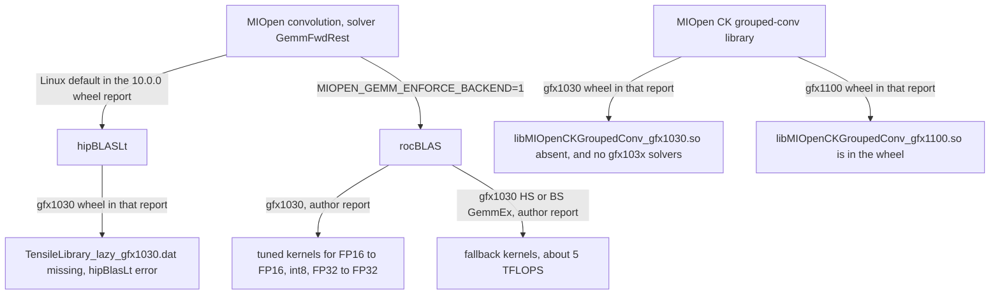

# Libraries

Date: **2026-10-13**. Which GEMM or convolution library runs on gfx1030 versus gfx1100. Live dest stays ROCm **7.14.0** ([pin](../pin/README.md)). Nightly library-pin scans are [../log/pin-scans.md](../log/pin-scans.md).

## Who serves the GEMM

### MIOpen `GemmFwdRest` on gfx1030

[TheRock#8729](https://github.com/ROCm/TheRock/issues/8729) (open) started as a missing `libMIOpenCKGroupedConv_gfx1030.so` in the ROCm 10.0.0 `rocm-sdk-device-gfx1030` wheel. The gfx1100 wheel in that report does ship `libMIOpenCKGroupedConv_gfx1100.so`.[^tr8729]

AMD (`BradPepersAMD`, 2026-10-08) reproduced the conv on gfx1030 with those wheels and wrote that the missing CK library is not the failure: the warning prints on runs that pass, and MIOpen has no CK grouped-conv solvers for gfx103x. The failure is `GemmFwdRest`, which handles the conv as one GEMM. On Linux, MIOpen sends that GEMM to **hipBLASLt**, and hipBLASLt has no gfx1030 kernels (`gemm_v2.cpp:346: hipBlasLt error encountered`, and `TensileLibrary_lazy_gfx1030.dat` cannot be read). Default find mode logs the error and falls back to another solver. `MIOPEN_FIND_MODE=FAST` fails at every N tested with `miopenStatusInternalError`. `MIOPEN_GEMM_ENFORCE_BACKEND=1` sends the GEMM to **rocBLAS** and passed in that repro, matching `F.linear`.[^tr8729c]

Workaround on gfx1030: `MIOPEN_GEMM_ENFORCE_BACKEND=1`. Dropping `MIOPEN_FIND_MODE=FAST` also avoided the failure in that comment. No pin change.

### rocBLAS HS/BS on gfx1030

Strata [#1123](https://github.com/Niko1221/Strata/pull/1123) (open) says the rocBLAS installed for gfx1030 (ROCm `10.2.0a20260930`, and ROCm 10.0.0 / rocBLAS 5.6.0) has tuned kernels for FP16→FP16, int8, and FP32→FP32. `hipblasGemmEx` with FP16 or BF16 inputs and FP32 output (HS/BS) hits fallback kernels at about 5 TFLOPS. On an RX 6800, a 12K-token prompt went from 343 tok/s on that default path to 534 tok/s when both inputs were widened to FP32 SGEMM, and to 619 tok/s on the pure FP16 route.[^st1123] Those are the PR author's numbers. On gfx1030, benchmark the GemmEx type combination the fork actually calls.

Strata [#1167](https://github.com/Niko1221/Strata/pull/1167) (open) adds `tools/hip/tune_rocblas` and a per-shape solution-index table (`tools/hip/gfx1030-rocblas-5.6.0.8d1ae90e.txt`) for the FP16 prompt route. On RX 6900 XT, ROCm 10.0.0 / rocBLAS 5.6.0.8d1ae90e, the author's A/B median gain was +13.3% at 833–1084 prompt tokens and +11.1% at 3065–4376 tokens. The 435–540 token bucket was flat (prompt read token by token, no prompt GEMM).[^st1167]

### hipBLASLt on gfx1100

hipBLASLt is the Linux MIOpen GEMM backend in the gfx1030 triage above, and the gfx1100 10.0.0 wheel in that issue does ship the CK grouped-conv library the gfx1030 wheel lacks.[^tr8729][^tr8729c] The 10.1.0 component table lists hipBLASLt 1.4.1 for Instinct, Radeon, and Ryzen without a per-arch exclusion line.[^rn1010]

[rocm-libraries#10720](https://github.com/ROCm/rocm-libraries/pull/10720) (open, updated in the PR text through the gfx11 WMMA case) says TensileLite's automatic LDS pad for gfx10/gfx11 WMMA fp16/bf16 kernels is an even number of instruction widths, so it cannot change bank-conflict parity. The PR says gfx12 is unaffected. It matters for gfx1100 hipBLASLt GEMMs that stage 16-bit WMMA operands through LDS.[^lt10720] gfx1030 has no hipBLASLt kernel file in the 10.0.0 wheel report above.[^tr8729c]

### Tensile `MaxLgkmcnt`

[rocm-libraries#6996](https://github.com/ROCm/rocm-libraries/pull/6996) (open) says Tensile hard-codes `MaxLgkmcnt` to 15. The PR's assembler check accepts `s_waitcnt lgkmcnt(63)` on gfx1100 and rejects `lgkmcnt(64)`. The change touches Tensile asm caps that rocBLAS gfx1030 kernels use.[^ten6996]

### rocKE / hipDNN generic targets

[rocm-libraries#13150](https://github.com/ROCm/rocm-libraries/pull/13150) (open) builds RDNA WMMA SDPA once as `gfx11-generic` (gfx1100, gfx1101, gfx1102, gfx1103, gfx1150, gfx1151, gfx1152, gfx1153) and `gfx12-generic` (gfx1200, gfx1201). The PR does not list gfx1030 or gfx900.[^ke13150] [rocm-libraries#13129](https://github.com/ROCm/rocm-libraries/pull/13129) (open) lets hipDNN kernel descriptors name those generic targets.[^dnn13129] A specific processor id still wins when the caller sets one; the PR says `base_arch_from_target_id()` is unchanged.[^ke13150]

### Nightly rocBLAS xml wrapper

[rocm-libraries#12240](https://github.com/ROCm/rocm-libraries/issues/12240) (open) says Linux gfx103X rocBLAS nightly shards can be marked failed with zero gtest failures because of the xml wrapper. Open the log before treating a red gfx103X rocBLAS nightly as a kernel regression.[^xml12240]

### hipCUB scan temp-storage alignment

[rocPRIM#778](https://github.com/ROCm/rocPRIM/issues/778) (open) reports that `hipcub::DeviceScan::ExclusiveScan` returns `hipSuccess` and silently wrong sums when `d_temp_storage` is misaligned. On a Radeon Pro W7800 (gfx1100) with ROCm 7.2.0, a pointer offset by 4 bytes failed 14 to 18 of 200 iterations; the same storage rounded up to 256 bytes failed 0 of 200. Every wrong region started on a 1024-element tile boundary, with a whole tile lost or counted twice. The issue notes that CUB on CUDA does not require an aligned temp pointer.[^prim778] If a kernel carves scan scratch out of a larger arena, round the offset to 256 bytes. gfx1030 was not tested in the report.

### XLA on gfx1030

[openxla/xla#50464](https://github.com/openxla/xla/issues/50464) (open) says `gfx1030` is in XLA's supported list but `has_hipblaslt()` is false for it, and the GEMM rewriter no longer falls back to rocBLAS. The reporter measured on MI100 (gfx908): fp64 dots fail to compile, and fp16/fp32 dots run as Triton fusions at about 16% of rocBLAS speed. The gfx1030 claim comes from the same code path, not a gfx1030 run.[^xla50464] This matches the gfx1030 hipBLASLt gap above; JAX matmuls on V620 need a measurement before anyone relies on them.

### PyTorch SDPA at head_dim > 256 on gfx11

[ComfyUI-WanVideoWrapper#2053](https://github.com/kijai/ComfyUI-WanVideoWrapper/issues/2053) (open): on gfx1100 (RX 7900 XTX, torch 2.13.0), `F.scaled_dot_product_attention` with head_dim 384 still dispatches to AOTriton's fused kernels. With aotriton 0.13.x (the ROCm 10.0.0 stable wheel and 10.1/10.2 nightlies) the result is silently wrong: relative error about 1.1 against the MATH backend, all values finite, so NaN or Inf checks miss it. With aotriton 0.14.50 in the ROCm 10.1.0 stable wheel the call fails with `hipErrorProfilerNotInitialized`. head_dim 64, 128, 192 and 256 were correct on every build. The working guard routes head_dim > 256 to `SDPBackend.MATH`.[^wan2053] An AOTriton maintainer wrote in April that head_dim > 256 is disabled on purpose on all gfx11, because of LDS and register-file limits and Triton codegen trouble at `BLOCK_DMODEL=512`, and would be revisited later.[^aot168]

For gfx1100 code that calls torch SDPA, add that guard for head_dim > 256 rather than trusting the dispatcher. Which SDPA backend gfx1030 gets at that size was not checked this pass (unsourced).

## Sources

[^tr8729]: TheRock#8729, open, issue body (wheel contents, gfx1030 vs gfx1100). https://github.com/ROCm/TheRock/issues/8729
[^tr8729c]: TheRock#8729 comment by `BradPepersAMD`, 2026-10-08. https://github.com/ROCm/TheRock/issues/8729
[^st1123]: Strata#1123, open. https://github.com/Niko1221/Strata/pull/1123
[^st1167]: Strata#1167, open. https://github.com/Niko1221/Strata/pull/1167
[^rn1010]: ROCm Core SDK 10.1.0 release notes, component table, dated 2026-10-05. https://rocm.docs.amd.com/en/docs-10.1.0/about/release-notes.html
[^lt10720]: rocm-libraries#10720, open. https://github.com/ROCm/rocm-libraries/pull/10720
[^ten6996]: rocm-libraries#6996, open. https://github.com/ROCm/rocm-libraries/pull/6996
[^ke13150]: rocm-libraries#13150, open. https://github.com/ROCm/rocm-libraries/pull/13150
[^dnn13129]: rocm-libraries#13129, open. https://github.com/ROCm/rocm-libraries/pull/13129
[^xml12240]: rocm-libraries#12240, open. https://github.com/ROCm/rocm-libraries/issues/12240
[^prim778]: rocPRIM#778, open. https://github.com/ROCm/rocPRIM/issues/778
[^xla50464]: openxla/xla#50464, open. https://github.com/openxla/xla/issues/50464
[^wan2053]: ComfyUI-WanVideoWrapper#2053, open, issue body and build table. https://github.com/kijai/ComfyUI-WanVideoWrapper/issues/2053
[^aot168]: ROCm/aotriton#168, open, `xinyazhang` comments 2026-04-25 and 2026-04-28. https://github.com/ROCm/aotriton/issues/168
