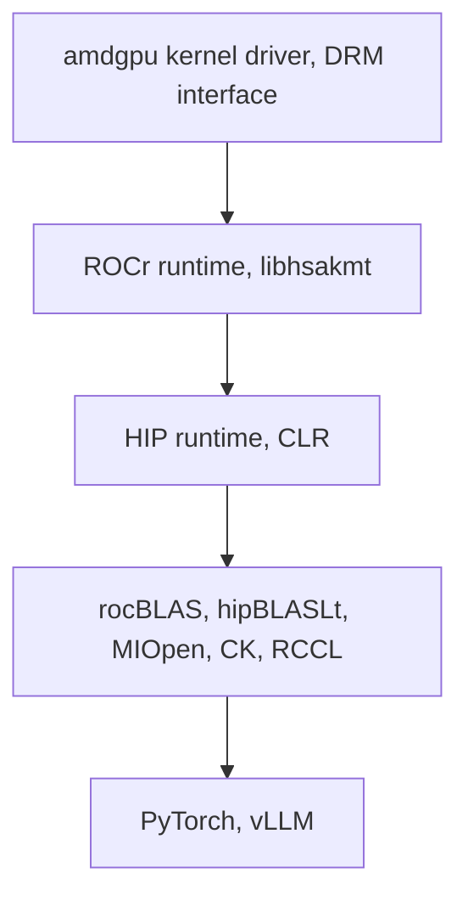

# Pin

Date of this page: **2026-10-11**. The dated nightly and submodule SHA log is [../log/pin-scans.md](../log/pin-scans.md). Nothing on this page moves the live dest.

## Live dest

This wiki's live dest pin stays ROCm **7.14.0**. Tag `rocm-7.14.0` on `ROCm/ROCm` is commit `830cc1b5e90d7da1b07e39113d7a5c95f3e687a1`.[^tag7140] The 7.14.0 release notes are dated 2026-07-15 and describe the move onto TheRock.[^rn7140]

ROCm **7.14.1** (release notes dated 2026-09-02) is a quality release. The notes list two changes: RCCL's InfiniBand fault-injection instrumentation, compiled in by default in 7.14.0, is disabled, and an `amdflang` `ScalarEvolution::LoopDisposition` regression that broke OpenBLAS and LAPACK builds is reverted. The notes say 7.14.1 has no other significant changes.[^rn7141] The GitHub API for `repos/ROCm/ROCm/git/ref/tags/rocm-7.14.1` returned 404 on 2026-10-11. TheRock tag `therock-7.14.1` is an annotated tag whose target commit is `f51dc6c91e0d3214f22853fd5cb3f96dbc7d2c4b`.[^tag7141]

Host OS attestation for this box (Fedora 43, RHEL 10, Ubuntu footnote on V620) is [silicon/rccl-p2p.md](../../silicon/rccl-p2p.md). This page does not restate it.

## Layers we build on

ROCm 7.14.0's own notes describe a core of runtime and compilers, with math and communication libraries shipped beside them.[^rn7140] The 10.1.0 component table names **ROCr Runtime**, **HIP**, **LLVM**, math libraries (rocBLAS, hipBLASLt, MIOpen, Composable Kernel), and **RCCL**.[^rn1010] The HIP virtual-memory hang is inside **ROCr / libhsakmt** talking to the **amdgpu** DRM interface.[^vmm9820] PyTorch and vLLM are the frameworks in the 10.1.0 AI-ecosystem table, above that stack.[^rn1010]

Which library actually serves a GEMM or convolution is [libraries/](../libraries/README.md). The host DRM check is below and in [comms/](../comms/README.md).

## Docs 10.1.0 versus dest 7.14.0

ROCm Core SDK **10.1.0** release notes are dated **2026-10-05**.[^rn1010] The compatibility matrix for that version lists **Radeon PRO V620** and **Radeon PRO W6800** as **gfx1030**, and lists gfx1100, gfx1101, and gfx1102 on the Radeon rows.[^mx1010] The same notes' hardware table includes V620 and W6800 as gfx1030 and the Instinct LLVM targets gfx950, gfx942, gfx90a, and gfx908. gfx900 is absent from those tables.[^rn1010]

Framework rows in those notes, each marked as a GPU allow-list, do not name gfx1030:[^rn1010]

| Framework | Version in the 10.1.0 notes | GPUs the notes name |
|---|---|---|
| JAX | 0.11.1 | gfx950, gfx942, gfx90a, gfx1200, gfx1201, gfx1100, gfx1101, gfx1102 |
| vLLM | 0.29.0 | gfx950, gfx942, gfx1200, gfx1201, gfx1100, gfx1101, gfx1102, gfx1152, gfx1151, gfx1150 |
| SGLang | 0.5.18 | gfx950, gfx942, gfx1200, gfx1201, gfx1100, gfx1101, gfx1102 |
| TensorFlow | 2.21 | gfx950, gfx942, gfx1200, gfx1201, gfx1100, gfx1101, gfx1102 |
| ONNX Runtime | 1.29.0 | gfx950, gfx942, gfx90a, gfx1200, gfx1201, gfx1100, gfx1101, gfx1102, gfx1153, gfx1152, gfx1151, gfx1150 |

The same notes' breaking-change section says ROCm SMI (`rocm-smi-lib`) is no longer built or installed in the standard `ROCm/TheRock` build, and that `amd-smi` is the replacement.[^rn1010] That is a 10.1.0 docs fact. The live dest is still 7.14.0.

TheRock `SUPPORTED_GPUS.md` at `74744339975d50c76a942aad3e090c4d95116af6` (main, read 2026-10-11) marks Linux **gfx1030** and **gfx1100** Build Passing, Sanity Tested, and Release Ready. Linux **gfx900** is Build Passing only.[^gpus] That page defines Release Ready as "supported and tested as part of our overall release process" and warns that Build Passing alone means a package was published, which is the gfx900 column.[^gpus] Older scan notes that used the phrase `gfx103X-dgpu` and "libraries excluded" are in the [log](../log/pin-scans.md); the support page opened this pass does not use that wording.

## Host amdgpu DRM is part of the pin

Two open upstream threads describe ROCm-era userspace failing on older in-tree amdgpu, and both clear on a kernel whose amdgpu is **DRM 3.64**.

- Silent RCCL `all_gather` / `reduce_scatter` corruption, and gfxhub page faults, on the Ubuntu 24.04 stock **6.8** kernel (`6.8.0-139`). The same host on HWE **7.0.0-34** (in-tree amdgpu **3.64.0**) ran the rccl-tests clean and 10 of 10 vLLM TP=8 starts clean. `HSA_DISABLE_CACHE=1` is the stopgap named in the report. AMD (`lucbruni-amd`) attributes the 6.8 failure to the kernel driver and asks for `uname -r` and `modinfo -n amdgpu`.[^rccl12145][^rccl6565] Write-up: [comms/](../comms/README.md).
- `hipMemAddressReserve` → `hipMemCreate` → `hipMemMap` → `hipMemSetAccess` blocks in `DRM_IOCTL_SYNCOBJ_TIMELINE_WAIT` when 7.14 userspace runs on DRM **3.61**, because libhsakmt asks for GEM_VA timeline output that older amdgpu ignores. The open fix gates that path on DRM ≥ 3.64.[^vmm9820][^vmm9821] Write-up: [runtime/](../runtime/README.md).

Record the kernel release and the amdgpu DRM version next to the ROCm version in any bring-up note. The previous page's `dmesg | grep "Initialized amdgpu"` one-liner was not in the issues opened this pass (unsourced).

## Sources

[^tag7140]: GitHub tag `rocm-7.14.0`, object SHA `830cc1b5e90d7da1b07e39113d7a5c95f3e687a1`, read 2026-10-11. https://github.com/ROCm/ROCm/commit/830cc1b5e90d7da1b07e39113d7a5c95f3e687a1
[^rn7140]: ROCm Core SDK 7.14.0 release notes, dated 2026-07-15. https://rocm.docs.amd.com/en/docs-7.14.0/about/release-notes.html
[^rn7141]: ROCm Core SDK 7.14.1 release notes, dated 2026-09-02. https://rocm.docs.amd.com/en/docs-7.14.1/about/release-notes.html
[^tag7141]: TheRock annotated tag `therock-7.14.1`, tag object `5514fb2fc503d1b16e915235d84934afaba8a1f1`, target commit `f51dc6c91e0d3214f22853fd5cb3f96dbc7d2c4b`. `ROCm/ROCm` tag `rocm-7.14.1` returned HTTP 404 on 2026-10-11. https://github.com/ROCm/TheRock/releases/tag/therock-7.14.1
[^rn1010]: ROCm Core SDK 10.1.0 release notes, dated 2026-10-05. https://rocm.docs.amd.com/en/docs-10.1.0/about/release-notes.html
[^mx1010]: ROCm 10.1.0 compatibility matrix, Radeon rows include V620 and W6800 as gfx1030. https://rocm.docs.amd.com/en/docs-10.1.0/compatibility/compatibility-matrix.html
[^gpus]: TheRock `SUPPORTED_GPUS.md` at `74744339975d50c76a942aad3e090c4d95116af6`. https://github.com/ROCm/TheRock/blob/74744339975d50c76a942aad3e090c4d95116af6/SUPPORTED_GPUS.md
[^rccl12145]: rocm-systems#12145, including the 2026-10 follow-up that 7.0.0-34 / amdgpu 3.64.0 clears the 8×V620 failure. https://github.com/ROCm/rocm-systems/issues/12145
[^rccl6565]: legacy-rocm-build#6565, comment by `lucbruni-amd` on 2026-10-06 attributing the failure to Ubuntu's 6.8 amdgpu. https://github.com/ROCm/legacy-rocm-build/issues/6565
[^vmm9820]: rocm-systems#9820. https://github.com/ROCm/rocm-systems/issues/9820
[^vmm9821]: rocm-systems#9821, open. https://github.com/ROCm/rocm-systems/pull/9821
